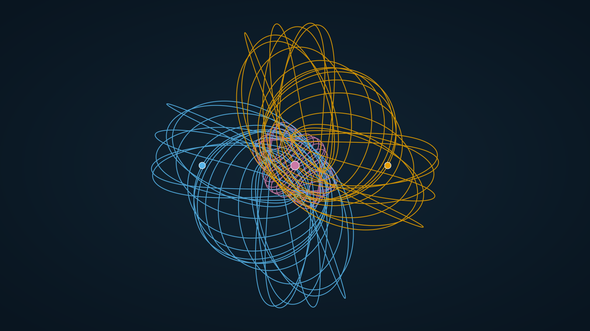

# dreikoerper — periodic orbits of the planar three-body problem

[](https://doi.org/10.5281/zenodo.23536576)

A search engine for periodic orbits of the planar three-body problem (zero angular momentum, G = 1), the orbits it found that are in none of the published lists, and a 30-digit verification of each one.

Code comments and working notes are in German. This page, the data package in [`fundbericht/`](fundbericht/README.md) and the output of `bahn-pruefen.mjs` are in English.

## The main result: a linearly stable orbit at masses 1 : 1 : 4



*One period (T = 53.25) computed with `kern.js` from the initial values below. Blue and orange: the two bodies of mass 1. Pink: the body of mass 4. The dots mark the starting configuration. Drawn by `werkzeug/bahnbild.mjs`.*

Euler configuration: r1 = (−1, 0), r2 = (1, 0), r3 = (0, 0); v1 = v2 = (a, b); v3 = −(m1 + m2)/m3 · (a, b).

```
m1 = m2 = 1, m3 = 4
a = 0.80329455331149897894751545304123
b = 1.43593335078306727053457398659518
T = 53.25485430443248007068935995289679
```

- **Period:** the scale-invariant period T* = T·|E|^1.5 is 498.10304.
- **Stability:** the stability indices are s1 = 0.050097460726014453493487243479 and s2 = −0.059928082662415128925027567105. Both satisfy |s| < 2, so the orbit is linearly stable, with a margin of 1.94.
- **Word and closest approach:** the free-group word is `ABABABAbabababABABABAbabababaBABABABabababaB` (44 letters). The closest approach of two bodies is 0.0015.
- **Comparison with the literature:** the orbit is not in Li, Jing & Liao (2018), the only published list for these masses we know of. It is also not a k-fold satellite of any orbit in that list.
- **It belongs to a known family.** The orbit is the continuation in m3 of the orbit I.A-5 that the same list gives at masses 1 : 1 : 2. So it is a new, stable member of a listed family, not a new family. See the next section.

## The family I.A-5 and its stability window

We checked the connection in both directions:

- **Downwards from m3 = 4:** continuing this orbit in m3 lands on I.A-5 at m3 = 2, at a distance of 4.8e-11 in (a, b). The list gives ten digits. (`werkzeug/massen-fortsetzung.mjs`)
- **Upwards from I.A-5:** continuing I.A-5 from m3 = 2 to m3 = 4 in steps of at most 0.005 arrives at this orbit to 5e-13 in a and b and 3e-11 in T. (`werkzeug/fortsetzung-zurueck.mjs`)
- **Topology:** the free-group word stays the same along the whole path.

At m3 = 4 the branch has left the square a, b < 1, in which 82 of the 85 listed orbits at these masses lie.

Stability along the family, computed at 30 digits at 23 sample masses (`werkzeug/fortsetzung-genau.mjs`, data in `ergebnisse/fortsetzung-1-1-4-genau.json`). Double precision is not reliable on this branch because of the close encounters.

| m3 | verdict at 30 digits |
|---|---|
| 2 (I.A-5 itself) | stable by a hair, margin 2.6e-5 |
| 3.0 | unstable, one index 2.0000004 |
| 3.4 – 3.5 | stable, margin 0.018 to 0.0037 |
| 3.6 – 3.725 | unstable |
| **3.75 – 4.175** | **stable at all 14 samples** (at m3 = 4: margin 1.94) |
| 4.1875 – 4.25 | unstable |

The stability window around the orbit thus extends from about m3 ≈ 3.74 to 4.18. Upwards, the branch becomes strongly unstable and the continuation stops near m3 ≈ 5.14; at m3 = 5 it is not in the list.

At m3 = 4.11 one index reaches −1.998. Version 1.0.0 said that a very narrow unstable sliver there was not excluded. It is excluded: the orbit has a half-period symmetry. After half a period its state is the mirror image of the initial state, x(T/2) = g x(0), with g a reflection of the plane combined with a rotation. So x(t + T/2) = g x(t) for all t, and the monodromy matrix is a square, M = N² with N = g · DΦ(T/2). Each nontrivial index is then s = σ² − 2, where σ is the index of N. While the two indices are real and distinct, as here, s ≥ −2: an index can touch −2 but cannot pass below it.

`halbperiode.mjs` checks this in double precision (results in `ergebnisse/halbperiode-fortsetzung-1-1-4.json`). It confirms M = N² at 22 of the 23 sample masses: |N² − M| / |M| is at most 6.5e-6, against at least 2.0 for the other readings (without g, or with the second-best g). At m3 = 2 the symmetry holds as well (to 3.9e-9), but the bodies come within 5.9e-5 of each other, and the double-precision monodromy is too rough to confirm the square.

Check it yourself. No downloads are needed:

```
node bahn-pruefen.mjs
```

It integrates the digits above over one period at 320 and at 448 bits and prints the return distance. Then it computes both stability indices from the monodromy matrix. It takes about four minutes on one core.

**Searching further at these masses.** The bound region at 1 : 1 : 4 reaches |v| = 2.38. We also searched the part of it with a > 1 or b > 1, in two windows. That search found 913 distinct orbits outside the list, but no second clearly stable one. Five more orbits are stable only by a hair: one index lies between 1.3e-4 and 4.2e-15 below 2. They are in `fundbericht/stable.txt` as S~.

## Family B: a stable family whose topology is in no list

The searches with a > 1 or b > 1 at masses 1 : 1 : 5 found a family of orbits whose free-group word, `ABABABAbabababaB`, occurs in none of the published lists at any mass. Continued in m3, it is linearly stable from m3 = 4.21 to 5.034 (30-digit samples). At m3 = 5:

```
a = 0.79623821011254661853007106578327
b = 1.77433055827060488061484304997624
T = 19.25669842976743050033657405267752
```

It has its own repository, with the data along the family, the novelty checks and their limits: [github.com/Ne0nk3k/dreikoerper-familie-b](https://github.com/Ne0nk3k/dreikoerper-familie-b).

## What else is here

| Path | What |
|---|---|
| `fundbericht/` | The data package: 721 orbits outside the lists that passed the 30-digit verification, with initial conditions, words, stability, and a column `family` that says whether the word is listed at any mass. Its README says which orbits of which runs are included, and explains the method and the caveats. |
| `ergebnisse/` | The raw reports of every search run (JSON, Markdown, map images; German field names). |
| `kern.js` | The double-precision core: Taylor integrator, monodromy, free-group words. The same file runs in Node and in the lab. |
| `genau.mjs` | Fixed-point arithmetic on BigInt: Taylor order 40 to 52, 320 to 448 bits. |
| `suche.mjs`, `nachpruefen.mjs` | The search, and the 30-digit verification of a run's finds. |
| `bahn-pruefen.mjs`, `halbperiode.mjs` | Re-check a single orbit at 30 digits; check its half-period symmetry and whether its monodromy is a square. |
| `werkzeug/` | Continuation in m3 (`massen-fortsetzung.mjs`, `fortsetzung-genau.mjs`), the family comparison over all masses (`familien-abgleich.mjs`), the satellite test (`fast-vielfach.mjs`), the word calibration (`woerter-eichen.mjs`), the symmetry check along a family (`halbperiode-familie.mjs`), and the builder of the family-B repository (`familie-b-bauen.mjs`). The data package itself is built by `fundbericht.mjs`. |
| `pruef-*.mjs` | Test batteries: against analytic cases, against the published lists, and against the 100-digit data of Hristov et al. |
| `vorlage.html`, `bauen.mjs` | An interactive lab, built as a single offline HTML file. |
| `daten-holen.mjs`, `quelle/HERKUNFT.json` | Download of the published lists from their authors. |

## Reproduce

You need Node.js 18 or later. No npm packages are required; Playwright is needed only for `pruef-browser.mjs`.

```
node bahn-pruefen.mjs            # the stable 1/1/4 orbit, no downloads (about 4 min)
node pruef-genau.mjs             # calibration of the 30-digit arithmetic, no downloads (15 checks, 40 s)
node daten-holen.mjs             # the published lists, about 175 MB, each file checked by SHA-256
node katalog-bauen.mjs
node katalog-gross-bauen.mjs
node pruef-kern.mjs              # calibration of the core, including against the lists (56 checks, 1 min)
node bauen.mjs --fassung v10     # the lab, written to labor/dreikoerper-labor-v10.html
```

Every check exits with code 0 only if every line passes. The times were measured on a machine with 12 logical cores. The large catalogues (`katalog-gross-*`) built from the downloaded lists are byte-identical to the ones used for the results. In `katalog.json`, four orbits of Šuvakov & Dmitrašinović (2013) are refined while the catalogue is built and differ by about 1e-12. The comparison tolerance is 1e-6.

The run that found the orbit above:

```
node suche.mjs --name euler-m3-4 --ebene euler --m 1,1,4 --art halb --raster 512 --tmax 40 --max 40000 --sicht 0.6,1.05,0,1.05
node nachpruefen.mjs euler-m3-4 --unbekannt --kandidaten
```

By default a search uses 42 % of the logical cores at low priority. The environment variable `DREIKOERPER_FAEDEN` sets the number of threads.

## Data from others (not included)

The published lists belong to their authors and are not redistributed here. `daten-holen.mjs` fetches them from these sources:

- **github.com/sjtu-liao/three-body:** Li & Liao (2017), Li, Jing & Liao (2018) and Li & Liao (2019), pinned to commit `b96b019`.
- **db2.fmi.uni-sofia.bg:** the databases of Hristov, Hristova, Dmitrašinović, Tanikawa et al.
- **data.threebodyorbits.com:** the catalogue of threebodyorbits.com.

`quelle/HERKUNFT.json` lists every file with its URL and SHA-256.

## Authors

Felix Habl had the idea and directed the work. The code, the computations and the documentation were written by Claude, an AI model by Anthropic, in conversation with him. Every number in this repository comes from a computation in this code. The test batteries compare that code against published high-precision data.

## How to cite

The repository is archived on Zenodo:

- **All versions:** [10.5281/zenodo.23536576](https://doi.org/10.5281/zenodo.23536576). This DOI always resolves to the latest version.
- **Single versions:** each release has its own DOI, listed on that page. Version 1.0.0: [10.5281/zenodo.23536577](https://doi.org/10.5281/zenodo.23536577).

**Changes in version 1.1.0:** the data package now holds 721 orbits (including the runs at 1 : 1 : 5) and a column `family`; a table of search windows replaces a paragraph that no longer matched the runs; the word calibration and the half-period symmetry above were added; family B was published separately.

GitHub also offers a citation under "Cite this repository" on the right of the repository page. The data are in `CITATION.cff`.

## License

- **Code:** MIT, see `LICENSE`.
- **Results and data package** (`ergebnisse/`, `fundbericht/`): [CC BY 4.0](https://creativecommons.org/licenses/by/4.0/). You may use them freely, with attribution.

For questions or corrections, please open an issue.
