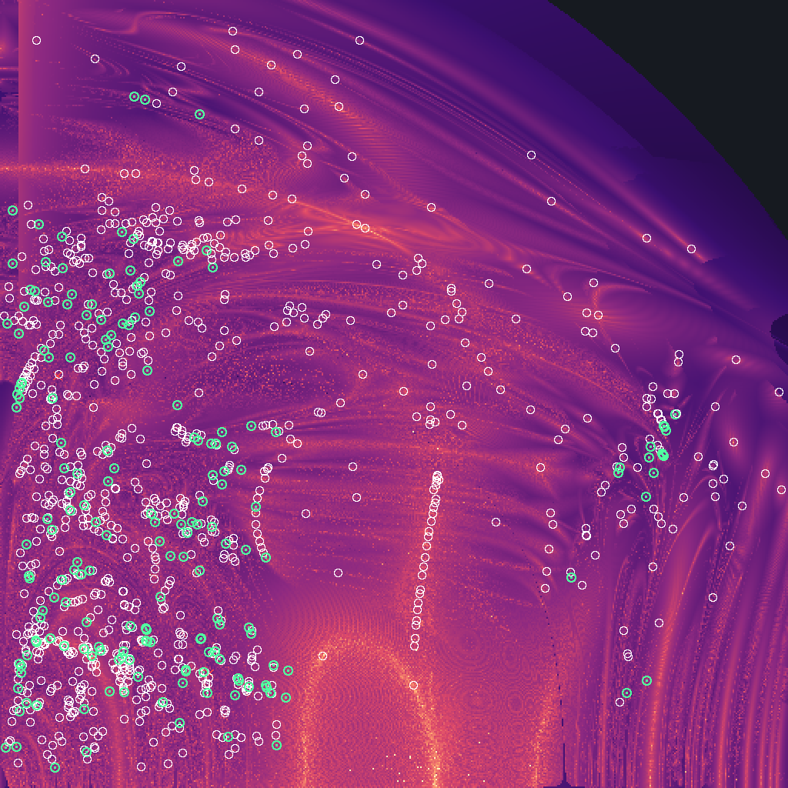

# Suchlauf euler-gleich-1

2026-10-02 17:40 UTC · Euler-Ebene · Massen 1 / 1 / 1 · Fenster v₁ 0…0.75, v₂ 0…0.75 · Raster 512×512 · Perioden bis 40 · Suche über Umkehrpunkte (halbe Periode)

## Was der Lauf getan hat

| Stufe | Zahl |
|---|---|
| Rasterpunkte gerechnet | 262144 in 64 s auf 11 Fäden |
| davon durchgelaufen / Zerfall / abgebrochen / ungebunden | 230982 / 18904 / 1447 / 10811 |
| Talsohlen (unter 0.3) in 8 Zielen × 6 Zeitbändern | 228020 |
| davon durch die Prüfkette | 60000 in 689 s |
| Umkehrpunkt verfehlt | 48589 |
| Umkehrpunkt getroffen, aber nach 12τ nicht zurück (nur bis auf eine Drehung periodisch) | 2059 |
| geschlossene Bahn | 9352 |
| verschiedene Orte in der Ebene | **1040** |
| verschiedene Bahnen (gleiches T* auf acht Stellen einmal gezählt) | **973** |
| — bestätigt (voller Umlauf: Rest < 1e-10 und Gegenprobe < 1e-8) | 182 |
| — über den Umkehrpunkt (halber Umlauf auf 1e-11 getroffen, voller für double zu empfindlich) | 630 |
| — an der Rechengrenze | 228 |
| sicher linear stabil | 11 |
| Ausnahmen im Schwarm | 0 |

Je Ziel (Fixmenge, die nach der halben Periode getroffen wird):

| Ziel | Kandidaten | Umkehrpunkt getroffen | geschlossene Bahn |
|---|---|---|---|
| A3 | 7759 | 2676 | 2671 |
| B1 | 7736 | 714 | 492 |
| B2 | 7851 | 595 | 303 |
| C | 12729 | 1501 | 948 |
| B3 | 16710 | 4699 | 4526 |
| R | 4768 | 704 | 80 |
| A2 | 1237 | 238 | 141 |
| A1 | 1210 | 284 | 191 |

## Bekannt oder nicht

Von den 1040 Funden stehen **856** in einer der geprüften Listen, **184** in keiner. Als verschiedene Bahnen gezählt (eine Bahn kann die Ebene an mehreren Stellen kreuzen): 973, davon **184** in keiner Liste.

| Liste | Stufe | Bahnen | Bedeutung |
|---|---|---|---|
| Li/Liao 2017–2019, Šuvakov/Dmitrašinović 2013 (2364 Bahnen, mit Klassen) | Ort | 96 | steht mit diesen Anfangswerten in der Liste |
| | Lage | 21 | gleiches T* auf acht Stellen: Listenbahn, an anderer Stelle getroffen |
| | Klasse | 92 | Klasse in der Liste, aber anderes T*: weitere Bahn derselben Familie |
| | keine | 831 | Klasse nicht in der Liste |
| Hristov u. a. (441985 Anfangswerte, gleiche Massen) | Ort | 853 | steht mit diesen Anfangswerten in der Liste |
| | Lage | 1 | gleiches T* auf acht Stellen: Listenbahn, an anderer Stelle getroffen |
| | keine | 186 | weder Ort noch T* in der Liste |

Trennschärfe: die 853 Ortstreffer liegen im Median 2.4e-14 und höchstens 8.4e-11 vom Listenwert (Schwelle 1e-6), ihr T* weicht höchstens 6.7e-11 ab; die 183 übrigen haben ihren nächsten Listennachbarn mindestens 2.2e-5 entfernt (Median 3.1e-4).

„In keiner Liste“ heißt genau das und nicht „neu“. Die Listen sind in sich begrenzt: Li und Liao führen je Klasse eine Bahn bis T = 200, gefunden auf einem Raster von 4000²; Hristov u. a. führen die Euler-Ebene bis T* = 211 und den freien Fall bis T* = 80 (mit Punktsymmetrie bis 120).

**Satelliten:** 10 der 184 Funde außerhalb der Listen laufen mehrmals fast den Weg einer anderen Bahn dieses Laufs oder der Liste, bevor sie sich schließen (Wort das k-fache, T* das k-fache); bei 10 davon ist die Grundbahn gelistet. Das sind eigene Bahnen, aber keine unerklärten — um eine stabile Bahn herum gibt es solche Begleiter regelmäßig. Sie sind in der Tabelle unten in der Spalte „Listen“ benannt.

## Gegenrichtung: was der Lauf von den Listen wiederfindet

| Liste | Bahnen im Fenster mit T bis 40 | gefunden | Anteil |
|---|---|---|---|
| Li/Liao, 2013 | 45 | 42 | 93 % |
| Hristov u. a. | 34107 | 586 | 1.7 % |
| — davon T < 10 | 25 | 7 | 28.0 % |
| — davon T < 20 | 1314 | 66 | 5.0 % |
| — davon T < 30 | 8873 | 220 | 2.5 % |
| — davon T < 40 | 23895 | 293 | 1.2 % |

Verpasst aus Li/Liao: II.C-66 (T 26.9), II.C-69 (T 33.2), II.C-190 (T 15.3).

Karte: hell = die Bahn kommt bis zur halben Höchstperiode einer Fixmenge nahe. Weißer Ring = Fund, der in einer Liste steht (nur bei bis zu 3000 Funden gezeichnet). Grüner Punkt = Fund, der in keiner Liste steht. Rotes Kreuz = Bahn aus Li/Liao, die der Lauf verpasst hat.

## Funde in keiner Liste (184)

| v₁ | v₂ | T | T* | Rest (voller Umlauf) | Umkehrpunkt | Urteil | Stabilität | \|λ\| | engste Begegnung | Wortlänge | Listen |
|---|---|---|---|---|---|---|---|---|---|---|---|
| 0.004851635698 | 0.038272754368 | 21.37707993 | 84.2741 | 8.2e-6 | B3 2.9e-10 | an der Rechengrenze | offen | 2.000e+6 | 1.5e-5 | 36 | — |
| 0.073019508391 | 0.214568117118 | 23.08310610 | 82.9382 | 7.1e-7 | C 4.0e-12 | über den Umkehrpunkt | instabil | 4.124e+8 | 0.003150 | 34 | — |
| 0.081770805024 | 0.034037018894 | 26.74142250 | 104.2156 | 9.3e-7 | C 4.1e-12 | über den Umkehrpunkt | offen | 3.751e+6 | 6.2e-4 | 44 | — |
| 0.016984958546 | 0.094794509827 | 27.05847038 | 105.1774 | 1.5e-6 | A3 6.5e-10 | an der Rechengrenze | instabil | 1.262e+8 | 6.2e-4 | 46 | — |
| 0.068169326217 | 0.469480122984 | 28.57214507 | 70.4327 | 2.0e-6 | C 2.6e-13 | über den Umkehrpunkt | instabil | 3.436e+9 | 0.04811 | 34 | — |
| 0.018477610544 | 0.370514780080 | 28.63003006 | 86.3270 | 7.4e-6 | B3 3.5e-13 | über den Umkehrpunkt | instabil | 1.093e+11 | 0.04032 | 72 | — |
| 0.020355210217 | 0.385144025103 | 28.73684391 | 84.5785 | 1.7e-6 | C 2.2e-14 | über den Umkehrpunkt | instabil | 4.856e+9 | 0.03648 | 70 | — |
| 0.044837637256 | 0.255839866014 | 28.79300229 | 100.2768 | 1.7e-6 | C 1.7e-13 | über den Umkehrpunkt | instabil | 2.601e+9 | 0.04156 | 40 | — |
| 0.170348543526 | 0.061843562867 | 28.99749217 | 107.9136 | 1.1e-6 | B3 2.2e-11 | an der Rechengrenze | offen | 7.540e+7 | 2.9e-4 | 44 | — |
| 0.018241243016 | 0.072393211163 | 29.76004592 | 116.4587 | 1.2e-7 | B3 1.4e-11 | an der Rechengrenze | instabil | 2.868e+6 | 0.001140 | 48 | — |
| 0.020022569881 | 0.384347303249 | 29.90243699 | 88.1300 | 1.2e-6 | C 1.1e-13 | über den Umkehrpunkt | instabil | 6.266e+9 | 0.03588 | 74 | — |
| 0.046388460749 | 0.409138383358 | 29.95708103 | 84.1831 | 6.6e-6 | C 5.6e-13 | über den Umkehrpunkt | instabil | 1.819e+10 | 0.002806 | 40 | — |
| 0.042008812689 | 0.415981651152 | 30.20128236 | 83.8626 | 7.6e-6 | C 2.1e-13 | über den Umkehrpunkt | instabil | 6.595e+10 | 0.07920 | 44 | — |
| 0.028605952560 | 0.473876184818 | 30.43492974 | 74.9657 | 4.0e-8 | A3 6.0e-11 | an der Rechengrenze | instabil | 2.226e+7 | 0.002035 | 34 | — |
| 0.024821010519 | 0.231446803123 | 30.75497550 | 109.9078 | 2.4e-6 | C 1.9e-12 | über den Umkehrpunkt | instabil | 2.099e+10 | 0.02534 | 44 | — |
| 0.057771977807 | 0.328304300412 | 30.99169634 | 98.8381 | 6.4e-6 | B3 3.8e-13 | über den Umkehrpunkt | instabil | 2.982e+8 | 0.003436 | 40 | — |
| 0.139915018676 | 0.139261611285 | 32.34209205 | 118.9813 | 8.3e-8 | C 3.0e-13 | über den Umkehrpunkt | instabil | 1.641e+7 | 0.01281 | 48 | — |
| 0.025725449145 | 0.125911001589 | 33.37099519 | 128.0085 | 4.4e-8 | C 5.1e-13 | über den Umkehrpunkt | instabil | 4.619e+7 | 0.006343 | 52 | — |
| 0.006341599712 | 0.441496286047 | 33.65474661 | 89.1951 | 3.6e-7 | C 2.9e-12 | über den Umkehrpunkt | offen | 8.748e+6 | 0.001348 | 46 | — |
| 0.011812698857 | 0.499119786907 | 33.96777462 | 78.7862 | 8.9e-7 | C 1.5e-12 | über den Umkehrpunkt | offen | 2.769e+9 | 0.002151 | 34 | — |
| 0.059476996628 | 0.494495897491 | 34.07939458 | 79.2880 | 2.1e-7 | C 2.8e-11 | an der Rechengrenze | instabil | 7.628e+6 | 4.9e-4 | 36 | — |
| 0.051832021546 | 0.018913508030 | 34.25699156 | 134.6713 | 9.8e-6 | C 1.8e-11 | an der Rechengrenze | offen | 1.084e+8 | 1.5e-6 | 60 | — |
| 0.060816767445 | 0.304126381426 | 34.53851324 | 113.5827 | 1.2e-7 | B3 8.0e-11 | an der Rechengrenze | offen | 9.295e+5 | 7.7e-5 | 38 | — |
| 0.024560408224 | 0.080248001328 | 35.01675644 | 136.6649 | 2.8e-6 | C 1.5e-12 | über den Umkehrpunkt | offen | 5.625e+8 | 5.9e-4 | 56 | — |
| 0.045276655060 | 0.462047160305 | 35.18609410 | 88.7811 | 8.3e-7 | C 8.9e-12 | über den Umkehrpunkt | offen | 7.063e+6 | 0.003896 | 30 | — |
| 0.063754015445 | 0.459911389052 | 35.31928377 | 89.1073 | 2.1e-7 | C 2.4e-13 | über den Umkehrpunkt | instabil | 1.724e+8 | 0.008594 | 44 | — |
| 0.216991885253 | 0.048042238742 | 35.34862195 | 127.4907 | 6.2e-8 | C 2.1e-12 | über den Umkehrpunkt | instabil | 1.423e+5 | 7.1e-4 | 52 | — |
| 0.093729297780 | 0.133985217334 | 35.68370711 | 134.3186 | 6.2e-8 | B3 5.5e-12 | über den Umkehrpunkt | instabil | 1.251e+7 | 0.01203 | 54 | — |
| 0.066475874596 | 0.409462796116 | 35.81063364 | 100.0569 | 1.3e-6 | B3 4.2e-13 | über den Umkehrpunkt | instabil | 7.651e+9 | 0.006753 | 44 | — |
| 0.079987385242 | 0.074400922707 | 35.88586999 | 138.8153 | 5.5e-6 | B3 1.3e-12 | über den Umkehrpunkt | instabil | 7.023e+8 | 0.006317 | 56 | — |
| 0.027140843334 | 0.201441171214 | 36.21368224 | 132.6347 | 4.8e-7 | A3 7.6e-11 | an der Rechengrenze | offen | 5.849e+6 | 1.0e-4 | 54 | — |
| 0.049775883153 | 0.370456944447 | 36.33189839 | 109.0561 | 4.9e-8 | B3 7.1e-13 | über den Umkehrpunkt | offen | 3.673e+6 | 0.002492 | 44 | — |
| 0.034654040781 | 0.138761185412 | 36.47272335 | 138.8954 | 7.9e-7 | B3 4.5e-12 | über den Umkehrpunkt | instabil | 7.138e+7 | 0.01125 | 56 | — |
| 0.082095774314 | 0.449360746609 | 36.52840724 | 93.7102 | 4.5e-6 | B3 3.5e-13 | über den Umkehrpunkt | instabil | 3.951e+9 | 0.1183 | 44 | — |
| 0.047580735880 | 0.141825380739 | 36.58566269 | 138.8315 | 9.2e-6 | B3 1.6e-11 | an der Rechengrenze | instabil | 9.077e+8 | 0.009835 | 56 | — |
| 0.095312956412 | 0.130166017180 | 36.83033861 | 138.8176 | 2.1e-6 | B3 1.7e-12 | über den Umkehrpunkt | instabil | 4.921e+7 | 0.009940 | 56 | — |
| 0.022689146658 | 0.457722543117 | 37.48070636 | 95.8395 | 4.9e-7 | A3 6.7e-11 | an der Rechengrenze | instabil | 5.750e+7 | 0.002623 | 44 | — |
| 0.019906069561 | 0.109352443078 | 37.85274607 | 146.3112 | 8.1e-6 | A3 3.4e-10 | an der Rechengrenze | instabil | 1.211e+9 | 0.002417 | 60 | — |
| 0.018439783570 | 0.380405710446 | 37.95663451 | 112.6216 | 3.3e-6 | C 5.5e-13 | über den Umkehrpunkt | instabil | 2.558e+10 | 0.03262 | 102 | — |
| 0.019868986272 | 0.114782196749 | 38.26230087 | 147.5659 | 4.8e-8 | B3 1.7e-12 | über den Umkehrpunkt | instabil | 7.658e+6 | 0.003463 | 60 | — |
| 0.070450009065 | 0.207338849810 | 38.32469060 | 138.6056 | 1.8e-6 | B3 5.8e-13 | über den Umkehrpunkt | instabil | 2.864e+7 | 0.005021 | 56 | — |
| 0.084852309143 | 0.206682944212 | 38.47105116 | 138.6131 | 9.9e-8 | B3 6.3e-13 | über den Umkehrpunkt | instabil | 2.119e+6 | 0.01830 | 56 | — |
| 0.100342341834 | 0.426193370771 | 38.47204521 | 102.7420 | 2.0e-7 | C 1.5e-13 | über den Umkehrpunkt | instabil | 2.110e+8 | 0.03793 | 42 | — |
| 0.072932361858 | 0.299020215489 | 38.87768859 | 128.2322 | 9.9e-8 | B3 2.2e-13 | über den Umkehrpunkt | instabil | 5.912e+7 | 0.01393 | 52 | — |
| 0.018282039980 | 0.379998455540 | 39.09509701 | 116.0793 | 5.5e-6 | C 8.4e-14 | über den Umkehrpunkt | instabil | 3.008e+10 | 0.03222 | 106 | — |
| 0.017301191117 | 0.432469949682 | 39.30390701 | 106.0401 | 4.1e-7 | B1 6.0e-12 | über den Umkehrpunkt | instabil | 9.603e+7 | 0.01144 | 52 | — |
| 0.154417977258 | 0.081324484263 | 39.40190740 | 147.2892 | 1.0e-7 | B3 1.9e-12 | über den Umkehrpunkt | instabil | 2.572e+8 | 0.003419 | 60 | — |
| 0.081686958058 | 0.157200623787 | 40.03819300 | 149.4088 | 1.4e-6 | C 2.7e-13 | über den Umkehrpunkt | offen | 2.100e+8 | 0.01342 | 60 | — |
| 0.152283560273 | 0.181695344998 | 40.71091883 | 144.9216 | 5.7e-7 | C 1.7e-12 | über den Umkehrpunkt | instabil | 7.911e+7 | 0.02230 | 58 | — |
| 0.123584932339 | 0.492473140894 | 41.58170285 | 94.3380 | 4.5e-7 | B3 4.2e-12 | über den Umkehrpunkt | offen | 9.771e+6 | 6.1e-4 | 44 | — |
| 0.117653788669 | 0.090603277228 | 41.72518223 | 158.4302 | 2.0e-6 | C 4.0e-13 | über den Umkehrpunkt | instabil | 7.603e+8 | 0.009112 | 64 | — |
| 0.113079537458 | 0.121618712058 | 42.17601448 | 158.5083 | 1.9e-8 | C 2.9e-12 | über den Umkehrpunkt | instabil | 3.063e+7 | 0.01563 | 64 | — |
| 0.038159251366 | 0.162124848493 | 42.19113715 | 158.5172 | 4.0e-8 | B3 5.9e-13 | über den Umkehrpunkt | instabil | 1.575e+6 | 0.001089 | 64 | — |
| 0.040574110396 | 0.168153684622 | 42.29079392 | 158.2467 | 6.2e-8 | R 2.5e-13 | über den Umkehrpunkt | instabil | 6.198e+6 | 0.001690 | 0 | — |
| 0.015347174930 | 0.038830753595 | 42.68979420 | 168.2170 | 4.9e-6 | B3 6.9e-12 | über den Umkehrpunkt | offen | 9.772e+8 | 2.1e-4 | 71 | — |
| 0.101084286360 | 0.239963765478 | 42.93155699 | 149.4184 | 4.2e-7 | C 4.3e-13 | über den Umkehrpunkt | instabil | 5.025e+5 | 0.001582 | 60 | — |
| 0.208624425311 | 0.155268747293 | 43.00431195 | 149.7209 | 8.3e-8 | C 1.3e-12 | über den Umkehrpunkt | instabil | 2.159e+7 | 0.01543 | 60 | — |
| 0.206407567037 | 0.161419002771 | 43.09052518 | 149.7192 | 8.0e-8 | C 3.0e-13 | über den Umkehrpunkt | instabil | 1.136e+8 | 0.01502 | 60 | — |
| 0.138663104440 | -0.139685019315 | 43.10094305 | 158.6304 | 7.8e-7 | C 3.3e-13 | über den Umkehrpunkt | instabil | 1.360e+9 | 0.01166 | 64 | — |
| 0.138917948916 | 0.150141864508 | 43.38703670 | 158.7494 | 1.9e-9 | A3 3.7e-11 | an der Rechengrenze | instabil | 1.215e+6 | 1.4e-4 | 64 | — |
| 0.018251452520 | 0.117792220556 | 43.45772839 | 167.4073 | 3.6e-6 | C 3.9e-12 | über den Umkehrpunkt | instabil | 2.450e+8 | 0.003168 | 68 | — |
| 0.176817492153 | 0.112394628162 | 43.53528337 | 158.6715 | 1.0e-7 | C 8.6e-14 | über den Umkehrpunkt | instabil | 3.451e+7 | 0.01185 | 64 | — |
| 0.104089789417 | 0.091732992776 | 43.86924854 | 167.4348 | 7.1e-6 | C 2.0e-12 | über den Umkehrpunkt | offen | 1.226e+9 | 0.005146 | 68 | — |
| 0.204010925056 | 0.129380065779 | 44.79896890 | 158.8109 | 1.3e-6 | C 1.8e-12 | über den Umkehrpunkt | instabil | 3.127e+8 | 0.01260 | 64 | — |
| 0.133183354517 | 0.481019017451 | 44.95428825 | 104.3070 | 3.4e-6 | C 2.9e-12 | über den Umkehrpunkt | offen | 1.482e+9 | 1.3e-4 | 46 | — |
| 0.051025170414 | 0.181129438459 | 45.67634227 | 169.1663 | 1.1e-6 | B3 5.7e-12 | über den Umkehrpunkt | offen | 4.308e+7 | 0.001354 | 68 | — |
| 0.062347793540 | 0.176709043509 | 45.70705906 | 169.3749 | 8.0e-8 | B3 1.8e-12 | über den Umkehrpunkt | instabil | 2.661e+5 | 2.5e-4 | 68 | — |
| 0.091008118380 | 0.252856475490 | 46.11944351 | 159.1259 | 6.2e-6 | B3 6.1e-11 | an der Rechengrenze | offen | 8.352e+9 | 8.3e-4 | 56 | — |
| 0.027595283783 | 0.199138119204 | 46.18233742 | 169.4332 | 8.1e-7 | B3 3.8e-12 | über den Umkehrpunkt | instabil | 1.290e+7 | 0.01903 | 68 | — |
| 0.079491951229 | 0.269049640727 | 46.68320210 | 159.0160 | 8.6e-7 | R 1.9e-12 | über den Umkehrpunkt | offen | 5.661e+6 | 4.5e-4 | 0 | — |
| 0.036370903010 | 0.535882363182 | 46.90544538 | 98.0188 | 2.5e-7 | C 2.7e-12 | über den Umkehrpunkt | offen | 8.265e+5 | 6.5e-4 | 42 | — |
| 0.033946457536 | 0.139626478605 | 46.95231553 | 178.7403 | 2.3e-6 | B3 8.8e-13 | über den Umkehrpunkt | instabil | 9.622e+8 | 0.01114 | 72 | — |
| 0.146936043901 | 0.252626946791 | 47.29831855 | 158.9691 | 3.6e-7 | C 1.7e-11 | an der Rechengrenze | instabil | 7.650e+6 | 0.002322 | 64 | — |
| 0.143388017449 | -0.260926516795 | 47.54700753 | 158.7701 | 5.4e-7 | C 3.3e-13 | über den Umkehrpunkt | offen | 1.381e+8 | 0.003825 | 64 | — |
| 0.034367974574 | 0.078384771168 | 47.99855037 | 187.2347 | 8.0e-7 | B3 1.2e-11 | an der Rechengrenze | offen | 1.035e+7 | 0.003431 | 76 | — |
| 0.142849153739 | 0.138370597661 | 48.60303351 | 178.6061 | 9.0e-6 | B3 1.4e-12 | über den Umkehrpunkt | instabil | 3.878e+9 | 0.01571 | 72 | — |
| 0.033055224459 | 0.472424080376 | 48.82366534 | 120.5864 | 6.4e-6 | C 1.6e-12 | über den Umkehrpunkt | offen | 9.029e+8 | 2.8e-4 | 62 | — |
| 0.176351405540 | 0.110681968964 | 48.91739662 | 178.4727 | 2.1e-6 | B3 2.1e-12 | über den Umkehrpunkt | instabil | 6.145e+8 | 0.01095 | 72 | — |
| 0.066384254123 | 0.281579569517 | 49.96584030 | 168.5131 | 2.7e-7 | B3 3.5e-13 | über den Umkehrpunkt | instabil | 8.326e+7 | 0.004301 | 68 | nur Klasse von I.A-36 |
| 0.131732787735 | 0.470448611280 | 50.29827390 | 119.8494 | 4.0e-6 | B3 2.2e-13 | über den Umkehrpunkt | instabil | 9.795e+9 | 0.1166 | 52 | Satellit 13. Ordnung von Acht (T* das 12.97397-fache) |
| 0.226072220782 | 0.104066238404 | 50.76731890 | 178.7233 | 1.0e-6 | B3 2.1e-11 | an der Rechengrenze | instabil | 3.055e+7 | 0.009960 | 72 | — |
| 0.182662410748 | 0.252771770244 | 50.93435267 | 167.1380 | 2.4e-7 | C 5.8e-12 | über den Umkehrpunkt | offen | 2.015e+8 | 5.9e-5 | 68 | — |
| 0.049034734820 | 0.245342967677 | 51.01544314 | 179.3667 | 4.2e-6 | B3 3.9e-13 | über den Umkehrpunkt | instabil | 3.264e+9 | 0.004569 | 72 | — |
| 0.187836970126 | 0.250650477460 | 51.03867364 | 167.1905 | 1.4e-7 | C 3.1e-12 | über den Umkehrpunkt | offen | 9.572e+8 | 4.5e-4 | 68 | — |
| 0.130598624984 | 0.477641355008 | 51.03897634 | 119.6191 | 1.1e-7 | B3 5.0e-13 | über den Umkehrpunkt | instabil | 6.932e+7 | 0.002722 | 52 | nur Klasse von I.A-25 |
| 0.128530473485 | 0.447469100338 | 51.07519071 | 128.4934 | 3.5e-7 | C 4.6e-12 | über den Umkehrpunkt | instabil | 9.449e+6 | 0.01530 | 54 | Satellit 3. Ordnung von Bahn bei Hristov u. a. (T* das 3.00334-fache, Wort bis auf 4 Buchstaben) |
| 0.058610718467 | 0.197694844078 | 51.74854903 | 189.1003 | 5.7e-7 | B3 5.1e-13 | über den Umkehrpunkt | instabil | 4.919e+7 | 0.002586 | 76 | — |
| 0.076821097624 | 0.203013753246 | 52.20295522 | 189.0997 | 2.7e-8 | B3 4.4e-13 | über den Umkehrpunkt | instabil | 1.616e+6 | 0.002747 | 76 | — |
| 0.108189168225 | 0.304161287662 | 52.73762690 | 170.6066 | 2.2e-7 | C 7.7e-11 | an der Rechengrenze | instabil | 5.526e+6 | 0.002221 | 70 | — |
| 0.223556538629 | 0.088102763767 | 52.86915973 | 187.6444 | 9.5e-6 | B3 5.8e-12 | über den Umkehrpunkt | offen | 6.431e+8 | 0.002982 | 76 | — |
| 0.117086197194 | 0.129471436124 | 53.04101888 | 198.2689 | 8.9e-6 | C 1.9e-12 | über den Umkehrpunkt | instabil | 9.301e+8 | 0.003515 | 80 | — |
| 0.173255759024 | 0.099825015362 | 54.02982041 | 198.3870 | 1.3e-6 | C 4.1e-12 | über den Umkehrpunkt | offen | 3.232e+8 | 0.003641 | 80 | — |
| 0.138570977786 | 0.151266994320 | 54.20166822 | 198.2279 | 3.7e-6 | B3 2.5e-12 | über den Umkehrpunkt | instabil | 4.248e+7 | 0.001146 | 80 | — |
| 0.086909368429 | 0.459770246720 | 54.70194442 | 136.8839 | 8.3e-6 | B1 2.7e-14 | über den Umkehrpunkt | instabil | 9.128e+8 | 0.1478 | 60 | — |
| 0.196862086275 | 0.090167489413 | 54.70520980 | 198.2513 | 7.9e-6 | C 1.6e-12 | über den Umkehrpunkt | offen | 9.693e+9 | 0.007077 | 80 | — |
| 0.193031731803 | 0.110212980568 | 54.98980567 | 198.3243 | 5.9e-6 | C 2.7e-13 | über den Umkehrpunkt | offen | 1.167e+9 | 0.01174 | 80 | — |
| 0.066940955325 | 0.263583258929 | 55.06157686 | 189.3285 | 2.3e-8 | B3 1.1e-13 | über den Umkehrpunkt | instabil | 4.097e+6 | 0.001921 | 76 | nur Klasse von I.A-40 |
| 0.131083681444 | 0.105534037029 | 55.37014330 | 207.8078 | 4.0e-6 | C 6.1e-12 | über den Umkehrpunkt | instabil | 1.520e+9 | 5.7e-4 | 84 | — |
| 0.239092186496 | 0.146495757536 | 55.64591903 | 189.5758 | 4.1e-6 | C 7.1e-13 | über den Umkehrpunkt | instabil | 1.544e+8 | 0.01371 | 76 | — |
| 0.236673790460 | 0.152685164666 | 55.72304985 | 189.5741 | 2.3e-6 | C 2.0e-13 | über den Umkehrpunkt | instabil | 6.419e+8 | 0.01252 | 76 | — |
| 0.226765814828 | 0.101814177639 | 56.37380637 | 198.5184 | 2.0e-6 | C 8.4e-13 | über den Umkehrpunkt | instabil | 1.352e+8 | 0.009550 | 80 | — |
| 0.126842258815 | 0.522111631109 | 57.40318235 | 119.8910 | 3.5e-8 | B3 1.3e-13 | über den Umkehrpunkt | instabil | 1.400e+8 | 0.1676 | 52 | Satellit 13. Ordnung von Acht (T* das 12.97848-fache) |
| 0.116013896083 | 0.528458997206 | 58.06569600 | 119.9283 | 1.2e-7 | B3 1.6e-13 | über den Umkehrpunkt | instabil | 5.523e+7 | 0.1344 | 52 | Satellit 13. Ordnung von Acht (T* das 12.98252-fache) |
| 0.184376233682 | 0.333357771864 | 58.15495160 | 172.5247 | 3.3e-6 | C 4.7e-11 | an der Rechengrenze | instabil | 5.115e+6 | 0.001264 | 70 | — |
| 0.015295689350 | 0.362067233659 | 58.54370915 | 178.9262 | 4.1e-6 | B3 1.6e-13 | über den Umkehrpunkt | instabil | 5.091e+12 | 4.6e-4 | 181 | — |
| 0.260265544265 | 0.116274548611 | 58.68747573 | 198.8930 | 1.5e-7 | C 1.1e-12 | über den Umkehrpunkt | instabil | 2.310e+7 | 0.01128 | 80 | — |
| 0.101656854080 | 0.320859823247 | 59.05170376 | 187.4807 | 6.8e-6 | B3 1.5e-12 | über den Umkehrpunkt | instabil | 3.722e+8 | 0.002878 | 76 | — |
| 0.096212472152 | 0.445504265910 | 59.68170622 | 153.4514 | 6.8e-6 | C 1.5e-12 | über den Umkehrpunkt | instabil | 6.936e+8 | 0.04679 | 66 | nur Klasse von II.B-7 |
| 0.177872815549 | 0.242677436703 | 59.69661969 | 198.5827 | 9.6e-7 | C 6.7e-12 | über den Umkehrpunkt | offen | 2.403e+7 | 3.6e-4 | 80 | — |
| 0.263172854288 | 0.040098890455 | 59.89964396 | 207.2223 | 1.9e-6 | C 5.3e-12 | über den Umkehrpunkt | offen | 4.532e+7 | 4.3e-4 | 84 | — |
| 0.165837870530 | 0.260569862508 | 60.27070362 | 198.5248 | 2.9e-6 | B3 1.4e-12 | über den Umkehrpunkt | offen | 3.034e+8 | 5.3e-5 | 80 | — |
| 0.102476291912 | 0.291709218057 | 60.53475814 | 199.3148 | 3.0e-6 | C 1.8e-12 | über den Umkehrpunkt | offen | 3.494e+8 | 0.001087 | 84 | — |
| 0.201735900123 | 0.248113297099 | 61.14343786 | 198.5982 | 2.8e-6 | B3 1.7e-12 | über den Umkehrpunkt | offen | 5.300e+8 | 4.5e-5 | 80 | — |
| 0.630125108265 | 0.317673945763 | 61.35469669 | 61.9148 | 1.7e-7 | C 1.5e-12 | über den Umkehrpunkt | instabil | 1.198e+6 | 0.08543 | 26 | — |
| 0.151254406431 | 0.234198608569 | 61.40174538 | 209.5589 | 3.3e-8 | B3 4.7e-11 | an der Rechengrenze | offen | 4.20e+3 | 2.0e-5 | 84 | — |
| 0.202241303427 | 0.297503887203 | 61.46478287 | 188.6237 | 4.8e-6 | C 9.9e-12 | über den Umkehrpunkt | offen | 1.216e+8 | 0.002894 | 76 | — |
| 0.174501496602 | 0.219481851198 | 61.51192325 | 209.5615 | 1.2e-7 | B3 9.0e-11 | an der Rechengrenze | offen | 9.48e+4 | 1.1e-4 | 84 | — |
| 0.116797852333 | 0.441742458193 | 62.04103305 | 159.1172 | 2.1e-6 | C 7.0e-13 | über den Umkehrpunkt | offen | 2.157e+9 | 0.02314 | 68 | — |
| 0.058720835594 | 0.524073050053 | 62.33738156 | 134.0118 | 1.6e-8 | C 2.0e-12 | über den Umkehrpunkt | instabil | 7.014e+5 | 0.02634 | 60 | — |
| 0.236522755497 | 0.096194334298 | 62.45873422 | 218.4908 | 3.0e-6 | B3 4.8e-12 | über den Umkehrpunkt | offen | 6.778e+8 | 0.008096 | 88 | — |
| 0.172067741520 | 0.250817488990 | 62.63447064 | 207.5207 | 9.5e-6 | R 1.5e-12 | über den Umkehrpunkt | offen | 3.454e+9 | 1.5e-4 | 2 | — |
| 0.087396919745 | 0.125074165526 | 62.77765232 | 237.8241 | 1.9e-6 | C 2.7e-12 | über den Umkehrpunkt | offen | 6.701e+8 | 0.008698 | 96 | — |
| 0.043296049620 | 0.500322676070 | 63.05828355 | 145.1579 | 3.4e-6 | B3 1.4e-12 | über den Umkehrpunkt | instabil | 5.324e+8 | 0.02662 | 64 | — |
| 0.115430558161 | 0.124010965184 | 63.41831128 | 237.8435 | 5.3e-7 | C 7.3e-13 | über den Umkehrpunkt | instabil | 8.485e+8 | 0.006505 | 96 | — |
| 0.214830540449 | 0.232306590468 | 63.48186834 | 207.0992 | 2.5e-6 | C 2.5e-12 | über den Umkehrpunkt | offen | 3.820e+7 | 3.5e-4 | 84 | — |
| 0.252926524551 | 0.097232065853 | 63.50294741 | 218.5832 | 8.6e-7 | B3 3.7e-12 | über den Umkehrpunkt | instabil | 1.407e+8 | 0.007953 | 88 | — |
| 0.257225509496 | 0.090069203857 | 63.60837896 | 218.5782 | 1.8e-6 | B3 4.2e-12 | über den Umkehrpunkt | instabil | 8.309e+7 | 0.006398 | 88 | — |
| 0.213214764063 | 0.300706693028 | 63.81954246 | 193.1539 | 2.7e-6 | C 8.2e-11 | an der Rechengrenze | offen | 4.662e+6 | 0.002878 | 78 | — |
| 0.105824513986 | 0.430681108300 | 64.35962479 | 169.8810 | 7.8e-6 | C 8.0e-13 | über den Umkehrpunkt | instabil | 8.361e+8 | 0.002332 | 70 | Satellit 7. Ordnung von Motte I (T* das 7.01827-fache) |
| 0.211217320490 | 0.288885566994 | 64.37811885 | 198.1296 | 2.1e-6 | C 1.1e-10 | an der Rechengrenze | offen | 7.356e+6 | 6.3e-5 | 80 | — |
| 0.123985980215 | 0.153629001807 | 64.78619791 | 238.3360 | 4.4e-7 | B3 4.1e-11 | an der Rechengrenze | offen | 8.318e+5 | 1.4e-4 | 96 | — |
| -0.630798758302 | 0.316699750661 | 65.40132476 | 65.9301 | 9.7e-8 | C 2.2e-12 | über den Umkehrpunkt | instabil | 1.940e+6 | 0.08848 | 28 | — |
| 0.102664960143 | 0.419919773367 | 65.42271570 | 176.6947 | 9.0e-7 | B3 9.0e-12 | über den Umkehrpunkt | offen | 2.978e+7 | 2.9e-4 | 72 | — |
| 0.161572219646 | 0.220651355401 | 65.44401841 | 224.6571 | 3.4e-6 | C 3.2e-11 | an der Rechengrenze | offen | 2.682e+6 | 1.9e-5 | 90 | Satellit 3. Ordnung von Bahn bei Hristov u. a. (T* das 2.99999-fache) |
| 0.201913316406 | 0.495451609722 | 65.75928552 | 138.2705 | 2.4e-6 | B3 2.8e-12 | über den Umkehrpunkt | instabil | 1.419e+8 | 0.1314 | 60 | Satellit 3. Ordnung von Bahn bei Hristov u. a. (T* das 3.00171-fache) |
| 0.141726619772 | 0.453148645488 | 65.80943999 | 162.0771 | 5.8e-7 | B3 1.7e-12 | über den Umkehrpunkt | offen | 5.723e+7 | 6.2e-4 | 68 | — |
| 0.189757332278 | 0.206386672636 | 65.94386927 | 224.6693 | 4.3e-6 | C 7.2e-10 | an der Rechengrenze | offen | 2.662e+7 | 2.8e-4 | 90 | — |
| 0.211215624094 | 0.338522910236 | 66.54965952 | 191.3978 | 3.1e-6 | C 1.2e-12 | über den Umkehrpunkt | instabil | 2.015e+8 | 0.009737 | 78 | — |
| 0.011885938689 | 0.549282858244 | 66.90378651 | 134.6987 | 6.8e-6 | C 3.4e-11 | an der Rechengrenze | offen | 2.187e+6 | 9.1e-4 | 58 | — |
| 0.190506290828 | 0.141640143894 | 66.94681547 | 238.2459 | 2.0e-7 | B3 1.2e-12 | über den Umkehrpunkt | offen | 1.358e+7 | 6.4e-4 | 96 | — |
| 0.191357234954 | 0.142308237486 | 67.01339095 | 238.2460 | 8.4e-8 | B3 2.1e-12 | über den Umkehrpunkt | offen | 2.288e+6 | 6.5e-4 | 96 | — |
| 0.137468156973 | 0.655066007739 | 67.97649063 | 84.4851 | 3.1e-6 | C 1.7e-12 | über den Umkehrpunkt | offen | 4.564e+8 | 0.01166 | 36 | — |
| 0.123035886096 | 0.121641349969 | 69.05302266 | 258.3815 | 5.4e-6 | B3 1.9e-12 | über den Umkehrpunkt | instabil | 2.347e+9 | 0.005227 | 104 | — |
| 0.253364239572 | 0.094872169878 | 69.22224451 | 238.3786 | 1.0e-7 | C 1.4e-12 | über den Umkehrpunkt | offen | 5.300e+8 | 0.007493 | 96 | — |
| 0.198490852731 | 0.129236417589 | 69.59353921 | 247.7863 | 1.0e-6 | R 1.5e-11 | an der Rechengrenze | offen | 1.293e+7 | 9.7e-5 | 0 | — |
| 0.208723658444 | 0.122352492798 | 69.67518607 | 246.9121 | 7.9e-6 | C 4.6e-12 | über den Umkehrpunkt | offen | 7.679e+8 | 0.005958 | 100 | — |
| 0.589909697538 | 0.304656533130 | 69.76773224 | 89.1531 | 5.3e-9 | C 5.3e-14 | über den Umkehrpunkt | instabil | 4.538e+5 | 0.07055 | 36 | — |
| -0.016152260366 | 0.374213938197 | 70.29309965 | 210.7311 | 8.7e-6 | C 1.1e-12 | über den Umkehrpunkt | instabil | 5.291e+11 | 0.01657 | 219 | — |
| 0.139626867472 | 0.396644636256 | 70.72830867 | 195.4960 | 2.3e-6 | B3 2.4e-11 | an der Rechengrenze | offen | 6.855e+6 | 0.001049 | 80 | — |
| 0.274146512495 | 0.111181998860 | 71.33883512 | 238.7564 | 1.3e-7 | C 7.7e-13 | über den Umkehrpunkt | instabil | 1.255e+8 | 0.009487 | 96 | — |
| 0.243501717415 | 0.267693143498 | 71.45603848 | 218.5645 | 6.4e-10 | B3 6.2e-13 | über den Umkehrpunkt | instabil | 1.32e+4 | 5.7e-4 | 88 | — |
| 0.188248860173 | 0.330455864661 | 71.60724672 | 212.6566 | 2.6e-6 | C 7.2e-11 | an der Rechengrenze | instabil | 3.986e+7 | 0.005618 | 86 | — |
| 0.631666478571 | 0.344297773901 | 71.63681436 | 66.0565 | 1.7e-7 | C 1.3e-13 | über den Umkehrpunkt | instabil | 2.228e+7 | 0.1732 | 38 | — |
| 0.127623393333 | 0.657678554887 | 71.72042251 | 88.8540 | 5.9e-6 | C 8.6e-13 | über den Umkehrpunkt | offen | 7.885e+8 | 0.009123 | 38 | — |
| 0.588439383279 | 0.299302331905 | 72.01109523 | 93.7716 | 1.1e-7 | C 1.6e-11 | an der Rechengrenze | instabil | 1.378e+6 | 0.02606 | 38 | — |
| 0.205261109420 | 0.327732373593 | 72.37480669 | 212.6454 | 1.1e-6 | C 3.2e-13 | über den Umkehrpunkt | instabil | 1.833e+7 | 0.002820 | 86 | — |
| 0.192628686866 | 0.272696215214 | 72.69128513 | 231.6581 | 5.6e-6 | C 2.2e-11 | an der Rechengrenze | offen | 2.137e+8 | 5.6e-5 | 96 | — |
| 0.642489630206 | 0.355514323682 | 72.71362248 | 60.2769 | 8.6e-8 | B3 1.7e-12 | über den Umkehrpunkt | instabil | 4.85e+4 | 3.4e-4 | 32 | — |
| 0.060644608560 | 0.134804477174 | 73.05906561 | 277.5079 | 8.3e-6 | C 1.3e-12 | über den Umkehrpunkt | offen | 5.798e+8 | 0.01505 | 112 | Satellit 7. Ordnung von Brille (T* das 7.00006-fache) |
| 0.631683677950 | 0.315479159475 | 73.21474774 | 73.6925 | 2.0e-6 | C 2.0e-12 | über den Umkehrpunkt | instabil | 1.936e+7 | 0.09180 | 32 | — |
| 0.079680370211 | 0.132017840859 | 73.31982171 | 277.5066 | 3.1e-7 | C 1.9e-12 | über den Umkehrpunkt | offen | 7.340e+8 | 0.01516 | 112 | Satellit 7. Ordnung von Brille (T* das 7.00003-fache) |
| 0.122338807858 | 0.439965413295 | 73.41951617 | 188.4091 | 4.1e-6 | C 2.1e-12 | über den Umkehrpunkt | offen | 1.731e+8 | 0.001068 | 78 | nur Klasse von I.B-61 |
| 0.632045335395 | 0.343830040082 | 73.82581464 | 68.0242 | 8.6e-8 | B3 8.6e-14 | über den Umkehrpunkt | instabil | 3.057e+7 | 0.1661 | 40 | — |
| 0.233656608928 | 0.226513577696 | 74.05339438 | 238.7334 | 9.2e-7 | R 8.0e-13 | über den Umkehrpunkt | offen | 9.469e+7 | 4.0e-4 | 0 | — |
| 0.252447278646 | 0.219139590086 | 75.04392876 | 239.0152 | 1.5e-10 | B3 2.6e-13 | über den Umkehrpunkt | instabil | 2.40e+4 | 4.5e-4 | 96 | — |
| 0.168499937753 | 0.364144781359 | 75.25589410 | 215.5785 | 1.1e-7 | C 1.2e-12 | über den Umkehrpunkt | offen | 9.29e+4 | 0.003982 | 88 | — |
| 0.238966984695 | 0.343932464073 | 75.73441098 | 210.0164 | 4.6e-11 | C 8.4e-12 | bestätigt | instabil | 813 | 0.004995 | 86 | — |
| 0.614361941184 | 0.276490106083 | 75.75154471 | 92.0022 | 4.0e-6 | B3 1.1e-12 | über den Umkehrpunkt | instabil | 1.091e+8 | 0.04969 | 40 | — |
| 0.189821850850 | 0.641190721038 | 76.09183413 | 94.8849 | 2.7e-6 | B3 1.4e-12 | über den Umkehrpunkt | offen | 2.005e+9 | 0.04324 | 40 | — |
| 0.271668195280 | 0.085974486294 | 76.24953823 | 258.4434 | 1.4e-6 | B3 9.7e-12 | über den Umkehrpunkt | offen | 3.827e+8 | 0.004787 | 104 | — |
| 0.200682902877 | 0.327662481501 | 77.13175603 | 227.5692 | 2.3e-6 | B3 4.8e-12 | über den Umkehrpunkt | instabil | 2.315e+8 | 0.004544 | 92 | — |
| 0.169071697232 | 0.500912595732 | 77.47603299 | 165.9279 | 7.7e-6 | C 2.2e-12 | über den Umkehrpunkt | offen | 5.635e+8 | 3.0e-4 | 72 | nur Klasse von II.B-8 |
| 0.196388182523 | 0.511511054804 | 77.63661867 | 157.0318 | 1.7e-7 | B3 2.4e-13 | über den Umkehrpunkt | instabil | 1.272e+8 | 0.3008 | 68 | Satellit 17. Ordnung von Acht (T* das 16.99905-fache) |
| 0.621762247829 | 0.299695066948 | 78.36566590 | 86.8317 | 1.5e-7 | B3 6.4e-12 | über den Umkehrpunkt | instabil | 3.353e+6 | 0.07437 | 36 | — |
| 0.596210478323 | 0.090205608363 | 79.09311240 | 132.3098 | 1.4e-6 | C 2.3e-11 | an der Rechengrenze | offen | 9.891e+6 | 0.001516 | 56 | — |
| 0.261987443095 | 0.338400612054 | 79.56921439 | 216.7596 | 4.4e-8 | B3 1.3e-12 | über den Umkehrpunkt | instabil | 7.655e+5 | 0.005249 | 88 | — |
| 0.220719630023 | 0.324310689739 | 79.59628786 | 231.6329 | 5.2e-6 | C 6.4e-12 | über den Umkehrpunkt | offen | 3.528e+7 | 0.004143 | 94 | — |
| 0.619051121836 | 0.324404040240 | 79.73096242 | 83.9062 | 7.8e-8 | C 2.5e-13 | über den Umkehrpunkt | instabil | 2.599e+6 | 0.1322 | 34 | — |
| 0.229464972588 | 0.302662293122 | 79.88472345 | 237.4352 | 9.5e-8 | R 2.2e-12 | über den Umkehrpunkt | offen | 7.087e+6 | 0.001295 | 0 | — |
| 0.614995486914 | 0.101907646020 | 80.67108279 | 124.3204 | 4.6e-6 | C 1.4e-12 | über den Umkehrpunkt | offen | 9.155e+8 | 0.001111 | 35 | — |
| 0.103923219026 | 0.488984892702 | 82.86882440 | 191.8903 | 3.0e-6 | B1 4.0e-14 | über den Umkehrpunkt | instabil | 7.179e+8 | 0.03914 | 84 | — |
| 0.633850368115 | 0.339665671102 | 88.03786675 | 81.3359 | 5.7e-8 | C 1.4e-13 | über den Umkehrpunkt | instabil | 2.561e+8 | 0.1433 | 54 | — |
| 0.617125619671 | 0.314263502855 | 90.55548845 | 98.9921 | 4.5e-6 | A2 7.5e-14 | über den Umkehrpunkt | instabil | 3.359e+8 | 0.1278 | 44 | — |
| 0.543275790445 | 0.199845374609 | 92.66125471 | 169.3349 | 3.8e-7 | C 2.6e-12 | über den Umkehrpunkt | offen | 8.235e+6 | 0.001315 | 68 | — |

## Sicher linear stabile Funde (11)

| v₁ | v₂ | T | T* | Rest (voller Umlauf) | Umkehrpunkt | Urteil | Stabilität | \|λ\| | engste Begegnung | Wortlänge | Listen |
|---|---|---|---|---|---|---|---|---|---|---|---|
| 0.347116888119 | 0.532724945388 | 6.32591398 | 9.2377 | 3.3e-15 | B2 2.3e-16 | bestätigt | stabil | 1.00 | 0.6905 | 4 | ort: Acht |
| 0.405915567135 | 0.230163125980 | 13.86712344 | 34.8022 | 1.1e-12 | B3 1.2e-14 | bestätigt | stabil | 1.00 | 0.008337 | 14 | ort: Schmetterling III |
| 0.464445172818 | 0.396060014653 | 14.89430518 | 24.2056 | 2.3e-13 | C 1.7e-15 | bestätigt | stabil | 1.00 | 0.07947 | 10 | ort: Motte I |
| 0.411292690948 | 0.260755101360 | 20.74906501 | 49.6301 | 9.7e-13 | B3 1.8e-14 | bestätigt | stabil | 1.00 | 0.005486 | 20 | ort: I.A-5 |
| 0.439165917888 | 0.452967643191 | 28.66927092 | 42.7821 | 6.1e-12 | C 1.4e-14 | bestätigt | stabil | 1.00 | 0.04970 | 18 | ort: Motte II |
| 0.409494591304 | 0.362823165469 | 33.86775072 | 68.6734 | 8.4e-12 | B3 7.7e-14 | bestätigt | stabil | 1.00 | 0.005905 | 28 | ort: I.A-8 |
| 0.255430935651 | 0.516385839015 | 35.04308702 | 64.6554 | 1.6e-11 | A1 9.1e-15 | bestätigt | stabil | 1.00 | 0.3605 | 28 | Hristov: ort |
| 0.230256723920 | 0.569654502923 | 46.06689971 | 73.6623 | 5.0e-11 | C 2.5e-14 | bestätigt | stabil | 1.00 | 0.02944 | 32 | ort: I.B-11 |
| 0.476352764223 | 0.378943449726 | 53.47149143 | 87.4837 | 2.5e-11 | B3 6.8e-14 | bestätigt | stabil | 1.00 | 0.006738 | 36 | ort: I.A-13 |
| 0.410354995984 | 0.551985435672 | 57.54525394 | 64.6554 | 3.6e-11 | A1 2.5e-15 | bestätigt | stabil | 1.00 | 0.5018 | 28 | Hristov: ort |
| 0.184278499158 | 0.587188172192 | 63.53435334 | 101.1842 | 7.6e-11 | B3 1.1e-12 | bestätigt | stabil | 1.00 | 0.01191 | 44 | ort: Hummel |

## Alle Funde (1040)

| v₁ | v₂ | T | T* | Rest (voller Umlauf) | Umkehrpunkt | Urteil | Stabilität | \|λ\| | engste Begegnung | Wortlänge | Listen |
|---|---|---|---|---|---|---|---|---|---|---|---|
| 0.306893420464 | 0.125506567015 | 6.23467484 | 19.9325 | 6.8e-13 | B3 7.6e-16 | bestätigt | instabil | 1.78 | 0.01102 | 8 | ort: Schmetterling I |
| 0.339407411991 | 0.536184978151 | 6.29081877 | 9.2377 | 1.1e-14 | A3 7.0e-16 | bestätigt | instabil | 1.10 | 0.6583 | 4 | Hristov: ort |
| 0.347116888119 | 0.532724945388 | 6.32591398 | 9.2377 | 3.3e-15 | B2 2.3e-16 | bestätigt | stabil | 1.00 | 0.6905 | 4 | ort: Acht |
| 0.392955493699 | 0.097578968423 | 7.00370960 | 19.9313 | 1.4e-13 | B3 2.6e-15 | bestätigt | instabil | 1.02 | 0.004099 | 8 | ort: Schmetterling II |
| 0.030591046377 | 0.375299235643 | 7.19977539 | 21.5147 | 4.3e-10 | B3 1.4e-12 | über den Umkehrpunkt | instabil | 1.309e+6 | 0.02753 | 10 | Hristov: ort |
| 0.088005461924 | 0.421271076906 | 8.97545309 | 24.3344 | 1.2e-12 | A3 4.5e-14 | bestätigt | instabil | 680 | 0.03728 | 10 | Hristov: ort |
| 0.055588616644 | 0.476379501409 | 9.87060008 | 24.0343 | 2.0e-12 | A3 3.8e-14 | bestätigt | instabil | 1.02e+3 | 0.06021 | 12 | Hristov: ort |
| 0.064909326168 | 0.372600330298 | 10.04564848 | 29.9369 | 1.6e-9 | C 3.6e-14 | über den Umkehrpunkt | instabil | 1.380e+5 | 0.001263 | 12 | Hristov: ort |
| 0.062014409046 | 0.254787672459 | 10.09007046 | 35.0512 | 1.5e-12 | A3 4.9e-14 | bestätigt | instabil | 121 | 0.04078 | 14 | Hristov: ort |
| 0.056005055936 | 0.139870726289 | 10.45366342 | 39.6448 | 7.6e-12 | C 9.5e-15 | bestätigt | instabil | 55.1 | 0.01801 | 16 | Hristov: ort |
| 0.083300071850 | 0.127889255520 | 10.46484953 | 39.6436 | 1.2e-12 | C 8.1e-15 | bestätigt | instabil | 20.7 | 0.01848 | 16 | ort: Brille |
| 0.032685660378 | 0.325235097170 | 10.76509178 | 34.6371 | 1.9e-8 | C 5.4e-13 | über den Umkehrpunkt | instabil | 2.835e+6 | 0.004409 | 14 | Hristov: ort |
| 0.282702090436 | 0.327208971523 | 10.96330309 | 29.6021 | 4.5e-13 | A3 2.2e-14 | bestätigt | instabil | 1.91 | 0.009784 | 12 | ort: Yin-Yang I b |
| 0.025545722051 | 0.312698924671 | 11.90797596 | 38.9818 | 3.8e-8 | C 8.3e-14 | über den Umkehrpunkt | instabil | 1.479e+7 | 0.008609 | 16 | Hristov: ort |
| 0.019354695512 | 0.223717019428 | 12.07658145 | 43.4704 | 9.8e-10 | A3 3.1e-13 | über den Umkehrpunkt | instabil | 1.498e+7 | 0.01400 | 18 | Hristov: ort |
| 0.083258051546 | 0.459741140310 | 12.14223348 | 30.4323 | 1.3e-11 | C 8.3e-15 | bestätigt | instabil | 1.41e+4 | 0.1549 | 14 | Hristov: ort |
| 0.055847438683 | 0.431096924244 | 12.21746924 | 32.8372 | 9.3e-11 | B3 6.7e-15 | bestätigt | instabil | 2.067e+6 | 0.1102 | 16 | Hristov: ort |
| 0.024878057668 | 0.256220620000 | 12.45236788 | 43.4693 | 1.3e-9 | A3 1.2e-13 | über den Umkehrpunkt | instabil | 5.591e+6 | 0.01451 | 18 | Hristov: ort |
| 0.049761408873 | 0.431578224547 | 13.06176263 | 35.1250 | 1.0e-10 | C 7.7e-15 | über den Umkehrpunkt | instabil | 5.797e+5 | 0.08875 | 18 | Hristov: ort |
| 0.022482616033 | 0.307167487278 | 13.07768658 | 43.1238 | 1.8e-7 | C 4.7e-13 | über den Umkehrpunkt | instabil | 5.913e+7 | 0.01088 | 18 | Hristov: ort |
| 0.039080237403 | 0.409439323633 | 13.26367058 | 37.3044 | 7.1e-10 | B3 9.6e-15 | über den Umkehrpunkt | instabil | 3.358e+7 | 0.07992 | 20 | Hristov: ort |
| 0.066732789869 | 0.291286756903 | 13.36971106 | 44.5853 | 2.4e-12 | A3 5.3e-14 | bestätigt | instabil | 334 | 0.03156 | 18 | ort: II.C-189 |
| 0.087988043946 | 0.206807486135 | 13.85675385 | 49.8698 | 2.2e-10 | B3 2.8e-13 | über den Umkehrpunkt | instabil | 1.745e+5 | 0.01351 | 20 | Hristov: ort |
| 0.405915567135 | 0.230163125980 | 13.86712344 | 34.8022 | 1.1e-12 | B3 1.2e-14 | bestätigt | stabil | 1.00 | 0.008337 | 14 | ort: Schmetterling III |
| 0.038809551581 | 0.418143717804 | 14.25751973 | 39.4509 | 4.6e-10 | C 2.2e-14 | über den Umkehrpunkt | instabil | 4.366e+6 | 0.06861 | 22 | Hristov: ort |
| 0.045559785920 | 0.256817934670 | 14.41366488 | 50.1425 | 2.0e-10 | B3 2.0e-14 | über den Umkehrpunkt | instabil | 6.62e+3 | 0.04132 | 20 | Hristov: ort |
| 0.093996305099 | 0.451358151662 | 14.42030080 | 36.6485 | 1.7e-10 | A3 4.3e-13 | über den Umkehrpunkt | instabil | 1.188e+5 | 0.08574 | 16 | Hristov: ort |
| 0.032239402097 | 0.398602217608 | 14.45761931 | 41.5143 | 6.7e-8 | B3 1.3e-13 | über den Umkehrpunkt | instabil | 1.765e+8 | 0.06738 | 24 | Hristov: ort |
| 0.049572694267 | 0.372929524165 | 14.87946362 | 44.4877 | 6.1e-11 | A3 5.7e-13 | bestätigt | instabil | 1.52e+3 | 0.005417 | 18 | Hristov: ort |
| 0.464445172818 | 0.396060014653 | 14.89430518 | 24.2056 | 2.3e-13 | C 1.7e-15 | bestätigt | stabil | 1.00 | 0.07947 | 10 | ort: Motte I |
| 0.055432422247 | 0.393007544819 | 15.31827337 | 44.2206 | 2.2e-11 | A3 5.4e-13 | bestätigt | instabil | 1.96e+4 | 0.005404 | 18 | Hristov: ort |
| 0.019510257687 | 0.301754862429 | 15.37332629 | 51.0464 | 7.8e-7 | C 1.2e-13 | über den Umkehrpunkt | instabil | 4.209e+8 | 0.01333 | 22 | Hristov: ort |
| 0.041429969883 | 0.317446136580 | 15.38367762 | 49.9436 | 4.5e-8 | B3 8.9e-14 | über den Umkehrpunkt | instabil | 1.712e+7 | 0.01230 | 20 | Hristov: ort |
| 0.032018681956 | 0.256608479101 | 15.48655803 | 53.9972 | 1.4e-9 | A3 5.3e-12 | über den Umkehrpunkt | instabil | 1.693e+5 | 0.04251 | 22 | Hristov: ort |
| 0.033287549285 | 0.410016364880 | 15.49610849 | 43.5779 | 9.3e-9 | C 4.5e-14 | über den Umkehrpunkt | instabil | 1.710e+7 | 0.05878 | 26 | Hristov: ort |
| 0.146771114348 | 0.198823898139 | 15.58520410 | 54.9592 | 3.2e-11 | A3 8.1e-14 | bestätigt | instabil | 548 | 0.01204 | 22 | ort: II.C-62 |
| 0.035836843244 | 0.138442001638 | 15.62220261 | 59.4930 | 2.4e-11 | B3 4.4e-13 | bestätigt | instabil | 3.68e+3 | 0.01161 | 24 | Hristov: ort |
| 0.028445810845 | 0.391865038737 | 15.67489316 | 45.5678 | 3.4e-8 | B3 5.4e-14 | über den Umkehrpunkt | instabil | 5.729e+8 | 0.06037 | 28 | Hristov: ort |
| 0.027158147213 | 0.146858947754 | 15.69170749 | 59.5533 | 2.1e-10 | B3 3.5e-14 | über den Umkehrpunkt | instabil | 3.28e+4 | 0.009495 | 24 | Hristov: ort |
| 0.121453416447 | 0.101202379955 | 15.74409450 | 59.4554 | 2.8e-12 | B3 4.7e-14 | bestätigt | instabil | 1.31e+3 | 0.01115 | 24 | ort: I.A-7 |
| 0.094893102570 | 0.253997259124 | 15.96972284 | 54.9592 | 8.9e-12 | A3 6.7e-14 | bestätigt | instabil | 548 | 0.01224 | 22 | lage: II.C-62 |
| 0.138948376479 | 0.139163284020 | 16.16262795 | 59.4930 | 2.5e-11 | B3 1.3e-13 | bestätigt | instabil | 3.68e+3 | 0.01188 | 24 | Hristov: ort |
| 0.047522976862 | 0.422282881957 | 16.17498958 | 44.3250 | 1.9e-10 | B3 7.7e-12 | über den Umkehrpunkt | instabil | 4.714e+5 | 0.09351 | 22 | Hristov: ort |
| 0.058531526068 | 0.044127803142 | 16.27999599 | 63.7309 | 3.8e-10 | A3 2.2e-12 | über den Umkehrpunkt | instabil | 3.69e+4 | 0.001797 | 26 | lage: II.C-192 |
| 0.035245331131 | 0.076761158599 | 16.33255500 | 63.7328 | 3.3e-11 | A3 7.6e-13 | bestätigt | instabil | 390 | 0.003384 | 26 | Hristov: ort |
| 0.244508405258 | 0.275224079621 | 16.39008490 | 49.6432 | 3.0e-12 | A3 2.3e-14 | bestätigt | instabil | 8.44 | 7.7e-4 | 20 | lage: II.C-3 |
| 0.110173983556 | 0.284472063285 | 16.65561605 | 55.1224 | 5.3e-8 | A3 7.7e-12 | über den Umkehrpunkt | offen | 1.328e+6 | 1.6e-4 | 22 | Hristov: ort |
| 0.029923563295 | 0.404466517292 | 16.73827395 | 47.5752 | 8.1e-9 | C 6.0e-14 | über den Umkehrpunkt | instabil | 4.749e+7 | 0.05290 | 30 | Hristov: ort |
| 0.145919754793 | 0.043457998715 | 16.81971134 | 63.7309 | 4.3e-10 | B3 2.4e-12 | über den Umkehrpunkt | instabil | 3.69e+4 | 0.001837 | 26 | ort: II.C-192 |
| 0.026006041837 | 0.387189865458 | 16.89106511 | 49.5134 | 3.3e-7 | B3 1.3e-13 | über den Umkehrpunkt | instabil | 1.421e+9 | 0.05583 | 32 | Hristov: ort |
| 0.151182507188 | 0.077153642246 | 16.99699234 | 63.7328 | 3.1e-11 | B3 4.4e-13 | bestätigt | instabil | 390 | 0.003475 | 26 | Hristov: ort |
| 0.513938537460 | 0.304735919347 | 17.32883402 | 29.6021 | 2.6e-13 | B3 3.8e-14 | bestätigt | instabil | 1.91 | 0.01328 | 12 | ort: Yin-Yang I a |
| 0.069539380600 | 0.500350333012 | 17.37504836 | 39.6886 | 8.5e-12 | A3 2.3e-13 | bestätigt | instabil | 1.25e+3 | 0.002485 | 18 | Hristov: ort |
| 0.012806038807 | 0.073219305967 | 17.41418108 | 68.1522 | 6.1e-9 | B3 1.7e-12 | über den Umkehrpunkt | instabil | 1.092e+6 | 5.1e-4 | 28 | Hristov: ort |
| 0.072656534145 | 0.501517234944 | 17.44796238 | 39.6885 | 8.6e-12 | A3 5.1e-13 | bestätigt | instabil | 1.07e+3 | 0.005076 | 18 | lage: II.C-191 |
| 0.069330586022 | 0.070832233239 | 17.54054246 | 68.1126 | 9.2e-10 | B3 2.7e-12 | über den Umkehrpunkt | instabil | 3.81e+4 | 6.5e-4 | 28 | Hristov: ort |
| 0.017991158225 | 0.298997194203 | 17.60874261 | 58.6717 | 2.4e-6 | C 1.6e-13 | über den Umkehrpunkt | instabil | 1.595e+9 | 0.01465 | 26 | Hristov: ort |
| 0.003631106734 | 0.449050354785 | 17.95792733 | 46.8465 | 5.6e-9 | B3 7.1e-11 | an der Rechengrenze | instabil | 4.99e+3 | 1.9e-5 | 24 | Hristov: ort |
| 0.027641709120 | 0.400388292048 | 17.97414486 | 51.4795 | 1.9e-8 | C 8.1e-14 | über den Umkehrpunkt | instabil | 1.069e+8 | 0.04895 | 34 | Hristov: ort |
| 0.024291793750 | 0.383718438598 | 18.09980389 | 53.3790 | 4.7e-8 | B3 1.1e-14 | über den Umkehrpunkt | instabil | 2.969e+9 | 0.05261 | 36 | Hristov: ort |
| 0.181942880483 | 0.514805997725 | 18.14136765 | 36.9090 | 5.8e-14 | B3 5.7e-14 | bestätigt | instabil | 3.83 | 0.2281 | 16 | Hristov: ort |
| 0.020823483954 | 0.505582333738 | 18.43828849 | 42.0232 | 6.8e-9 | A3 1.6e-11 | an der Rechengrenze | instabil | 1.637e+5 | 0.006176 | 18 | Hristov: ort |
| 0.038235674788 | 0.245767725445 | 18.53012054 | 65.2437 | 3.8e-11 | C 2.6e-14 | über den Umkehrpunkt | instabil | 1.020e+8 | 0.04388 | 26 | Hristov: ort |
| 0.120461020187 | 0.464443537847 | 18.92310565 | 46.0547 | 2.9e-11 | B3 2.0e-13 | bestätigt | instabil | 2.11e+4 | 0.1105 | 20 | Hristov: ort |
| 0.063330864580 | 0.272807254862 | 18.97617517 | 64.6731 | 1.6e-10 | A3 4.0e-13 | über den Umkehrpunkt | instabil | 2.80e+3 | 9.5e-5 | 26 | Hristov: ort |
| 0.025982589978 | 0.397239827211 | 19.20117289 | 55.3132 | 1.8e-9 | C 1.1e-13 | über den Umkehrpunkt | instabil | 2.093e+8 | 0.04611 | 38 | Hristov: ort |
| 0.029281974779 | 0.211320895571 | 19.29450246 | 70.1060 | 4.3e-9 | C 7.5e-14 | über den Umkehrpunkt | instabil | 9.450e+6 | 0.02402 | 28 | Hristov: ort |
| 0.023014112457 | 0.381019066918 | 19.29962779 | 57.1823 | 6.2e-8 | B3 1.1e-13 | über den Umkehrpunkt | instabil | 5.511e+9 | 0.05018 | 40 | Hristov: ort |
| 0.171713172098 | 0.164148230093 | 19.60937949 | 69.7744 | 1.4e-7 | B3 2.1e-11 | an der Rechengrenze | instabil | 2.538e+7 | 0.01400 | 28 | Hristov: ort |
| 0.189004891951 | 0.539762452801 | 19.73539189 | 36.9400 | 5.7e-13 | A3 3.3e-14 | bestätigt | instabil | 43.8 | 0.2607 | 16 | Hristov: ort |
| 0.042127084836 | 0.305738444713 | 19.75789633 | 65.0999 | 6.8e-7 | C 8.9e-13 | über den Umkehrpunkt | instabil | 5.656e+8 | 0.01999 | 26 | Hristov: ort |
| 0.027361427748 | 0.153374766325 | 19.78161567 | 74.8024 | 7.1e-9 | B3 2.6e-12 | über den Umkehrpunkt | instabil | 3.411e+6 | 0.01054 | 30 | Hristov: ort |
| 0.051023846608 | 0.245471485637 | 19.94378694 | 70.0852 | 1.1e-10 | C 8.7e-14 | über den Umkehrpunkt | instabil | 1.483e+5 | 0.04242 | 28 | Hristov: ort |
| 0.030068131255 | 0.257156613632 | 20.06013065 | 69.9220 | 1.9e-8 | C 1.1e-13 | über den Umkehrpunkt | instabil | 4.137e+6 | 0.04195 | 28 | Hristov: ort |
| 0.042323533911 | 0.270310682357 | 20.07053649 | 68.8893 | 2.1e-10 | B3 5.8e-13 | über den Umkehrpunkt | instabil | 2.030e+5 | 0.006609 | 28 | Hristov: ort |
| 0.038100709294 | 0.177933979694 | 20.10972608 | 74.8003 | 2.8e-8 | C 2.6e-12 | über den Umkehrpunkt | instabil | 2.290e+7 | 0.02125 | 30 | Hristov: ort |
| 0.049215445147 | 0.272087832748 | 20.14649838 | 68.9321 | 1.1e-10 | A3 1.0e-13 | über den Umkehrpunkt | instabil | 5.21e+4 | 0.01392 | 28 | Hristov: ort |
| 0.067477109003 | 0.176382476107 | 20.18667726 | 74.7276 | 2.9e-10 | B3 2.4e-12 | über den Umkehrpunkt | instabil | 293 | 4.5e-4 | 30 | Hristov: ort |
| 0.050260718052 | 0.274070762066 | 20.19400052 | 68.9322 | 3.8e-10 | A3 2.2e-13 | über den Umkehrpunkt | instabil | 1.712e+5 | 0.02040 | 28 | Hristov: ort |
| 0.071329509030 | 0.176761351127 | 20.21208108 | 74.7276 | 1.1e-11 | A3 1.4e-12 | bestätigt | instabil | 119 | 5.3e-4 | 30 | lage: II.C-64 |
| 0.008059673521 | 0.043170484792 | 20.38713997 | 80.3076 | 4.9e-7 | B3 1.6e-10 | an der Rechengrenze | offen | 8.709e+7 | 1.2e-5 | 34 | Hristov: ort |
| 0.024716238210 | 0.394721155363 | 20.41905679 | 59.0910 | 1.7e-7 | C 2.2e-14 | über den Umkehrpunkt | instabil | 3.704e+8 | 0.04396 | 42 | Hristov: ort |
| 0.029305023526 | 0.202895030540 | 20.44051800 | 74.7640 | 5.4e-11 | B3 3.1e-13 | bestätigt | instabil | 2.44e+3 | 0.02176 | 30 | Hristov: ort |
| 0.034297165145 | 0.277219916019 | 20.49957469 | 69.9216 | 1.2e-9 | C 7.9e-14 | über den Umkehrpunkt | instabil | 5.809e+7 | 0.03472 | 28 | Hristov: ort |
| 0.079729237231 | 0.080497395576 | 20.56038630 | 79.4015 | 1.5e-10 | B3 2.1e-12 | über den Umkehrpunkt | instabil | 1.29e+4 | 0.004710 | 32 | Hristov: ort |
| 0.124845074905 | 0.428794509452 | 20.56270071 | 53.9231 | 1.2e-11 | B3 1.3e-12 | bestätigt | instabil | 82.4 | 4.6e-4 | 22 | lage: II.C-4 |
| 0.083829363832 | 0.276956778863 | 20.58419935 | 69.4162 | 9.4e-10 | B3 1.4e-11 | an der Rechengrenze | offen | 1.02e+4 | 2.2e-5 | 28 | Hristov: ort |
| 0.077068420570 | 0.087555133288 | 20.58829098 | 79.3975 | 6.0e-11 | A3 1.0e-12 | bestätigt | instabil | 4.53e+3 | 0.004443 | 32 | Hristov: ort |
| 0.099714125756 | 0.196061627155 | 20.69354636 | 74.7791 | 4.4e-10 | C 5.6e-13 | über den Umkehrpunkt | instabil | 8.52e+3 | 0.02793 | 30 | Hristov: ort |
| 0.117135595237 | 0.186593873722 | 20.69978926 | 74.7795 | 2.2e-11 | B3 4.9e-13 | bestätigt | instabil | 5.79e+3 | 0.03033 | 30 | Hristov: ort |
| 0.411292690948 | 0.260755101360 | 20.74906501 | 49.6301 | 9.7e-13 | B3 1.8e-14 | bestätigt | stabil | 1.00 | 0.005486 | 20 | ort: I.A-5 |
| 0.079852101478 | 0.432796490535 | 20.75666687 | 55.1756 | 1.1e-11 | B3 2.7e-13 | bestätigt | instabil | 1.22e+4 | 0.04314 | 24 | Hristov: ort |
| 0.049977249465 | 0.350297693989 | 20.76867507 | 64.3069 | 1.6e-8 | A3 1.1e-10 | an der Rechengrenze | instabil | 2.066e+5 | 2.8e-4 | 26 | Hristov: ort |
| 0.042658449948 | 0.136179805552 | 20.81231258 | 79.2707 | 1.1e-10 | B3 8.7e-13 | über den Umkehrpunkt | instabil | 1.29e+4 | 0.01340 | 32 | Hristov: ort |
| 0.142048629896 | 0.430051698418 | 20.84407965 | 53.9291 | 2.5e-8 | C 5.1e-10 | an der Rechengrenze | offen | 2.51e+3 | 1.6e-6 | 22 | Hristov: ort |
| 0.021693968468 | 0.139514579156 | 20.85238389 | 79.4863 | 8.2e-8 | C 1.2e-13 | über den Umkehrpunkt | instabil | 2.414e+8 | 0.006182 | 32 | Hristov: ort |
| 0.034156397886 | 0.139200706072 | 20.85512849 | 79.4076 | 4.4e-11 | B3 2.8e-13 | bestätigt | instabil | 1.69e+4 | 0.01114 | 32 | Hristov: ort |
| 0.039090883364 | 0.383368396756 | 20.87484529 | 61.4728 | 5.6e-7 | C 1.2e-12 | über den Umkehrpunkt | offen | 2.980e+9 | 5.6e-4 | 26 | Hristov: ort |
| 0.045713705152 | 0.140934070360 | 20.87577013 | 79.2797 | 2.3e-10 | C 9.3e-14 | über den Umkehrpunkt | instabil | 4.89e+4 | 0.01536 | 32 | Hristov: ort |
| 0.060136433081 | 0.135819365446 | 20.88231548 | 79.2882 | 2.0e-11 | B3 2.0e-13 | bestätigt | instabil | 752 | 0.01662 | 32 | Hristov: ort |
| 0.037664517437 | 0.293729064307 | 20.89991366 | 69.9227 | 6.1e-7 | C 1.5e-13 | über den Umkehrpunkt | instabil | 9.569e+8 | 0.02626 | 28 | Hristov: ort |
| 0.113693093317 | 0.101277465539 | 20.91473163 | 79.2469 | 1.0e-10 | C 8.0e-14 | über den Umkehrpunkt | instabil | 1.69e+4 | 0.01132 | 32 | Hristov: ort |
| 0.025638239434 | 0.312698000456 | 20.93055274 | 68.5175 | 7.9e-9 | B3 1.1e-11 | an der Rechengrenze | instabil | 1.395e+6 | 0.008659 | 28 | Hristov: ort |
| 0.083632024082 | 0.133007119089 | 20.98395936 | 79.2882 | 2.5e-11 | B3 5.1e-13 | bestätigt | instabil | 752 | 0.01668 | 32 | Hristov: ort |
| 0.201678309264 | 0.409895543659 | 21.02051589 | 53.9231 | 5.5e-11 | A3 2.0e-12 | bestätigt | instabil | 82.4 | 4.7e-4 | 22 | ort: II.C-4 |
| 0.096883480864 | 0.132129205382 | 21.06364512 | 79.2707 | 1.8e-10 | B3 1.4e-12 | über den Umkehrpunkt | instabil | 1.29e+4 | 0.01351 | 32 | Hristov: ort |
| 0.053216056648 | 0.360178533205 | 21.09628736 | 64.3063 | 3.0e-9 | A3 5.7e-11 | an der Rechengrenze | instabil | 5.63e+3 | 1.8e-4 | 26 | Hristov: ort |
| 0.123145355952 | 0.111604461780 | 21.11954868 | 79.3665 | 2.0e-11 | B3 1.3e-13 | bestätigt | instabil | 4.64e+3 | 0.009249 | 32 | Hristov: ort |
| 0.066457829060 | 0.067412851578 | 21.21281932 | 82.5022 | 9.6e-9 | A3 3.2e-11 | an der Rechengrenze | instabil | 1.259e+5 | 1.9e-5 | 34 | Hristov: ort |
| 0.080584225541 | 0.588836089778 | 21.27233739 | 36.7714 | 4.9e-12 | C 1.5e-14 | bestätigt | instabil | 1.31 | 0.007336 | 16 | ort: Libelle |
| 0.049513874823 | 0.039925050407 | 21.29710987 | 83.5719 | 4.9e-9 | A3 1.2e-11 | an der Rechengrenze | instabil | 6.047e+5 | 0.001277 | 34 | Hristov: ort |
| 0.056331518211 | 0.319066506131 | 21.32546155 | 68.8805 | 1.0e-8 | A3 2.5e-11 | an der Rechengrenze | instabil | 1.19e+3 | 2.4e-5 | 28 | Hristov: ort |
| 0.004851635698 | 0.038272754368 | 21.37707993 | 84.2741 | 8.2e-6 | B3 2.9e-10 | an der Rechengrenze | offen | 2.000e+6 | 1.5e-5 | 36 | — |
| 0.048416686805 | 0.368804016446 | 21.43809550 | 64.5386 | 3.4e-10 | B3 6.2e-13 | über den Umkehrpunkt | instabil | 3.51e+3 | 0.001771 | 26 | Hristov: ort |
| 0.034063368427 | 0.078160130411 | 21.44263137 | 83.6528 | 9.2e-11 | B3 4.0e-12 | bestätigt | instabil | 1.98e+3 | 0.003376 | 34 | Hristov: ort |
| 0.107108767053 | 0.236646594650 | 21.45732769 | 74.7276 | 2.6e-10 | B3 1.7e-12 | über den Umkehrpunkt | instabil | 293 | 4.7e-4 | 30 | Hristov: ort |
| 0.106606298760 | 0.236974050081 | 21.45933180 | 74.7276 | 4.9e-11 | A3 2.1e-12 | bestätigt | instabil | 119 | 5.5e-4 | 30 | ort: II.C-64 |
| 0.176072684205 | 0.272127043704 | 21.48649889 | 69.3895 | 1.2e-9 | B3 2.3e-11 | an der Rechengrenze | offen | 1.62e+3 | 5.9e-6 | 20 | Hristov: ort |
| 0.135763247881 | 0.138148027998 | 21.51834728 | 79.3799 | 2.6e-11 | B3 2.5e-13 | bestätigt | instabil | 1.20e+4 | 0.01018 | 32 | lage: II.C-9 |
| 0.142540755738 | 0.138162555858 | 21.58651977 | 79.3478 | 2.2e-10 | C 6.1e-14 | über den Umkehrpunkt | instabil | 3.01e+4 | 0.01663 | 32 | Hristov: ort |
| 0.146985093201 | 0.219929331007 | 21.60848569 | 74.8859 | 8.3e-11 | A3 5.1e-13 | bestätigt | instabil | 172 | 0.001803 | 30 | Hristov: ort |
| 0.041715441694 | 0.322210733476 | 21.64942612 | 69.8429 | 2.2e-8 | B3 3.3e-12 | über den Umkehrpunkt | instabil | 3.614e+7 | 0.009470 | 28 | Hristov: ort |
| 0.021223674261 | 0.377057447692 | 21.67321548 | 64.6472 | 3.1e-7 | B3 3.7e-14 | über den Umkehrpunkt | instabil | 1.496e+10 | 0.04668 | 48 | Hristov: ort |
| 0.050027115259 | 0.332483070682 | 21.67704838 | 68.8556 | 2.7e-9 | A3 8.2e-13 | über den Umkehrpunkt | instabil | 4.05e+4 | 0.006395 | 28 | Hristov: ort |
| 0.049210631518 | 0.378690349229 | 21.69686147 | 64.2677 | 1.7e-9 | A3 2.9e-11 | an der Rechengrenze | instabil | 5.57e+4 | 4.0e-4 | 26 | Hristov: ort |
| 0.021088218293 | 0.116392130939 | 21.72586069 | 83.7252 | 3.0e-10 | A3 1.6e-12 | über den Umkehrpunkt | instabil | 894 | 0.003987 | 34 | Hristov: ort |
| 0.173918430930 | 0.114084387452 | 21.75353410 | 79.3799 | 7.0e-11 | A3 7.2e-13 | bestätigt | instabil | 1.20e+4 | 0.01026 | 32 | ort: II.C-9 |
| 0.169324268963 | 0.122148653105 | 21.78265412 | 79.4366 | 1.4e-9 | B3 2.4e-12 | über den Umkehrpunkt | instabil | 2.350e+5 | 0.008774 | 32 | Hristov: ort |
| 0.021379009578 | 0.211016475864 | 21.81290191 | 79.3364 | 8.2e-8 | A3 1.0e-12 | über den Umkehrpunkt | instabil | 6.057e+8 | 0.002826 | 34 | Hristov: ort |
| 0.198066087117 | 0.098792589688 | 21.98852003 | 79.3665 | 5.6e-12 | B3 1.3e-13 | bestätigt | instabil | 4.64e+3 | 0.009501 | 32 | Hristov: ort |
| 0.054104376836 | 0.345956228101 | 22.11515242 | 68.8525 | 4.0e-10 | B3 1.5e-12 | über den Umkehrpunkt | instabil | 1.19e+4 | 0.001779 | 28 | Hristov: ort |
| 0.053991279215 | 0.352106725671 | 22.31867781 | 68.8593 | 3.5e-9 | B3 1.9e-11 | an der Rechengrenze | instabil | 1.030e+5 | 3.8e-4 | 28 | Hristov: ort |
| 0.243384558645 | 0.250516692357 | 22.33337879 | 69.6227 | 4.5e-11 | B3 1.5e-12 | bestätigt | instabil | 19.9 | 2.9e-5 | 28 | ort: II.C-8 |
| 0.155091889751 | 0.081793203849 | 22.37397364 | 83.5921 | 4.3e-10 | B3 4.1e-12 | über den Umkehrpunkt | instabil | 4.99e+4 | 0.003124 | 34 | Hristov: ort |
| 0.073434308779 | 0.295678508274 | 22.40131731 | 74.1748 | 2.7e-11 | A3 1.3e-13 | bestätigt | instabil | 2.89e+3 | 0.02019 | 30 | ort: II.C-193 |
| 0.157880984396 | 0.271097433254 | 22.50585885 | 73.6769 | 8.5e-11 | A3 1.4e-11 | an der Rechengrenze | instabil | 4.42e+3 | 8.0e-5 | 30 | Hristov: ort |
| 0.068459770043 | 0.070824100410 | 22.65545113 | 87.9940 | 1.5e-9 | B3 2.7e-12 | über den Umkehrpunkt | instabil | 6.429e+5 | 2.4e-4 | 36 | Hristov: ort |
| 0.020671936308 | 0.092012600121 | 22.66362814 | 88.1555 | 2.0e-7 | C 2.5e-13 | über den Umkehrpunkt | instabil | 1.466e+8 | 0.002350 | 36 | Hristov: ort |
| 0.078514543462 | 0.399178323504 | 22.67324152 | 64.2969 | 5.0e-10 | B3 4.2e-12 | über den Umkehrpunkt | instabil | 9.52e+3 | 7.9e-4 | 26 | Hristov: ort |
| 0.047777847019 | 0.091687811749 | 22.71773314 | 88.0775 | 1.0e-9 | A3 4.3e-12 | über den Umkehrpunkt | instabil | 8.78e+3 | 5.4e-4 | 36 | Hristov: ort |
| 0.027871998561 | 0.097771996206 | 22.72104718 | 88.1470 | 4.2e-8 | B3 1.2e-11 | an der Rechengrenze | instabil | 1.430e+6 | 0.004164 | 36 | Hristov: ort |
| 0.016641876345 | 0.023286556314 | 22.73291825 | 89.7273 | 2.3e-7 | A3 4.5e-10 | an der Rechengrenze | instabil | 6.520e+6 | 9.5e-5 | 40 | Hristov: ort |
| 0.054163465983 | 0.097241009302 | 22.80580267 | 88.1449 | 9.7e-9 | C 7.5e-13 | über den Umkehrpunkt | instabil | 1.971e+5 | 0.008304 | 36 | Hristov: ort |
| 0.022899685449 | 0.390914389892 | 22.82936305 | 66.5172 | 2.1e-7 | C 3.6e-14 | über den Umkehrpunkt | instabil | 9.425e+8 | 0.04087 | 50 | Hristov: ort |
| 0.009409622031 | 0.044690676169 | 22.90267687 | 90.1911 | 1.1e-7 | A3 1.2e-10 | an der Rechengrenze | offen | 1.519e+5 | 5.6e-5 | 38 | Hristov: ort |
| 0.035729814332 | 0.122423567579 | 22.95063012 | 88.0775 | 4.5e-10 | B3 2.7e-12 | über den Umkehrpunkt | instabil | 8.78e+3 | 5.4e-4 | 36 | Hristov: ort |
| 0.039670333811 | 0.045553583792 | 23.05590283 | 90.5385 | 4.2e-8 | A3 1.3e-10 | an der Rechengrenze | instabil | 5.477e+6 | 1.5e-4 | 34 | Hristov: ort |
| 0.073019508391 | 0.214568117118 | 23.08310610 | 82.9382 | 7.1e-7 | C 4.0e-12 | über den Umkehrpunkt | instabil | 4.124e+8 | 0.003150 | 34 | — |
| 0.211712624315 | 0.047641291474 | 23.09174053 | 83.6512 | 1.7e-9 | A3 1.2e-11 | an der Rechengrenze | instabil | 1.257e+5 | 0.002259 | 34 | Hristov: ort |
| 0.056902810215 | 0.197544795969 | 23.12499683 | 84.5448 | 4.7e-10 | A3 4.1e-11 | an der Rechengrenze | instabil | 3.74e+3 | 1.1e-4 | 34 | Hristov: ort |
| 0.063381042333 | 0.374169375152 | 23.15402305 | 68.8547 | 2.1e-10 | A3 1.3e-12 | über den Umkehrpunkt | instabil | 4.01e+3 | 0.002016 | 28 | Hristov: ort |
| 0.074469524288 | 0.439640695829 | 23.15603098 | 60.8131 | 1.7e-7 | C 6.8e-14 | über den Umkehrpunkt | instabil | 3.690e+9 | 0.09885 | 28 | Hristov: ort |
| 0.127915027245 | 0.169470801846 | 23.18605855 | 84.3151 | 2.4e-9 | B3 2.6e-12 | über den Umkehrpunkt | instabil | 2.657e+5 | 0.02585 | 34 | Hristov: ort |
| 0.213800975374 | 0.071230906355 | 23.25581843 | 83.6528 | 1.9e-10 | A3 3.5e-12 | über den Umkehrpunkt | instabil | 1.98e+3 | 0.003564 | 34 | Hristov: ort |
| 0.138098327565 | 0.073089062151 | 23.26361060 | 87.9463 | 1.1e-9 | B3 3.4e-12 | über den Umkehrpunkt | instabil | 9.71e+4 | 9.0e-4 | 36 | Hristov: ort |
| 0.072914387425 | 0.203442645411 | 23.32115154 | 84.5446 | 1.4e-10 | B3 2.1e-11 | an der Rechengrenze | instabil | 2.24e+3 | 2.2e-4 | 34 | Hristov: ort |
| 0.157543489937 | 0.052618151918 | 23.32124240 | 87.6455 | 2.1e-9 | C 1.4e-12 | über den Umkehrpunkt | instabil | 2.90e+4 | 0.001032 | 36 | Hristov: ort |
| 0.138898023308 | 0.537502415024 | 23.33464606 | 46.1409 | 1.1e-11 | B3 1.0e-14 | bestätigt | instabil | 431 | 0.1597 | 20 | Hristov: ort |
| 0.028449079563 | 0.302192179535 | 23.39085656 | 77.5594 | 3.6e-7 | A3 1.3e-11 | an der Rechengrenze | instabil | 1.029e+9 | 0.01084 | 32 | Hristov: ort |
| 0.617818158662 | 0.331482079288 | 23.44060140 | 24.3344 | 4.2e-12 | B3 6.0e-14 | bestätigt | instabil | 680 | 0.07069 | 10 | Hristov: ort |
| 0.058880084868 | 0.292917179005 | 23.44463195 | 78.1884 | 9.6e-11 | B3 1.7e-12 | bestätigt | instabil | 789 | 0.01512 | 32 | Hristov: ort |
| 0.170646632780 | 0.056649821390 | 23.62215232 | 87.9940 | 6.8e-10 | B3 1.1e-12 | über den Umkehrpunkt | instabil | 6.429e+5 | 2.5e-4 | 36 | Hristov: ort |
| 0.147902110331 | 0.272287895843 | 23.63602094 | 77.7568 | 1.4e-9 | B3 1.6e-10 | an der Rechengrenze | offen | 4.26e+3 | 8.9e-5 | 32 | Hristov: ort |
| 0.035398051666 | 0.463720113492 | 23.68590245 | 59.6549 | 6.5e-10 | A3 1.7e-11 | an der Rechengrenze | instabil | 1.204e+5 | 0.02966 | 28 | Hristov: ort |
| 0.145974776159 | 0.259717459885 | 23.78292236 | 79.3975 | 1.1e-10 | B3 9.3e-13 | über den Umkehrpunkt | instabil | 4.53e+3 | 0.004892 | 32 | Hristov: ort |
| 0.066924285481 | 0.305564006020 | 23.85589355 | 78.1877 | 2.3e-10 | A3 2.1e-12 | über den Umkehrpunkt | instabil | 1.94e+3 | 0.001078 | 32 | Hristov: ort |
| 0.022222544366 | 0.389431711759 | 24.02313632 | 70.1789 | 3.9e-7 | C 6.5e-14 | über den Umkehrpunkt | instabil | 1.394e+9 | 0.03972 | 54 | Hristov: ort |
| 0.079821987997 | 0.035963863448 | 24.18817473 | 94.2960 | 2.1e-8 | A3 8.6e-11 | an der Rechengrenze | instabil | 4.502e+5 | 0.001424 | 36 | Hristov: ort |
| 0.012856881328 | 0.444499697848 | 24.31656529 | 64.0247 | 7.9e-9 | A3 2.1e-11 | an der Rechengrenze | instabil | 9.82e+4 | 0.005275 | 32 | Hristov: ort |
| 0.078282850713 | 0.255616208832 | 24.57768347 | 84.9259 | 5.8e-8 | B3 5.6e-12 | über den Umkehrpunkt | instabil | 2.701e+7 | 0.01379 | 34 | Hristov: ort |
| 0.010825354435 | 0.063325301819 | 24.60049524 | 96.5205 | 7.1e-8 | C 5.0e-12 | über den Umkehrpunkt | instabil | 3.968e+5 | 2.2e-4 | 40 | Hristov: ort |
| 0.163368830405 | 0.058527601493 | 24.62709144 | 92.1182 | 5.7e-7 | B3 4.6e-10 | an der Rechengrenze | offen | 1.037e+6 | 2.4e-6 | 38 | Hristov: ort |
| 0.065157560764 | 0.264898945530 | 24.64844924 | 84.6764 | 5.8e-11 | A3 9.1e-13 | bestätigt | instabil | 1.30e+3 | 0.001148 | 34 | Hristov: ort |
| 0.079076821889 | 0.048220994052 | 24.77560806 | 96.4259 | 1.1e-6 | C 5.5e-12 | über den Umkehrpunkt | instabil | 3.312e+7 | 0.001655 | 40 | Hristov: ort |
| 0.032889768229 | 0.151261864240 | 24.83163308 | 93.9526 | 2.4e-9 | A3 2.6e-11 | an der Rechengrenze | instabil | 1.244e+5 | 1.3e-5 | 30 | Hristov: ort |
| 0.101055798597 | 0.488325137838 | 24.84137311 | 57.7048 | 3.5e-11 | A3 1.0e-12 | bestätigt | instabil | 853 | 0.01659 | 26 | Hristov: ort |
| 0.049130575444 | 0.027223147312 | 24.87966356 | 97.7875 | 7.8e-8 | A3 2.3e-10 | an der Rechengrenze | instabil | 6.417e+6 | 5.8e-4 | 34 | Hristov: ort |
| 0.102497261022 | 0.199115340741 | 24.95883569 | 89.8875 | 2.1e-9 | B3 1.7e-13 | über den Umkehrpunkt | instabil | 1.572e+5 | 0.02517 | 36 | Hristov: ort |
| 0.382741412266 | 0.458977118199 | 25.05730466 | 42.7835 | 6.7e-12 | A3 5.7e-14 | bestätigt | instabil | 30.9 | 0.01595 | 18 | Hristov: ort |
| 0.095896788379 | 0.414569509913 | 25.17347105 | 68.9073 | 7.8e-11 | B3 1.5e-13 | bestätigt | instabil | 5.95e+4 | 0.005509 | 28 | Hristov: ort |
| 0.037049979579 | 0.081413675533 | 25.21394754 | 98.2350 | 5.9e-9 | A3 1.1e-10 | an der Rechengrenze | offen | 3.44e+4 | 1.2e-5 | 32 | Hristov: ort |
| 0.064104111131 | 0.075918900034 | 25.21842331 | 97.9183 | 4.2e-9 | A3 3.6e-11 | an der Rechengrenze | instabil | 1.93e+4 | 3.5e-4 | 40 | Hristov: ort |
| 0.064144356572 | 0.083291572122 | 25.25149250 | 97.8362 | 1.3e-10 | A3 2.4e-12 | über den Umkehrpunkt | instabil | 9.47e+4 | 0.003293 | 40 | Hristov: ort |
| 0.066217532613 | 0.081876516136 | 25.25399964 | 97.8394 | 7.7e-10 | B3 1.4e-11 | an der Rechengrenze | instabil | 1.003e+6 | 0.006852 | 40 | Hristov: ort |
| 0.159312015125 | 0.022656829200 | 25.31432162 | 95.4362 | 6.3e-6 | C 1.5e-11 | an der Rechengrenze | offen | 4.688e+7 | 1.4e-4 | 40 | Hristov: ort |
| 0.259557114145 | 0.345634066418 | 25.42970948 | 68.6873 | 8.5e-12 | A3 2.5e-13 | bestätigt | instabil | 155 | 0.002322 | 28 | lage: II.C-6 |
| 0.047947951026 | 0.241920285850 | 25.50507572 | 89.9837 | 5.3e-9 | B3 6.0e-12 | über den Umkehrpunkt | instabil | 8.454e+5 | 0.02308 | 36 | Hristov: ort |
| 0.093099100490 | 0.169492718252 | 25.62388143 | 94.5466 | 3.5e-11 | B3 2.6e-12 | bestätigt | instabil | 6.22e+3 | 5.9e-4 | 38 | Hristov: ort |
| 0.046062757872 | 0.186683788026 | 25.64245602 | 94.6905 | 7.7e-10 | A3 5.1e-13 | über den Umkehrpunkt | instabil | 6.852e+6 | 0.02103 | 38 | Hristov: ort |
| 0.075226103441 | 0.084556055835 | 25.65807094 | 99.0931 | 1.1e-9 | A3 1.4e-12 | über den Umkehrpunkt | instabil | 7.909e+5 | 0.007993 | 40 | Hristov: ort |
| 0.063686447256 | 0.509082190040 | 25.67146431 | 57.4214 | 6.3e-11 | B3 1.9e-12 | bestätigt | instabil | 2.626e+5 | 0.02675 | 24 | Hristov: ort |
| 0.061750519912 | 0.247389123149 | 25.70459433 | 89.9508 | 8.2e-10 | B3 5.9e-13 | über den Umkehrpunkt | instabil | 4.60e+4 | 0.02340 | 36 | Hristov: ort |
| 0.054514186831 | 0.192688233703 | 25.79418865 | 94.6901 | 4.0e-10 | A3 8.7e-13 | über den Umkehrpunkt | instabil | 8.22e+4 | 0.01693 | 38 | Hristov: ort |
| 0.191591716173 | 0.437458279358 | 25.83883968 | 63.2213 | 1.2e-9 | A3 5.9e-12 | über den Umkehrpunkt | instabil | 8.83e+3 | 9.5e-4 | 26 | Hristov: ort |
| 0.383443519950 | 0.377363694888 | 25.83923636 | 53.8569 | 1.6e-12 | C 2.3e-14 | bestätigt | instabil | 1.68 | 0.006717 | 22 | ort: Motte III |
| 0.077255372959 | 0.096293502255 | 25.83964112 | 99.3509 | 4.0e-10 | A3 2.6e-11 | an der Rechengrenze | instabil | 4.03e+3 | 9.1e-5 | 40 | ort: II.C-197 |
| 0.089036119258 | 0.182886958655 | 25.84391273 | 94.6441 | 2.7e-9 | A3 4.9e-12 | über den Umkehrpunkt | instabil | 1.13e+3 | 9.4e-4 | 38 | Hristov: ort |
| 0.116526954902 | 0.236555569818 | 25.93883422 | 89.9702 | 1.5e-9 | B3 4.6e-12 | über den Umkehrpunkt | instabil | 1.44e+4 | 3.6e-4 | 36 | Hristov: ort |
| 0.037506411423 | 0.127934422758 | 25.94528876 | 99.2942 | 3.1e-10 | B3 2.3e-12 | über den Umkehrpunkt | instabil | 2.43e+3 | 4.8e-4 | 40 | Hristov: ort |
| 0.122078320356 | 0.172231320483 | 25.99652930 | 94.6281 | 3.0e-8 | B3 2.1e-11 | an der Rechengrenze | instabil | 3.41e+4 | 0.02255 | 38 | Hristov: ort |
| 0.065920446224 | 0.126748470291 | 26.02071873 | 99.1003 | 1.5e-10 | B3 1.3e-12 | über den Umkehrpunkt | instabil | 2.18e+4 | 0.006557 | 40 | Hristov: ort |
| 0.028877141344 | 0.062181038543 | 26.03638919 | 102.0483 | 2.0e-8 | A3 1.1e-11 | an der Rechengrenze | instabil | 3.469e+5 | 3.4e-4 | 42 | Hristov: ort |
| 0.039015142028 | 0.138695838106 | 26.03746813 | 99.1004 | 2.6e-8 | B3 1.9e-12 | über den Umkehrpunkt | instabil | 1.370e+6 | 0.01274 | 40 | Hristov: ort |
| 0.087254728256 | 0.114758313702 | 26.03834303 | 99.0993 | 4.7e-10 | B3 3.0e-12 | über den Umkehrpunkt | instabil | 4.12e+4 | 0.008284 | 40 | Hristov: ort |
| 0.150365547650 | 0.510957535837 | 26.08613758 | 55.2352 | 2.3e-11 | A3 3.7e-13 | bestätigt | instabil | 330 | 0.08624 | 24 | Hristov: ort |
| 0.033870237790 | 0.140010469944 | 26.09847784 | 99.3342 | 1.3e-10 | B3 1.6e-12 | über den Umkehrpunkt | instabil | 5.40e+4 | 0.01118 | 40 | Hristov: ort |
| 0.083769356493 | 0.256089480910 | 26.10647635 | 90.0077 | 5.9e-9 | B3 1.2e-13 | über den Umkehrpunkt | instabil | 3.043e+5 | 0.01852 | 36 | Hristov: ort |
| 0.053382567856 | 0.139210909178 | 26.11811763 | 99.1376 | 7.4e-9 | B3 4.5e-12 | über den Umkehrpunkt | instabil | 3.021e+5 | 0.01140 | 40 | Hristov: ort |
| 0.117003239188 | 0.095842488674 | 26.12460662 | 99.0438 | 2.7e-11 | B3 1.3e-13 | bestätigt | instabil | 2.601e+5 | 0.01014 | 40 | Hristov: ort |
| 0.123649796508 | 0.518690715783 | 26.13341607 | 55.2384 | 2.6e-11 | B3 6.4e-13 | bestätigt | instabil | 467 | 0.1072 | 24 | Hristov: ort |
| 0.025724000642 | 0.145741226930 | 26.15266513 | 99.3288 | 1.1e-9 | A3 2.1e-12 | über den Umkehrpunkt | instabil | 4.76e+4 | 0.008694 | 40 | Hristov: ort |
| 0.078924538199 | 0.268476109427 | 26.23121919 | 89.4216 | 2.8e-9 | A3 2.3e-12 | über den Umkehrpunkt | instabil | 4.69e+3 | 3.5e-5 | 28 | Hristov: ort |
| 0.109216220116 | 0.113150206057 | 26.24419808 | 99.1557 | 1.0e-10 | B3 7.5e-13 | bestätigt | instabil | 4.49e+4 | 0.009318 | 40 | Hristov: ort |
| 0.212962626309 | 0.434936267831 | 26.25711647 | 63.2213 | 5.7e-10 | A3 2.0e-11 | an der Rechengrenze | instabil | 4.82e+3 | 0.001951 | 26 | Hristov: ort |
| 0.522520163383 | 0.226808387137 | 26.31938488 | 49.6432 | 3.1e-12 | B3 2.0e-13 | bestätigt | instabil | 8.44 | 0.001060 | 20 | ort: II.C-3 |
| 0.153631437714 | 0.094390051480 | 26.34169693 | 98.0910 | 1.0e-8 | A3 1.6e-11 | an der Rechengrenze | instabil | 4.285e+5 | 2.2e-5 | 40 | Hristov: ort |
| 0.117960818492 | 0.115278969320 | 26.35007020 | 99.0993 | 3.9e-11 | B3 1.1e-12 | bestätigt | instabil | 4.12e+4 | 0.008350 | 40 | Hristov: ort |
| 0.133921369823 | 0.093362721987 | 26.35666114 | 99.2260 | 3.9e-9 | B3 1.4e-11 | an der Rechengrenze | instabil | 1.718e+5 | 0.003045 | 40 | Hristov: ort |
| 0.098682211153 | -0.131758459237 | 26.36114797 | 99.1605 | 3.9e-11 | B3 2.0e-12 | bestätigt | instabil | 2.98e+4 | 0.01170 | 40 | Hristov: ort |
| 0.021157936101 | 0.387024554710 | 26.39117275 | 77.4221 | 7.0e-7 | C 8.5e-14 | über den Umkehrpunkt | instabil | 2.744e+9 | 0.03789 | 62 | Hristov: ort |
| 0.111777797157 | 0.125690487293 | 26.39731278 | 99.0760 | 1.2e-9 | B3 3.5e-12 | über den Umkehrpunkt | instabil | 1.634e+5 | 0.01265 | 40 | Hristov: ort |
| 0.115051657239 | 0.124917308015 | 26.43080795 | 99.1003 | 2.1e-11 | A3 8.3e-13 | bestätigt | instabil | 2.18e+4 | 0.006625 | 40 | Hristov: ort |
| 0.123299298262 | 0.116971223959 | 26.48445275 | 99.2933 | 1.5e-11 | B3 3.7e-13 | bestätigt | instabil | 1.29e+4 | 0.007678 | 40 | Hristov: ort |
| 0.105510431090 | 0.323947876305 | 26.50545908 | 83.6625 | 2.8e-10 | A3 1.5e-12 | über den Umkehrpunkt | instabil | 1.78e+4 | 0.005654 | 34 | Hristov: ort |
| 0.034881377810 | 0.078487085254 | 26.55652583 | 103.5831 | 9.0e-10 | A3 6.0e-12 | über den Umkehrpunkt | instabil | 5.00e+3 | 0.003259 | 42 | Hristov: ort |
| 0.621204716451 | 0.210330354892 | 26.60282580 | 35.3907 | 9.4e-10 | C 9.0e-14 | über den Umkehrpunkt | instabil | 1.751e+5 | 0.02795 | 14 | Hristov: ort |
| 0.034267731651 | 0.234670665915 | 26.61637276 | 94.7407 | 2.2e-6 | A3 9.5e-11 | an der Rechengrenze | instabil | 1.398e+9 | 0.01485 | 38 | Hristov: ort |
| 0.089385702706 | 0.039072236161 | 26.70563889 | 103.7602 | 5.3e-10 | A3 1.2e-11 | an der Rechengrenze | instabil | 3.134e+5 | 0.001877 | 42 | Hristov: ort |
| 0.081770805024 | 0.034037018894 | 26.74142250 | 104.2156 | 9.3e-7 | C 4.1e-12 | über den Umkehrpunkt | offen | 3.751e+6 | 6.2e-4 | 44 | — |
| 0.137225420380 | 0.485301102743 | 26.78223988 | 61.3098 | 1.6e-9 | B3 9.0e-13 | über den Umkehrpunkt | instabil | 4.328e+6 | 0.01595 | 26 | Hristov: ort |
| 0.039039827195 | 0.101590066693 | 26.79308476 | 103.6590 | 4.4e-9 | A3 4.8e-12 | über den Umkehrpunkt | instabil | 5.86e+3 | 0.006690 | 42 | Hristov: ort |
| 0.537955720731 | 0.341457854438 | 26.91866962 | 39.0752 | 4.4e-13 | B3 4.0e-15 | bestätigt | instabil | 56.9 | 0.06187 | 16 | ort: I.A-4 |
| 0.109009962435 | 0.284752974675 | 26.99343144 | 89.3531 | 3.5e-7 | B3 5.4e-11 | an der Rechengrenze | offen | 2.283e+7 | 3.0e-4 | 36 | Hristov: ort |
| 0.251733033679 | 0.294190155578 | 27.00343892 | 79.2736 | 5.7e-12 | B3 5.9e-15 | bestätigt | instabil | 21.8 | 0.01258 | 32 | Hristov: ort |
| 0.016984958546 | 0.094794509827 | 27.05847038 | 105.1774 | 1.5e-6 | A3 6.5e-10 | an der Rechengrenze | instabil | 1.262e+8 | 6.2e-4 | 46 | — |
| 0.145700729391 | 0.140757088867 | 27.09072243 | 99.2728 | 2.3e-9 | B3 8.1e-13 | über den Umkehrpunkt | instabil | 1.008e+5 | 0.01192 | 40 | Hristov: ort |
| 0.093936270437 | 0.243556867567 | 27.18522128 | 94.5514 | 4.4e-9 | B3 1.2e-12 | über den Umkehrpunkt | instabil | 3.976e+5 | 0.003796 | 38 | Hristov: ort |
| 0.177438945379 | 0.111469391838 | 27.20769467 | 99.1605 | 5.1e-10 | B3 4.8e-12 | über den Umkehrpunkt | instabil | 2.98e+4 | 0.01195 | 40 | Hristov: ort |
| 0.169684489428 | 0.122243986142 | 27.24256755 | 99.3203 | 2.3e-8 | B3 8.8e-13 | über den Umkehrpunkt | instabil | 1.173e+6 | 0.009214 | 40 | Hristov: ort |
| 0.030025841915 | 0.147536442765 | 27.39460133 | 103.8984 | 2.9e-9 | A3 1.6e-12 | über den Umkehrpunkt | instabil | 1.283e+6 | 7.1e-4 | 42 | Hristov: ort |
| 0.174382940156 | 0.267626807697 | 27.44826436 | 89.1949 | 3.6e-11 | B3 3.5e-12 | über den Umkehrpunkt | instabil | 4.78e+4 | 0.001235 | 28 | Hristov: ort |
| 0.048557899639 | 0.495552078881 | 27.46665338 | 63.9250 | 1.2e-7 | R 5.0e-12 | über den Umkehrpunkt | offen | 6.929e+5 | 1.0e-5 | 0 | Hristov: ort |
| 0.055897461552 | 0.049111579802 | 27.48745319 | 107.5727 | 6.3e-6 | B3 1.2e-11 | an der Rechengrenze | instabil | 1.313e+8 | 0.002147 | 44 | Hristov: ort |
| 0.119041928431 | 0.536629856591 | 27.50616496 | 55.3334 | 2.6e-11 | B3 1.8e-13 | bestätigt | instabil | 894 | 0.1120 | 24 | Hristov: ort |
| 0.198593120267 | 0.104717319212 | 27.57952650 | 99.2777 | 2.2e-11 | B3 9.5e-14 | bestätigt | instabil | 1.67e+4 | 0.01058 | 40 | Hristov: ort |
| 0.140931985365 | 0.234382507754 | 27.62009989 | 94.8138 | 9.4e-10 | A3 7.3e-12 | über den Umkehrpunkt | instabil | 116 | 5.2e-5 | 38 | lage: II.C-19 |
| 0.024804083784 | 0.079181950858 | 27.66111106 | 107.9879 | 2.7e-7 | B3 1.2e-10 | an der Rechengrenze | instabil | 4.969e+6 | 4.1e-4 | 44 | Hristov: ort |
| 0.414912960880 | 0.274618755099 | 27.66464711 | 64.4455 | 2.3e-12 | A3 1.1e-13 | bestätigt | instabil | 1.02 | 0.003676 | 26 | ort: I.B-9 |
| 0.203812611344 | 0.252688535689 | 27.69108922 | 89.3650 | 6.2e-10 | A3 7.0e-12 | über den Umkehrpunkt | instabil | 5.09e+3 | 9.7e-5 | 28 | Hristov: ort |
| 0.028314059454 | 0.440199274946 | 27.71141353 | 73.5095 | 7.8e-8 | A3 2.6e-10 | an der Rechengrenze | offen | 1.97e+4 | 0.001176 | 4 | Hristov: ort |
| 0.141577491021 | 0.102491826485 | 27.72081201 | 103.6063 | 4.0e-9 | B3 4.2e-12 | über den Umkehrpunkt | instabil | 5.894e+5 | 0.001758 | 42 | Hristov: ort |
| 0.186859214402 | 0.204454880989 | 27.72536513 | 94.8138 | 2.1e-10 | B3 4.4e-12 | über den Umkehrpunkt | instabil | 116 | 5.2e-5 | 38 | ort: II.C-19 |
| 0.025527720907 | 0.089956519703 | 27.74890452 | 107.9654 | 1.4e-8 | A3 1.1e-11 | an der Rechengrenze | instabil | 1.521e+6 | 7.6e-4 | 44 | Hristov: ort |
| 0.398044433461 | 0.176138333450 | 27.82341433 | 74.6945 | 4.2e-12 | B3 2.2e-13 | bestätigt | offen | 1.00 | 0.001070 | 30 | ort: I.B-10 |
| 0.031548231840 | 0.167819228169 | 27.82460402 | 104.2645 | 5.6e-8 | A3 1.3e-11 | an der Rechengrenze | instabil | 9.051e+6 | 5.8e-4 | 42 | Hristov: ort |
| 0.057310626760 | 0.440067584472 | 27.82977578 | 73.4135 | 4.3e-6 | R 1.9e-12 | über den Umkehrpunkt | offen | 1.132e+9 | 2.4e-4 | 0 | Hristov: ort |
| 0.065541183003 | 0.278246723245 | 27.84588742 | 94.2839 | 1.0e-10 | B3 4.2e-13 | über den Umkehrpunkt | instabil | 9.60e+3 | 0.001964 | 38 | Hristov: ort |
| 0.202467620481 | 0.127567450745 | 27.95061708 | 99.2937 | 1.7e-11 | B3 2.7e-13 | über den Umkehrpunkt | instabil | 6.10e+4 | 0.009961 | 40 | Hristov: ort |
| 0.224932141493 | 0.104100055482 | 28.17966649 | 99.3027 | 3.0e-10 | B3 1.7e-12 | über den Umkehrpunkt | instabil | 3.21e+4 | 0.009945 | 40 | lage: II.C-66 |
| 0.072636749177 | 0.372613078906 | 28.20378559 | 83.8538 | 8.9e-8 | A3 4.9e-11 | an der Rechengrenze | instabil | 1.897e+6 | 1.9e-4 | 34 | Hristov: ort |
| 0.075875300215 | 0.287371565280 | 28.23702357 | 94.3474 | 3.7e-10 | C 8.2e-13 | über den Umkehrpunkt | instabil | 4.839e+5 | 9.9e-4 | 38 | Hristov: ort |
| 0.134008197240 | 0.019915970855 | 28.24430136 | 107.9772 | 2.3e-6 | A3 2.6e-10 | an der Rechengrenze | offen | 8.051e+7 | 1.1e-4 | 44 | Hristov: ort |
| 0.179240291127 | 0.444796249920 | 28.27416242 | 68.8556 | 1.6e-9 | B3 1.4e-12 | über den Umkehrpunkt | instabil | 4.05e+4 | 0.007635 | 28 | Hristov: ort |
| 0.156604365646 | 0.260194184414 | 28.30722192 | 93.8428 | 3.3e-7 | A3 9.9e-10 | an der Rechengrenze | offen | 4.62e+4 | 2.0e-6 | 38 | Hristov: ort |
| 0.152421866563 | 0.267761406594 | 28.34347583 | 93.4494 | 2.5e-9 | A3 3.1e-12 | über den Umkehrpunkt | instabil | 5.05e+4 | 4.8e-4 | 30 | Hristov: ort |
| 0.236185580609 | 0.093800691511 | 28.35042643 | 99.2933 | 3.3e-11 | B3 3.8e-13 | bestätigt | instabil | 1.29e+4 | 0.008034 | 40 | Hristov: ort |
| 0.246618201707 | 0.234562128618 | 28.36714892 | 89.5828 | 1.3e-10 | A3 5.8e-12 | über den Umkehrpunkt | offen | 44.0 | 1.0e-5 | 36 | lage: II.C-17 |
| 0.188471432530 | 0.442829106858 | 28.40458631 | 68.8899 | 4.5e-8 | B3 1.3e-11 | an der Rechengrenze | instabil | 5.853e+5 | 0.006907 | 28 | Hristov: ort |
| 0.009026409622 | 0.465835406942 | 28.40616156 | 71.4051 | 4.6e-9 | C 1.8e-12 | über den Umkehrpunkt | instabil | 3.104e+6 | 0.001920 | 34 | Hristov: ort |
| 0.224655762284 | 0.425829459963 | 28.41358627 | 68.8805 | 1.2e-8 | B3 7.4e-11 | an der Rechengrenze | offen | 1.65e+3 | 2.8e-5 | 28 | Hristov: ort |
| 0.132629625863 | 0.063298938756 | 28.41652613 | 107.9879 | 9.1e-9 | B3 2.3e-11 | an der Rechengrenze | instabil | 4.969e+6 | 4.1e-4 | 44 | Hristov: ort |
| 0.068169326217 | 0.469480122984 | 28.57214507 | 70.4327 | 2.0e-6 | C 2.6e-13 | über den Umkehrpunkt | instabil | 3.436e+9 | 0.04811 | 34 | — |
| 0.018477610544 | 0.370514780080 | 28.63003006 | 86.3270 | 7.4e-6 | B3 3.5e-13 | über den Umkehrpunkt | instabil | 1.093e+11 | 0.04032 | 72 | — |
| 0.082752017175 | 0.027288637065 | 28.66210860 | 111.7521 | 7.8e-7 | C 1.9e-12 | über den Umkehrpunkt | instabil | 1.196e+7 | 3.3e-4 | 48 | Hristov: ort |
| 0.439165917888 | 0.452967643191 | 28.66927092 | 42.7821 | 6.1e-12 | C 1.4e-14 | bestätigt | stabil | 1.00 | 0.04970 | 18 | ort: Motte II |
| 0.063916118580 | 0.199507438363 | 28.68361199 | 104.5438 | 3.0e-10 | A3 1.1e-12 | über den Umkehrpunkt | instabil | 1.75e+3 | 9.9e-4 | 42 | Hristov: ort |
| 0.020355210217 | 0.385144025103 | 28.73684391 | 84.5785 | 1.7e-6 | C 2.2e-14 | über den Umkehrpunkt | instabil | 4.856e+9 | 0.03648 | 70 | — |
| 0.238515667033 | 0.120719592522 | 28.74718352 | 99.3342 | 1.1e-10 | B3 1.0e-12 | über den Umkehrpunkt | instabil | 5.40e+4 | 0.01192 | 40 | Hristov: ort |
| 0.045834258270 | 0.269085342278 | 28.78092695 | 98.8552 | 2.2e-8 | B3 1.5e-13 | über den Umkehrpunkt | instabil | 9.813e+6 | 0.03824 | 40 | Hristov: ort |
| 0.044837637256 | 0.255839866014 | 28.79300229 | 100.2768 | 1.7e-6 | C 1.7e-13 | über den Umkehrpunkt | instabil | 2.601e+9 | 0.04156 | 40 | — |
| 0.074561967521 | 0.202154603957 | 28.82244823 | 104.5438 | 2.6e-10 | A3 8.5e-13 | über den Umkehrpunkt | instabil | 1.25e+3 | 9.9e-4 | 42 | Hristov: ort |
| 0.142832304365 | 0.095266038024 | 28.84712650 | 108.0320 | 5.3e-7 | B3 5.4e-11 | an der Rechengrenze | instabil | 9.501e+7 | 7.6e-4 | 44 | Hristov: ort |
| 0.161024158872 | 0.075204757031 | 28.92287486 | 107.8899 | 9.7e-7 | B3 4.5e-11 | an der Rechengrenze | instabil | 3.188e+5 | 3.5e-4 | 44 | Hristov: ort |
| 0.130817986767 | 0.283950229626 | 28.95604519 | 94.9242 | 2.2e-7 | B3 1.6e-11 | an der Rechengrenze | offen | 3.07e+4 | 6.2e-4 | 38 | Hristov: ort |
| 0.038698848805 | 0.155411334678 | 28.95647541 | 109.2167 | 7.4e-10 | A3 2.4e-12 | über den Umkehrpunkt | instabil | 1.191e+5 | 1.7e-4 | 44 | Hristov: ort |
| 0.170348543526 | 0.061843562867 | 28.99749217 | 107.9136 | 1.1e-6 | B3 2.2e-11 | an der Rechengrenze | offen | 7.540e+7 | 2.9e-4 | 44 | — |
| 0.046156525252 | 0.278013336499 | 29.05782998 | 98.8384 | 4.3e-9 | B3 2.0e-13 | über den Umkehrpunkt | instabil | 6.337e+6 | 0.005764 | 40 | Hristov: ort |
| 0.505695409770 | 0.602356412015 | 29.09853230 | 15.0494 | 8.5e-13 | A3 3.0e-14 | bestätigt | instabil | 570 | 0.2748 | 8 | Hristov: ort |
| 0.327578070942 | 0.579861679719 | 29.21293407 | 36.9400 | 2.2e-12 | A3 1.1e-14 | bestätigt | instabil | 43.8 | 0.3386 | 16 | Hristov: ort |
| 0.051660993881 | 0.463422805937 | 29.22242223 | 73.3952 | 1.3e-9 | R 4.9e-14 | über den Umkehrpunkt | instabil | 1.460e+5 | 0.001716 | 0 | Hristov: ort |
| 0.210280919946 | 0.120724388771 | 29.26568008 | 103.6590 | 6.3e-10 | B3 2.2e-12 | über den Umkehrpunkt | instabil | 1.18e+3 | 0.006173 | 42 | Hristov: ort |
| 0.243687365080 | 0.049352775837 | 29.41626574 | 103.5822 | 4.8e-9 | A3 1.1e-11 | an der Rechengrenze | instabil | 2.857e+5 | 0.001949 | 42 | Hristov: ort |
| 0.173504457249 | 0.033098613490 | 29.48545040 | 110.0677 | 9.0e-8 | A3 9.9e-11 | an der Rechengrenze | offen | 9.959e+5 | 2.4e-4 | 46 | Hristov: ort |
| 0.024098414588 | 0.129901259781 | 29.65264424 | 113.5490 | 2.0e-8 | B3 3.3e-11 | an der Rechengrenze | instabil | 8.856e+5 | 0.002046 | 46 | Hristov: ort |
| 0.074305771791 | 0.399215532780 | 29.65658951 | 84.2162 | 1.7e-8 | A3 7.2e-12 | über den Umkehrpunkt | instabil | 5.292e+5 | 9.7e-4 | 34 | Hristov: ort |
| 0.273266788270 | 0.454148746988 | 29.69779488 | 63.3571 | 3.8e-11 | B3 1.1e-12 | bestätigt | instabil | 760 | 0.009085 | 26 | Hristov: ort |
| 0.042165857893 | 0.471385399233 | 29.70655271 | 73.4236 | 1.5e-8 | R 1.0e-12 | über den Umkehrpunkt | instabil | 7.596e+5 | 0.001082 | 0 | Hristov: ort |
| 0.075408303972 | 0.093282620097 | 29.71785038 | 114.4410 | 7.5e-9 | B3 4.2e-12 | über den Umkehrpunkt | instabil | 1.540e+6 | 0.003068 | 46 | Hristov: ort |
| 0.018241243016 | 0.072393211163 | 29.76004592 | 116.4587 | 1.2e-7 | B3 1.4e-11 | an der Rechengrenze | instabil | 2.868e+6 | 0.001140 | 48 | — |
| 0.033369485839 | 0.463594082425 | 29.79479759 | 75.0874 | 3.8e-8 | A3 1.9e-11 | an der Rechengrenze | instabil | 1.302e+6 | 0.02648 | 34 | Hristov: ort |
| 0.176680182325 | 0.242236208960 | 29.81081342 | 99.2942 | 6.1e-10 | B3 1.1e-11 | an der Rechengrenze | instabil | 2.43e+3 | 5.3e-4 | 40 | Hristov: ort |
| 0.020022569881 | 0.384347303249 | 29.90243699 | 88.1300 | 1.2e-6 | C 1.1e-13 | über den Umkehrpunkt | instabil | 6.266e+9 | 0.03588 | 74 | — |
| 0.191306419866 | 0.251388834084 | 29.93692921 | 97.7291 | 3.0e-8 | A3 2.0e-10 | an der Rechengrenze | instabil | 8.18e+4 | 6.0e-5 | 40 | Hristov: ort |
| 0.046388460749 | 0.409138383358 | 29.95708103 | 84.1831 | 6.6e-6 | C 5.6e-13 | über den Umkehrpunkt | instabil | 1.819e+10 | 0.002806 | 40 | — |
| 0.194403431943 | 0.233597916009 | 29.97690742 | 99.3509 | 1.7e-9 | B3 3.2e-11 | an der Rechengrenze | offen | 4.03e+3 | 1.0e-4 | 40 | lage: II.C-197 |
| 0.061563789214 | 0.196786349411 | 30.05358013 | 109.8230 | 1.0e-6 | C 1.2e-12 | über den Umkehrpunkt | instabil | 3.173e+7 | 0.03406 | 44 | Hristov: ort |
| 0.169086897259 | 0.135945230149 | 30.07665682 | 108.9588 | 1.0e-8 | B3 2.3e-11 | an der Rechengrenze | instabil | 5.691e+6 | 0.002591 | 44 | Hristov: ort |
| 0.092988063750 | 0.049180003910 | 30.08652125 | 116.5665 | 1.4e-6 | A3 1.3e-10 | an der Rechengrenze | offen | 1.641e+8 | 2.8e-4 | 48 | Hristov: ort |
| 0.223293742261 | 0.050604843707 | 30.09625401 | 107.9190 | 2.3e-7 | B3 1.6e-10 | an der Rechengrenze | instabil | 2.344e+6 | 1.0e-4 | 44 | Hristov: ort |
| 0.042008812689 | 0.415981651152 | 30.20128236 | 83.8626 | 7.6e-6 | C 2.1e-13 | über den Umkehrpunkt | instabil | 6.595e+10 | 0.07920 | 44 | — |
| 0.173555472375 | 0.136122126887 | 30.21823280 | 109.1420 | 2.6e-10 | A3 3.7e-12 | über den Umkehrpunkt | instabil | 5.72e+3 | 0.001652 | 44 | Hristov: ort |
| 0.171081791727 | 0.145912386160 | 30.27762106 | 108.9578 | 1.4e-8 | A3 2.1e-11 | an der Rechengrenze | instabil | 8.315e+5 | 0.002059 | 44 | Hristov: ort |
| 0.033763773540 | 0.213377278549 | 30.28981079 | 109.8151 | 3.5e-7 | C 1.3e-13 | über den Umkehrpunkt | instabil | 4.009e+8 | 0.02857 | 44 | Hristov: ort |
| 0.174348190020 | 0.144695572697 | 30.31639214 | 108.9354 | 7.2e-9 | A3 3.0e-11 | an der Rechengrenze | offen | 3.34e+4 | 1.3e-4 | 44 | Hristov: ort |
| 0.129968807663 | 0.176033873625 | 30.36602230 | 109.8375 | 1.1e-6 | C 5.4e-13 | über den Umkehrpunkt | instabil | 1.184e+8 | 0.02570 | 44 | Hristov: ort |
| 0.100052544563 | 0.196212287580 | 30.40264727 | 109.8377 | 7.9e-9 | B3 4.3e-12 | über den Umkehrpunkt | instabil | 2.859e+6 | 0.01446 | 44 | Hristov: ort |
| 0.068649455715 | 0.262854413134 | 30.42485535 | 104.6469 | 1.1e-9 | B3 1.7e-12 | über den Umkehrpunkt | instabil | 4.80e+3 | 1.7e-4 | 42 | Hristov: ort |
| 0.104222807269 | 0.195416612652 | 30.42845828 | 109.8174 | 4.6e-9 | C 2.0e-13 | über den Umkehrpunkt | instabil | 1.996e+6 | 0.02789 | 44 | Hristov: ort |
| 0.028605952560 | 0.473876184818 | 30.43492974 | 74.9657 | 4.0e-8 | A3 6.0e-11 | an der Rechengrenze | instabil | 2.226e+7 | 0.002035 | 34 | — |
| 0.260695270772 | 0.438423738770 | 30.53717528 | 68.8525 | 7.5e-9 | A3 7.8e-12 | über den Umkehrpunkt | instabil | 1.19e+4 | 0.002206 | 28 | Hristov: ort |
| 0.056443169393 | 0.224894027519 | 30.65353742 | 109.6340 | 6.2e-8 | C 1.3e-12 | über den Umkehrpunkt | offen | 5.924e+9 | 0.003582 | 48 | Hristov: ort |
| 0.154704140071 | 0.169831221295 | 30.66467386 | 109.8822 | 6.2e-8 | C 7.8e-14 | über den Umkehrpunkt | instabil | 3.133e+6 | 0.02321 | 44 | Hristov: ort |
| 0.024821010519 | 0.231446803123 | 30.75497550 | 109.9078 | 2.4e-6 | C 1.9e-12 | über den Umkehrpunkt | instabil | 2.099e+10 | 0.02534 | 44 | — |
| 0.060778427454 | 0.171848089424 | 30.76323379 | 114.4027 | 1.4e-8 | B3 2.0e-12 | über den Umkehrpunkt | instabil | 8.133e+5 | 0.001582 | 46 | Hristov: ort |
| 0.085689267565 | 0.161996505355 | 30.78947310 | 114.4231 | 1.1e-7 | B3 8.9e-11 | an der Rechengrenze | instabil | 1.290e+6 | 0.006891 | 46 | Hristov: ort |
| 0.153049155709 | 0.177410224293 | 30.78951085 | 109.8799 | 1.5e-8 | C 9.5e-14 | über den Umkehrpunkt | instabil | 1.713e+7 | 0.02517 | 44 | Hristov: ort |
| 0.069164578054 | 0.101221009955 | 30.91032230 | 118.8933 | 9.8e-10 | B3 1.4e-12 | über den Umkehrpunkt | instabil | 1.608e+5 | 0.004255 | 48 | Hristov: ort |
| 0.044653775054 | 0.031654139803 | 30.93111161 | 121.6072 | 5.4e-6 | A3 9.8e-10 | an der Rechengrenze | offen | 7.366e+8 | 3.2e-4 | 54 | Hristov: ort |
| 0.057771977807 | 0.328304300412 | 30.99169634 | 98.8381 | 6.4e-6 | B3 3.8e-13 | über den Umkehrpunkt | instabil | 2.982e+8 | 0.003436 | 40 | — |
| 0.033832638105 | 0.492620922798 | 31.01493536 | 72.9446 | 6.6e-6 | R 9.6e-12 | über den Umkehrpunkt | offen | 2.544e+7 | 1.7e-5 | 0 | Hristov: ort |
| 0.027263677504 | 0.440181638596 | 31.03454519 | 82.3390 | 1.5e-9 | R 2.2e-13 | über den Umkehrpunkt | instabil | 6.68e+4 | 0.001649 | 0 | Hristov: ort |
| 0.079641736550 | 0.098088347618 | 31.06795045 | 119.2949 | 4.8e-10 | B3 7.6e-12 | über den Umkehrpunkt | instabil | 851 | 3.6e-5 | 48 | Hristov: ort |
| 0.034454984472 | 0.440706384775 | 31.09345953 | 82.3198 | 7.0e-9 | R 1.0e-13 | über den Umkehrpunkt | instabil | 3.264e+6 | 0.002721 | 0 | Hristov: ort |
| 0.640158726948 | 0.246206794643 | 31.10750765 | 35.3386 | 3.5e-9 | C 3.1e-13 | über den Umkehrpunkt | instabil | 2.348e+5 | 0.02600 | 2 | Hristov: ort |
| 0.223316131222 | 0.037064791999 | 31.15532303 | 111.9693 | 2.6e-7 | B3 2.1e-10 | an der Rechengrenze | offen | 2.062e+6 | 3.0e-5 | 46 | Hristov: ort |
| 0.034737149547 | 0.129746635689 | 31.17219364 | 119.2393 | 1.8e-10 | A3 1.4e-13 | über den Umkehrpunkt | instabil | 3.47e+3 | 0.001223 | 48 | Hristov: ort |
| 0.042447865021 | 0.135996697821 | 31.21666475 | 118.9141 | 1.4e-9 | B3 5.4e-13 | über den Umkehrpunkt | instabil | 5.01e+4 | 0.01330 | 48 | Hristov: ort |
| 0.080702961286 | 0.504135284416 | 31.21767773 | 70.2970 | 3.2e-11 | A3 4.3e-12 | bestätigt | instabil | 3.39e+4 | 9.1e-4 | 32 | Hristov: ort |
| 0.091225817460 | 0.110043069014 | 31.21856467 | 118.8918 | 1.5e-9 | B3 2.6e-12 | über den Umkehrpunkt | instabil | 7.642e+5 | 0.007631 | 48 | Hristov: ort |
| 0.041500644232 | 0.136885197514 | 31.22051224 | 118.8930 | 6.7e-8 | C 3.1e-13 | über den Umkehrpunkt | instabil | 6.566e+6 | 0.01319 | 48 | Hristov: ort |
| 0.017024040680 | 0.083050205294 | 31.24311307 | 121.9050 | 4.2e-6 | A3 4.6e-10 | an der Rechengrenze | instabil | 2.942e+8 | 0.001324 | 50 | Hristov: ort |
| 0.038813737377 | 0.138347033344 | 31.24724144 | 118.9538 | 2.8e-8 | B3 5.1e-12 | über den Umkehrpunkt | instabil | 1.513e+7 | 0.01261 | 48 | Hristov: ort |
| 0.138391142392 | 0.086161779321 | 31.25200548 | 117.6723 | 3.0e-10 | A3 6.8e-12 | über den Umkehrpunkt | instabil | 6.612e+5 | 0.002788 | 48 | Hristov: ort |
| 0.069607386079 | 0.128299649366 | 31.29982570 | 119.0090 | 8.9e-10 | A3 2.0e-12 | über den Umkehrpunkt | instabil | 1.27e+4 | 0.01003 | 48 | Hristov: ort |
| 0.060220425585 | 0.134393963365 | 31.30167434 | 118.9320 | 1.1e-9 | B3 5.3e-12 | über den Umkehrpunkt | instabil | 7.47e+3 | 0.01423 | 48 | Hristov: ort |
| 0.216717734739 | 0.302179405504 | 31.31319008 | 94.2839 | 4.0e-10 | B3 1.2e-12 | über den Umkehrpunkt | instabil | 9.60e+3 | 0.002124 | 38 | Hristov: ort |
| 0.046126046617 | 0.140975818278 | 31.31556238 | 118.9158 | 5.5e-7 | C 1.5e-12 | über den Umkehrpunkt | instabil | 1.621e+7 | 0.01550 | 48 | Hristov: ort |
| 0.116876917400 | 0.093857396380 | 31.32242723 | 118.8391 | 4.1e-9 | C 1.7e-13 | über den Umkehrpunkt | instabil | 3.704e+6 | 0.009755 | 48 | Hristov: ort |
| 0.047708714609 | 0.369856274129 | 31.32473007 | 94.1577 | 2.3e-9 | B3 3.2e-12 | über den Umkehrpunkt | instabil | 1.25e+4 | 0.003433 | 38 | Hristov: ort |
| 0.043232708762 | 0.495861695889 | 31.32481118 | 72.9383 | 4.5e-8 | A3 2.3e-11 | an der Rechengrenze | instabil | 1.918e+6 | 7.9e-4 | 32 | Hristov: ort |
| 0.056470460056 | 0.138289015115 | 31.33813885 | 118.9331 | 5.9e-10 | B3 9.7e-13 | über den Umkehrpunkt | instabil | 3.73e+4 | 0.01622 | 48 | Hristov: ort |
| 0.061194390615 | 0.136317762044 | 31.33879260 | 118.9324 | 3.2e-10 | C 2.0e-13 | über den Umkehrpunkt | instabil | 2.34e+4 | 0.01786 | 48 | Hristov: ort |
| 0.033887733720 | 0.140672022311 | 31.34566809 | 119.2645 | 2.5e-10 | B3 2.6e-12 | über den Umkehrpunkt | instabil | 1.453e+5 | 0.01012 | 48 | Hristov: ort |
| 0.129246445562 | 0.477320113239 | 31.39530174 | 73.7041 | 9.7e-7 | C 2.7e-11 | an der Rechengrenze | offen | 4.729e+6 | 7.2e-6 | 32 | Hristov: ort |
| 0.272570685998 | 0.443473379774 | 31.42088950 | 68.8547 | 9.4e-10 | A3 5.8e-12 | über den Umkehrpunkt | instabil | 4.01e+3 | 0.002471 | 28 | Hristov: ort |
| 0.065039181628 | 0.078504925596 | 31.42639425 | 121.9071 | 3.1e-6 | A3 3.7e-10 | an der Rechengrenze | offen | 8.249e+7 | 3.9e-4 | 50 | Hristov: ort |
| 0.078277466573 | 0.133551079232 | 31.43374336 | 118.9320 | 5.5e-10 | B3 1.7e-12 | über den Umkehrpunkt | instabil | 7.47e+3 | 0.01427 | 48 | Hristov: ort |
| 0.117831667223 | 0.173778457631 | 31.44548367 | 114.5677 | 2.7e-10 | A3 1.9e-12 | über den Umkehrpunkt | instabil | 4.951e+5 | 0.01185 | 46 | Hristov: ort |
| 0.084336787017 | 0.131040749642 | 31.45233868 | 118.9315 | 3.6e-10 | C 2.5e-13 | über den Umkehrpunkt | instabil | 1.07e+4 | 0.01719 | 48 | Hristov: ort |
| 0.115298092495 | 0.104762559837 | 31.45738371 | 118.9540 | 9.8e-9 | A3 1.3e-11 | an der Rechengrenze | instabil | 8.934e+5 | 0.008112 | 48 | Hristov: ort |
| 0.110765418576 | 0.112389757651 | 31.47777433 | 118.8918 | 2.0e-9 | A3 3.0e-12 | über den Umkehrpunkt | instabil | 7.642e+5 | 0.007673 | 48 | Hristov: ort |
| 0.082836529909 | 0.134199768223 | 31.48702978 | 118.9331 | 6.1e-10 | A3 2.9e-12 | über den Umkehrpunkt | instabil | 3.73e+4 | 0.01627 | 48 | Hristov: ort |
| 0.071077359151 | 0.072441177747 | 31.51719716 | 122.2801 | 1.1e-7 | A3 1.8e-11 | an der Rechengrenze | instabil | 3.111e+8 | 3.4e-4 | 42 | Hristov: ort |
| 0.075993691814 | 0.299758824219 | 31.51916563 | 103.7717 | 6.5e-11 | B3 1.3e-12 | bestätigt | instabil | 2.64e+3 | 0.002642 | 42 | ort: II.C-199 |
| 0.089928625430 | 0.693626947079 | 31.54591180 | 33.0906 | 1.6e-10 | A3 2.3e-12 | über den Umkehrpunkt | instabil | 3.65e+4 | 0.02131 | 16 | Hristov: ort |
| 0.097301875093 | 0.129429515696 | 31.55670334 | 118.8983 | 1.2e-8 | C 2.2e-13 | über den Umkehrpunkt | instabil | 8.229e+5 | 0.01638 | 48 | Hristov: ort |
| 0.107021058334 | 0.118638563072 | 31.56490247 | 119.0819 | 1.4e-9 | A3 6.0e-12 | über den Umkehrpunkt | instabil | 9.91e+4 | 0.007603 | 48 | Hristov: ort |
| 0.186840948769 | 0.337261909939 | 31.57583242 | 92.9536 | 9.1e-11 | A3 7.9e-13 | bestätigt | instabil | 2.66e+3 | 0.007794 | 38 | Hristov: ort |
| 0.079218143634 | 0.249265805718 | 31.58065821 | 109.7819 | 3.4e-8 | C 1.2e-13 | über den Umkehrpunkt | instabil | 6.385e+6 | 0.01180 | 44 | Hristov: ort |
| 0.028631814962 | 0.073755122334 | 31.58562343 | 123.4490 | 4.4e-9 | B3 9.0e-12 | über den Umkehrpunkt | instabil | 1.508e+5 | 6.1e-4 | 50 | Hristov: ort |
| 0.128008662957 | 0.227613510318 | 31.60597333 | 109.9162 | 6.8e-9 | A3 6.2e-12 | über den Umkehrpunkt | instabil | 2.77e+4 | 3.5e-4 | 44 | Hristov: ort |
| 0.267888175991 | 0.313255979463 | 31.62781254 | 88.8083 | 2.2e-10 | A3 3.6e-11 | an der Rechengrenze | offen | 21.0 | 9.6e-6 | 36 | Hristov: ort |
| 0.083598509976 | 0.249796603443 | 31.64418657 | 109.7918 | 2.4e-7 | C 1.1e-13 | über den Umkehrpunkt | instabil | 3.466e+7 | 0.01078 | 44 | Hristov: ort |
| 0.099070210437 | 0.131922834434 | 31.66477364 | 119.0841 | 9.3e-11 | A3 1.5e-12 | bestätigt | instabil | 5.43e+4 | 0.008950 | 48 | Hristov: ort |
| 0.116212496474 | 0.186932296920 | 31.66820027 | 114.4231 | 6.7e-10 | A3 2.2e-12 | über den Umkehrpunkt | instabil | 1.290e+6 | 0.007021 | 46 | Hristov: ort |
| 0.036375751148 | 0.078382564611 | 31.67215458 | 123.5163 | 3.8e-10 | A3 1.6e-12 | über den Umkehrpunkt | instabil | 1.76e+4 | 0.002266 | 50 | Hristov: ort |
| 0.017764321382 | 0.448998597516 | 31.67516822 | 82.5803 | 3.6e-6 | R 1.8e-12 | über den Umkehrpunkt | offen | 4.309e+7 | 8.4e-4 | 0 | Hristov: ort |
| 0.048958821161 | 0.094471367532 | 31.82428150 | 123.2416 | 8.6e-8 | A3 2.6e-11 | an der Rechengrenze | instabil | 7.786e+5 | 0.001051 | 50 | Hristov: ort |
| 0.032486934198 | 0.464519705621 | 31.82589013 | 80.0500 | 1.0e-8 | A1 1.0e-13 | über den Umkehrpunkt | instabil | 1.676e+6 | 0.02482 | 36 | Hristov: ort |
| 0.090048591071 | 0.037614212287 | 31.84254946 | 123.7172 | 2.4e-9 | B3 1.6e-11 | an der Rechengrenze | instabil | 3.845e+5 | 1.8e-5 | 50 | Hristov: ort |
| 0.123147567793 | 0.120319969861 | 31.84563556 | 119.2245 | 9.0e-11 | B3 3.5e-13 | bestätigt | instabil | 3.18e+4 | 0.005937 | 48 | Hristov: ort |
| 0.098272733077 | 0.147067332402 | 31.85472029 | 118.8928 | 1.6e-9 | A3 4.3e-12 | über den Umkehrpunkt | instabil | 9.841e+5 | 0.001168 | 48 | Hristov: ort |
| 0.075606463179 | 0.498847397844 | 31.87383105 | 72.9245 | 1.5e-8 | A3 1.3e-10 | an der Rechengrenze | offen | 1.251e+5 | 1.2e-4 | 34 | Hristov: ort |
| 0.132534010083 | 0.112403073202 | 31.87405923 | 119.2068 | 6.5e-9 | A3 9.5e-12 | über den Umkehrpunkt | instabil | 2.611e+5 | 4.3e-4 | 48 | Hristov: ort |
| 0.109369983701 | 0.536727667524 | 31.88307700 | 64.5198 | 9.3e-10 | B3 5.8e-14 | über den Umkehrpunkt | instabil | 1.51e+3 | 0.08235 | 28 | Hristov: ort |
| 0.117131389501 | 0.135648176860 | 31.93224089 | 118.9963 | 9.5e-11 | B3 1.4e-12 | bestätigt | instabil | 1.33e+4 | 0.001248 | 48 | Hristov: ort |
| 0.117869221511 | 0.065549859134 | 31.93424375 | 122.1208 | 1.8e-7 | B3 2.2e-10 | an der Rechengrenze | offen | 4.860e+7 | 1.5e-5 | 50 | Hristov: ort |
| 0.141181039464 | 0.499826425948 | 32.00600738 | 70.3624 | 2.9e-8 | A3 1.8e-11 | an der Rechengrenze | instabil | 1.179e+7 | 0.04763 | 30 | Hristov: ort |
| 0.097439837377 | 0.053424953358 | 32.03529988 | 123.8264 | 5.2e-9 | B3 3.6e-11 | an der Rechengrenze | instabil | 2.146e+5 | 3.5e-5 | 50 | Hristov: ort |
| 0.022919840537 | 0.184541693150 | 32.06210584 | 118.9302 | 9.0e-10 | B3 2.1e-12 | über den Umkehrpunkt | instabil | 5.682e+5 | 0.01007 | 48 | Hristov: ort |
| 0.076608530525 | 0.514674574456 | 32.10806131 | 70.3989 | 2.0e-9 | A3 2.8e-11 | an der Rechengrenze | instabil | 2.778e+5 | 8.6e-4 | 30 | Hristov: ort |
| 0.105931063917 | 0.159682074282 | 32.20772453 | 118.9908 | 3.1e-9 | A3 5.7e-12 | über den Umkehrpunkt | instabil | 4.757e+5 | 0.003713 | 48 | Hristov: ort |
| 0.134590398890 | 0.139584255198 | 32.32660710 | 119.2325 | 2.4e-10 | B3 2.0e-12 | über den Umkehrpunkt | instabil | 7.95e+4 | 0.007686 | 48 | Hristov: ort |
| 0.064512376240 | 0.280186976797 | 32.34082234 | 109.2959 | 3.0e-8 | B3 2.3e-13 | über den Umkehrpunkt | instabil | 2.753e+6 | 0.004991 | 44 | Hristov: ort |
| 0.139915018676 | 0.139261611285 | 32.34209205 | 118.9813 | 8.3e-8 | C 3.0e-13 | über den Umkehrpunkt | instabil | 1.641e+7 | 0.01281 | 48 | — |
| 0.097591577591 | 0.317419893585 | 32.48409583 | 103.7788 | 6.3e-10 | A3 2.5e-11 | an der Rechengrenze | instabil | 2.22e+4 | 8.5e-4 | 42 | Hristov: ort |
| 0.208643892467 | 0.513848995771 | 32.63567403 | 64.6482 | 5.3e-12 | A3 1.2e-13 | bestätigt | instabil | 22.3 | 0.2988 | 28 | Hristov: ort |
| 0.022541721823 | 0.472348245182 | 32.65710148 | 80.7880 | 8.4e-9 | B3 2.3e-11 | an der Rechengrenze | instabil | 3.077e+6 | 0.002274 | 36 | Hristov: ort |
| 0.162162054115 | 0.196870179168 | 32.72162570 | 114.4973 | 1.9e-9 | B3 1.4e-12 | über den Umkehrpunkt | instabil | 1.65e+4 | 6.9e-4 | 46 | Hristov: ort |
| 0.181342135083 | 0.115597436012 | 32.81422681 | 119.0631 | 1.3e-10 | A3 1.4e-13 | über den Umkehrpunkt | instabil | 22.5 | 0.01304 | 48 | Hristov: ort |
| 0.276237247838 | 0.331713840771 | 32.84084065 | 88.8065 | 1.7e-11 | A3 7.7e-13 | bestätigt | instabil | 9.94 | 0.001504 | 36 | Hristov: ort |
| 0.203491687451 | 0.518112860740 | 32.84907117 | 64.6487 | 2.6e-11 | B3 8.9e-14 | bestätigt | instabil | 4.04 | 0.3094 | 28 | Hristov: ort |
| 0.189555211341 | 0.108736426542 | 32.90848157 | 119.0623 | 2.1e-10 | C 7.9e-14 | über den Umkehrpunkt | instabil | 3.75e+4 | 0.01151 | 48 | Hristov: ort |
| 0.210136242863 | 0.158853563538 | 33.02021273 | 114.5650 | 9.0e-10 | B3 3.8e-12 | über den Umkehrpunkt | instabil | 5.18e+4 | 0.001850 | 46 | Hristov: ort |
| 0.194676621685 | 0.109880098116 | 33.03354802 | 119.0090 | 1.8e-10 | B3 5.0e-13 | über den Umkehrpunkt | instabil | 1.27e+4 | 0.01040 | 48 | Hristov: ort |
| 0.017681991258 | 0.112165470925 | 33.08347393 | 127.7506 | 2.3e-7 | C 7.8e-13 | über den Umkehrpunkt | instabil | 2.385e+7 | 0.002703 | 52 | Hristov: ort |
| 0.051924040790 | 0.491463474020 | 33.08749075 | 77.7374 | 3.3e-8 | A3 9.8e-13 | über den Umkehrpunkt | instabil | 8.383e+6 | 0.001202 | 36 | Hristov: ort |
| 0.173129705496 | 0.260219416912 | 33.28002037 | 109.1109 | 2.8e-8 | A3 5.4e-11 | an der Rechengrenze | offen | 2.294e+5 | 7.5e-6 | 44 | Hristov: ort |
| 0.490622556856 | 0.445741837007 | 33.30075219 | 42.7835 | 1.7e-12 | A3 1.4e-14 | bestätigt | instabil | 30.9 | 0.01928 | 18 | Hristov: ort |
| 0.025725449145 | 0.125911001589 | 33.37099519 | 128.0085 | 4.4e-8 | C 5.1e-13 | über den Umkehrpunkt | instabil | 4.619e+7 | 0.006343 | 52 | — |
| 0.107362654628 | 0.479030001671 | 33.43292620 | 79.1971 | 6.7e-9 | C 1.6e-12 | über den Umkehrpunkt | instabil | 1.225e+5 | 0.001262 | 36 | Hristov: ort |
| 0.077563603835 | 0.316596018952 | 33.46291821 | 107.8010 | 1.4e-10 | B3 3.3e-13 | über den Umkehrpunkt | instabil | 151 | 8.9e-4 | 44 | Hristov: ort |
| 0.056352910389 | 0.066776763162 | 33.46868547 | 130.4827 | 1.2e-6 | A3 6.2e-11 | an der Rechengrenze | offen | 3.531e+9 | 0.001537 | 54 | Hristov: ort |
| 0.116628176198 | 0.401593015931 | 33.48152388 | 92.9556 | 3.8e-11 | A3 1.1e-12 | bestätigt | instabil | 137 | 0.005115 | 38 | lage: II.C-196 |
| 0.203525634894 | 0.127531839762 | 33.53878407 | 119.0487 | 7.5e-11 | B3 4.1e-13 | über den Umkehrpunkt | instabil | 7.154e+5 | 0.01142 | 48 | Hristov: ort |
| 0.150344233872 | 0.127990186424 | 33.54188426 | 123.3917 | 2.4e-9 | B3 2.6e-12 | über den Umkehrpunkt | instabil | 1.722e+6 | 0.001032 | 50 | Hristov: ort |
| 0.066924513056 | 0.507672603823 | 33.54271748 | 75.2271 | 1.1e-8 | A3 3.9e-12 | über den Umkehrpunkt | instabil | 8.647e+6 | 0.009451 | 34 | Hristov: ort |
| 0.186237815959 | 0.578713866046 | 33.64141876 | 55.2035 | 1.2e-11 | C 1.9e-14 | bestätigt | instabil | 2.33 | 0.02456 | 24 | ort: I.B-7 |
| 0.006341599712 | 0.441496286047 | 33.65474661 | 89.1951 | 3.6e-7 | C 2.9e-12 | über den Umkehrpunkt | offen | 8.748e+6 | 0.001348 | 46 | — |
| 0.205366024191 | -0.129707941609 | 33.66079115 | 119.1787 | 4.1e-9 | C 2.8e-13 | über den Umkehrpunkt | instabil | 4.211e+5 | 0.01543 | 48 | Hristov: ort |
| 0.116818169120 | 0.405136344995 | 33.70416229 | 92.9556 | 7.0e-10 | A3 1.0e-12 | über den Umkehrpunkt | instabil | 246 | 0.007320 | 38 | Hristov: ort |
| 0.205799426329 | 0.133100841730 | 33.73997346 | 119.2116 | 8.7e-8 | B3 4.1e-11 | an der Rechengrenze | instabil | 2.182e+6 | 0.008179 | 48 | Hristov: ort |
| 0.133978166676 | 0.071310860852 | 33.76253324 | 127.9629 | 7.5e-9 | B3 1.1e-11 | an der Rechengrenze | instabil | 5.061e+6 | 0.002689 | 52 | Hristov: ort |
| 0.209661504927 | 0.525702388967 | 33.86151867 | 64.6517 | 7.1e-12 | B1 4.8e-15 | bestätigt | instabil | 7.15 | 0.3441 | 28 | Hristov: ort |
| 0.409494591304 | 0.362823165469 | 33.86775072 | 68.6734 | 8.4e-12 | B3 7.7e-14 | bestätigt | stabil | 1.00 | 0.005905 | 28 | ort: I.A-8 |
| 0.072816861842 | 0.288812256907 | 33.88962361 | 113.1486 | 7.0e-10 | A3 4.3e-11 | an der Rechengrenze | instabil | 1.19e+3 | 1.2e-4 | 46 | Hristov: ort |
| 0.222006737942 | 0.237478664105 | 33.89611718 | 109.3241 | 4.3e-9 | A3 2.4e-11 | an der Rechengrenze | offen | 1.35e+4 | 3.2e-5 | 36 | Hristov: ort |
| 0.233703184053 | 0.093183356348 | 33.91563939 | 119.0819 | 6.0e-11 | B3 2.1e-12 | bestätigt | instabil | 9.91e+4 | 0.007976 | 48 | Hristov: ort |
| 0.213479758884 | 0.464501783329 | 33.94915979 | 76.3137 | 1.8e-9 | A3 1.8e-11 | an der Rechengrenze | instabil | 3.87e+3 | 0.002198 | 32 | Hristov: ort |
| 0.011812698857 | 0.499119786907 | 33.96777462 | 78.7862 | 8.9e-7 | C 1.5e-12 | über den Umkehrpunkt | offen | 2.769e+9 | 0.002151 | 34 | — |
| 0.194064998821 | 0.090158114241 | 33.98284958 | 123.4109 | 7.3e-8 | A3 3.4e-11 | an der Rechengrenze | instabil | 4.294e+6 | 0.003328 | 50 | Hristov: ort |
| 0.138233445983 | 0.094259918577 | 34.03755391 | 127.8230 | 1.5e-6 | C 2.0e-12 | über den Umkehrpunkt | instabil | 3.401e+8 | 0.009499 | 52 | Hristov: ort |
| 0.090920408015 | 0.185219339075 | 34.03908350 | 124.3733 | 5.6e-9 | A3 1.5e-11 | an der Rechengrenze | instabil | 1.10e+4 | 5.0e-4 | 50 | Hristov: ort |
| 0.152447029732 | 0.079478030342 | 34.04033896 | 127.4614 | 5.0e-9 | C 6.8e-13 | über den Umkehrpunkt | instabil | 9.624e+5 | 0.003510 | 52 | Hristov: ort |
| 0.059476996628 | 0.494495897491 | 34.07939458 | 79.2880 | 2.1e-7 | C 2.8e-11 | an der Rechengrenze | instabil | 7.628e+6 | 4.9e-4 | 36 | — |
| 0.236545201289 | 0.098346985367 | 34.10489874 | 119.2044 | 9.1e-10 | B3 2.8e-12 | über den Umkehrpunkt | instabil | 4.69e+4 | 0.008774 | 48 | lage: II.C-69 |
| 0.059330818421 | 0.148731448208 | 34.11947675 | 128.6924 | 8.5e-10 | A3 1.1e-11 | an der Rechengrenze | instabil | 2.25e+4 | 9.1e-5 | 52 | Hristov: ort |
| 0.088645631109 | 0.053411119256 | 34.14977722 | 132.3947 | 9.7e-8 | B3 1.2e-11 | an der Rechengrenze | instabil | 9.707e+7 | 0.002041 | 54 | Hristov: ort |
| 0.137365173071 | 0.259676247029 | 34.20308415 | 114.7510 | 2.3e-9 | B3 4.1e-11 | an der Rechengrenze | offen | 3.33e+4 | 5.2e-6 | 46 | Hristov: ort |
| 0.080047347295 | 0.142428073693 | 34.24087014 | 128.8980 | 1.1e-9 | A3 3.9e-12 | über den Umkehrpunkt | instabil | 7.20e+4 | 0.001501 | 52 | Hristov: ort |
| 0.412102872517 | 0.283383749688 | 34.24704997 | 79.2555 | 3.1e-12 | B3 3.8e-14 | bestätigt | offen | 1.01 | 0.003132 | 32 | ort: I.A-10 |
| 0.073653900890 | 0.148873392727 | 34.24964986 | 128.7166 | 2.4e-7 | A3 8.7e-11 | an der Rechengrenze | instabil | 2.230e+6 | 0.002061 | 52 | Hristov: ort |
| 0.051832021546 | 0.018913508030 | 34.25699156 | 134.6713 | 9.8e-6 | C 1.8e-11 | an der Rechengrenze | offen | 1.084e+8 | 1.5e-6 | 60 | — |
| 0.027194233075 | 0.153196114628 | 34.29961951 | 129.7163 | 8.6e-6 | B3 4.0e-11 | an der Rechengrenze | instabil | 3.202e+10 | 0.006265 | 53 | Hristov: ort |
| 0.213893672088 | 0.469810630238 | 34.41640909 | 76.3242 | 5.8e-10 | A3 1.8e-11 | an der Rechengrenze | instabil | 866 | 1.5e-4 | 32 | Hristov: ort |
| 0.250536490409 | 0.223484575936 | 34.45941768 | 109.5340 | 2.7e-10 | B3 1.3e-12 | über den Umkehrpunkt | instabil | 102 | 4.5e-5 | 44 | lage: II.C-25 |
| 0.586740599413 | 0.305418960469 | 34.46001728 | 44.5853 | 4.1e-12 | B3 9.0e-14 | bestätigt | instabil | 334 | 0.05934 | 18 | lage: II.C-189 |
| 0.060816767445 | 0.304126381426 | 34.53851324 | 113.5827 | 1.2e-7 | B3 8.0e-11 | an der Rechengrenze | offen | 9.295e+5 | 7.7e-5 | 38 | — |
| 0.016845863346 | 0.117920916642 | 34.60404908 | 133.3059 | 4.2e-8 | A3 4.3e-12 | über den Umkehrpunkt | instabil | 6.186e+8 | 1.5e-4 | 46 | Hristov: ort |
| 0.239532078018 | 0.125121674544 | 34.61925180 | 119.2557 | 3.8e-9 | B3 6.9e-12 | über den Umkehrpunkt | instabil | 2.519e+5 | 0.009216 | 48 | Hristov: ort |
| 0.154117476787 | 0.116295784815 | 34.62529449 | 127.7883 | 2.8e-7 | C 1.2e-12 | über den Umkehrpunkt | instabil | 8.084e+8 | 0.003923 | 52 | Hristov: ort |
| 0.402712168929 | 0.210015508499 | 34.71201537 | 89.5601 | 5.5e-12 | B3 4.7e-14 | bestätigt | offen | 1.00 | 0.001068 | 36 | ort: I.A-14 |
| 0.177999228974 | 0.331698767473 | 34.72045512 | 103.7705 | 3.1e-10 | B3 2.1e-12 | über den Umkehrpunkt | instabil | 3.13e+3 | 0.001129 | 42 | Hristov: ort |
| 0.217963618067 | 0.306857929932 | 34.72279102 | 103.7860 | 3.6e-9 | B3 9.9e-11 | an der Rechengrenze | offen | 3.16e+3 | 2.2e-4 | 42 | Hristov: ort |
| 0.258439319892 | 0.089163086265 | 34.72729403 | 119.2245 | 6.8e-11 | B3 6.0e-13 | bestätigt | instabil | 3.18e+4 | 0.006290 | 48 | Hristov: ort |
| 0.138413368455 | 0.443129575737 | 34.75371792 | 87.6934 | 3.4e-10 | B3 1.7e-13 | über den Umkehrpunkt | instabil | 3.080e+6 | 0.05018 | 36 | Hristov: ort |
| 0.024150665320 | 0.131157275267 | 34.79751299 | 133.1693 | 3.0e-7 | A3 1.0e-11 | an der Rechengrenze | instabil | 4.057e+8 | 9.9e-4 | 46 | Hristov: ort |
| 0.518220881618 | 0.189376215970 | 34.83274127 | 69.6227 | 7.4e-11 | B3 1.2e-11 | an der Rechengrenze | offen | 20.0 | 3.8e-5 | 28 | lage: II.C-8 |
| 0.141373337446 | 0.514942162733 | 34.89035801 | 73.5824 | 2.7e-11 | A3 4.6e-13 | bestätigt | instabil | 217 | 0.02644 | 32 | Hristov: ort |
| 0.137154378084 | 0.516138596176 | 34.89595177 | 73.5824 | 1.8e-10 | A3 1.2e-12 | über den Umkehrpunkt | instabil | 618 | 0.02829 | 32 | Hristov: ort |
| 0.043101974914 | 0.344538413127 | 34.90818969 | 109.1521 | 8.1e-8 | A3 2.7e-11 | an der Rechengrenze | offen | 5.483e+6 | 4.7e-5 | 36 | Hristov: ort |
| 0.120000307527 | 0.150079200984 | 34.96869573 | 129.1415 | 5.9e-9 | A3 1.3e-11 | an der Rechengrenze | instabil | 1.83e+4 | 6.2e-6 | 52 | Hristov: ort |
| 0.086879756032 | 0.437023716046 | 34.99463383 | 91.9674 | 1.2e-8 | B3 2.8e-12 | über den Umkehrpunkt | instabil | 3.600e+7 | 0.003673 | 40 | Hristov: ort |
| 0.125927274518 | 0.474915475381 | 34.99967616 | 82.8233 | 1.6e-9 | A3 8.4e-13 | über den Umkehrpunkt | instabil | 5.196e+5 | 0.008370 | 36 | Hristov: ort |
| 0.119481100233 | 0.154692472491 | 35.00076694 | 128.9481 | 9.1e-9 | A3 5.0e-11 | an der Rechengrenze | instabil | 2.868e+5 | 1.6e-4 | 44 | Hristov: ort |
| 0.217647696442 | 0.235016193420 | 35.00099990 | 113.6051 | 1.8e-7 | A3 4.3e-10 | an der Rechengrenze | offen | 9.68e+4 | 6.3e-6 | 46 | Hristov: ort |
| 0.024560408224 | 0.080248001328 | 35.01675644 | 136.6649 | 2.8e-6 | C 1.5e-12 | über den Umkehrpunkt | offen | 5.625e+8 | 5.9e-4 | 56 | — |
| 0.255430935651 | 0.516385839015 | 35.04308702 | 64.6554 | 1.6e-11 | A1 9.1e-15 | bestätigt | stabil | 1.00 | 0.3605 | 28 | Hristov: ort |
| 0.126288461043 | 0.152645927463 | 35.12257415 | 129.1421 | 6.0e-9 | A3 1.4e-11 | an der Rechengrenze | offen | 3.94e+3 | 1.3e-5 | 52 | Hristov: ort |
| 0.074029129854 | 0.178113877712 | 35.13418137 | 129.6840 | 1.4e-8 | B3 3.4e-11 | an der Rechengrenze | offen | 3.46e+3 | 4.0e-5 | 52 | Hristov: ort |
| 0.259924276403 | 0.114148758974 | 35.14467898 | 119.2645 | 8.2e-10 | A3 2.9e-12 | über den Umkehrpunkt | instabil | 1.453e+5 | 0.01092 | 48 | Hristov: ort |
| 0.205879729536 | 0.050739190657 | 35.16472495 | 127.9046 | 8.1e-8 | B3 1.2e-11 | an der Rechengrenze | instabil | 3.130e+7 | 0.001058 | 52 | Hristov: ort |
| 0.015563241748 | 0.074550949683 | 35.18331728 | 137.6249 | 1.8e-6 | B3 2.3e-10 | an der Rechengrenze | offen | 9.503e+8 | 1.4e-5 | 56 | Hristov: ort |
| 0.045276655060 | 0.462047160305 | 35.18609410 | 88.7811 | 8.3e-7 | C 8.9e-12 | über den Umkehrpunkt | offen | 7.063e+6 | 0.003896 | 30 | — |
| 0.206123763238 | 0.326194036767 | 35.25740582 | 103.7382 | 1.1e-9 | A3 1.2e-10 | an der Rechengrenze | instabil | 2.66e+3 | 7.1e-5 | 42 | Hristov: ort |
| 0.063754015445 | 0.459911389052 | 35.31928377 | 89.1073 | 2.1e-7 | C 2.4e-13 | über den Umkehrpunkt | instabil | 1.724e+8 | 0.008594 | 44 | — |
| 0.100361665829 | 0.271971611314 | 35.34787755 | 119.1303 | 5.7e-7 | C 1.9e-12 | über den Umkehrpunkt | instabil | 9.876e+6 | 0.005143 | 48 | Hristov: ort |
| 0.216991885253 | 0.048042238742 | 35.34862195 | 127.4907 | 6.2e-8 | C 2.1e-12 | über den Umkehrpunkt | instabil | 1.423e+5 | 7.1e-4 | 52 | — |
| 0.081441875514 | 0.426951303913 | 35.35205316 | 95.0261 | 2.8e-6 | B3 3.6e-11 | an der Rechengrenze | offen | 5.125e+8 | 2.5e-6 | 40 | Hristov: ort |
| 0.086427017672 | 0.279278620275 | 35.40837887 | 118.9939 | 1.1e-7 | R 5.3e-13 | über den Umkehrpunkt | offen | 4.481e+6 | 8.4e-4 | 0 | Hristov: ort |
| 0.109131831485 | 0.470951233435 | 35.41267205 | 85.4405 | 6.0e-8 | A3 2.2e-11 | an der Rechengrenze | instabil | 1.289e+8 | 0.005164 | 38 | Hristov: ort |
| 0.087795234443 | 0.489778435436 | 35.41361299 | 82.4921 | 1.5e-6 | A3 9.3e-10 | an der Rechengrenze | offen | 2.984e+5 | 2.4e-5 | 36 | Hristov: ort |
| 0.180845410216 | 0.506763862347 | 35.42634483 | 73.8226 | 2.5e-11 | A3 3.2e-13 | bestätigt | instabil | 6.73e+3 | 0.1745 | 32 | Hristov: ort |
| 0.021196850880 | 0.443629241914 | 35.44882623 | 93.4434 | 1.0e-7 | B1 2.6e-12 | über den Umkehrpunkt | instabil | 2.171e+7 | 0.01440 | 44 | Hristov: ort |
| 0.213131703738 | 0.074212591036 | 35.46272936 | 127.5258 | 8.7e-9 | B3 1.8e-11 | an der Rechengrenze | instabil | 4.682e+5 | 0.001364 | 52 | Hristov: ort |
| 0.093729297780 | 0.133985217334 | 35.68370711 | 134.3186 | 6.2e-8 | B3 5.5e-12 | über den Umkehrpunkt | instabil | 1.251e+7 | 0.01203 | 54 | — |
| 0.173602635698 | 0.242064985927 | 35.69762813 | 119.1807 | 1.6e-9 | B3 1.2e-11 | an der Rechengrenze | instabil | 1.32e+4 | 5.6e-4 | 48 | Hristov: ort |
| 0.262061839266 | 0.049890728973 | 35.72441287 | 123.5159 | 1.0e-7 | A3 1.8e-10 | an der Rechengrenze | instabil | 5.186e+5 | 0.001623 | 50 | Hristov: ort |
| 0.150455057619 | 0.258452305386 | 35.76164337 | 119.2258 | 8.5e-9 | B3 1.3e-11 | an der Rechengrenze | instabil | 2.07e+4 | 0.003473 | 48 | Hristov: ort |
| 0.041642442861 | 0.510489068832 | 35.77122990 | 80.1992 | 6.9e-8 | A3 3.8e-11 | an der Rechengrenze | instabil | 1.807e+7 | 0.01567 | 36 | Hristov: ort |
| 0.142404176833 | 0.264382929872 | 35.78480647 | 119.1244 | 3.8e-9 | C 8.4e-14 | über den Umkehrpunkt | instabil | 3.385e+5 | 0.005054 | 48 | Hristov: ort |
| 0.309911365154 | 0.450505206389 | 35.79787684 | 72.6537 | 3.9e-11 | C 7.9e-14 | bestätigt | instabil | 845 | 0.007045 | 30 | Hristov: ort |
| 0.242425966855 | 0.115078650552 | 35.80458214 | 123.5866 | 2.1e-9 | B3 7.4e-12 | über den Umkehrpunkt | instabil | 1.05e+4 | 0.005953 | 50 | Hristov: ort |
| 0.066475874596 | 0.409462796116 | 35.81063364 | 100.0569 | 1.3e-6 | B3 4.2e-13 | über den Umkehrpunkt | instabil | 7.651e+9 | 0.006753 | 44 | — |
| 0.088283808477 | 0.361515544247 | 35.81701223 | 107.7963 | 2.1e-10 | B3 2.1e-12 | über den Umkehrpunkt | instabil | 21.5 | 0.001811 | 44 | ort: II.C-24 |
| 0.442590855256 | 0.423513834737 | 35.83346441 | 57.7280 | 6.0e-12 | B3 3.1e-14 | bestätigt | instabil | 5.53 | 0.008855 | 24 | ort: I.A-6 |
| 0.132716725490 | 0.525423798090 | 35.83768191 | 73.8226 | 2.8e-11 | A3 2.8e-13 | bestätigt | instabil | 6.73e+3 | 0.1758 | 32 | Hristov: ort |
| 0.262994472890 | 0.060324930362 | 35.84010721 | 123.5163 | 5.6e-10 | A3 1.1e-11 | an der Rechengrenze | instabil | 1.76e+4 | 0.002461 | 50 | Hristov: ort |
| 0.079987385242 | 0.074400922707 | 35.88586999 | 138.8153 | 5.5e-6 | B3 1.3e-12 | über den Umkehrpunkt | instabil | 7.023e+8 | 0.006317 | 56 | — |
| 0.074249556530 | 0.306995247624 | 35.90850739 | 117.2318 | 4.6e-9 | A3 2.9e-11 | an der Rechengrenze | instabil | 2.831e+5 | 0.001546 | 48 | Hristov: ort |
| 0.184205540500 | 0.510868947684 | 35.95867189 | 73.8177 | 1.1e-11 | B3 1.3e-13 | bestätigt | instabil | 113 | 0.1980 | 32 | Hristov: ort |
| 0.212364623120 | 0.218452409906 | 36.01126335 | 119.2393 | 5.2e-10 | B3 9.8e-12 | über den Umkehrpunkt | instabil | 3.47e+3 | 0.001347 | 48 | Hristov: ort |
| 0.103074305753 | 0.150050986518 | 36.07385080 | 134.1736 | 8.1e-9 | A3 3.0e-11 | an der Rechengrenze | instabil | 5.124e+5 | 6.0e-4 | 54 | Hristov: ort |
| 0.007986682792 | 0.476829452551 | 36.08183016 | 88.4251 | 5.7e-7 | A3 1.3e-10 | an der Rechengrenze | instabil | 7.104e+6 | 0.001296 | 40 | Hristov: ort |
| 0.173673996928 | 0.516048686968 | 36.11452480 | 73.8177 | 8.0e-12 | B3 4.0e-13 | bestätigt | instabil | 113 | 0.1985 | 32 | Hristov: ort |
| 0.027140843334 | 0.201441171214 | 36.21368224 | 132.6347 | 4.8e-7 | A3 7.6e-11 | an der Rechengrenze | offen | 5.849e+6 | 1.0e-4 | 54 | — |
| 0.223484208840 | 0.215343380473 | 36.28483828 | 119.2949 | 5.9e-10 | B3 2.1e-11 | an der Rechengrenze | instabil | 850 | 4.0e-5 | 48 | Hristov: ort |
| 0.156365699508 | 0.171527321103 | 36.28531160 | 129.7492 | 2.1e-8 | B3 4.2e-13 | über den Umkehrpunkt | instabil | 8.656e+6 | 0.02063 | 52 | Hristov: ort |
| 0.074612145768 | 0.110237087776 | 36.29174951 | 138.9047 | 4.0e-9 | A3 9.0e-12 | über den Umkehrpunkt | instabil | 1.319e+5 | 4.4e-4 | 56 | Hristov: ort |
| 0.103963514535 | 0.536963553929 | 36.33039177 | 73.7058 | 2.6e-10 | B3 2.4e-13 | über den Umkehrpunkt | instabil | 3.56e+3 | 0.05586 | 32 | Hristov: ort |
| 0.166261401889 | 0.112021662733 | 36.33186305 | 133.3508 | 2.0e-6 | A3 4.9e-11 | an der Rechengrenze | instabil | 1.674e+9 | 0.001511 | 54 | Hristov: ort |
| 0.049775883153 | 0.370456944447 | 36.33189839 | 109.0561 | 4.9e-8 | B3 7.1e-13 | über den Umkehrpunkt | offen | 3.673e+6 | 0.002492 | 44 | — |
| 0.217361136890 | 0.031778815219 | 36.36132015 | 131.4288 | 8.0e-7 | A3 1.1e-10 | an der Rechengrenze | offen | 8.282e+7 | 2.5e-4 | 54 | Hristov: ort |
| 0.040212789765 | 0.135708398468 | 36.44791710 | 138.9090 | 3.2e-9 | B3 1.7e-12 | über den Umkehrpunkt | instabil | 1.750e+6 | 0.009158 | 56 | Hristov: ort |
| 0.063752097891 | 0.128680191257 | 36.45905151 | 138.8005 | 3.3e-9 | B3 3.2e-12 | über den Umkehrpunkt | instabil | 6.787e+5 | 0.007705 | 56 | Hristov: ort |
| 0.034654040781 | 0.138761185412 | 36.47272335 | 138.8954 | 7.9e-7 | B3 4.5e-12 | über den Umkehrpunkt | instabil | 7.138e+7 | 0.01125 | 56 | — |
| 0.067868532493 | 0.129880167607 | 36.50121145 | 138.7425 | 5.7e-9 | B3 2.2e-12 | über den Umkehrpunkt | instabil | 4.58e+4 | 0.01105 | 56 | Hristov: ort |
| 0.081913292933 | 0.122009296624 | 36.50927082 | 138.7421 | 2.1e-9 | B3 1.1e-12 | über den Umkehrpunkt | instabil | 2.984e+5 | 0.01084 | 56 | Hristov: ort |
| 0.117425837816 | 0.091920118365 | 36.52433152 | 138.6347 | 3.2e-7 | B3 2.1e-12 | über den Umkehrpunkt | instabil | 5.330e+7 | 0.009369 | 56 | Hristov: ort |
| 0.082095774314 | 0.449360746609 | 36.52840724 | 93.7102 | 4.5e-6 | B3 3.5e-13 | über den Umkehrpunkt | instabil | 3.951e+9 | 0.1183 | 44 | — |
| 0.090511098306 | 0.117037859126 | 36.52949871 | 138.7435 | 1.8e-9 | A3 2.7e-12 | über den Umkehrpunkt | instabil | 6.628e+5 | 0.006454 | 56 | Hristov: ort |
| 0.060576991422 | 0.317297721180 | 36.53375252 | 118.1558 | 1.6e-7 | A3 7.1e-10 | an der Rechengrenze | offen | 3.416e+5 | 6.9e-6 | 48 | Hristov: ort |
| 0.128331671092 | 0.290852743477 | 36.57359900 | 119.0846 | 9.4e-7 | R 1.2e-12 | über den Umkehrpunkt | offen | 1.706e+7 | 3.4e-4 | 0 | Hristov: ort |
| 0.047580735880 | 0.141825380739 | 36.58566269 | 138.8315 | 9.2e-6 | B3 1.6e-11 | an der Rechengrenze | instabil | 9.077e+8 | 0.009835 | 56 | — |
| 0.088971894602 | 0.121877911887 | 36.58904193 | 138.7437 | 2.1e-9 | A3 9.1e-12 | über den Umkehrpunkt | instabil | 1.263e+5 | 0.006185 | 56 | Hristov: ort |
| 0.033995674485 | 0.141252591755 | 36.59579009 | 139.1963 | 2.6e-9 | B3 3.6e-12 | über den Umkehrpunkt | instabil | 3.517e+5 | 0.008348 | 56 | Hristov: ort |
| 0.120991183101 | 0.218818260840 | 36.61902567 | 128.7693 | 3.3e-7 | A3 3.9e-11 | an der Rechengrenze | instabil | 6.203e+7 | 0.002885 | 52 | Hristov: ort |
| 0.287301072700 | 0.601635268451 | 36.62599425 | 46.1429 | 2.2e-11 | B3 5.2e-14 | bestätigt | instabil | 254 | 0.2191 | 20 | Hristov: ort |
| 0.037275818386 | 0.148502944679 | 36.68723520 | 138.9429 | 5.6e-8 | B3 8.2e-11 | an der Rechengrenze | offen | 1.713e+6 | 1.2e-5 | 56 | Hristov: ort |
| 0.114407815355 | 0.107177209360 | 36.69730621 | 138.6894 | 8.8e-9 | B3 2.7e-12 | über den Umkehrpunkt | instabil | 1.533e+7 | 0.006048 | 56 | Hristov: ort |
| 0.059256062279 | 0.198385475520 | 36.74601441 | 134.1888 | 2.0e-8 | B3 1.4e-10 | an der Rechengrenze | offen | 5.16e+3 | 2.3e-5 | 54 | Hristov: ort |
| 0.221938647107 | 0.121587856597 | 36.81247220 | 129.0668 | 2.2e-8 | B3 5.4e-11 | an der Rechengrenze | instabil | 1.025e+6 | 0.002665 | 52 | Hristov: ort |
| 0.095312956412 | 0.130166017180 | 36.83033861 | 138.8176 | 2.1e-6 | B3 1.7e-12 | über den Umkehrpunkt | instabil | 4.921e+7 | 0.009940 | 56 | — |
| 0.171326933379 | 0.275700807277 | 36.85702104 | 118.9520 | 1.6e-9 | R 1.6e-13 | über den Umkehrpunkt | instabil | 8.40e+4 | 0.001211 | 0 | Hristov: ort |
| 0.122699547591 | 0.107287930988 | 36.86639308 | 138.8146 | 1.3e-8 | B3 6.8e-13 | über den Umkehrpunkt | instabil | 6.696e+6 | 0.01108 | 56 | Hristov: ort |
| 0.151838822407 | 0.529794337643 | 36.87462659 | 73.8460 | 1.2e-11 | B3 4.8e-13 | bestätigt | instabil | 172 | 0.2131 | 32 | Hristov: ort |
| 0.158904232960 | 0.080054168036 | 36.90915276 | 137.6616 | 1.1e-6 | A3 1.5e-10 | an der Rechengrenze | instabil | 1.252e+8 | 2.7e-4 | 56 | Hristov: ort |
| 0.117615184860 | 0.174062177153 | 36.91844125 | 134.4955 | 2.2e-9 | A3 1.7e-12 | über den Umkehrpunkt | instabil | 9.854e+5 | 0.01207 | 54 | Hristov: ort |
| 0.223879105124 | 0.125364764025 | 36.94116507 | 129.0642 | 3.9e-10 | A3 1.3e-11 | an der Rechengrenze | instabil | 3.33e+3 | 0.001735 | 52 | Hristov: ort |
| 0.141047276865 | 0.463680520170 | 36.97346448 | 88.9411 | 6.7e-10 | A3 4.4e-11 | an der Rechengrenze | instabil | 2.55e+3 | 0.005417 | 38 | Hristov: ort |
| 0.073332778269 | 0.203010074949 | 37.00709205 | 134.1887 | 2.5e-9 | A3 1.4e-11 | an der Rechengrenze | offen | 1.05e+4 | 1.7e-5 | 54 | Hristov: ort |
| 0.158707467173 | 0.254604830961 | 37.01793727 | 123.2705 | 2.5e-8 | A3 3.2e-11 | an der Rechengrenze | offen | 2.279e+5 | 1.4e-4 | 50 | Hristov: ort |
| 0.110804714392 | 0.127431821887 | 37.02017563 | 138.8884 | 8.4e-9 | A3 6.4e-12 | über den Umkehrpunkt | instabil | 2.080e+6 | 0.008581 | 56 | Hristov: ort |
| 0.274436556876 | 0.344872940464 | 37.02818997 | 98.2987 | 1.4e-10 | B3 1.5e-13 | über den Umkehrpunkt | instabil | 375 | 0.001563 | 40 | ort: I.A-48 |
| 0.119564468660 | 0.121360268649 | 37.04060478 | 138.8336 | 2.1e-8 | A3 7.2e-12 | über den Umkehrpunkt | instabil | 1.703e+7 | 0.006760 | 56 | Hristov: ort |
| 0.147485788743 | 0.208144384878 | 37.10964612 | 129.8460 | 6.3e-9 | B3 1.4e-12 | über den Umkehrpunkt | instabil | 2.24e+4 | 0.006321 | 52 | Hristov: ort |
| 0.117005939074 | 0.130057457134 | 37.14344589 | 138.8087 | 2.2e-8 | B3 6.3e-12 | über den Umkehrpunkt | instabil | 1.237e+7 | 0.003332 | 56 | Hristov: ort |
| 0.045035386560 | 0.303177023566 | 37.16100411 | 122.7662 | 1.8e-8 | B3 1.0e-12 | über den Umkehrpunkt | instabil | 7.737e+5 | 0.002203 | 50 | Hristov: ort |
| 0.302615882117 | 0.357684695962 | 37.17696330 | 92.9000 | 8.5e-11 | B3 2.8e-12 | bestätigt | instabil | 19.3 | 2.2e-4 | 38 | ort: II.C-20 |
| 0.148718607339 | 0.507593559381 | 37.18630577 | 79.5825 | 5.3e-9 | B3 3.8e-12 | über den Umkehrpunkt | instabil | 1.838e+6 | 0.04507 | 34 | Hristov: ort |
| 0.122914415173 | 0.122823047974 | 37.20806500 | 139.1572 | 9.2e-11 | A3 3.9e-13 | bestätigt | instabil | 7.26e+4 | 0.004588 | 56 | Hristov: ort |
| 0.138648661127 | 0.271413123122 | 37.21274423 | 123.2005 | 1.4e-6 | A3 5.6e-11 | an der Rechengrenze | offen | 1.412e+8 | 0.001008 | 50 | Hristov: ort |
| 0.170839568892 | 0.147794145092 | 37.21703919 | 133.8095 | 7.9e-9 | B3 2.9e-11 | an der Rechengrenze | instabil | 1.328e+7 | 2.8e-4 | 54 | Hristov: ort |
| 0.089407796365 | 0.246308309175 | 37.30098482 | 129.6029 | 2.4e-7 | B3 4.9e-13 | über den Umkehrpunkt | instabil | 2.890e+7 | 0.006255 | 52 | Hristov: ort |
| 0.119132865933 | 0.135532452015 | 37.30808622 | 138.9146 | 1.2e-9 | B3 4.4e-12 | über den Umkehrpunkt | instabil | 1.512e+6 | 1.6e-4 | 56 | Hristov: ort |
| 0.615040722870 | 0.522615854447 | 37.32052360 | 15.0484 | 4.0e-12 | B3 5.7e-15 | bestätigt | instabil | 84.9 | 0.5026 | 8 | ort: I.A-3 |
| 0.147637217154 | 0.217126933208 | 37.39046386 | 129.8426 | 1.6e-9 | A3 1.2e-11 | an der Rechengrenze | instabil | 7.25e+4 | 1.9e-4 | 52 | Hristov: ort |
| 0.251333660513 | 0.301240842268 | 37.42141909 | 108.8951 | 4.2e-11 | A3 1.2e-12 | bestätigt | instabil | 91.8 | 0.002877 | 44 | ort: II.C-200 |
| 0.022689146658 | 0.457722543117 | 37.48070636 | 95.8395 | 4.9e-7 | A3 6.7e-11 | an der Rechengrenze | instabil | 5.750e+7 | 0.002623 | 44 | — |
| 0.135903748330 | 0.540678695736 | 37.52761192 | 73.6546 | 2.2e-10 | A3 1.5e-11 | an der Rechengrenze | offen | 249 | 3.1e-5 | 32 | ort: II.C-11 |
| 0.031548208493 | 0.444739432570 | 37.56370104 | 98.6606 | 6.6e-7 | R 4.4e-12 | über den Umkehrpunkt | offen | 1.067e+6 | 2.4e-5 | 0 | Hristov: ort |
| 0.015370446659 | 0.145743207875 | 37.67927124 | 143.2197 | 4.2e-7 | B3 6.5e-11 | an der Rechengrenze | instabil | 8.656e+6 | 0.001305 | 58 | Hristov: ort |
| 0.111030412740 | 0.246640048449 | 37.70070227 | 129.8378 | 1.1e-8 | B3 1.8e-12 | über den Umkehrpunkt | instabil | 3.85e+3 | 0.004248 | 52 | Hristov: ort |
| 0.105525016122 | 0.249959468531 | 37.73467309 | 129.8378 | 8.8e-9 | B3 3.0e-13 | über den Umkehrpunkt | instabil | 3.39e+4 | 0.006917 | 52 | Hristov: ort |
| 0.134345529367 | 0.140304434398 | 37.74028803 | 139.1646 | 1.4e-10 | A3 1.6e-12 | über den Umkehrpunkt | instabil | 1.826e+5 | 0.006045 | 56 | Hristov: ort |
| 0.080973760018 | 0.263395726519 | 37.76820068 | 129.3587 | 1.2e-8 | B3 3.0e-11 | an der Rechengrenze | offen | 3.952e+5 | 6.6e-5 | 44 | Hristov: ort |
| 0.254918844219 | 0.539739712084 | 37.77007981 | 64.6620 | 2.6e-11 | B3 1.4e-13 | bestätigt | instabil | 25.7 | 0.4050 | 28 | Hristov: ort |
| 0.115969856421 | 0.332546258023 | 37.77678252 | 117.2598 | 3.1e-9 | B3 1.3e-11 | an der Rechengrenze | instabil | 4.71e+4 | 0.01701 | 48 | Hristov: ort |
| 0.016894122095 | 0.103378384967 | 37.82241922 | 146.5632 | 3.9e-6 | A3 1.1e-10 | an der Rechengrenze | offen | 6.642e+9 | 4.1e-4 | 60 | Hristov: ort |
| 0.019906069561 | 0.109352443078 | 37.85274607 | 146.3112 | 8.1e-6 | A3 3.4e-10 | an der Rechengrenze | instabil | 1.211e+9 | 0.002417 | 60 | — |
| 0.081675938299 | 0.267166380297 | 37.85774913 | 129.1227 | 2.8e-7 | B3 5.8e-11 | an der Rechengrenze | offen | 4.528e+6 | 2.9e-5 | 52 | Hristov: ort |
| 0.236950431503 | 0.506754781713 | 37.85775191 | 73.8460 | 2.7e-12 | A3 8.0e-14 | bestätigt | instabil | 172 | 0.2168 | 32 | Hristov: ort |
| 0.018439783570 | 0.380405710446 | 37.95663451 | 112.6216 | 3.3e-6 | C 5.5e-13 | über den Umkehrpunkt | instabil | 2.558e+10 | 0.03262 | 102 | — |
| 0.129471492739 | 0.083264985427 | 37.95977424 | 143.6949 | 3.2e-6 | B3 1.7e-10 | an der Rechengrenze | instabil | 2.978e+8 | 3.6e-4 | 58 | Hristov: ort |
| 0.189970901907 | 0.069501952563 | 37.97708633 | 139.1976 | 2.5e-9 | B3 1.4e-11 | an der Rechengrenze | instabil | 4.49e+4 | 7.6e-4 | 56 | Hristov: ort |
| 0.178632609186 | 0.334316243842 | 38.05458670 | 113.2500 | 4.1e-10 | C 4.5e-13 | über den Umkehrpunkt | instabil | 2.00e+4 | 0.01966 | 46 | Hristov: ort |
| 0.144811929630 | 0.542898141262 | 38.06303015 | 73.6559 | 3.1e-11 | A3 1.9e-13 | bestätigt | instabil | 90.8 | 0.01452 | 32 | ort: II.C-10 |
| 0.099353953220 | 0.280069523529 | 38.06871504 | 127.2052 | 1.2e-6 | R 1.7e-12 | über den Umkehrpunkt | offen | 1.467e+6 | 2.0e-5 | 0 | Hristov: ort |
| 0.133430182224 | 0.331734083022 | 38.08199311 | 117.2548 | 7.8e-9 | A3 2.1e-12 | über den Umkehrpunkt | instabil | 8.32e+4 | 0.009025 | 48 | Hristov: ort |
| 0.095651582051 | 0.183896485401 | 38.09113394 | 139.0748 | 3.0e-7 | B3 5.7e-11 | an der Rechengrenze | offen | 1.345e+6 | 2.7e-4 | 56 | Hristov: ort |
| 0.063095432960 | 0.529337396488 | 38.09435805 | 80.5534 | 7.7e-9 | B3 4.2e-12 | über den Umkehrpunkt | instabil | 5.106e+6 | 0.02512 | 34 | Hristov: ort |
| 0.075990736260 | 0.319113130774 | 38.21379791 | 122.7611 | 8.0e-9 | A3 8.3e-12 | über den Umkehrpunkt | instabil | 5.609e+5 | 0.001094 | 50 | Hristov: ort |
| 0.160327361087 | 0.193574931892 | 38.23670028 | 134.2862 | 2.0e-7 | B3 6.3e-11 | an der Rechengrenze | offen | 3.637e+6 | 1.6e-4 | 54 | Hristov: ort |
| 0.019868986272 | 0.114782196749 | 38.26230087 | 147.5659 | 4.8e-8 | B3 1.7e-12 | über den Umkehrpunkt | instabil | 7.658e+6 | 0.003463 | 60 | — |
| 0.070450009065 | 0.207338849810 | 38.32469060 | 138.6056 | 1.8e-6 | B3 5.8e-13 | über den Umkehrpunkt | instabil | 2.864e+7 | 0.005021 | 56 | — |
| 0.065940915162 | 0.520911117605 | 38.34883480 | 82.9776 | 1.7e-7 | A3 3.1e-11 | an der Rechengrenze | instabil | 5.830e+7 | 0.05027 | 36 | Hristov: ort |
| 0.192354252577 | 0.104159621166 | 38.37068847 | 138.7994 | 7.0e-8 | A3 8.2e-11 | an der Rechengrenze | instabil | 1.083e+6 | 0.01058 | 56 | Hristov: ort |
| 0.181787727611 | 0.221777527926 | 38.38337695 | 129.8293 | 5.5e-8 | B3 7.2e-11 | an der Rechengrenze | offen | 1.786e+5 | 7.2e-4 | 52 | Hristov: ort |
| 0.195343673033 | 0.098570291425 | 38.39028154 | 138.8634 | 5.9e-9 | B3 6.9e-14 | über den Umkehrpunkt | instabil | 2.636e+6 | 0.009502 | 56 | Hristov: ort |
| 0.620883408537 | 0.381553513394 | 38.41326454 | 33.1682 | 1.5e-11 | A3 5.4e-13 | bestätigt | instabil | 946 | 0.1735 | 16 | lage: II.C-61 |
| 0.202781171927 | 0.292239592828 | 38.41439767 | 118.6121 | 2.2e-6 | A3 1.2e-10 | an der Rechengrenze | offen | 1.661e+6 | 2.0e-4 | 48 | Hristov: ort |
| 0.084852309143 | 0.206682944212 | 38.47105116 | 138.6131 | 9.9e-8 | B3 6.3e-13 | über den Umkehrpunkt | instabil | 2.119e+6 | 0.01830 | 56 | — |
| 0.100342341834 | 0.426193370771 | 38.47204521 | 102.7420 | 2.0e-7 | C 1.5e-13 | über den Umkehrpunkt | instabil | 2.110e+8 | 0.03793 | 42 | — |
| 0.125530876368 | 0.342226045495 | 38.49177056 | 117.2524 | 1.9e-8 | A3 3.0e-11 | an der Rechengrenze | instabil | 1.82e+4 | 2.3e-4 | 48 | Hristov: ort |
| 0.079936833398 | 0.401504835199 | 38.52486336 | 108.7370 | 3.3e-7 | R 1.6e-13 | über den Umkehrpunkt | instabil | 4.000e+7 | 0.001463 | 0 | Hristov: ort |
| 0.191094838553 | 0.335805016522 | 38.52603349 | 113.2580 | 1.1e-9 | B3 3.5e-12 | über den Umkehrpunkt | instabil | 1.196e+5 | 0.001679 | 46 | Hristov: ort |
| 0.678484364539 | 0.180795577251 | 38.65550532 | 39.8746 | 9.2e-9 | B3 5.2e-12 | über den Umkehrpunkt | instabil | 2.035e+6 | 0.01312 | 4 | Hristov: ort |
| 0.242884571619 | 0.261373338795 | 38.69293078 | 119.2733 | 2.2e-11 | B3 3.8e-14 | bestätigt | instabil | 175 | 0.005073 | 48 | Hristov: ort |
| 0.146661019566 | 0.275283210821 | 38.76502150 | 127.1970 | 4.5e-7 | R 4.2e-11 | an der Rechengrenze | offen | 1.803e+5 | 2.4e-5 | 0 | Hristov: ort |
| 0.103613289304 | 0.557955542160 | 38.77186480 | 73.6531 | 1.0e-9 | A3 2.7e-12 | über den Umkehrpunkt | instabil | 380 | 2.5e-4 | 32 | Hristov: ort |
| 0.222479856004 | 0.321894392900 | 38.79116773 | 113.0808 | 8.6e-10 | A3 1.8e-12 | über den Umkehrpunkt | instabil | 348 | 0.008520 | 46 | ort: II.C-201 |
| 0.072932361858 | 0.299020215489 | 38.87768859 | 128.2322 | 9.9e-8 | B3 2.2e-13 | über den Umkehrpunkt | instabil | 5.912e+7 | 0.01393 | 52 | — |
| 0.189208214289 | 0.375981055972 | 39.03143180 | 107.8010 | 2.3e-10 | B3 2.8e-12 | über den Umkehrpunkt | offen | 152 | 9.8e-4 | 44 | Hristov: ort |
| 0.018282039980 | 0.379998455540 | 39.09509701 | 116.0793 | 5.5e-6 | C 8.4e-14 | über den Umkehrpunkt | instabil | 3.008e+10 | 0.03222 | 106 | — |
| 0.065021907119 | 0.265965107550 | 39.14146638 | 134.3195 | 4.5e-9 | A3 8.6e-12 | über den Umkehrpunkt | instabil | 2.19e+4 | 1.2e-4 | 54 | Hristov: ort |
| 0.143710268174 | 0.471959439813 | 39.15029789 | 92.1771 | 2.0e-7 | A1 2.0e-14 | über den Umkehrpunkt | instabil | 3.389e+8 | 0.06219 | 40 | Hristov: ort |
| 0.557061991123 | 0.240119148352 | 39.20675147 | 64.6731 | 2.8e-10 | B3 6.0e-12 | über den Umkehrpunkt | instabil | 2.80e+3 | 1.5e-4 | 26 | Hristov: ort |
| 0.097410788589 | 0.262943594757 | 39.22343912 | 133.6268 | 8.7e-6 | B3 7.9e-11 | an der Rechengrenze | offen | 1.358e+7 | 0.004252 | 54 | Hristov: ort |
| 0.114684005536 | 0.470762759691 | 39.29067788 | 94.5446 | 5.2e-7 | B3 1.5e-13 | über den Umkehrpunkt | instabil | 1.105e+9 | 0.03486 | 40 | Hristov: ort |
| 0.197162057115 | 0.071456978433 | 39.29474901 | 143.1939 | 5.2e-8 | B3 2.0e-11 | an der Rechengrenze | instabil | 9.708e+6 | 0.001734 | 58 | Hristov: ort |
| 0.017301191117 | 0.432469949682 | 39.30390701 | 106.0401 | 4.1e-7 | B1 6.0e-12 | über den Umkehrpunkt | instabil | 9.603e+7 | 0.01144 | 52 | — |
| 0.147732296487 | 0.552242500391 | 39.32110459 | 73.6587 | 5.3e-11 | A3 8.9e-13 | bestätigt | instabil | 1.15e+3 | 0.002146 | 32 | Hristov: ort |
| 0.166564268230 | 0.339325369003 | 39.33366948 | 117.2581 | 2.8e-9 | A3 8.0e-12 | über den Umkehrpunkt | instabil | 2.47e+4 | 0.01749 | 48 | Hristov: ort |
| 0.244405193377 | 0.130836370775 | 39.33948245 | 134.4955 | 5.3e-9 | B3 3.5e-12 | über den Umkehrpunkt | instabil | 9.854e+5 | 0.01259 | 54 | Hristov: ort |
| 0.172741157601 | 0.336500742153 | 39.34442452 | 117.2425 | 4.3e-10 | A3 2.7e-12 | über den Umkehrpunkt | instabil | 899 | 0.002411 | 48 | ort: II.C-202 |
| 0.249727988753 | 0.344306248419 | 39.35411133 | 107.7619 | 8.2e-11 | A3 8.8e-12 | bestätigt | instabil | 9.26e+3 | 0.003676 | 44 | lage: II.C-68 |
| 0.226330838326 | 0.098237228651 | 39.37063572 | 138.8884 | 8.2e-10 | B3 1.3e-12 | über den Umkehrpunkt | instabil | 2.080e+6 | 0.008940 | 56 | Hristov: ort |
| 0.161480681144 | 0.548954802302 | 39.39196863 | 73.6536 | 4.2e-10 | A3 2.8e-12 | über den Umkehrpunkt | instabil | 491 | 1.9e-4 | 32 | Hristov: ort |
| 0.154417977258 | 0.081324484263 | 39.40190740 | 147.2892 | 1.0e-7 | B3 1.9e-12 | über den Umkehrpunkt | instabil | 2.572e+8 | 0.003419 | 60 | — |
| 0.041900138431 | 0.153461594017 | 39.40768889 | 148.7311 | 2.5e-8 | A3 1.7e-11 | an der Rechengrenze | offen | 9.713e+6 | 2.0e-5 | 60 | Hristov: ort |
| 0.289591233834 | 0.446972667985 | 39.42307752 | 83.4842 | 8.4e-12 | A3 9.5e-13 | bestätigt | instabil | 11.7 | 0.009985 | 34 | lage: II.C-12 |
| 0.131100599735 | 0.110755778186 | 39.51241428 | 147.9795 | 4.2e-7 | B3 8.4e-11 | an der Rechengrenze | instabil | 2.239e+7 | 0.001332 | 60 | Hristov: ort |
| 0.201477394848 | 0.243692007900 | 39.54317001 | 129.0400 | 4.9e-7 | A3 6.4e-10 | an der Rechengrenze | offen | 1.828e+6 | 3.2e-4 | 44 | Hristov: ort |
| 0.239829826216 | 0.149081267616 | 39.56532271 | 134.4928 | 2.8e-9 | B3 4.1e-12 | über den Umkehrpunkt | instabil | 1.456e+5 | 0.002074 | 54 | Hristov: ort |
| 0.045813151382 | 0.511899189508 | 39.57784377 | 88.3129 | 3.6e-8 | B3 1.9e-11 | an der Rechengrenze | instabil | 2.632e+7 | 0.02735 | 38 | Hristov: ort |
| 0.557809118768 | 0.451774297424 | 39.59504946 | 36.9090 | 3.4e-12 | A3 7.9e-14 | bestätigt | instabil | 3.83 | 0.3839 | 16 | Hristov: ort |
| 0.301499666336 | 0.441007042821 | 39.61079127 | 83.4833 | 6.4e-11 | A3 7.4e-13 | bestätigt | instabil | 99.4 | 0.02124 | 34 | Hristov: ort |
| 0.204183626572 | 0.243132242181 | 39.62012878 | 129.0729 | 5.9e-8 | B3 5.7e-10 | an der Rechengrenze | offen | 9.089e+5 | 3.3e-5 | 52 | Hristov: ort |
| 0.245364299349 | 0.087049623368 | 39.63205625 | 137.9401 | 4.3e-8 | A3 3.9e-11 | an der Rechengrenze | instabil | 1.759e+6 | 1.2e-4 | 56 | Hristov: ort |
| 0.088604124105 | 0.072511451715 | 39.77404808 | 153.5257 | 2.2e-7 | A3 9.4e-11 | an der Rechengrenze | instabil | 1.032e+7 | 5.6e-4 | 62 | Hristov: ort |
| 0.221949485958 | 0.230745230893 | 39.80105746 | 129.2110 | 5.0e-8 | A3 1.8e-10 | an der Rechengrenze | instabil | 2.035e+5 | 4.2e-4 | 52 | Hristov: ort |
| 0.229246331006 | 0.047622803088 | 39.81677858 | 142.1168 | 7.8e-8 | A3 8.4e-11 | an der Rechengrenze | offen | 9.886e+7 | 1.5e-4 | 50 | Hristov: lage |
| 0.140033798486 | 0.261269543287 | 39.84565278 | 133.2604 | 4.5e-8 | B3 1.5e-11 | an der Rechengrenze | instabil | 2.477e+6 | 0.002064 | 54 | Hristov: ort |
| 0.236370133334 | 0.101333510402 | 39.84594281 | 139.1310 | 3.4e-9 | B3 2.2e-12 | über den Umkehrpunkt | instabil | 1.316e+5 | 0.009281 | 56 | Hristov: ort |
| 0.081686958058 | 0.157200623787 | 40.03819300 | 149.4088 | 1.4e-6 | C 2.7e-13 | über den Umkehrpunkt | offen | 2.100e+8 | 0.01342 | 60 | — |
| 0.318262363786 | 0.674128022035 | 40.28443663 | 30.6150 | 4.2e-12 | B3 1.5e-13 | bestätigt | instabil | 200 | 0.02251 | 14 | lage: II.C-2 |
| 0.152283560273 | 0.181695344998 | 40.71091883 | 144.9216 | 5.7e-7 | C 1.7e-12 | über den Umkehrpunkt | instabil | 7.911e+7 | 0.02230 | 58 | — |
| 0.049014396917 | 0.238492790117 | 40.94874009 | 144.9031 | 1.7e-7 | C 2.4e-11 | an der Rechengrenze | instabil | 2.570e+7 | 0.004605 | 58 | Hristov: ort |
| 0.414348148387 | 0.288103109513 | 41.12605536 | 94.0628 | 5.8e-12 | C 1.3e-13 | bestätigt | offen | 1.00 | 0.002392 | 38 | ort: I.B-15 |
| 0.161690308502 | 0.488028609577 | 41.27172862 | 92.0499 | 2.7e-9 | C 5.9e-14 | über den Umkehrpunkt | instabil | 1.799e+6 | 0.08130 | 40 | Hristov: ort |
| 0.087474827996 | 0.091274550017 | 41.45486099 | 159.1731 | 8.7e-10 | B3 1.1e-11 | an der Rechengrenze | instabil | 4.96e+4 | 1.5e-4 | 64 | Hristov: ort |
| 0.123584932339 | 0.492473140894 | 41.58170285 | 94.3380 | 4.5e-7 | B3 4.2e-12 | über den Umkehrpunkt | offen | 9.771e+6 | 6.1e-4 | 44 | — |
| 0.064404967472 | 0.129417114472 | 41.66450706 | 158.5376 | 1.1e-7 | C 5.2e-13 | über den Umkehrpunkt | instabil | 6.389e+6 | 0.008846 | 64 | Hristov: ort |
| 0.087314311241 | 0.116553529727 | 41.68795888 | 158.5356 | 1.8e-8 | C 2.4e-13 | über den Umkehrpunkt | instabil | 1.732e+7 | 0.009697 | 64 | Hristov: ort |
| 0.117653788669 | 0.090603277228 | 41.72518223 | 158.4302 | 2.0e-6 | C 4.0e-13 | über den Umkehrpunkt | instabil | 7.603e+8 | 0.009112 | 64 | — |
| 0.395637094442 | 0.154449980287 | 41.78843172 | 114.5665 | 9.1e-11 | A3 6.4e-11 | bestätigt | offen | 1.05 | 3.5e-4 | 46 | ort: I.B-17 |
| 0.118580192973 | 0.111772067897 | 42.10784616 | 158.5539 | 2.3e-7 | C 6.1e-13 | über den Umkehrpunkt | instabil | 3.682e+7 | 0.009397 | 64 | Hristov: ort |
| 0.034037692144 | 0.160027014991 | 42.11513387 | 158.5185 | 1.3e-6 | B3 2.7e-13 | über den Umkehrpunkt | offen | 5.548e+8 | 0.001052 | 64 | Hristov: ort |
| 0.113079537458 | 0.121618712058 | 42.17601448 | 158.5083 | 1.9e-8 | C 2.9e-12 | über den Umkehrpunkt | instabil | 3.063e+7 | 0.01563 | 64 | — |
| 0.116777100719 | 0.118117467177 | 42.18905847 | 158.5543 | 4.8e-8 | C 3.8e-13 | über den Umkehrpunkt | instabil | 6.651e+6 | 0.008449 | 64 | Hristov: ort |
| 0.038159251366 | 0.162124848493 | 42.19113715 | 158.5172 | 4.0e-8 | B3 5.9e-13 | über den Umkehrpunkt | instabil | 1.575e+6 | 0.001089 | 64 | — |
| 0.040574110396 | 0.168153684622 | 42.29079392 | 158.2467 | 6.2e-8 | R 2.5e-13 | über den Umkehrpunkt | instabil | 6.198e+6 | 0.001690 | 0 | — |
| 0.089152302789 | -0.383666921742 | 42.30158652 | 122.7611 | 1.9e-7 | B3 1.1e-10 | an der Rechengrenze | instabil | 5.609e+5 | 0.001171 | 50 | Hristov: ort |
| 0.156763726574 | 0.187792258598 | 42.32658215 | 149.6164 | 4.8e-7 | C 6.0e-13 | über den Umkehrpunkt | instabil | 2.038e+7 | 0.001578 | 60 | Hristov: ort |
| 0.428187776388 | 0.355035187431 | 42.36413979 | 83.4835 | 1.7e-11 | C 1.1e-12 | bestätigt | instabil | 5.23 | 0.007054 | 34 | ort: I.B-12 |
| 0.157441631113 | 0.432855596683 | 42.37936315 | 107.8112 | 6.3e-6 | C 6.2e-11 | an der Rechengrenze | offen | 6.527e+6 | 1.3e-5 | 44 | Hristov: ort |
| 0.190000957757 | 0.278185759088 | 42.41723326 | 134.6119 | 4.5e-6 | C 4.7e-11 | an der Rechengrenze | offen | 3.205e+8 | 0.003040 | 54 | Hristov: ort |
| 0.626110440504 | 0.258062894598 | 42.57056450 | 50.7407 | 1.5e-7 | R 6.9e-14 | über den Umkehrpunkt | offen | 1.685e+7 | 3.3e-4 | 0 | Hristov: ort |
| 0.015347174930 | 0.038830753595 | 42.68979420 | 168.2170 | 4.9e-6 | B3 6.9e-12 | über den Umkehrpunkt | offen | 9.772e+8 | 2.1e-4 | 71 | — |
| 0.429089814887 | 0.475313290357 | 42.82996610 | 61.2901 | 2.6e-11 | C 1.9e-14 | bestätigt | instabil | 6.97 | 0.04115 | 26 | ort: I.B-8 |
| 0.282838941650 | 0.697896123109 | 42.91083070 | 30.6371 | 3.7e-11 | C 5.4e-14 | bestätigt | instabil | 625 | 0.001080 | 14 | Hristov: ort |
| 0.071714879837 | 0.512747262753 | 42.91166255 | 94.7662 | 3.0e-8 | B3 1.2e-13 | über den Umkehrpunkt | instabil | 2.023e+7 | 0.007049 | 40 | Hristov: ort |
| 0.101084286360 | 0.239963765478 | 42.93155699 | 149.4184 | 4.2e-7 | C 4.3e-13 | über den Umkehrpunkt | instabil | 5.025e+5 | 0.001582 | 60 | — |
| 0.208624425311 | 0.155268747293 | 43.00431195 | 149.7209 | 8.3e-8 | C 1.3e-12 | über den Umkehrpunkt | instabil | 2.159e+7 | 0.01543 | 60 | — |
| 0.077104364025 | 0.523209652735 | 43.06259615 | 92.1771 | 3.0e-7 | B1 3.0e-14 | über den Umkehrpunkt | instabil | 3.389e+8 | 0.06628 | 40 | Hristov: ort |
| 0.206407567037 | 0.161419002771 | 43.09052518 | 149.7192 | 8.0e-8 | C 3.0e-13 | über den Umkehrpunkt | instabil | 1.136e+8 | 0.01502 | 60 | — |
| 0.138663104440 | -0.139685019315 | 43.10094305 | 158.6304 | 7.8e-7 | C 3.3e-13 | über den Umkehrpunkt | instabil | 1.360e+9 | 0.01166 | 64 | — |
| 0.208465936771 | 0.420725179910 | 43.24299095 | 107.8066 | 1.2e-6 | C 7.0e-11 | an der Rechengrenze | offen | 6.46e+4 | 3.1e-5 | 44 | Hristov: ort |
| 0.138917948916 | 0.150141864508 | 43.38703670 | 158.7494 | 1.9e-9 | A3 3.7e-11 | an der Rechengrenze | instabil | 1.215e+6 | 1.4e-4 | 64 | — |
| 0.076616797847 | 0.516484796574 | 43.43708063 | 94.7646 | 1.8e-9 | B3 2.0e-13 | über den Umkehrpunkt | instabil | 2.484e+6 | 0.01956 | 40 | Hristov: ort |
| 0.018251452520 | 0.117792220556 | 43.45772839 | 167.4073 | 3.6e-6 | C 3.9e-12 | über den Umkehrpunkt | instabil | 2.450e+8 | 0.003168 | 68 | — |
| 0.176817492153 | 0.112394628162 | 43.53528337 | 158.6715 | 1.0e-7 | C 8.6e-14 | über den Umkehrpunkt | instabil | 3.451e+7 | 0.01185 | 64 | — |
| 0.058730481595 | 0.270264922381 | 43.56595811 | 149.0514 | 2.1e-6 | R 1.4e-13 | über den Umkehrpunkt | offen | 3.830e+9 | 0.001458 | 0 | Hristov: ort |
| 0.063649660097 | 0.267599456491 | 43.58464678 | 149.3612 | 5.8e-8 | B3 5.4e-13 | über den Umkehrpunkt | instabil | 4.307e+6 | 0.003244 | 60 | Hristov: ort |
| 0.101577851559 | 0.452371433146 | 43.68265476 | 110.3746 | 5.4e-6 | C 7.6e-13 | über den Umkehrpunkt | offen | 4.115e+8 | 4.1e-5 | 48 | Hristov: ort |
| 0.195520480335 | 0.095704266755 | 43.82214567 | 158.6589 | 7.9e-8 | C 1.9e-13 | über den Umkehrpunkt | instabil | 3.860e+7 | 0.008986 | 64 | Hristov: ort |
| 0.104089789417 | 0.091732992776 | 43.86924854 | 167.4348 | 7.1e-6 | C 2.0e-12 | über den Umkehrpunkt | offen | 1.226e+9 | 0.005146 | 68 | — |
| 0.525576925120 | 0.250125352858 | 43.86985381 | 79.2774 | 1.5e-11 | B3 6.6e-14 | bestätigt | instabil | 21.3 | 0.003291 | 32 | ort: I.A-9 |
| 0.593348184160 | 0.314042808347 | 43.96056674 | 54.0686 | 5.4e-12 | C 4.4e-14 | bestätigt | instabil | 1.47e+3 | 0.08869 | 22 | Hristov: ort |
| 0.204010925056 | 0.129380065779 | 44.79896890 | 158.8109 | 1.3e-6 | C 1.8e-12 | über den Umkehrpunkt | instabil | 3.127e+8 | 0.01260 | 64 | — |
| 0.133183354517 | 0.481019017451 | 44.95428825 | 104.3070 | 3.4e-6 | C 2.9e-12 | über den Umkehrpunkt | offen | 1.482e+9 | 1.3e-4 | 46 | — |
| 0.099681111690 | 0.257902607672 | 45.20202944 | 154.6618 | 8.1e-9 | C 7.2e-11 | an der Rechengrenze | instabil | 1.331e+5 | 5.6e-4 | 62 | Hristov: ort |
| 0.051025170414 | 0.181129438459 | 45.67634227 | 169.1663 | 1.1e-6 | B3 5.7e-12 | über den Umkehrpunkt | offen | 4.308e+7 | 0.001354 | 68 | — |
| 0.062347793540 | 0.176709043509 | 45.70705906 | 169.3749 | 8.0e-8 | B3 1.8e-12 | über den Umkehrpunkt | instabil | 2.661e+5 | 2.5e-4 | 68 | — |
| 0.700195471317 | 0.407171853052 | 45.87219814 | 17.7905 | 6.9e-12 | C 8.6e-15 | bestätigt | instabil | 339 | 0.3223 | 8 | Hristov: ort |
| 0.078462083307 | 0.179108771428 | 45.97649445 | 169.3745 | 1.6e-7 | B3 1.5e-12 | über den Umkehrpunkt | offen | 8.83e+4 | 4.6e-4 | 68 | Hristov: ort |
| 0.091922749312 | 0.320243518385 | 46.03933319 | 146.8630 | 1.2e-7 | B3 1.1e-12 | über den Umkehrpunkt | instabil | 3.336e+6 | 0.002065 | 60 | Hristov: ort |
| 0.230256723920 | 0.569654502923 | 46.06689971 | 73.6623 | 5.0e-11 | C 2.5e-14 | bestätigt | stabil | 1.00 | 0.02944 | 32 | ort: I.B-11 |
| 0.239286623203 | -0.122297268487 | 46.09192511 | 159.0323 | 2.6e-8 | C 1.8e-13 | über den Umkehrpunkt | instabil | 3.565e+6 | 0.01300 | 64 | Hristov: ort |
| 0.091008118380 | 0.252856475490 | 46.11944351 | 159.1259 | 6.2e-6 | B3 6.1e-11 | an der Rechengrenze | offen | 8.352e+9 | 8.3e-4 | 56 | — |
| 0.396049465056 | 0.352941393016 | 46.13407355 | 98.2894 | 2.8e-11 | B3 2.8e-13 | bestätigt | offen | 1.00 | 0.001158 | 40 | ort: I.A-15 |
| 0.027595283783 | 0.199138119204 | 46.18233742 | 169.4332 | 8.1e-7 | B3 3.8e-12 | über den Umkehrpunkt | instabil | 1.290e+7 | 0.01903 | 68 | — |
| 0.040973749530 | 0.521895626505 | 46.20684959 | 100.4226 | 3.6e-7 | R 5.4e-12 | über den Umkehrpunkt | offen | 6.833e+8 | 1.4e-4 | 0 | Hristov: ort |
| 0.076877087128 | 0.092714372679 | 46.42792413 | 178.7515 | 2.7e-7 | B3 6.9e-12 | über den Umkehrpunkt | instabil | 4.094e+7 | 0.002108 | 72 | Hristov: ort |
| 0.100686386906 | 0.325939818456 | 46.55755142 | 146.8633 | 1.1e-7 | B3 6.0e-13 | über den Umkehrpunkt | instabil | 1.228e+6 | 0.006885 | 60 | Hristov: ort |
| 0.214325479366 | 0.073321305852 | 46.55755703 | 167.3017 | 4.6e-6 | C 1.0e-11 | über den Umkehrpunkt | instabil | 4.245e+7 | 0.003539 | 68 | Hristov: ort |
| 0.102998700063 | 0.318378663638 | 46.59656796 | 148.3418 | 2.8e-7 | C 7.2e-13 | über den Umkehrpunkt | offen | 1.647e+8 | 0.001536 | 60 | Hristov: ort |
| 0.079491951229 | 0.269049640727 | 46.68320210 | 159.0160 | 8.6e-7 | R 1.9e-12 | über den Umkehrpunkt | offen | 5.661e+6 | 4.5e-4 | 0 | — |
| 0.036370903010 | 0.535882363182 | 46.90544538 | 98.0188 | 2.5e-7 | C 2.7e-12 | über den Umkehrpunkt | offen | 8.265e+5 | 6.5e-4 | 42 | — |
| 0.029584129757 | 0.536488850166 | 46.93163565 | 98.0188 | 2.3e-7 | C 4.4e-12 | über den Umkehrpunkt | offen | 2.160e+5 | 0.001105 | 42 | Hristov: ort |
| 0.033946457536 | 0.139626478605 | 46.95231553 | 178.7403 | 2.3e-6 | B3 8.8e-13 | über den Umkehrpunkt | instabil | 9.622e+8 | 0.01114 | 72 | — |
| 0.144330218030 | 0.097168093011 | 47.15105619 | 176.3176 | 7.3e-7 | R 5.9e-13 | über den Umkehrpunkt | offen | 4.872e+8 | 3.1e-4 | 0 | Hristov: ort |
| 0.146936043901 | 0.252626946791 | 47.29831855 | 158.9691 | 3.6e-7 | C 1.7e-11 | an der Rechengrenze | instabil | 7.650e+6 | 0.002322 | 64 | — |
| 0.143388017449 | -0.260926516795 | 47.54700753 | 158.7701 | 5.4e-7 | C 3.3e-13 | über den Umkehrpunkt | offen | 1.381e+8 | 0.003825 | 64 | — |
| 0.246330081074 | 0.043746597933 | 47.59829470 | 167.3540 | 1.3e-7 | C 8.9e-12 | über den Umkehrpunkt | offen | 2.576e+6 | 5.4e-4 | 68 | Hristov: ort |
| 0.123290454700 | 0.114671608202 | 47.60586858 | 178.6581 | 2.6e-7 | B3 1.0e-12 | über den Umkehrpunkt | instabil | 6.209e+7 | 0.008517 | 72 | Hristov: ort |
| 0.253893790466 | 0.303574612405 | 47.88401532 | 138.5096 | 3.0e-11 | B3 4.8e-14 | bestätigt | instabil | 261 | 0.003148 | 56 | Hristov: ort |
| 0.179048265589 | 0.244204930860 | 47.89231913 | 158.9412 | 1.7e-8 | C 2.2e-12 | über den Umkehrpunkt | offen | 8.968e+5 | 8.2e-4 | 64 | Hristov: ort |
| 0.415250570636 | 0.291346180809 | 47.92549772 | 108.8685 | 1.9e-11 | B3 2.6e-13 | bestätigt | offen | 1.00 | 0.001980 | 44 | ort: I.A-19 |
| 0.034367974574 | 0.078384771168 | 47.99855037 | 187.2347 | 8.0e-7 | B3 1.2e-11 | an der Rechengrenze | offen | 1.035e+7 | 0.003431 | 76 | — |
| 0.191798210771 | -0.238021617539 | 48.09181751 | 159.0399 | 5.9e-8 | C 3.5e-11 | an der Rechengrenze | instabil | 4.19e+4 | 1.5e-5 | 64 | Hristov: ort |
| 0.524681032358 | 0.558089498742 | 48.10441368 | 30.6057 | 9.1e-10 | C 3.6e-13 | über den Umkehrpunkt | instabil | 40.3 | 1.2e-4 | 14 | Hristov: ort |
| 0.625431295264 | -0.326262284094 | 48.12897302 | 48.6472 | 7.2e-8 | C 1.6e-13 | über den Umkehrpunkt | instabil | 6.036e+6 | 0.04766 | 20 | Hristov: ort |
| 0.118200961156 | 0.584736766261 | 48.27237175 | 82.7495 | 9.2e-12 | B3 3.1e-12 | bestätigt | instabil | 1.25 | 0.003868 | 36 | ort: I.A-12 |
| 0.408210815498 | 0.243685190411 | 48.48685136 | 119.2413 | 4.8e-11 | B3 1.6e-13 | bestätigt | offen | 1.01 | 8.3e-4 | 48 | ort: I.A-21 |
| 0.142849153739 | 0.138370597661 | 48.60303351 | 178.6061 | 9.0e-6 | B3 1.4e-12 | über den Umkehrpunkt | instabil | 3.878e+9 | 0.01571 | 72 | — |
| 0.168860434228 | 0.467894731363 | 48.64920171 | 113.3669 | 1.4e-9 | B3 2.4e-12 | über den Umkehrpunkt | instabil | 656 | 0.002844 | 48 | Hristov: ort |
| 0.170919889353 | 0.266717929615 | 48.65755086 | 158.6615 | 2.2e-7 | B3 4.7e-13 | über den Umkehrpunkt | offen | 3.361e+7 | 6.6e-4 | 64 | Hristov: ort |
| 0.399128764342 | 0.184708119927 | 48.66737686 | 129.4496 | 1.8e-11 | B3 5.3e-14 | bestätigt | offen | 1.00 | 3.9e-4 | 52 | ort: I.A-26 |
| 0.033055224459 | 0.472424080376 | 48.82366534 | 120.5864 | 6.4e-6 | C 1.6e-12 | über den Umkehrpunkt | offen | 9.029e+8 | 2.8e-4 | 62 | — |
| 0.174656186856 | 0.269572123017 | 48.91592938 | 158.5838 | 1.2e-6 | R 1.3e-12 | über den Umkehrpunkt | offen | 8.022e+7 | 3.7e-4 | 0 | Hristov: ort |
| 0.176351405540 | 0.110681968964 | 48.91739662 | 178.4727 | 2.1e-6 | B3 2.1e-12 | über den Umkehrpunkt | instabil | 6.145e+8 | 0.01095 | 72 | — |
| 0.200915080836 | 0.254721914403 | 49.22650264 | 158.9104 | 3.0e-8 | R 1.1e-13 | über den Umkehrpunkt | instabil | 1.446e+6 | 8.2e-4 | 0 | Hristov: ort |
| 0.144723684380 | 0.227919800280 | 49.24910111 | 169.6987 | 2.1e-8 | B3 1.1e-11 | an der Rechengrenze | instabil | 1.66e+4 | 2.6e-4 | 68 | Hristov: ort |
| 0.176599263114 | 0.329191936803 | 49.39811318 | 148.3282 | 1.0e-7 | C 1.3e-13 | über den Umkehrpunkt | instabil | 9.595e+6 | 0.02184 | 60 | Hristov: ort |
| 0.173064488477 | 0.339726976499 | 49.52816679 | 146.8541 | 1.4e-9 | B3 1.2e-12 | über den Umkehrpunkt | instabil | 6.68e+4 | 0.01734 | 60 | Hristov: ort |
| 0.436419267357 | 0.445709547667 | 49.59540332 | 76.2979 | 1.6e-11 | B3 6.2e-14 | bestätigt | instabil | 2.99 | 0.01565 | 32 | ort: I.A-11 |
| 0.358087004101 | 0.497695449098 | 49.63150661 | 79.7797 | 8.0e-11 | C 3.5e-14 | bestätigt | instabil | 189 | 0.01544 | 34 | ort: I.B-13 |
| 0.066384254123 | 0.281579569517 | 49.96584030 | 168.5131 | 2.7e-7 | B3 3.5e-13 | über den Umkehrpunkt | instabil | 8.326e+7 | 0.004301 | 68 | nur Klasse von I.A-36 |
| 0.628807036809 | 0.251331482318 | 50.15784854 | 59.7948 | 4.1e-7 | R 3.7e-13 | über den Umkehrpunkt | offen | 1.052e+9 | 4.8e-4 | 0 | Hristov: ort |
| 0.131732787735 | 0.470448611280 | 50.29827390 | 119.8494 | 4.0e-6 | B3 2.2e-13 | über den Umkehrpunkt | instabil | 9.795e+9 | 0.1166 | 52 | Satellit 13. Ordnung von Acht (T* das 12.97397-fache) |
| 0.246255683104 | 0.616231125866 | 50.40979590 | 64.5214 | 1.6e-9 | B3 4.6e-13 | über den Umkehrpunkt | instabil | 1.90e+3 | 0.1066 | 28 | Hristov: ort |
| 0.650520016462 | 0.276247909358 | 50.51347453 | 50.6296 | 2.7e-7 | R 4.2e-14 | über den Umkehrpunkt | offen | 4.396e+7 | 0.001453 | 0 | Hristov: ort |
| 0.244805065854 | 0.241757580726 | 50.68324749 | 159.2085 | 9.9e-10 | B3 7.5e-12 | über den Umkehrpunkt | offen | 890 | 2.0e-5 | 64 | Hristov: ort |
| 0.226072220782 | 0.104066238404 | 50.76731890 | 178.7233 | 1.0e-6 | B3 2.1e-11 | an der Rechengrenze | instabil | 3.055e+7 | 0.009960 | 72 | — |
| 0.182662410748 | 0.252771770244 | 50.93435267 | 167.1380 | 2.4e-7 | C 5.8e-12 | über den Umkehrpunkt | offen | 2.015e+8 | 5.9e-5 | 68 | — |
| 0.234368240691 | 0.094503891327 | 50.95553031 | 178.7162 | 2.2e-8 | B3 3.0e-13 | über den Umkehrpunkt | instabil | 1.612e+7 | 0.008179 | 72 | Hristov: ort |
| 0.049034734820 | 0.245342967677 | 51.01544314 | 179.3667 | 4.2e-6 | B3 3.9e-13 | über den Umkehrpunkt | instabil | 3.264e+9 | 0.004569 | 72 | — |
| 0.187836970126 | 0.250650477460 | 51.03867364 | 167.1905 | 1.4e-7 | C 3.1e-12 | über den Umkehrpunkt | offen | 9.572e+8 | 4.5e-4 | 68 | — |
| 0.130598624984 | 0.477641355008 | 51.03897634 | 119.6191 | 1.1e-7 | B3 5.0e-13 | über den Umkehrpunkt | instabil | 6.932e+7 | 0.002722 | 52 | nur Klasse von I.A-25 |
| 0.128530473485 | 0.447469100338 | 51.07519071 | 128.4934 | 3.5e-7 | C 4.6e-12 | über den Umkehrpunkt | instabil | 9.449e+6 | 0.01530 | 54 | Satellit 3. Ordnung von Bahn bei Hristov u. a. (T* das 3.00334-fache, Wort bis auf 4 Buchstaben) |
| 0.217556008229 | 0.304969732337 | 51.20573371 | 153.4959 | 3.5e-8 | C 7.0e-12 | über den Umkehrpunkt | instabil | 1.446e+5 | 7.7e-4 | 62 | Hristov: ort |
| 0.287284607899 | 0.456754762309 | 51.20711381 | 106.2240 | 5.7e-10 | B3 3.7e-13 | über den Umkehrpunkt | instabil | 2.47e+4 | 0.003641 | 44 | Hristov: ort |
| 0.322191333119 | 0.647984894407 | 51.39314309 | 46.0125 | 2.3e-10 | B1 5.1e-16 | über den Umkehrpunkt | instabil | 1.06e+4 | 0.2981 | 20 | Hristov: ort |
| 0.109156575862 | 0.387760994270 | 51.40841281 | 146.8445 | 2.6e-9 | B3 2.8e-12 | über den Umkehrpunkt | instabil | 4.91e+3 | 6.7e-4 | 60 | Hristov: ort |
| 0.193538207994 | 0.522759838730 | 51.73909911 | 101.5671 | 8.5e-11 | B3 7.9e-14 | bestätigt | instabil | 34.3 | 0.2830 | 44 | Hristov: ort |
| 0.058610718467 | 0.197694844078 | 51.74854903 | 189.1003 | 5.7e-7 | B3 5.1e-13 | über den Umkehrpunkt | instabil | 4.919e+7 | 0.002586 | 76 | — |
| 0.568991007454 | 0.449428949707 | 51.96453653 | 46.0639 | 3.6e-12 | B1 2.1e-15 | bestätigt | instabil | 13.5 | 0.4214 | 20 | Hristov: ort |
| 0.232790726182 | 0.508573315750 | 52.05664015 | 101.5741 | 2.1e-11 | B3 3.2e-14 | bestätigt | instabil | 19.6 | 0.2901 | 44 | Hristov: ort |
| 0.076821097624 | 0.203013753246 | 52.20295522 | 189.0997 | 2.7e-8 | B3 4.4e-13 | über den Umkehrpunkt | instabil | 1.616e+6 | 0.002747 | 76 | — |
| 0.060716579009 | 0.135466501699 | 52.20321942 | 198.2202 | 1.5e-8 | C 3.2e-13 | über den Umkehrpunkt | instabil | 2.605e+6 | 0.01620 | 80 | Hristov: ort |
| 0.258602587020 | 0.097478330213 | 52.30548302 | 178.9926 | 4.3e-8 | B3 1.5e-11 | an der Rechengrenze | instabil | 8.030e+5 | 0.007710 | 72 | Hristov: ort |
| 0.124818694506 | 0.393178752181 | 52.33117824 | 146.8500 | 7.4e-8 | B3 5.0e-12 | über den Umkehrpunkt | instabil | 1.73e+4 | 9.5e-4 | 60 | Hristov: ort |
| 0.080409425086 | 0.130996847626 | 52.35653964 | 198.2189 | 9.0e-8 | C 1.0e-12 | über den Umkehrpunkt | instabil | 2.660e+6 | 0.01595 | 80 | Hristov: ort |
| 0.083941714113 | 0.131384494939 | 52.42286715 | 198.2192 | 2.6e-8 | C 1.0e-12 | über den Umkehrpunkt | instabil | 3.486e+6 | 0.01706 | 80 | Hristov: ort |
| 0.615449958935 | 0.370926096396 | 52.62492074 | 48.7975 | 4.1e-10 | C 3.3e-14 | über den Umkehrpunkt | instabil | 2.51e+3 | 0.1931 | 22 | Hristov: ort |
| 0.108189168225 | 0.304161287662 | 52.73762690 | 170.6066 | 2.2e-7 | C 7.7e-11 | an der Rechengrenze | instabil | 5.526e+6 | 0.002221 | 70 | — |
| 0.627674964516 | 0.321590915426 | 52.77985202 | 53.3994 | 6.7e-9 | C 7.7e-14 | über den Umkehrpunkt | instabil | 4.987e+6 | 0.07060 | 22 | Hristov: ort |
| 0.223556538629 | 0.088102763767 | 52.86915973 | 187.6444 | 9.5e-6 | B3 5.8e-12 | über den Umkehrpunkt | offen | 6.431e+8 | 0.002982 | 76 | — |
| 0.117086197194 | 0.129471436124 | 53.04101888 | 198.2689 | 8.9e-6 | C 1.9e-12 | über den Umkehrpunkt | instabil | 9.301e+8 | 0.003515 | 80 | — |
| 0.476352764223 | 0.378943449726 | 53.47149143 | 87.4837 | 2.5e-11 | B3 6.8e-14 | bestätigt | stabil | 1.00 | 0.006738 | 36 | ort: I.A-13 |
| 0.096942265258 | 0.561596839538 | 53.68994441 | 101.1739 | 4.5e-10 | B3 6.3e-11 | an der Rechengrenze | instabil | 176 | 0.003407 | 44 | ort: I.A-20 |
| 0.396529317635 | 0.492290167016 | 53.74677265 | 79.7794 | 1.1e-11 | C 3.6e-14 | bestätigt | instabil | 21.0 | 0.03023 | 34 | Hristov: ort |
| 0.173255759024 | 0.099825015362 | 54.02982041 | 198.3870 | 1.3e-6 | C 4.1e-12 | über den Umkehrpunkt | offen | 3.232e+8 | 0.003641 | 80 | — |
| 0.113355806700 | 0.413897880934 | 54.03163200 | 146.8487 | 4.7e-9 | B3 1.9e-12 | über den Umkehrpunkt | instabil | 1.47e+4 | 0.004162 | 60 | Hristov: ort |
| 0.409717122781 | 0.439221955454 | 54.05725494 | 91.2445 | 3.4e-10 | C 3.1e-12 | über den Umkehrpunkt | instabil | 8.89 | 3.3e-4 | 38 | ort: I.B-14 |
| 0.138570977786 | 0.151266994320 | 54.20166822 | 198.2279 | 3.7e-6 | B3 2.5e-12 | über den Umkehrpunkt | instabil | 4.248e+7 | 0.001146 | 80 | — |
| 0.409251985030 | 0.349834314137 | 54.32610921 | 113.0953 | 5.7e-12 | C 4.5e-13 | bestätigt | offen | 1.06 | 0.001966 | 46 | ort: I.B-18 |
| 0.122912800500 | 0.415344855419 | 54.46770697 | 146.8526 | 2.1e-8 | B3 2.4e-13 | über den Umkehrpunkt | instabil | 8.09e+4 | 0.007598 | 60 | Hristov: ort |
| 0.086909368429 | 0.459770246720 | 54.70194442 | 136.8839 | 8.3e-6 | B1 2.7e-14 | über den Umkehrpunkt | instabil | 9.128e+8 | 0.1478 | 60 | — |
| 0.196862086275 | 0.090167489413 | 54.70520980 | 198.2513 | 7.9e-6 | C 1.6e-12 | über den Umkehrpunkt | offen | 9.693e+9 | 0.007077 | 80 | — |
| 0.207520620257 | 0.168314182541 | 54.82200678 | 189.4598 | 8.3e-7 | C 5.3e-12 | über den Umkehrpunkt | offen | 7.314e+6 | 2.8e-4 | 76 | Hristov: ort |
| 0.417407802374 | 0.293283939256 | 54.86068200 | 123.6732 | 2.7e-11 | C 2.4e-12 | bestätigt | offen | 1.00 | 0.001593 | 50 | ort: I.B-20 |
| 0.193031731803 | 0.110212980568 | 54.98980567 | 198.3243 | 5.9e-6 | C 2.7e-13 | über den Umkehrpunkt | offen | 1.167e+9 | 0.01174 | 80 | — |
| 0.066940955325 | 0.263583258929 | 55.06157686 | 189.3285 | 2.3e-8 | B3 1.1e-13 | über den Umkehrpunkt | instabil | 4.097e+6 | 0.001921 | 76 | nur Klasse von I.A-40 |
| 0.409932184199 | 0.253418281022 | 55.36801317 | 134.0684 | 3.5e-11 | C 2.9e-11 | bestätigt | offen | 1.18 | 7.1e-4 | 54 | ort: I.B-22 |
| 0.131083681444 | 0.105534037029 | 55.37014330 | 207.8078 | 4.0e-6 | C 6.1e-12 | über den Umkehrpunkt | instabil | 1.520e+9 | 5.7e-4 | 84 | — |
| 0.257850009431 | 0.687875705944 | 55.64504576 | 46.0157 | 1.4e-10 | B1 6.2e-16 | über den Umkehrpunkt | instabil | 2.32e+4 | 0.1603 | 20 | Hristov: ort |
| 0.239092186496 | 0.146495757536 | 55.64591903 | 189.5758 | 4.1e-6 | C 7.1e-13 | über den Umkehrpunkt | instabil | 1.544e+8 | 0.01371 | 76 | — |
| 0.558625303611 | 0.351335129914 | 55.71412397 | 72.6442 | 1.1e-11 | C 5.4e-14 | bestätigt | instabil | 5.02 | 0.01499 | 30 | Hristov: ort |
| 0.084078773504 | 0.503884201221 | 55.71919361 | 125.3707 | 1.0e-5 | B3 3.0e-12 | über den Umkehrpunkt | instabil | 3.845e+8 | 0.01010 | 56 | Hristov: ort |
| 0.236673790460 | 0.152685164666 | 55.72304985 | 189.5741 | 2.3e-6 | C 2.0e-13 | über den Umkehrpunkt | instabil | 6.419e+8 | 0.01252 | 76 | — |
| 0.394538237317 | 0.142437029801 | 55.76105314 | 154.4337 | 4.3e-11 | C 1.4e-10 | bestätigt | offen | 1.35 | 1.6e-4 | 62 | ort: I.B-59 |
| 0.226765814828 | 0.101814177639 | 56.37380637 | 198.5184 | 2.0e-6 | C 8.4e-13 | über den Umkehrpunkt | instabil | 1.352e+8 | 0.009550 | 80 | — |
| 0.619730192217 | 0.370089840097 | 56.48419523 | 51.2235 | 3.9e-10 | B3 5.4e-14 | über den Umkehrpunkt | instabil | 9.83e+3 | 0.2745 | 24 | Hristov: ort |
| 0.077503034779 | 0.294158587887 | 56.52327079 | 187.2657 | 1.1e-7 | B3 9.6e-13 | über den Umkehrpunkt | instabil | 2.696e+6 | 0.005246 | 76 | Hristov: ort |
| 0.234528544559 | 0.091561766577 | 56.54765407 | 198.5121 | 4.2e-7 | C 9.5e-13 | über den Umkehrpunkt | instabil | 2.377e+8 | 0.007544 | 80 | Hristov: ort |
| 0.223956481497 | 0.540264372065 | 56.78372286 | 101.6048 | 1.2e-10 | B3 8.2e-14 | über den Umkehrpunkt | instabil | 1.92e+3 | 0.3337 | 44 | Hristov: ort |
| 0.096829531875 | 0.396542699260 | 57.18951821 | 161.7726 | 3.1e-7 | C 1.0e-11 | an der Rechengrenze | offen | 4.654e+5 | 3.7e-5 | 66 | Hristov: ort |
| 0.159626910533 | 0.512756200175 | 57.35276934 | 119.8814 | 9.4e-7 | B3 3.5e-13 | über den Umkehrpunkt | instabil | 7.405e+7 | 0.1379 | 52 | Hristov: ort |
| 0.155021188599 | 0.541276187136 | 57.36099744 | 110.5807 | 1.5e-9 | C 5.4e-13 | über den Umkehrpunkt | instabil | 6.01e+4 | 0.001977 | 48 | Hristov: ort |
| 0.126842258815 | 0.522111631109 | 57.40318235 | 119.8910 | 3.5e-8 | B3 1.3e-13 | über den Umkehrpunkt | instabil | 1.400e+8 | 0.1676 | 52 | Satellit 13. Ordnung von Acht (T* das 12.97848-fache) |
| 0.410354995984 | 0.551985435672 | 57.54525394 | 64.6554 | 3.6e-11 | A1 2.5e-15 | bestätigt | stabil | 1.00 | 0.5018 | 28 | Hristov: ort |
| 0.139320182510 | 0.308539321406 | 57.59023492 | 182.3377 | 2.6e-7 | C 3.2e-11 | an der Rechengrenze | offen | 3.402e+5 | 6.5e-5 | 76 | Hristov: ort |
| 0.095687914846 | 0.530663976556 | 57.65673212 | 119.7344 | 9.7e-9 | B1 1.8e-13 | über den Umkehrpunkt | instabil | 4.221e+5 | 0.09235 | 52 | Hristov: ort |
| 0.557655683971 | 0.246992468952 | 57.90273765 | 94.2810 | 2.0e-9 | C 3.8e-12 | über den Umkehrpunkt | offen | 1.46e+4 | 1.7e-4 | 38 | Hristov: ort |
| 0.125517278963 | 0.444710194610 | 57.90826166 | 146.8290 | 3.2e-6 | C 4.8e-13 | über den Umkehrpunkt | offen | 6.427e+8 | 1.0e-4 | 62 | Hristov: ort |
| 0.116013896083 | 0.528458997206 | 58.06569600 | 119.9283 | 1.2e-7 | B3 1.6e-13 | über den Umkehrpunkt | instabil | 5.523e+7 | 0.1344 | 52 | Satellit 13. Ordnung von Acht (T* das 12.98252-fache) |
| 0.625169553495 | 0.356105052565 | 58.09318138 | 53.5413 | 3.3e-10 | C 7.4e-14 | über den Umkehrpunkt | instabil | 3.034e+5 | 0.1907 | 26 | Hristov: ort |
| 0.113203837385 | 0.333570417227 | 58.13280980 | 180.4269 | 6.9e-8 | C 7.5e-13 | über den Umkehrpunkt | instabil | 4.80e+4 | 0.01738 | 74 | Hristov: ort |
| 0.265260928205 | 0.339327295399 | 58.14317323 | 157.5321 | 2.3e-9 | B3 2.2e-13 | über den Umkehrpunkt | instabil | 1.62e+4 | 0.004442 | 64 | Hristov: ort |
| 0.184376233682 | 0.333357771864 | 58.15495160 | 172.5247 | 3.3e-6 | C 4.7e-11 | an der Rechengrenze | instabil | 5.115e+6 | 0.001264 | 70 | — |
| 0.172819315835 | 0.514405194860 | 58.32879758 | 119.8869 | 3.6e-10 | B3 9.2e-14 | über den Umkehrpunkt | instabil | 170 | 0.1910 | 52 | Hristov: ort |
| 0.606150084985 | 0.304503981226 | 58.38301538 | 69.1621 | 1.8e-10 | B3 2.0e-13 | über den Umkehrpunkt | instabil | 1.91e+4 | 0.09172 | 28 | Hristov: ort |
| 0.098592236837 | 0.408018346723 | 58.44458793 | 161.7734 | 4.8e-9 | C 8.4e-12 | über den Umkehrpunkt | instabil | 4.968e+5 | 0.001634 | 66 | Hristov: ort |
| 0.115796912720 | 0.336913275034 | 58.48288204 | 180.4261 | 1.5e-7 | C 6.1e-12 | über den Umkehrpunkt | instabil | 1.543e+5 | 0.002963 | 74 | Hristov: ort |
| 0.015295689350 | 0.362067233659 | 58.54370915 | 178.9262 | 4.1e-6 | B3 1.6e-13 | über den Umkehrpunkt | instabil | 5.091e+12 | 4.6e-4 | 181 | — |
| 0.260265544265 | 0.116274548611 | 58.68747573 | 198.8930 | 1.5e-7 | C 1.1e-12 | über den Umkehrpunkt | instabil | 2.310e+7 | 0.01128 | 80 | — |
| 0.101656854080 | 0.320859823247 | 59.05170376 | 187.4807 | 6.8e-6 | B3 1.5e-12 | über den Umkehrpunkt | instabil | 3.722e+8 | 0.002878 | 76 | — |
| 0.596825734557 | 0.127807236295 | 59.13239147 | 96.1109 | 4.3e-8 | B3 4.9e-12 | über den Umkehrpunkt | instabil | 2.326e+5 | 0.004038 | 40 | Hristov: ort |
| 0.259062982983 | 0.564315461201 | 59.17519463 | 92.1299 | 5.2e-11 | C 2.6e-14 | bestätigt | instabil | 14.5 | 0.03090 | 40 | ort: I.B-16 |
| 0.246696124577 | 0.282955701074 | 59.64612681 | 178.5704 | 2.6e-10 | B3 5.3e-13 | über den Umkehrpunkt | instabil | 2.26e+3 | 6.0e-4 | 72 | Hristov: ort |
| 0.096212472152 | 0.445504265910 | 59.68170622 | 153.4514 | 6.8e-6 | C 1.5e-12 | über den Umkehrpunkt | instabil | 6.936e+8 | 0.04679 | 66 | nur Klasse von II.B-7 |
| 0.177872815549 | 0.242677436703 | 59.69661969 | 198.5827 | 9.6e-7 | C 6.7e-12 | über den Umkehrpunkt | offen | 2.403e+7 | 3.6e-4 | 80 | — |
| 0.140793754166 | 0.406612830655 | 59.70260263 | 161.8881 | 4.6e-6 | C 1.7e-11 | an der Rechengrenze | offen | 5.712e+6 | 1.6e-4 | 66 | Hristov: ort |
| 0.263172854288 | 0.040098890455 | 59.89964396 | 207.2223 | 1.9e-6 | C 5.3e-12 | über den Umkehrpunkt | offen | 4.532e+7 | 4.3e-4 | 84 | — |
| 0.134127420438 | 0.413329771156 | 60.21531706 | 161.8918 | 1.2e-7 | C 6.6e-12 | über den Umkehrpunkt | offen | 4.281e+5 | 4.5e-4 | 66 | Hristov: ort |
| 0.212892044767 | 0.221648899125 | 60.24892723 | 198.8355 | 1.8e-6 | C 1.7e-12 | über den Umkehrpunkt | offen | 3.232e+7 | 0.002008 | 80 | Hristov: ort |
| 0.165837870530 | 0.260569862508 | 60.27070362 | 198.5248 | 2.9e-6 | B3 1.4e-12 | über den Umkehrpunkt | offen | 3.034e+8 | 5.3e-5 | 80 | — |
| 0.110643849716 | 0.422406004042 | 60.41833072 | 161.7436 | 2.4e-8 | C 1.9e-11 | an der Rechengrenze | offen | 3.60e+4 | 8.4e-5 | 66 | Hristov: ort |
| 0.136585973936 | 0.414588988919 | 60.45418058 | 161.8883 | 9.4e-6 | C 6.4e-12 | über den Umkehrpunkt | offen | 7.363e+6 | 1.6e-4 | 66 | Hristov: ort |
| 0.102476291912 | 0.291709218057 | 60.53475814 | 199.3148 | 3.0e-6 | C 1.8e-12 | über den Umkehrpunkt | offen | 3.494e+8 | 0.001087 | 84 | — |
| 0.220920259550 | 0.219233931913 | 60.57525020 | 198.9319 | 3.5e-8 | C 3.2e-12 | über den Umkehrpunkt | offen | 2.057e+6 | 5.4e-5 | 80 | Hristov: ort |
| 0.168282935974 | 0.342412729638 | 60.87605941 | 180.4227 | 2.2e-10 | C 5.2e-12 | über den Umkehrpunkt | instabil | 264 | 0.01188 | 74 | Hristov: ort |
| 0.167934103916 | 0.343055505934 | 60.91900730 | 180.4227 | 1.6e-9 | C 3.6e-12 | über den Umkehrpunkt | instabil | 555 | 0.007541 | 74 | Hristov: ort |
| 0.626582537125 | 0.356120934043 | 61.00338705 | 55.7486 | 2.2e-8 | B3 3.3e-13 | über den Umkehrpunkt | instabil | 4.074e+5 | 0.2210 | 28 | Hristov: ort |
| 0.519683077280 | 0.205946332277 | 61.06514891 | 119.2732 | 8.7e-11 | B3 2.9e-13 | bestätigt | instabil | 174 | 2.5e-4 | 48 | ort: I.A-49 |
| 0.201735900123 | 0.248113297099 | 61.14343786 | 198.5982 | 2.8e-6 | B3 1.7e-12 | über den Umkehrpunkt | offen | 5.300e+8 | 4.5e-5 | 80 | — |
| 0.338874965506 | 0.276352910403 | 61.22949791 | 163.7092 | 2.4e-11 | C 1.7e-12 | bestätigt | offen | 1.45 | 0.001313 | 66 | ort: I.B-30 |
| 0.415169125943 | 0.295340909804 | 61.32282881 | 138.4773 | 3.3e-11 | B3 4.2e-13 | bestätigt | offen | 1.00 | 0.001611 | 56 | ort: I.A-27 |
| 0.630125108265 | 0.317673945763 | 61.35469669 | 61.9148 | 1.7e-7 | C 1.5e-12 | über den Umkehrpunkt | instabil | 1.198e+6 | 0.08543 | 26 | — |
| 0.151254406431 | 0.234198608569 | 61.40174538 | 209.5589 | 3.3e-8 | B3 4.7e-11 | an der Rechengrenze | offen | 4.20e+3 | 2.0e-5 | 84 | — |
| 0.202241303427 | 0.297503887203 | 61.46478287 | 188.6237 | 4.8e-6 | C 9.9e-12 | über den Umkehrpunkt | offen | 1.216e+8 | 0.002894 | 76 | — |
| 0.174501496602 | 0.219481851198 | 61.51192325 | 209.5615 | 1.2e-7 | B3 9.0e-11 | an der Rechengrenze | offen | 9.48e+4 | 1.1e-4 | 84 | — |
| 0.289444776616 | 0.646279371927 | 61.66503016 | 61.2616 | 5.8e-9 | C 2.3e-13 | über den Umkehrpunkt | instabil | 1.98e+3 | 6.8e-5 | 26 | Hristov: ort |
| 0.324059319962 | 0.366571224847 | 61.69808053 | 146.7480 | 3.1e-9 | B3 7.8e-12 | über den Umkehrpunkt | instabil | 43.8 | 1.6e-4 | 60 | ort: I.A-51 |
| 0.413880752105 | 0.347795568444 | 61.84477891 | 127.8999 | 9.2e-11 | B3 3.2e-13 | bestätigt | offen | 1.00 | 0.002116 | 52 | ort: I.A-23 |
| 0.116797852333 | 0.441742458193 | 62.04103305 | 159.1172 | 2.1e-6 | C 7.0e-13 | über den Umkehrpunkt | offen | 2.157e+9 | 0.02314 | 68 | — |
| 0.321226953876 | 0.204690307893 | 62.08753075 | 184.2062 | 8.3e-11 | C 4.8e-10 | bestätigt | instabil | 1.93 | 6.6e-4 | 74 | ort: I.B-36 |
| 0.058720835594 | 0.524073050053 | 62.33738156 | 134.0118 | 1.6e-8 | C 2.0e-12 | über den Umkehrpunkt | instabil | 7.014e+5 | 0.02634 | 60 | — |
| 0.404132214415 | 0.219164193233 | 62.44681363 | 159.1674 | 4.2e-11 | B3 3.4e-13 | bestätigt | offen | 1.00 | 3.7e-4 | 64 | ort: I.A-32 |
| 0.236522755497 | 0.096194334298 | 62.45873422 | 218.4908 | 3.0e-6 | B3 4.8e-12 | über den Umkehrpunkt | offen | 6.778e+8 | 0.008096 | 88 | — |
| 0.168731005791 | 0.539030847517 | 62.62708349 | 120.0273 | 5.4e-8 | B3 1.1e-12 | über den Umkehrpunkt | instabil | 1.134e+6 | 0.2115 | 52 | Hristov: ort |
| 0.397219398005 | 0.169198529187 | 62.62758444 | 169.3267 | 7.1e-11 | B3 6.1e-13 | bestätigt | offen | 1.00 | 1.9e-4 | 68 | ort: I.A-35 |
| 0.172067741520 | 0.250817488990 | 62.63447064 | 207.5207 | 9.5e-6 | R 1.5e-12 | über den Umkehrpunkt | offen | 3.454e+9 | 1.5e-4 | 2 | — |
| 0.087396919745 | 0.125074165526 | 62.77765232 | 237.8241 | 1.9e-6 | C 2.7e-12 | über den Umkehrpunkt | offen | 6.701e+8 | 0.008698 | 96 | — |
| 0.248571166941 | 0.228560270635 | 62.81433786 | 199.1183 | 3.3e-10 | B3 4.2e-13 | über den Umkehrpunkt | instabil | 4.52e+3 | 9.7e-4 | 80 | ort: I.A-150 |
| 0.628671317606 | 0.350026535404 | 62.84956960 | 57.8979 | 1.7e-8 | C 5.8e-14 | über den Umkehrpunkt | instabil | 2.253e+6 | 0.1871 | 30 | Hristov: ort |
| 0.500617716291 | 0.493599071831 | 63.01648612 | 64.6517 | 1.6e-11 | B1 4.8e-15 | bestätigt | instabil | 7.15 | 0.5206 | 28 | Hristov: ort |
| 0.043296049620 | 0.500322676070 | 63.05828355 | 145.1579 | 3.4e-6 | B3 1.4e-12 | über den Umkehrpunkt | instabil | 5.324e+8 | 0.02662 | 64 | — |
| 0.157483875006 | 0.489529367374 | 63.11736186 | 140.7268 | 1.0e-9 | C 2.3e-13 | über den Umkehrpunkt | instabil | 2.10e+3 | 3.5e-4 | 62 | Hristov: ort |
| 0.115430558161 | 0.124010965184 | 63.41831128 | 237.8435 | 5.3e-7 | C 7.3e-13 | über den Umkehrpunkt | instabil | 8.485e+8 | 0.006505 | 96 | — |
| 0.214830540449 | 0.232306590468 | 63.48186834 | 207.0992 | 2.5e-6 | C 2.5e-12 | über den Umkehrpunkt | offen | 3.820e+7 | 3.5e-4 | 84 | — |
| 0.634962781978 | 0.375277705218 | 63.49006114 | 51.3405 | 1.3e-10 | B3 8.9e-14 | über den Umkehrpunkt | instabil | 2.73e+3 | 0.02089 | 24 | Hristov: ort |
| 0.252926524551 | 0.097232065853 | 63.50294741 | 218.5832 | 8.6e-7 | B3 3.7e-12 | über den Umkehrpunkt | instabil | 1.407e+8 | 0.007953 | 88 | — |
| 0.184278499158 | 0.587188172192 | 63.53435334 | 101.1842 | 7.6e-11 | B3 1.1e-12 | bestätigt | stabil | 1.00 | 0.01191 | 44 | ort: Hummel |
| 0.257225509496 | 0.090069203857 | 63.60837896 | 218.5782 | 1.8e-6 | B3 4.2e-12 | über den Umkehrpunkt | instabil | 8.309e+7 | 0.006398 | 88 | — |
| 0.148852153344 | 0.651254071560 | 63.71377812 | 79.7180 | 8.4e-6 | C 5.5e-13 | über den Umkehrpunkt | offen | 3.645e+8 | 0.01491 | 34 | Hristov: ort |
| 0.464939031471 | 0.479908763731 | 63.81187238 | 79.7814 | 1.0e-10 | C 6.7e-14 | über den Umkehrpunkt | instabil | 385 | 0.06914 | 34 | Hristov: ort |
| 0.213214764063 | 0.300706693028 | 63.81954246 | 193.1539 | 2.7e-6 | C 8.2e-11 | an der Rechengrenze | offen | 4.662e+6 | 0.002878 | 78 | — |
| 0.307060821596 | 0.446704084290 | 64.08130450 | 131.9482 | 1.1e-9 | C 2.9e-13 | über den Umkehrpunkt | instabil | 2.60e+4 | 0.003110 | 54 | Hristov: ort |
| 0.434054392804 | 0.460692725501 | 64.11622180 | 94.8241 | 3.3e-10 | B3 9.1e-14 | über den Umkehrpunkt | instabil | 1.51 | 0.009637 | 40 | ort: I.A-16 |
| 0.221313256956 | 0.719714410080 | 64.18700318 | 45.8506 | 4.3e-7 | R 8.1e-13 | über den Umkehrpunkt | offen | 1.829e+5 | 1.2e-5 | 0 | Hristov: ort |
| 0.530676389237 | 0.330867272244 | 64.33708596 | 98.3183 | 2.4e-11 | B3 4.9e-14 | bestätigt | instabil | 1.69e+3 | 0.03298 | 40 | Hristov: ort |
| 0.105824513986 | 0.430681108300 | 64.35962479 | 169.8810 | 7.8e-6 | C 8.0e-13 | über den Umkehrpunkt | instabil | 8.361e+8 | 0.002332 | 70 | Satellit 7. Ordnung von Motte I (T* das 7.01827-fache) |
| 0.211217320490 | 0.288885566994 | 64.37811885 | 198.1296 | 2.1e-6 | C 1.1e-10 | an der Rechengrenze | offen | 7.356e+6 | 6.3e-5 | 80 | — |
| 0.664327396180 | 0.314701859173 | 64.63923730 | 53.2601 | 1.5e-8 | A1 1.3e-14 | über den Umkehrpunkt | instabil | 1.560e+6 | 0.1594 | 24 | Hristov: ort |
| 0.572005457772 | 0.281270061980 | 64.66086961 | 93.7587 | 9.6e-7 | C 5.8e-12 | über den Umkehrpunkt | instabil | 2.411e+7 | 0.01300 | 38 | Hristov: ort |
| 0.125204660905 | 0.538100273287 | 64.67656867 | 128.9762 | 6.1e-9 | C 5.8e-13 | über den Umkehrpunkt | instabil | 1.074e+5 | 0.03990 | 56 | Hristov: ort |
| 0.252565687814 | 0.344783886293 | 64.69912703 | 176.4491 | 6.6e-8 | B3 2.9e-12 | über den Umkehrpunkt | instabil | 1.460e+6 | 0.003214 | 72 | Hristov: ort |
| 0.123985980215 | 0.153629001807 | 64.78619791 | 238.3360 | 4.4e-7 | B3 4.1e-11 | an der Rechengrenze | offen | 8.318e+5 | 1.4e-4 | 96 | — |
| 0.305643353804 | 0.356366484032 | 64.80638787 | 161.5860 | 3.8e-9 | C 2.0e-12 | über den Umkehrpunkt | instabil | 5.29e+3 | 7.5e-4 | 66 | Hristov: ort |
| 0.294620725936 | 0.415209721715 | 64.91701704 | 146.7436 | 2.6e-9 | B3 1.8e-12 | über den Umkehrpunkt | offen | 14.3 | 9.1e-5 | 60 | Hristov: ort |
| 0.629434249936 | 0.349889258343 | 65.38921447 | 59.9904 | 2.0e-8 | B3 6.0e-14 | über den Umkehrpunkt | instabil | 2.913e+6 | 0.1938 | 32 | Hristov: ort |
| -0.630798758302 | 0.316699750661 | 65.40132476 | 65.9301 | 9.7e-8 | C 2.2e-12 | über den Umkehrpunkt | instabil | 1.940e+6 | 0.08848 | 28 | — |
| 0.102664960143 | 0.419919773367 | 65.42271570 | 176.6947 | 9.0e-7 | B3 9.0e-12 | über den Umkehrpunkt | offen | 2.978e+7 | 2.9e-4 | 72 | — |
| 0.161572219646 | 0.220651355401 | 65.44401841 | 224.6571 | 3.4e-6 | C 3.2e-11 | an der Rechengrenze | offen | 2.682e+6 | 1.9e-5 | 90 | Satellit 3. Ordnung von Bahn bei Hristov u. a. (T* das 2.99999-fache) |
| 0.504946888363 | 0.359549829511 | 65.44687910 | 102.3446 | 5.4e-11 | C 2.7e-13 | bestätigt | instabil | 3.00e+3 | 0.006923 | 42 | Hristov: ort |
| 0.201913316406 | 0.495451609722 | 65.75928552 | 138.2705 | 2.4e-6 | B3 2.8e-12 | über den Umkehrpunkt | instabil | 1.419e+8 | 0.1314 | 60 | Satellit 3. Ordnung von Bahn bei Hristov u. a. (T* das 3.00171-fache) |
| 0.141726619772 | 0.453148645488 | 65.80943999 | 162.0771 | 5.8e-7 | B3 1.7e-12 | über den Umkehrpunkt | offen | 5.723e+7 | 6.2e-4 | 68 | — |
| 0.189757332278 | 0.206386672636 | 65.94386927 | 224.6693 | 4.3e-6 | C 7.2e-10 | an der Rechengrenze | offen | 2.662e+7 | 2.8e-4 | 90 | — |
| 0.641477611762 | 0.375347056817 | 66.31588375 | 51.3160 | 3.0e-9 | R 6.0e-13 | über den Umkehrpunkt | offen | 3.41e+3 | 2.1e-4 | 0 | Hristov: ort |
| 0.458037882821 | 0.409375302332 | 66.35197368 | 106.1467 | 5.3e-11 | B3 9.0e-14 | bestätigt | offen | 1.00 | 0.003082 | 44 | ort: I.A-18 |
| 0.275537513511 | 0.458444632022 | 66.45133535 | 139.7827 | 5.9e-10 | C 3.2e-13 | über den Umkehrpunkt | instabil | 5.155e+5 | 0.003491 | 58 | Hristov: ort |
| 0.575460695695 | 0.287860692248 | 66.45273905 | 93.7572 | 1.7e-7 | C 8.1e-12 | über den Umkehrpunkt | offen | 2.658e+7 | 0.001529 | 38 | Hristov: ort |
| 0.211215624094 | 0.338522910236 | 66.54965952 | 191.3978 | 3.1e-6 | C 1.2e-12 | über den Umkehrpunkt | instabil | 2.015e+8 | 0.009737 | 78 | — |
| 0.011885938689 | 0.549282858244 | 66.90378651 | 134.6987 | 6.8e-6 | C 3.4e-11 | an der Rechengrenze | offen | 2.187e+6 | 9.1e-4 | 58 | — |
| 0.190506290828 | 0.141640143894 | 66.94681547 | 238.2459 | 2.0e-7 | B3 1.2e-12 | über den Umkehrpunkt | offen | 1.358e+7 | 6.4e-4 | 96 | — |
| 0.191357234954 | 0.142308237486 | 67.01339095 | 238.2460 | 8.4e-8 | B3 2.1e-12 | über den Umkehrpunkt | offen | 2.288e+6 | 6.5e-4 | 96 | — |
| 0.630515111725 | 0.346571703126 | 67.32408485 | 62.0450 | 2.4e-8 | C 2.7e-14 | über den Umkehrpunkt | instabil | 8.387e+6 | 0.1837 | 34 | Hristov: ort |
| 0.344750334525 | 0.393044638619 | 67.38777463 | 146.7374 | 1.1e-9 | B3 3.9e-13 | über den Umkehrpunkt | instabil | 21.6 | 6.1e-4 | 60 | ort: I.A-29 |
| 0.137468156973 | 0.655066007739 | 67.97649063 | 84.4851 | 3.1e-6 | C 1.7e-12 | über den Umkehrpunkt | offen | 4.564e+8 | 0.01166 | 36 | — |
| 0.415679373589 | 0.296403109697 | 68.06563995 | 153.2810 | 9.9e-11 | C 1.2e-12 | bestätigt | offen | 1.21 | 0.001469 | 62 | ort: I.B-26 |
| 0.401289161917 | 0.498542264553 | 68.55367007 | 98.2622 | 4.4e-11 | C 7.9e-15 | bestätigt | instabil | 18.8 | 0.03803 | 42 | ort: I.B-56 |
| 0.254906739281 | 0.305030037925 | 68.57256770 | 197.7377 | 8.3e-9 | B3 3.4e-13 | über den Umkehrpunkt | instabil | 3.42e+3 | 0.002212 | 80 | Hristov: ort |
| 0.423516792049 | 0.445592115174 | 68.76367768 | 109.8124 | 1.6e-10 | C 3.2e-13 | über den Umkehrpunkt | instabil | 667 | 0.007156 | 46 | Hristov: ort |
| 0.279241031974 | 0.451706802270 | 69.05188830 | 146.8796 | 3.7e-8 | B3 1.1e-12 | über den Umkehrpunkt | instabil | 1.152e+5 | 0.01120 | 60 | Hristov: ort |
| 0.123035886096 | 0.121641349969 | 69.05302266 | 258.3815 | 5.4e-6 | B3 1.9e-12 | über den Umkehrpunkt | instabil | 2.347e+9 | 0.005227 | 104 | — |
| 0.412442174241 | 0.266466252398 | 69.12948382 | 163.7082 | 2.7e-11 | C 1.3e-12 | bestätigt | offen | 1.03 | 5.4e-4 | 66 | ort: I.B-31 |
| 0.253364239572 | 0.094872169878 | 69.22224451 | 238.3786 | 1.0e-7 | C 1.4e-12 | über den Umkehrpunkt | offen | 5.300e+8 | 0.007493 | 96 | — |
| 0.399568515215 | 0.188036549275 | 69.51177741 | 184.2038 | 1.1e-10 | C 4.1e-10 | an der Rechengrenze | offen | 1.00 | 2.0e-4 | 74 | Hristov: ort |
| 0.678340785693 | 0.306393141020 | 69.56908745 | 53.3616 | 2.5e-10 | C 1.6e-13 | über den Umkehrpunkt | instabil | 1.20e+4 | 0.05561 | 22 | Hristov: ort |
| 0.198490852731 | 0.129236417589 | 69.59353921 | 247.7863 | 1.0e-6 | R 1.5e-11 | an der Rechengrenze | offen | 1.293e+7 | 9.7e-5 | 0 | — |
| 0.208723658444 | 0.122352492798 | 69.67518607 | 246.9121 | 7.9e-6 | C 4.6e-12 | über den Umkehrpunkt | offen | 7.679e+8 | 0.005958 | 100 | — |
| 0.393932374749 | 0.134728390898 | 69.73873817 | 194.2991 | 2.4e-10 | C 4.5e-10 | an der Rechengrenze | offen | 1.41 | 9.2e-5 | 78 | ort: I.B-38 |
| 0.290422648563 | 0.260919513597 | 69.76658575 | 203.6868 | 4.3e-11 | C 9.8e-12 | bestätigt | instabil | 3.33 | 0.003329 | 82 | ort: I.B-39 |
| 0.589909697538 | 0.304656533130 | 69.76773224 | 89.1531 | 5.3e-9 | C 5.3e-14 | über den Umkehrpunkt | instabil | 4.538e+5 | 0.07055 | 36 | — |
| 0.372358862298 | 0.451552171970 | 69.83772325 | 124.7688 | 2.8e-9 | B3 2.9e-12 | über den Umkehrpunkt | instabil | 2.74e+3 | 1.8e-4 | 52 | Hristov: ort |
| -0.016152260366 | 0.374213938197 | 70.29309965 | 210.7311 | 8.7e-6 | C 1.1e-12 | über den Umkehrpunkt | instabil | 5.291e+11 | 0.01657 | 219 | — |
| 0.694328774280 | 0.230070358759 | 70.54862097 | 59.7268 | 2.9e-7 | R 4.1e-14 | über den Umkehrpunkt | offen | 1.607e+9 | 0.005289 | 0 | Hristov: ort |
| 0.590555076465 | 0.260283188180 | 70.67470659 | 98.8292 | 2.4e-9 | C 1.2e-13 | über den Umkehrpunkt | instabil | 6.12e+4 | 0.03223 | 40 | Hristov: ort |
| 0.139626867472 | 0.396644636256 | 70.72830867 | 195.4960 | 2.3e-6 | B3 2.4e-11 | an der Rechengrenze | offen | 6.855e+6 | 0.001049 | 80 | — |
| 0.164410247026 | 0.661861230853 | 70.74974539 | 82.1499 | 3.1e-6 | R 8.9e-13 | über den Umkehrpunkt | offen | 2.345e+7 | 1.1e-4 | 0 | Hristov: ort |
| 0.335567432386 | 0.305715179916 | 70.84810510 | 182.8891 | 3.7e-10 | C 1.6e-12 | über den Umkehrpunkt | instabil | 21.4 | 0.006755 | 74 | Hristov: ort |
| 0.274146512495 | 0.111181998860 | 71.33883512 | 238.7564 | 1.3e-7 | C 7.7e-13 | über den Umkehrpunkt | instabil | 1.255e+8 | 0.009487 | 96 | — |
| 0.411055048257 | 0.402998904357 | 71.38498931 | 131.9141 | 8.8e-11 | C 3.2e-13 | bestätigt | instabil | 151 | 0.01081 | 54 | ort: I.B-21 |
| 0.243501717415 | 0.267693143498 | 71.45603848 | 218.5645 | 6.4e-10 | B3 6.2e-13 | über den Umkehrpunkt | instabil | 1.32e+4 | 5.7e-4 | 88 | — |
| 0.188248860173 | 0.330455864661 | 71.60724672 | 212.6566 | 2.6e-6 | C 7.2e-11 | an der Rechengrenze | instabil | 3.986e+7 | 0.005618 | 86 | — |
| 0.631666478571 | 0.344297773901 | 71.63681436 | 66.0565 | 1.7e-7 | C 1.3e-13 | über den Umkehrpunkt | instabil | 2.228e+7 | 0.1732 | 38 | — |
| 0.127623393333 | 0.657678554887 | 71.72042251 | 88.8540 | 5.9e-6 | C 8.6e-13 | über den Umkehrpunkt | offen | 7.885e+8 | 0.009123 | 38 | — |
| 0.593199099082 | 0.149549417054 | 71.90697646 | 116.2224 | 3.3e-7 | C 1.2e-12 | über den Umkehrpunkt | instabil | 6.675e+6 | 0.004373 | 48 | Hristov: ort |
| 0.588439383279 | 0.299302331905 | 72.01109523 | 93.7716 | 1.1e-7 | C 1.6e-11 | an der Rechengrenze | instabil | 1.378e+6 | 0.02606 | 38 | — |
| 0.678237203932 | 0.289349808822 | 72.06119137 | 58.3567 | 5.8e-10 | C 4.9e-14 | über den Umkehrpunkt | instabil | 1.40e+4 | 0.03228 | 24 | Hristov: ort |
| 0.277612140820 | 0.560095519826 | 72.29751817 | 110.6013 | 4.8e-10 | C 2.2e-14 | über den Umkehrpunkt | instabil | 63.3 | 0.03487 | 48 | ort: I.B-19 |
| 0.589636073134 | 0.081151944261 | 72.29862876 | 124.5719 | 7.3e-6 | C 1.1e-11 | an der Rechengrenze | offen | 1.358e+9 | 1.8e-4 | 50 | Hristov: ort |
| 0.205261109420 | 0.327732373593 | 72.37480669 | 212.6454 | 1.1e-6 | C 3.2e-13 | über den Umkehrpunkt | instabil | 1.833e+7 | 0.002820 | 86 | — |
| 0.592046556620 | 0.323901460257 | 72.62235149 | 87.6640 | 6.2e-11 | B3 3.2e-14 | bestätigt | instabil | 1.02e+4 | 0.1042 | 36 | Hristov: ort |
| 0.192628686866 | 0.272696215214 | 72.69128513 | 231.6581 | 5.6e-6 | C 2.2e-11 | an der Rechengrenze | offen | 2.137e+8 | 5.6e-5 | 96 | — |
| 0.642489630206 | 0.355514323682 | 72.71362248 | 60.2769 | 8.6e-8 | B3 1.7e-12 | über den Umkehrpunkt | instabil | 4.85e+4 | 3.4e-4 | 32 | — |
| 0.439163809635 | 0.345167326240 | 72.96063454 | 142.7043 | 1.1e-10 | C 1.8e-12 | über den Umkehrpunkt | instabil | 78.0 | 0.005864 | 58 | ort: I.B-58 |
| 0.060644608560 | 0.134804477174 | 73.05906561 | 277.5079 | 8.3e-6 | C 1.3e-12 | über den Umkehrpunkt | offen | 5.798e+8 | 0.01505 | 112 | Satellit 7. Ordnung von Brille (T* das 7.00006-fache) |
| 0.631683677950 | 0.315479159475 | 73.21474774 | 73.6925 | 2.0e-6 | C 2.0e-12 | über den Umkehrpunkt | instabil | 1.936e+7 | 0.09180 | 32 | — |
| 0.198277099933 | 0.576062550982 | 73.27681174 | 119.6336 | 2.1e-10 | B3 7.7e-13 | über den Umkehrpunkt | instabil | 3.12 | 0.007555 | 52 | ort: I.A-25 |
| 0.592910956281 | 0.250915376969 | 73.30823266 | 103.2508 | 2.7e-10 | C 8.1e-13 | über den Umkehrpunkt | instabil | 9.21e+4 | 0.02883 | 42 | Hristov: ort |
| 0.079680370211 | 0.132017840859 | 73.31982171 | 277.5066 | 3.1e-7 | C 1.9e-12 | über den Umkehrpunkt | offen | 7.340e+8 | 0.01516 | 112 | Satellit 7. Ordnung von Brille (T* das 7.00003-fache) |
| 0.122338807858 | 0.439965413295 | 73.41951617 | 188.4091 | 4.1e-6 | C 2.1e-12 | über den Umkehrpunkt | offen | 1.731e+8 | 0.001068 | 78 | nur Klasse von I.B-61 |
| 0.644157935496 | 0.355858054106 | 73.60207890 | 60.2710 | 7.9e-7 | R 2.4e-11 | an der Rechengrenze | offen | 8.98e+4 | 1.9e-5 | 0 | Hristov: ort |
| 0.632045335395 | 0.343830040082 | 73.82581464 | 68.0242 | 8.6e-8 | B3 8.6e-14 | über den Umkehrpunkt | instabil | 3.057e+7 | 0.1661 | 40 | — |
| 0.542901689028 | 0.204727438437 | 73.83783743 | 134.2990 | 7.7e-9 | C 3.9e-12 | über den Umkehrpunkt | instabil | 1.053e+5 | 0.001948 | 54 | Hristov: ort |
| 0.233656608928 | 0.226513577696 | 74.05339438 | 238.7334 | 9.2e-7 | R 8.0e-13 | über den Umkehrpunkt | offen | 9.469e+7 | 4.0e-4 | 0 | — |
| 0.600361973091 | 0.265356077152 | 74.48817171 | 98.8311 | 2.5e-9 | C 2.1e-13 | über den Umkehrpunkt | instabil | 2.051e+5 | 0.04280 | 40 | Hristov: ort |
| 0.621913371259 | 0.265315176728 | 74.49019768 | 89.2994 | 2.0e-8 | C 5.9e-13 | über den Umkehrpunkt | instabil | 1.315e+5 | 0.007975 | 36 | Hristov: ort |
| 0.657836149039 | 0.512816348899 | 74.54169236 | 19.7710 | 2.0e-11 | B3 1.7e-14 | bestätigt | instabil | 1.59e+3 | 0.4710 | 12 | Hristov: ort |
| 0.626615775935 | 0.156928317566 | 74.58238904 | 104.0043 | 1.1e-8 | B3 1.5e-11 | an der Rechengrenze | instabil | 7.301e+5 | 0.01464 | 28 | Hristov: ort |
| 0.416067467401 | 0.297149930254 | 74.78921110 | 168.0844 | 3.8e-10 | B3 3.8e-13 | über den Umkehrpunkt | offen | 1.00 | 0.001369 | 68 | ort: I.A-36 |
| 0.161784705943 | 0.518719521150 | 74.85613320 | 153.5291 | 2.4e-11 | C 1.2e-13 | bestätigt | instabil | 30.8 | 0.08362 | 66 | Hristov: ort |
| 0.408991249576 | 0.345712508402 | 75.02109995 | 157.5074 | 2.4e-10 | B3 6.5e-13 | über den Umkehrpunkt | offen | 1.06 | 0.001205 | 64 | ort: I.A-33 |
| 0.252447278646 | 0.219139590086 | 75.04392876 | 239.0152 | 1.5e-10 | B3 2.6e-13 | über den Umkehrpunkt | instabil | 2.40e+4 | 4.5e-4 | 96 | — |
| 0.168499937753 | 0.364144781359 | 75.25589410 | 215.5785 | 1.1e-7 | C 1.2e-12 | über den Umkehrpunkt | offen | 9.29e+4 | 0.003982 | 88 | — |
| 0.223331923573 | 0.702297337974 | 75.46148290 | 61.3100 | 1.2e-8 | C 1.6e-13 | über den Umkehrpunkt | instabil | 4.559e+5 | 0.001132 | 26 | Hristov: ort |
| 0.128702290114 | 0.584244079401 | 75.57389657 | 128.7303 | 1.3e-10 | C 4.7e-13 | über den Umkehrpunkt | offen | 1.00 | 0.001829 | 56 | ort: I.B-23 |
| 0.122173360545 | 0.508528361041 | 75.58526603 | 164.5035 | 3.0e-8 | C 2.0e-11 | an der Rechengrenze | offen | 4.42e+3 | 5.0e-4 | 74 | Hristov: ort |
| 0.688815631054 | 0.293412241159 | 75.61219777 | 55.9734 | 1.7e-9 | B3 5.7e-13 | über den Umkehrpunkt | instabil | 2.46e+4 | 0.03233 | 24 | Hristov: ort |
| 0.238966984695 | 0.343932464073 | 75.73441098 | 210.0164 | 4.6e-11 | C 8.4e-12 | bestätigt | instabil | 813 | 0.004995 | 86 | — |
| 0.614361941184 | 0.276490106083 | 75.75154471 | 92.0022 | 4.0e-6 | B3 1.1e-12 | über den Umkehrpunkt | instabil | 1.091e+8 | 0.04969 | 40 | — |
| 0.680062034051 | 0.276855840340 | 75.83790882 | 62.8828 | 3.2e-9 | C 2.4e-13 | über den Umkehrpunkt | instabil | 1.54e+4 | 0.01398 | 26 | Hristov: ort |
| 0.413536664519 | 0.271005605962 | 76.02852245 | 178.5233 | 8.9e-11 | B3 2.2e-13 | bestätigt | offen | 1.08 | 4.7e-4 | 72 | ort: I.A-38 |
| 0.189821850850 | 0.641190721038 | 76.09183413 | 94.8849 | 2.7e-6 | B3 1.4e-12 | über den Umkehrpunkt | offen | 2.005e+9 | 0.04324 | 40 | — |
| 0.407376207589 | 0.238843153281 | 76.22197246 | 188.8475 | 1.4e-10 | B3 1.7e-12 | über den Umkehrpunkt | offen | 1.09 | 3.2e-4 | 76 | ort: I.A-40 |
| 0.130360565741 | 0.526450461090 | 76.22917408 | 156.8249 | 2.7e-8 | A2 7.3e-14 | über den Umkehrpunkt | instabil | 1.451e+5 | 0.1687 | 68 | Hristov: ort |
| 0.246245950377 | 0.662221152322 | 76.23307018 | 76.5166 | 1.1e-9 | B3 7.7e-14 | über den Umkehrpunkt | instabil | 8.43e+4 | 0.06078 | 32 | Hristov: ort |
| 0.271668195280 | 0.085974486294 | 76.24953823 | 258.4434 | 1.4e-6 | B3 9.7e-12 | über den Umkehrpunkt | offen | 3.827e+8 | 0.004787 | 104 | — |
| 0.333499460126 | 0.444402100017 | 76.38569062 | 150.8200 | 5.1e-7 | C 5.7e-13 | über den Umkehrpunkt | offen | 9.591e+6 | 3.4e-4 | 62 | Hristov: ort |
| 0.401558460388 | 0.202266464375 | 76.40107866 | 199.0689 | 3.4e-10 | B3 4.2e-12 | über den Umkehrpunkt | offen | 1.14 | 2.0e-4 | 80 | ort: I.A-42 |
| 0.172284345372 | 0.686040443011 | 76.44224644 | 76.3276 | 3.9e-6 | R 6.7e-12 | über den Umkehrpunkt | offen | 3.697e+8 | 9.5e-6 | 0 | Hristov: ort |
| 0.396057714583 | 0.158600969328 | 76.59269890 | 209.1983 | 3.0e-10 | B3 3.0e-12 | über den Umkehrpunkt | offen | 1.25 | 1.1e-4 | 84 | ort: I.A-45 |
| 0.597761484577 | 0.124489402177 | 76.61466681 | 124.4120 | 4.0e-9 | C 9.5e-12 | über den Umkehrpunkt | instabil | 2.000e+5 | 0.003917 | 52 | Hristov: ort |
| 0.131634436762 | 0.529801347010 | 77.08160834 | 156.8730 | 7.2e-6 | A2 1.2e-13 | über den Umkehrpunkt | instabil | 2.070e+8 | 0.1663 | 68 | Hristov: ort |
| 0.200682902877 | 0.327662481501 | 77.13175603 | 227.5692 | 2.3e-6 | B3 4.8e-12 | über den Umkehrpunkt | instabil | 2.315e+8 | 0.004544 | 92 | — |
| 0.292241622091 | 0.611059480253 | 77.42461994 | 92.2144 | 8.1e-11 | A1 5.2e-14 | bestätigt | instabil | 2.64e+3 | 0.2394 | 40 | Hristov: ort |
| 0.169071697232 | 0.500912595732 | 77.47603299 | 165.9279 | 7.7e-6 | C 2.2e-12 | über den Umkehrpunkt | offen | 5.635e+8 | 3.0e-4 | 72 | nur Klasse von II.B-8 |
| 0.523656016494 | 0.261529384287 | 77.54516878 | 138.5120 | 1.1e-10 | B3 8.8e-13 | über den Umkehrpunkt | instabil | 220 | 0.002660 | 56 | ort: I.A-148 |
| 0.196388182523 | 0.511511054804 | 77.63661867 | 157.0318 | 1.7e-7 | B3 2.4e-13 | über den Umkehrpunkt | instabil | 1.272e+8 | 0.3008 | 68 | Satellit 17. Ordnung von Acht (T* das 16.99905-fache) |
| 0.471747922135 | 0.252327029298 | 77.85194945 | 163.7093 | 2.2e-10 | C 7.9e-11 | an der Rechengrenze | offen | 1.87 | 1.8e-4 | 66 | Hristov: ort |
| 0.553966722615 | 0.192728618787 | 78.07472267 | 138.8572 | 6.1e-8 | C 1.5e-12 | über den Umkehrpunkt | offen | 2.401e+5 | 0.002557 | 56 | Hristov: ort |
| 0.167849367088 | 0.454097960433 | 78.22269480 | 188.4109 | 2.3e-6 | C 2.2e-12 | über den Umkehrpunkt | offen | 7.800e+7 | 8.4e-4 | 78 | Hristov: ort |
| 0.621762247829 | 0.299695066948 | 78.36566590 | 86.8317 | 1.5e-7 | B3 6.4e-12 | über den Umkehrpunkt | instabil | 3.353e+6 | 0.07437 | 36 | — |
| 0.428987067803 | 0.472379764806 | 78.39849792 | 113.3313 | 3.0e-10 | B3 9.8e-14 | über den Umkehrpunkt | instabil | 15.9 | 0.01835 | 48 | ort: I.A-22 |
| 0.558407277331 | 0.239613600806 | 78.72265921 | 129.3299 | 5.9e-7 | C 6.2e-12 | über den Umkehrpunkt | offen | 2.590e+6 | 6.9e-5 | 52 | Hristov: ort |
| 0.566476907961 | 0.220941002048 | 78.88444133 | 129.3957 | 2.5e-7 | C 1.6e-11 | an der Rechengrenze | offen | 2.673e+6 | 4.0e-4 | 52 | Hristov: ort |
| 0.596210478323 | 0.090205608363 | 79.09311240 | 132.3098 | 1.4e-6 | C 2.3e-11 | an der Rechengrenze | offen | 9.891e+6 | 0.001516 | 56 | — |
| 0.347225275373 | 0.564976338127 | 79.19539683 | 101.6048 | 2.7e-10 | B3 1.4e-14 | über den Umkehrpunkt | instabil | 1.92e+3 | 0.4178 | 44 | Hristov: ort |
| 0.556676676027 | 0.434231734624 | 79.21246908 | 79.7670 | 1.3e-11 | C 6.4e-14 | bestätigt | instabil | 15.4 | 0.08728 | 34 | Hristov: ort |
| 0.233410366275 | 0.504274371896 | 79.46695539 | 156.8778 | 4.1e-9 | B2 2.0e-13 | über den Umkehrpunkt | instabil | 8.92e+4 | 0.2020 | 68 | Hristov: ort |
| 0.261987443095 | 0.338400612054 | 79.56921439 | 216.7596 | 4.4e-8 | B3 1.3e-12 | über den Umkehrpunkt | instabil | 7.655e+5 | 0.005249 | 88 | — |
| 0.220719630023 | 0.324310689739 | 79.59628786 | 231.6329 | 5.2e-6 | C 6.4e-12 | über den Umkehrpunkt | offen | 3.528e+7 | 0.004143 | 94 | — |
| 0.619051121836 | 0.324404040240 | 79.73096242 | 83.9062 | 7.8e-8 | C 2.5e-13 | über den Umkehrpunkt | instabil | 2.599e+6 | 0.1322 | 34 | — |
| 0.229464972588 | 0.302662293122 | 79.88472345 | 237.4352 | 9.5e-8 | R 2.2e-12 | über den Umkehrpunkt | offen | 7.087e+6 | 0.001295 | 0 | — |
| 0.741201239285 | 0.376346858109 | 80.02530251 | 22.3252 | 1.3e-11 | C 6.3e-15 | bestätigt | instabil | 586 | 0.2749 | 10 | Hristov: ort |
| 0.614995486914 | 0.101907646020 | 80.67108279 | 124.3204 | 4.6e-6 | C 1.4e-12 | über den Umkehrpunkt | offen | 9.155e+8 | 0.001111 | 35 | — |
| 0.398039306176 | 0.503890478845 | 82.24932514 | 116.7416 | 6.9e-11 | C 3.6e-13 | bestätigt | instabil | 13.7 | 0.03668 | 50 | ort: I.B-156 |
| 0.444131151213 | 0.382310607118 | 82.36188013 | 146.7558 | 1.1e-10 | B3 7.7e-13 | über den Umkehrpunkt | instabil | 49.1 | 9.1e-4 | 60 | ort: I.A-31 |
| 0.103923219026 | 0.488984892702 | 82.86882440 | 191.8903 | 3.0e-6 | B1 4.0e-14 | über den Umkehrpunkt | instabil | 7.179e+8 | 0.03914 | 84 | — |
| 0.383115782926 | 0.488052196869 | 84.50637058 | 131.8295 | 4.8e-10 | B3 3.1e-13 | über den Umkehrpunkt | instabil | 1.39e+4 | 0.01132 | 56 | Hristov: ort |
| 0.292339189433 | 0.594036940661 | 85.72878425 | 110.5834 | 9.8e-10 | C 1.6e-13 | über den Umkehrpunkt | instabil | 2.83e+3 | 0.06545 | 48 | Hristov: ort |
| 0.212821078168 | 0.504853943501 | 86.70610427 | 175.3968 | 1.7e-7 | B2 9.4e-15 | über den Umkehrpunkt | instabil | 8.151e+6 | 0.2651 | 76 | Hristov: ort |
| 0.680503530297 | 0.362798121547 | 87.72108855 | 53.1327 | 2.3e-8 | A1 9.8e-14 | über den Umkehrpunkt | instabil | 3.086e+5 | 0.2646 | 24 | Hristov: ort |
| 0.186577649021 | 0.519633961404 | 87.85164586 | 175.3891 | 5.0e-10 | B2 2.8e-14 | über den Umkehrpunkt | instabil | 1.90e+3 | 0.2538 | 76 | Hristov: ort |
| 0.633850368115 | 0.339665671102 | 88.03786675 | 81.3359 | 5.7e-8 | C 1.4e-13 | über den Umkehrpunkt | instabil | 2.561e+8 | 0.1433 | 54 | — |
| 0.096368453552 | 0.549457111453 | 89.10541168 | 174.6910 | 2.0e-8 | B2 9.5e-13 | über den Umkehrpunkt | offen | 1.36e+3 | 0.001024 | 76 | Hristov: ort |
| 0.108978266552 | 0.547796317852 | 89.30238245 | 174.6915 | 3.9e-9 | A2 5.8e-12 | über den Umkehrpunkt | offen | 4.43e+3 | 3.6e-4 | 76 | Hristov: ort |
| 0.617125619671 | 0.314263502855 | 90.55548845 | 98.9921 | 4.5e-6 | A2 7.5e-14 | über den Umkehrpunkt | instabil | 3.359e+8 | 0.1278 | 44 | — |
| 0.543275790445 | 0.199845374609 | 92.66125471 | 169.3349 | 3.8e-7 | C 2.6e-12 | über den Umkehrpunkt | offen | 8.235e+6 | 0.001315 | 68 | — |
| 0.189957340311 | 0.537945374684 | 93.30274892 | 175.4680 | 1.7e-9 | B1 3.8e-14 | über den Umkehrpunkt | instabil | 4.14e+3 | 0.2737 | 76 | Hristov: ort |
| 0.564282094319 | 0.433025182119 | 94.72887401 | 92.2144 | 6.8e-10 | A1 4.4e-14 | über den Umkehrpunkt | instabil | 2.64e+3 | 0.2738 | 40 | Hristov: ort |
| 0.705903980337 | 0.268244122843 | 95.44899078 | 66.9237 | 2.2e-6 | A1 4.1e-14 | über den Umkehrpunkt | instabil | 5.655e+8 | 0.1255 | 32 | Hristov: ort |
| 0.278653909775 | 0.513449130617 | 97.83518885 | 175.4680 | 1.3e-9 | B1 4.9e-14 | über den Umkehrpunkt | instabil | 4.14e+3 | 0.2825 | 76 | Hristov: ort |
| 0.174436373265 | 0.511789240552 | 98.11522431 | 202.8554 | 1.4e-6 | A1 2.8e-13 | über den Umkehrpunkt | instabil | 1.240e+7 | 0.1973 | 88 | Hristov: ort |
| 0.201392684290 | 0.502452490343 | 98.33042224 | 202.9277 | 5.2e-6 | A1 6.3e-13 | über den Umkehrpunkt | instabil | 2.667e+8 | 0.1587 | 88 | Hristov: ort |
| 0.585449409964 | 0.418363299178 | 100.01356845 | 92.1197 | 3.3e-9 | A1 7.7e-14 | über den Umkehrpunkt | instabil | 2.41e+4 | 0.3083 | 40 | Hristov: ort |
| 0.698073258027 | 0.328500922253 | 100.84541054 | 60.8858 | 1.7e-9 | B1 3.0e-15 | über den Umkehrpunkt | instabil | 2.54e+3 | 0.2225 | 28 | Hristov: ort |
| 0.148117616768 | 0.537388381072 | 103.44163008 | 203.0681 | 6.6e-8 | B1 3.5e-13 | über den Umkehrpunkt | instabil | 6.72e+4 | 0.1851 | 88 | Hristov: ort |
| 0.614906030597 | 0.362620905765 | 105.42959120 | 100.9064 | 3.3e-8 | B2 2.5e-13 | über den Umkehrpunkt | instabil | 3.58e+4 | 0.08300 | 44 | Hristov: ort |
| 0.679208865178 | 0.307714639609 | 105.48893506 | 80.0500 | 2.5e-8 | B1 6.9e-14 | über den Umkehrpunkt | instabil | 1.676e+6 | 0.05517 | 36 | Hristov: ort |
| 0.341812944009 | 0.711347177570 | 106.14424293 | 53.2601 | 2.2e-9 | B1 1.1e-14 | über den Umkehrpunkt | instabil | 1.560e+6 | 0.2219 | 24 | Hristov: ort |
| 0.259837127111 | 0.508177961635 | 108.07588048 | 203.0760 | 9.8e-7 | A1 3.4e-13 | über den Umkehrpunkt | instabil | 5.789e+6 | 0.1812 | 88 | Hristov: ort |
| 0.034735371611 | 0.711342042522 | 110.68136376 | 107.1078 | 5.1e-6 | A1 3.0e-12 | über den Umkehrpunkt | offen | 2.712e+7 | 0.002860 | 48 | Hristov: ort |
| 0.145152610992 | 0.519559947436 | 111.04347674 | 230.4412 | 6.5e-9 | B1 4.1e-13 | über den Umkehrpunkt | instabil | 5.79e+3 | 0.1305 | 100 | Hristov: ort |
| 0.144439459069 | 0.519954165193 | 111.10596739 | 230.4413 | 3.4e-7 | B2 2.5e-13 | über den Umkehrpunkt | instabil | 5.691e+5 | 0.1360 | 100 | Hristov: ort |
| 0.149179066240 | 0.518639786890 | 111.11408454 | 230.4412 | 1.4e-8 | B2 1.3e-12 | über den Umkehrpunkt | instabil | 2.11e+3 | 0.1280 | 100 | Hristov: ort |
| 0.150152773804 | 0.518572558483 | 111.18230265 | 230.4412 | 8.1e-9 | A1 2.3e-12 | über den Umkehrpunkt | instabil | 5.79e+3 | 0.1306 | 100 | Hristov: ort |
| 0.223277722382 | 0.626643886474 | 116.00484937 | 147.2605 | 4.9e-7 | A1 4.7e-13 | über den Umkehrpunkt | instabil | 9.236e+6 | 0.08104 | 64 | Hristov: ort |
| 0.026577792641 | 0.554422167950 | 116.17383341 | 229.7897 | 2.5e-6 | B2 3.6e-12 | über den Umkehrpunkt | offen | 2.170e+7 | 0.003741 | 100 | Hristov: ort |
| 0.564737392899 | 0.480750760163 | 117.58123377 | 92.1197 | 5.3e-9 | B1 1.1e-13 | über den Umkehrpunkt | instabil | 2.41e+4 | 0.3434 | 40 | Hristov: ort |
| 0.200857727000 | 0.508385214579 | 118.20033546 | 240.0289 | 1.4e-9 | A2 1.6e-13 | über den Umkehrpunkt | instabil | 9.85e+3 | 0.2726 | 104 | Hristov: ort |
| 0.222560857254 | 0.504828570766 | 120.09288298 | 240.0594 | 8.0e-6 | A2 3.8e-13 | über den Umkehrpunkt | instabil | 1.818e+9 | 0.2650 | 104 | Hristov: ort |
| 0.214895991882 | 0.509748095530 | 120.65420496 | 240.0619 | 2.4e-8 | A2 3.3e-12 | über den Umkehrpunkt | instabil | 4.56e+4 | 0.2683 | 104 | Hristov: ort |
| 0.334564328834 | 0.600789697245 | 139.50688141 | 156.8730 | 2.7e-6 | B2 1.9e-13 | über den Umkehrpunkt | instabil | 2.070e+8 | 0.2470 | 68 | Hristov: ort |
| 0.259991393656 | 0.508589677474 | 142.69158889 | 267.7243 | 1.8e-8 | B1 9.2e-14 | über den Umkehrpunkt | instabil | 2.022e+5 | 0.2008 | 116 | Hristov: ort |
| 0.728003098884 | 0.298598362461 | 143.78064664 | 74.0564 | 4.1e-7 | B1 1.2e-13 | über den Umkehrpunkt | instabil | 1.230e+7 | 0.1840 | 36 | Hristov: ort |
| 0.539525063189 | 0.467053264438 | 182.93166899 | 175.3897 | 4.4e-10 | B2 3.3e-14 | über den Umkehrpunkt | instabil | 21.9 | 0.4315 | 76 | Hristov: ort |
| 0.743437336660 | 0.283126643160 | 185.51938344 | 86.5280 | 1.7e-6 | B1 1.4e-14 | über den Umkehrpunkt | instabil | 9.030e+8 | 0.1641 | 44 | Hristov: ort |
| 0.182160771767 | 0.517356276106 | 196.54822336 | 396.8462 | 4.3e-8 | B2 2.3e-13 | über den Umkehrpunkt | instabil | 9.89e+4 | 0.2320 | 172 | Hristov: ort |
| 0.292947991255 | 0.529259013524 | 205.84936910 | 341.7937 | 5.8e-9 | B2 2.3e-14 | über den Umkehrpunkt | offen | 1.02 | 0.5093 | 148 | Hristov: ort |
| 0.197188376551 | 0.523818038553 | 222.70502248 | 434.0083 | 1.5e-6 | B1 2.3e-13 | über den Umkehrpunkt | instabil | 3.975e+6 | 0.2934 | 188 | Hristov: ort |
| 0.242197093117 | 0.511163564224 | 227.08166278 | 434.0399 | 2.5e-8 | B1 7.9e-14 | über den Umkehrpunkt | instabil | 2.974e+5 | 0.3058 | 188 | Hristov: ort |
| -0.645555261409 | 0.404839312275 | 233.81311975 | 154.3301 | 5.3e-7 | B1 1.2e-14 | über den Umkehrpunkt | instabil | 5.686e+6 | 0.03889 | 68 | Hristov: ort |
| 0.215788229630 | 0.538635911162 | 238.70557287 | 434.1174 | 2.6e-8 | B1 7.5e-14 | über den Umkehrpunkt | instabil | 2.994e+7 | 0.3264 | 188 | Hristov: ort |
| 0.645637355659 | 0.412395035673 | 242.80839694 | 154.3296 | 1.4e-6 | B2 1.9e-14 | über den Umkehrpunkt | instabil | 3.378e+7 | 0.05981 | 68 | Hristov: ort |
| 0.290209852213 | 0.517142403673 | 249.91577821 | 434.1173 | 1.2e-6 | B1 1.3e-13 | über den Umkehrpunkt | instabil | 1.897e+7 | 0.3401 | 188 | Hristov: ort |

## Nachprüfung in erhöhter Genauigkeit (2026-10-02 17:41 UTC)

184 Funde (in keiner Liste), Festkomma mit 320 Bit, Taylorreihe der Ordnung 40, Ziel 30 Stellen; Gegenprobe mit 448 Bit und Ordnung 52. Rechenzeit zusammen 242 min auf 5 Fäden.

| Urteil | Bahnen |
|---|---|
| belegt (Rest unter 1e-30, beide Rechnungen einig, Korrektur unter 1e-5) | **184** |
| belegt, aber verschoben | 0 |
| offen (Newton kam nicht unter 1e-30) | 0 |
| Zeitlimit | 0 |
| Ausnahmen | 0 |

Stabilität in erhöhter Genauigkeit (72 Bahnen): stabil **0**, an der Grenze 0, instabil 72, Zeitlimit 0, abgebrochen 0.

| a | b | T | Rest | Rest (448 Bit) | Korrektur gegen double | Rest in double | wahrer Rest dort | Schritte | s | Stabilität (double) | Stabilität (genau) | Abstand zur Grenze | Listen | Urteil |
|---|---|---|---|---|---|---|---|---|---|---|---|---|---|---|
| 0.0048516356977207218604 | 0.0382727543676646401768 | 21.3770799285640415099 | 1.6e-32 | 1.6e-32 | 1.6e-10 | 8.2e-6 | 3.6e-5 | 3780 | 214 | offen | instabil | -3.4e+5 | in keiner | belegt |
| 0.0730195083910406840206 | 0.2145681171179257520832 | 23.0831060999834236344 | 2.3e-31 | 3.3e-29 | 4.1e-13 | 7.1e-7 | 2.5e-6 | 1913 | 48 | instabil | — | — | in keiner | belegt |
| 0.0817708050244560077266 | 0.0340370188938125084904 | 26.7414225002550652727 | 6.8e-35 | 1.3e-30 | 5.7e-12 | 9.3e-7 | 4.3e-7 | 5268 | 132 | offen | instabil | -3.8e+6 | in keiner | belegt |
| 0.0169849585464855597514 | 0.0947945098271450344127 | 27.0584703848461694508 | 5.4e-36 | 8.7e-30 | 4.4e-12 | 1.5e-6 | 3.7e-6 | 2788 | 74 | instabil | — | — | in keiner | belegt |
| 0.0681693262171775834110 | 0.4694801229843983954854 | 28.5721450659654379449 | 5.2e-32 | 9.5e-30 | 3.8e-14 | 2.0e-6 | 1.2e-6 | 1117 | 24 | instabil | — | — | in keiner | belegt |
| 0.0184776105435651506679 | 0.3705147800797335255297 | 28.6300300628571553254 | 1.7e-33 | 5.0e-29 | 1.3e-13 | 7.4e-6 | 2.0e-5 | 1440 | 31 | instabil | — | — | in keiner | belegt |
| 0.0203552102166696162893 | 0.3851440251030375207997 | 28.7368439097945797193 | 3.2e-36 | 3.1e-30 | 3.7e-13 | 1.7e-6 | 2.0e-6 | 1330 | 27 | instabil | — | — | in keiner | belegt |
| 0.0448376372555048277203 | 0.2558398660138347677892 | 28.7930022850938092026 | 1.2e-34 | 6.1e-30 | 2.5e-14 | 1.7e-6 | 2.0e-6 | 1856 | 46 | instabil | — | — | in keiner | belegt |
| 0.1703485435256700590794 | 0.0618435628673807361671 | 28.9974921698260078466 | 2.0e-33 | 2.9e-30 | 1.1e-12 | 1.1e-6 | 4.0e-6 | 4454 | 135 | offen | instabil | -7.5e+7 | in keiner | belegt |
| 0.0182412430157565752779 | 0.0723932111631984343660 | 29.7600459189314279465 | 1.0e-32 | 3.0e-31 | 1.0e-12 | 1.2e-7 | 4.9e-8 | 4284 | 96 | instabil | — | — | in keiner | belegt |
| 0.0200225698809240590737 | 0.3843473032494477115314 | 29.9024369922671739940 | 2.5e-32 | 3.6e-30 | 1.6e-13 | 1.2e-6 | 6.5e-7 | 1392 | 24 | instabil | — | — | in keiner | belegt |
| 0.0463884607486213028953 | 0.4091383833575101791579 | 29.9570810328300849464 | 4.6e-35 | 4.0e-30 | 1.6e-13 | 6.6e-6 | 1.8e-7 | 2437 | 72 | instabil | — | — | in keiner | belegt |
| 0.0420088126887778082405 | 0.4159816511518361898583 | 30.2012823608770981183 | 5.4e-36 | 7.2e-29 | 3.9e-13 | 7.6e-6 | 3.7e-5 | 1155 | 38 | instabil | — | — | in keiner | belegt |
| 0.0286059525599752291885 | 0.4738761848182374595904 | 30.4349297417360038095 | 2.4e-36 | 1.6e-30 | 1.8e-12 | 4.0e-8 | 1.6e-7 | 2390 | 58 | instabil | — | — | in keiner | belegt |
| 0.0248210105189562901799 | 0.2314468031225557253167 | 30.7549755013586801361 | 2.8e-34 | 2.2e-29 | 6.3e-13 | 2.4e-6 | 6.9e-7 | 1934 | 53 | instabil | — | — | in keiner | belegt |
| 0.0577719778066886222972 | 0.3283043004115080549269 | 30.9916963416518347320 | 9.4e-34 | 3.6e-30 | 7.1e-13 | 6.4e-6 | 6.2e-6 | 2674 | 66 | instabil | — | — | in keiner | belegt |
| 0.1399150186757087675507 | 0.1392616112847116127410 | 32.3420920470893769876 | 7.8e-35 | 4.1e-32 | 3.9e-13 | 8.3e-8 | 2.5e-7 | 3527 | 73 | instabil | — | — | in keiner | belegt |
| 0.0257254491451610528232 | 0.1259110015894228007272 | 33.3709951867674748627 | 6.0e-36 | 6.0e-31 | 1.2e-13 | 4.4e-8 | 1.3e-7 | 3532 | 65 | instabil | — | — | in keiner | belegt |
| 0.0063415997122395774221 | 0.4414962860468569041359 | 33.6547466143698669265 | 3.2e-31 | 4.8e-30 | 6.4e-13 | 3.6e-7 | 2.0e-6 | 3024 | 55 | offen | instabil | -8.7e+6 | in keiner | belegt |
| 0.0118126988566182721207 | 0.4991197869068163221442 | 33.9677746217580062179 | 3.5e-31 | 3.5e-31 | 4.1e-12 | 8.9e-7 | 1.7e-4 | 2155 | 66 | offen | instabil | -2.8e+9 | in keiner | belegt |
| 0.0594769966276024978173 | 0.4944958974911628434844 | 34.0793945803879938148 | 1.1e-31 | 8.2e-31 | 1.6e-12 | 2.1e-7 | 1.2e-7 | 2783 | 52 | instabil | — | — | in keiner | belegt |
| 0.0518320215462116924684 | 0.0189135080303789708451 | 34.2569915627021941647 | 9.5e-31 | 9.5e-31 | 6.1e-13 | 9.8e-6 | 3.4e-5 | 8025 | 400 | offen | instabil | -1.1e+8 | in keiner | belegt |
| 0.0608167674443141423709 | 0.3041263814248495456836 | 34.5385132408151681848 | 5.0e-31 | 8.4e-30 | 8.1e-11 | 1.2e-7 | 2.0e-6 | 3271 | 80 | offen | instabil | -9.3e+5 | in keiner | belegt |
| 0.0245604082238361173827 | 0.0802480013279042686369 | 35.0167564396087202818 | 1.3e-35 | 5.1e-29 | 2.6e-13 | 2.8e-6 | 2.2e-6 | 5412 | 163 | offen | instabil | -5.6e+8 | in keiner | belegt |
| 0.0452766550596840532789 | 0.4620471603048947458686 | 35.1860941024817896099 | 2.0e-31 | 1.9e-30 | 2.6e-13 | 8.3e-7 | 6.3e-7 | 2414 | 41 | offen | instabil | -7.1e+6 | in keiner | belegt |
| 0.0637540154454819600057 | 0.4599113890515195987205 | 35.3192837715635496008 | 1.8e-33 | 4.7e-31 | 2.8e-13 | 2.1e-7 | 4.5e-7 | 1973 | 34 | instabil | — | — | in keiner | belegt |
| 0.2169918852529194745193 | 0.0480422387418848725648 | 35.3486219503022537425 | 1.0e-35 | 6.8e-32 | 1.5e-12 | 6.2e-8 | 6.2e-9 | 6534 | 203 | instabil | — | — | in keiner | belegt |
| 0.0937292977803927883822 | 0.1339852173343875020543 | 35.6837071137671039655 | 2.8e-34 | 4.8e-31 | 9.2e-15 | 6.2e-8 | 3.7e-7 | 3622 | 71 | instabil | — | — | in keiner | belegt |
| 0.0664758745958955659667 | 0.4094627961163844238813 | 35.8106336430135830041 | 1.4e-32 | 1.4e-29 | 5.1e-13 | 1.3e-6 | 4.7e-6 | 2456 | 46 | instabil | — | — | in keiner | belegt |
| 0.0799873852414944140711 | 0.0744009227067874130132 | 35.8858699876640771900 | 1.1e-34 | 1.2e-29 | 2.1e-12 | 5.5e-6 | 8.2e-6 | 4471 | 138 | instabil | — | — | in keiner | belegt |
| 0.0271408433336921914536 | 0.2014411712143797194611 | 36.2136822413115962317 | 6.5e-31 | 1.7e-31 | 1.3e-11 | 4.8e-7 | 2.4e-7 | 4737 | 158 | offen | instabil | -5.9e+6 | in keiner | belegt |
| 0.0497758831527745783937 | 0.3704569444468863196757 | 36.3318983871322643742 | 1.3e-36 | 8.0e-31 | 1.9e-12 | 4.9e-8 | 1.1e-7 | 3029 | 66 | offen | instabil | -3.7e+6 | in keiner | belegt |
| 0.0346540407806184357846 | 0.1387611854116482053747 | 36.4727233518980899722 | 3.2e-36 | 8.4e-31 | 5.2e-13 | 7.9e-7 | 4.1e-7 | 4273 | 149 | instabil | — | — | in keiner | belegt |
| 0.0820957743139160641261 | 0.4493607466090783746104 | 36.5284072364283069565 | 6.3e-31 | 2.2e-30 | 3.2e-13 | 4.5e-6 | 3.2e-6 | 1312 | 25 | instabil | — | — | in keiner | belegt |
| 0.0475807358803103619120 | 0.1418253807393886477911 | 36.5856626869243532036 | 7.6e-35 | 9.5e-30 | 1.4e-12 | 9.2e-6 | 2.2e-5 | 3742 | 163 | instabil | — | — | in keiner | belegt |
| 0.0953129564121720050302 | 0.1301660171804402077222 | 36.8303386131938125443 | 2.0e-35 | 8.7e-31 | 4.4e-13 | 2.1e-6 | 9.0e-7 | 4114 | 148 | instabil | — | — | in keiner | belegt |
| 0.0226891466579390716231 | 0.4577225431172022535967 | 37.4807063576035142097 | 1.5e-32 | 7.2e-31 | 2.5e-12 | 4.9e-7 | 5.1e-8 | 2690 | 86 | instabil | — | — | in keiner | belegt |
| 0.0199060695614487780519 | 0.1093524430780655250991 | 37.8527460708823977965 | 6.5e-31 | 6.5e-31 | 4.2e-13 | 8.1e-6 | 1.2e-5 | 4495 | 200 | instabil | — | — | in keiner | belegt |
| 0.0184397835703190614212 | 0.3804057104463808425124 | 37.9566345066133678752 | 1.7e-34 | 1.0e-29 | 2.4e-13 | 3.3e-6 | 6.6e-6 | 1823 | 59 | instabil | — | — | in keiner | belegt |
| 0.0198689862716223240302 | 0.1147821967486879754933 | 38.2623008713929020784 | 4.9e-33 | 6.9e-31 | 3.0e-12 | 4.8e-8 | 1.9e-7 | 4703 | 151 | instabil | — | — | in keiner | belegt |
| 0.0704500090647764825713 | 0.2073388498099820127868 | 38.3246905992652153041 | 7.8e-32 | 3.8e-30 | 5.9e-14 | 1.8e-6 | 5.5e-7 | 3201 | 117 | instabil | — | — | in keiner | belegt |
| 0.0848523091430164553223 | 0.2066829442115156380321 | 38.4710511596230951378 | 3.5e-34 | 9.2e-32 | 5.8e-13 | 9.9e-8 | 3.1e-8 | 2900 | 92 | instabil | — | — | in keiner | belegt |
| 0.1003423418337827299204 | 0.4261933707714383373006 | 38.4720452077934390741 | 3.4e-33 | 2.6e-30 | 7.6e-13 | 2.0e-7 | 2.5e-7 | 2088 | 63 | instabil | — | — | in keiner | belegt |
| 0.0729323618580086804587 | 0.2990202154892139694232 | 38.8776885874261640048 | 1.6e-36 | 4.6e-31 | 1.5e-13 | 9.9e-8 | 1.4e-7 | 2773 | 82 | instabil | — | — | in keiner | belegt |
| 0.0182820399801884250428 | 0.3799984555402868637790 | 39.0950970078858477124 | 4.7e-34 | 1.5e-29 | 1.6e-13 | 5.5e-6 | 7.0e-6 | 1885 | 79 | instabil | — | — | in keiner | belegt |
| 0.0173011911168090250167 | 0.4324699496823492454940 | 39.3039070075944111769 | 3.6e-32 | 4.0e-31 | 6.4e-14 | 4.1e-7 | 2.5e-7 | 3099 | 98 | instabil | — | — | in keiner | belegt |
| 0.1544179772584080607713 | 0.0813244842630065513646 | 39.4019074039220515325 | 6.7e-35 | 8.6e-30 | 1.5e-12 | 1.0e-7 | 1.6e-7 | 5810 | 172 | instabil | — | — | in keiner | belegt |
| 0.0816869580584481538799 | 0.1572006237874954181085 | 40.0381930045971077875 | 8.8e-32 | 2.0e-29 | 2.9e-13 | 1.4e-6 | 6.4e-6 | 3831 | 110 | offen | instabil | -2.1e+8 | in keiner | belegt |
| 0.1522835602734582849702 | 0.1816953449979138646494 | 40.7109188314765045529 | 7.1e-32 | 2.1e-30 | 6.0e-13 | 5.7e-7 | 1.7e-7 | 3395 | 105 | instabil | — | — | in keiner | belegt |
| 0.1235849323387937935527 | 0.4924731408936441945884 | 41.5817028524010655076 | 5.0e-36 | 1.7e-30 | 6.3e-12 | 4.5e-7 | 3.3e-7 | 2469 | 76 | offen | instabil | -9.8e+6 | in keiner | belegt |
| 0.1176537886690696946276 | 0.0906032772279286604045 | 41.7251822288955349792 | 6.4e-33 | 6.5e-30 | 4.0e-13 | 2.0e-6 | 8.1e-6 | 6428 | 215 | instabil | — | — | in keiner | belegt |
| 0.1130795374581065286747 | 0.1216187120577740478558 | 42.1760144831499255349 | 8.4e-35 | 2.7e-32 | 1.6e-12 | 1.9e-8 | 4.9e-7 | 5276 | 147 | instabil | — | — | in keiner | belegt |
| 0.0381592513657951512124 | 0.1621248484927367345094 | 42.1911371492550611545 | 1.2e-36 | 1.6e-31 | 1.1e-13 | 4.0e-8 | 3.0e-8 | 4523 | 117 | instabil | — | — | in keiner | belegt |
| 0.0405741103962857739659 | 0.1681536846224290723582 | 42.2907939221649666268 | 4.5e-34 | 2.0e-31 | 3.1e-13 | 6.2e-8 | 3.3e-7 | 4344 | 98 | instabil | — | — | in keiner | belegt |
| 0.0153471749302347217950 | 0.0388307535954736410188 | 42.6897942010884717956 | 3.7e-31 | 3.7e-31 | 1.7e-11 | 4.9e-6 | 8.9e-5 | 7294 | 464 | offen | instabil | -9.8e+8 | in keiner | belegt |
| 0.1010842863603134001220 | 0.2399637654784583543110 | 42.9315569907340662438 | 2.6e-31 | 1.2e-30 | 7.8e-14 | 4.2e-7 | 1.1e-7 | 3909 | 88 | instabil | — | — | in keiner | belegt |
| 0.2086244253106452667821 | 0.1552687472930305983615 | 43.0043119475870969102 | 9.6e-35 | 1.3e-30 | 1.0e-12 | 8.3e-8 | 5.0e-8 | 4144 | 95 | instabil | — | — | in keiner | belegt |
| 0.2064075670374522323765 | 0.1614190027711334087223 | 43.0905251839520184728 | 6.6e-31 | 6.2e-30 | 3.8e-13 | 8.0e-8 | 9.0e-7 | 4116 | 109 | instabil | — | — | in keiner | belegt |
| 0.1386631044400793071506 | -0.139685019314877675054 | 43.1009430541376176639 | 8.6e-34 | 6.3e-29 | 2.8e-13 | 7.8e-7 | 1.4e-5 | 4728 | 174 | instabil | — | — | in keiner | belegt |
| 0.1389179489160209544444 | 0.1501418645075619588122 | 43.3870367006081577650 | 1.0e-31 | 1.0e-31 | 1.8e-13 | 1.9e-9 | 2.5e-9 | 4964 | 141 | instabil | — | — | in keiner | belegt |
| 0.0182514525195683888970 | 0.1177922205561563560460 | 43.4577283856450131195 | 1.1e-31 | 3.2e-30 | 2.3e-13 | 3.6e-6 | 1.0e-7 | 4991 | 186 | instabil | — | — | in keiner | belegt |
| 0.1768174921533731800820 | 0.1123946281619629828749 | 43.5352833671111920349 | 2.0e-36 | 3.9e-31 | 1.5e-12 | 1.0e-7 | 9.5e-7 | 5286 | 187 | instabil | — | — | in keiner | belegt |
| 0.1040897894169393640598 | 0.0917329927760108993028 | 43.8692485409543455008 | 6.1e-31 | 1.4e-29 | 5.3e-13 | 7.1e-6 | 4.3e-5 | 5905 | 253 | offen | instabil | -1.2e+9 | in keiner | belegt |
| 0.2040109250559649181308 | 0.1293800657794199828248 | 44.7989688968269102414 | 6.6e-35 | 1.9e-29 | 6.1e-13 | 1.3e-6 | 8.0e-6 | 4998 | 187 | instabil | — | — | in keiner | belegt |
| 0.1331833545183075141678 | 0.4810190174515579287377 | 44.9542882546587442383 | 2.3e-35 | 2.3e-29 | 7.6e-11 | 3.4e-6 | 4.7e-6 | 2216 | 113 | offen | instabil | -1.5e+9 | in keiner | belegt |
| 0.0510251704137364025856 | 0.1811294384588141255881 | 45.6763422689452282163 | 3.7e-32 | 5.0e-30 | 2.4e-12 | 1.1e-6 | 4.7e-6 | 4099 | 184 | offen | instabil | -4.3e+7 | in keiner | belegt |
| 0.0623477935399046557585 | 0.1767090435093327854985 | 45.7070590591129757416 | 7.6e-35 | 1.5e-31 | 7.0e-12 | 8.0e-8 | 5.6e-9 | 4542 | 154 | instabil | — | — | in keiner | belegt |
| 0.0910081183802366573405 | 0.2528564754895463958867 | 46.1194435133930909292 | 6.5e-34 | 6.5e-34 | 4.7e-13 | 6.2e-6 | 1.4e-6 | 4487 | 175 | offen | instabil | -8.4e+9 | in keiner | belegt |
| 0.0275952837830160415071 | 0.1991381192035723611184 | 46.1823374153810401798 | 2.6e-31 | 3.2e-31 | 2.2e-13 | 8.1e-7 | 1.8e-8 | 4245 | 132 | instabil | — | — | in keiner | belegt |
| 0.0794919512286639517092 | 0.2690496407274947851071 | 46.6832020957926278807 | 6.8e-33 | 1.1e-30 | 9.4e-13 | 8.6e-7 | 6.4e-8 | 5331 | 154 | offen | instabil | -5.7e+6 | in keiner | belegt |
| 0.0363709030100748453597 | 0.5358823631824545027005 | 46.9054453831393788671 | 3.1e-31 | 6.5e-30 | 6.6e-12 | 2.5e-7 | 2.8e-6 | 3053 | 107 | offen | instabil | -8.3e+5 | in keiner | belegt |
| 0.0339464575360729995607 | 0.1396264786054902366276 | 46.9523155315830356865 | 5.2e-34 | 1.2e-29 | 8.1e-13 | 2.3e-6 | 4.2e-6 | 5813 | 137 | instabil | — | — | in keiner | belegt |
| 0.1469360439012004232820 | 0.2526269467906236069382 | 47.2983185501896124353 | 2.9e-36 | 2.6e-31 | 5.8e-13 | 3.6e-7 | 1.4e-7 | 4494 | 101 | instabil | — | — | in keiner | belegt |
| 0.1433880174493988570853 | -0.260926516795299783750 | 47.5470075344608464485 | 8.3e-34 | 2.0e-30 | 1.1e-12 | 5.4e-7 | 7.8e-6 | 5003 | 118 | offen | instabil | -1.4e+8 | in keiner | belegt |
| 0.0343679745738643531923 | 0.0783847711682423374350 | 47.9985503697093563597 | 3.9e-34 | 1.6e-30 | 7.0e-12 | 8.0e-7 | 4.0e-6 | 8185 | 187 | offen | instabil | -1.0e+7 | in keiner | belegt |
| 0.1428491537387752326767 | 0.1383705976606092561082 | 48.6030335075027293279 | 1.4e-33 | 1.4e-33 | 5.0e-13 | 9.0e-6 | 3.6e-5 | 5708 | 235 | instabil | — | — | in keiner | belegt |
| 0.0330552244587884616918 | 0.4724240803756985309947 | 48.8236653359661111667 | 2.1e-31 | 2.6e-29 | 3.2e-12 | 6.4e-6 | 1.2e-5 | 3570 | 69 | offen | instabil | -9.0e+8 | in keiner | belegt |
| 0.1763514055403121092355 | 0.1106819689641451457775 | 48.9173966181038720690 | 8.2e-36 | 1.8e-29 | 1.8e-13 | 2.1e-6 | 2.7e-6 | 5977 | 125 | instabil | — | — | in keiner | belegt |
| 0.0663842541226158626146 | 0.2815795695174113546906 | 49.9658403002384399862 | 8.2e-37 | 3.0e-30 | 8.9e-13 | 2.7e-7 | 4.3e-8 | 4299 | 70 | instabil | — | — | in keiner | belegt |
| 0.1317327877350704171513 | 0.4704486112795469081505 | 50.2982738974584645178 | 3.7e-33 | 5.4e-30 | 1.7e-12 | 4.0e-6 | 1.4e-5 | 1785 | 38 | instabil | — | — | in keiner | belegt |
| 0.2260722207821924062447 | 0.1040662384044716777397 | 50.7673189012116036824 | 9.6e-36 | 2.9e-30 | 6.6e-13 | 1.0e-6 | 2.0e-7 | 6334 | 117 | instabil | — | — | in keiner | belegt |
| 0.1826624107479017581229 | 0.2527717702443947162097 | 50.9343526723547024928 | 1.8e-31 | 3.2e-29 | 1.2e-11 | 2.4e-7 | 1.5e-5 | 5843 | 160 | offen | instabil | -2.0e+8 | in keiner | belegt |
| 0.0490347348202960167780 | 0.2453429676774517521194 | 51.0154431449823751696 | 6.6e-35 | 4.7e-29 | 1.0e-13 | 4.2e-6 | 1.5e-5 | 4076 | 82 | instabil | — | — | in keiner | belegt |
| 0.1878369701259831019249 | 0.2506504774597617891162 | 51.0386736413423344576 | 2.4e-34 | 2.4e-34 | 3.9e-12 | 1.4e-7 | 6.6e-5 | 6169 | 291 | offen | instabil | -9.6e+8 | in keiner | belegt |
| 0.1305986249837344748960 | 0.4776413550082373072714 | 51.0389763402159863553 | 2.4e-33 | 8.0e-31 | 3.5e-12 | 1.1e-7 | 7.7e-8 | 2475 | 40 | instabil | — | — | in keiner | belegt |
| 0.1285304734849249408367 | 0.4474691003376339781672 | 51.0751907119258093009 | 3.1e-33 | 1.2e-31 | 2.3e-12 | 3.5e-7 | 2.6e-7 | 2578 | 41 | instabil | — | — | in keiner | belegt |
| 0.0586107184668176185599 | 0.1976948440776365212573 | 51.7485490287500440603 | 9.3e-36 | 3.0e-30 | 3.2e-13 | 5.7e-7 | 1.6e-7 | 5092 | 93 | instabil | — | — | in keiner | belegt |
| 0.0768210976240268361225 | 0.2030137532462684783753 | 52.2029552185162357881 | 2.6e-36 | 3.7e-31 | 3.5e-13 | 2.7e-8 | 4.7e-8 | 5146 | 84 | instabil | — | — | in keiner | belegt |
| 0.1081891682245890998086 | 0.3041612876623498103340 | 52.7376268965113468213 | 7.3e-33 | 1.1e-31 | 3.2e-12 | 2.2e-7 | 9.7e-9 | 4691 | 77 | instabil | — | — | in keiner | belegt |
| 0.2235565386287564677227 | 0.0881027637667210960216 | 52.8691597289437046888 | 9.5e-32 | 1.6e-29 | 4.2e-13 | 9.5e-6 | 2.3e-5 | 6873 | 129 | offen | instabil | -6.4e+8 | in keiner | belegt |
| 0.1170861971938116191765 | 0.1294714361239777046201 | 53.0410188826391215512 | 1.2e-32 | 1.1e-29 | 6.7e-13 | 8.9e-6 | 1.5e-6 | 6676 | 137 | instabil | — | — | in keiner | belegt |
| 0.1732557590235189492353 | 0.0998250153624031874410 | 54.0298204056575752139 | 1.2e-35 | 1.1e-29 | 1.3e-12 | 1.3e-6 | 1.0e-5 | 6005 | 124 | offen | instabil | -3.2e+8 | in keiner | belegt |
| 0.1385709777862560527315 | 0.1512669943202124093850 | 54.2016682197867579337 | 2.0e-33 | 4.6e-30 | 2.2e-12 | 3.7e-6 | 6.3e-6 | 5783 | 107 | instabil | — | — | in keiner | belegt |
| 0.0869093684294441566532 | 0.4597702467195180706610 | 54.7019444212387027105 | 2.4e-32 | 3.9e-29 | 7.5e-14 | 8.3e-6 | 9.0e-7 | 1914 | 36 | instabil | — | — | in keiner | belegt |
| 0.1968620862752993714322 | 0.0901674894127232116553 | 54.7052098031910829737 | 9.5e-32 | 9.5e-32 | 4.2e-12 | 7.9e-6 | 2.1e-4 | 8171 | 427 | offen | instabil | -9.7e+9 | in keiner | belegt |
| 0.1930317318025088720868 | 0.1102129805679334400214 | 54.9898056696339861358 | 8.7e-32 | 2.6e-29 | 1.3e-12 | 5.9e-6 | 3.9e-5 | 6791 | 125 | offen | instabil | -1.2e+9 | in keiner | belegt |
| 0.0669409553249575435127 | 0.2635832589285163677162 | 55.0615768646367082827 | 5.2e-33 | 1.3e-31 | 1.0e-12 | 2.3e-8 | 2.2e-8 | 5677 | 81 | instabil | — | — | in keiner | belegt |
| 0.1310836814444837340784 | 0.1055340370284522488636 | 55.3701432955634012977 | 8.4e-32 | 3.5e-29 | 7.6e-12 | 4.0e-6 | 4.6e-6 | 7110 | 134 | instabil | — | — | in keiner | belegt |
| 0.2390921864956633370756 | 0.1464957575363789464251 | 55.6459190325961446083 | 1.5e-33 | 9.1e-31 | 3.4e-13 | 4.1e-6 | 3.2e-6 | 5645 | 103 | instabil | — | — | in keiner | belegt |
| 0.2366737904596175088841 | 0.1526851646663885740544 | 55.7230498476822429941 | 5.4e-33 | 5.0e-29 | 3.0e-13 | 2.3e-6 | 8.3e-6 | 5590 | 101 | instabil | — | — | in keiner | belegt |
| 0.2267658148284290854745 | 0.1018141776390652271193 | 56.3738063660798820067 | 6.7e-35 | 7.4e-30 | 2.5e-12 | 2.0e-6 | 3.4e-6 | 7068 | 131 | instabil | — | — | in keiner | belegt |
| 0.1268422588150657715994 | 0.5221116311086019981047 | 57.4031823478642790951 | 6.5e-31 | 7.2e-31 | 4.5e-13 | 3.5e-8 | 2.0e-6 | 1692 | 25 | instabil | — | — | in keiner | belegt |
| 0.1160138960834265743697 | 0.5284589972058722842264 | 58.0656960029182221499 | 8.5e-32 | 5.7e-32 | 3.5e-13 | 1.2e-7 | 2.5e-7 | 1703 | 22 | instabil | — | — | in keiner | belegt |
| 0.1843762336817530504486 | 0.3333577718639155936050 | 58.1549516033137362740 | 1.1e-32 | 2.2e-30 | 4.2e-12 | 3.3e-6 | 3.0e-6 | 4353 | 78 | instabil | — | — | in keiner | belegt |
| 0.0152956893498962111910 | 0.3620672336586403418587 | 58.5437091543679337604 | 1.6e-35 | 1.6e-35 | 9.7e-14 | 4.1e-6 | 4.8e-4 | 3292 | 182 | instabil | — | — | in keiner | belegt |
| 0.2602655442648646622875 | 0.1162745486107215212532 | 58.6874757298986946349 | 1.6e-31 | 2.3e-30 | 4.1e-12 | 1.5e-7 | 1.4e-6 | 7136 | 118 | instabil | — | — | in keiner | belegt |
| 0.1016568540800779479356 | 0.3208598232471646280825 | 59.0517037560859954262 | 1.8e-33 | 1.6e-29 | 8.8e-12 | 6.8e-6 | 2.7e-6 | 4617 | 84 | instabil | — | — | in keiner | belegt |
| 0.0962124721515948809334 | 0.4455042659100666759426 | 59.6817062225505814893 | 1.0e-34 | 1.6e-30 | 2.0e-11 | 6.8e-6 | 7.1e-6 | 2601 | 55 | instabil | — | — | in keiner | belegt |
| 0.1778728155487903724370 | 0.2426774367028924727171 | 59.6966196905711465952 | 5.0e-31 | 8.0e-30 | 8.9e-12 | 9.6e-7 | 5.3e-6 | 6125 | 114 | offen | instabil | -2.4e+7 | in keiner | belegt |
| 0.2631728542876789423879 | 0.0400988904544392769115 | 59.8996439623822976301 | 6.7e-33 | 9.5e-30 | 8.4e-13 | 1.9e-6 | 4.0e-6 | 11666 | 256 | offen | instabil | -4.5e+7 | in keiner | belegt |
| 0.1658378705301699150234 | 0.2605698625078113612474 | 60.2707036232122373816 | 1.0e-35 | 3.2e-29 | 1.7e-11 | 2.9e-6 | 3.0e-5 | 8160 | 209 | offen | instabil | -3.0e+8 | in keiner | belegt |
| 0.1024762919119111186505 | 0.2917092180567800739355 | 60.5347581443085352515 | 8.8e-35 | 4.2e-30 | 1.2e-12 | 3.0e-6 | 5.3e-7 | 6401 | 132 | offen | instabil | -3.5e+8 | in keiner | belegt |
| 0.2017359001233898260105 | 0.2481132970987130727779 | 61.1434378627228146056 | 1.1e-31 | 1.1e-31 | 5.9e-12 | 2.8e-6 | 4.2e-5 | 8181 | 434 | offen | instabil | -5.3e+8 | in keiner | belegt |
| 0.6301251082651563324848 | 0.3176739457631999139352 | 61.3546966864397768358 | 4.5e-36 | 9.1e-32 | 3.7e-13 | 1.7e-7 | 4.0e-8 | 1197 | 18 | instabil | — | — | in keiner | belegt |
| 0.1512544064258307311715 | 0.2341986085723340085155 | 61.4017453778503604428 | 1.3e-35 | 1.2e-31 | 1.2e-10 | 3.3e-8 | 1.0e-7 | 6989 | 165 | offen | instabil | -4197 | in keiner | belegt |
| 0.2022413034265319733001 | 0.2975038872030440968489 | 61.4647828677253207283 | 7.5e-35 | 6.7e-30 | 4.1e-12 | 4.8e-6 | 3.9e-6 | 5310 | 108 | offen | instabil | -1.2e+8 | in keiner | belegt |
| 0.1745014966025330463848 | 0.2194818511981343065981 | 61.5119232492640561578 | 6.4e-33 | 9.8e-34 | 1.1e-11 | 1.2e-7 | 3.9e-8 | 6512 | 164 | offen | instabil | -9.477e+4 | in keiner | belegt |
| 0.1167978523326488332854 | 0.4417424581926655481424 | 62.0410330522356920724 | 4.1e-33 | 4.1e-33 | 2.6e-12 | 2.1e-6 | 1.2e-4 | 3061 | 132 | offen | instabil | -2.2e+9 | in keiner | belegt |
| 0.0587208355940905924053 | 0.5240730500533163321954 | 62.3373815550101541677 | 1.9e-31 | 2.4e-31 | 7.2e-13 | 1.6e-8 | 2.7e-8 | 2817 | 39 | instabil | — | — | in keiner | belegt |
| 0.2365227554974061755999 | 0.0961943342976873989872 | 62.4587342197248564697 | 9.6e-33 | 4.2e-29 | 2.3e-12 | 3.0e-6 | 2.9e-6 | 8474 | 176 | offen | instabil | -6.8e+8 | in keiner | belegt |
| 0.1720677415203112640663 | 0.2508174889904472020872 | 62.6344706406277344176 | 3.5e-36 | 3.4e-36 | 5.8e-12 | 9.5e-6 | 6.4e-5 | 8049 | 355 | offen | instabil | -3.5e+9 | in keiner | belegt |
| 0.0873969197446626232822 | 0.1250741655261134583100 | 62.7776523159294712602 | 6.1e-35 | 6.1e-35 | 2.4e-12 | 1.9e-6 | 3.8e-5 | 8230 | 354 | offen | instabil | -6.7e+8 | in keiner | belegt |
| 0.0432960496200411572692 | 0.5003226760701157718053 | 63.0582835467855516204 | 2.5e-32 | 1.1e-29 | 5.8e-14 | 3.4e-6 | 5.0e-6 | 3483 | 62 | instabil | — | — | in keiner | belegt |
| 0.1154305581605267343920 | 0.1240109651840679180278 | 63.4183112802749871530 | 9.9e-33 | 5.5e-30 | 2.4e-13 | 5.3e-7 | 6.8e-6 | 8109 | 183 | instabil | — | — | in keiner | belegt |
| 0.2148305404490668033483 | 0.2323065904679994142142 | 63.4818683375916909975 | 5.8e-31 | 5.0e-29 | 9.0e-12 | 2.5e-6 | 4.4e-6 | 7828 | 149 | offen | instabil | -3.8e+7 | in keiner | belegt |
| 0.2529265245507795968714 | 0.0972320658534382625462 | 63.5029474134261994770 | 6.6e-32 | 1.6e-29 | 1.7e-12 | 8.6e-7 | 3.5e-6 | 8160 | 152 | instabil | — | — | in keiner | belegt |
| 0.2572255094956838865281 | 0.0900692038571950101741 | 63.6083789631262250112 | 3.1e-32 | 3.2e-30 | 3.8e-12 | 1.8e-6 | 1.7e-6 | 8740 | 163 | instabil | — | — | in keiner | belegt |
| 0.2132147640634738660437 | 0.3007066930280168657115 | 63.8195424556789194659 | 2.7e-36 | 8.1e-30 | 1.3e-12 | 2.7e-6 | 5.4e-6 | 5155 | 94 | offen | instabil | -4.7e+6 | in keiner | belegt |
| 0.1058245139864871731425 | 0.4306811083002428063175 | 64.3596247886239763259 | 1.5e-31 | 5.6e-31 | 2.6e-12 | 7.8e-6 | 6.7e-7 | 3760 | 68 | instabil | — | — | in keiner | belegt |
| 0.2112173204903573014612 | 0.2888855669940218820775 | 64.3781188487707843478 | 3.2e-32 | 1.1e-29 | 6.5e-11 | 2.1e-6 | 3.0e-6 | 5893 | 122 | offen | instabil | -7.4e+6 | in keiner | belegt |
| 0.1239859802148400428260 | 0.1536290018066965784184 | 64.7861979073707025400 | 4.1e-33 | 3.6e-31 | 2.6e-11 | 4.4e-7 | 2.3e-7 | 9135 | 193 | offen | instabil | -8.3e+5 | in keiner | belegt |
| -0.630798758301545379572 | 0.3166997506610557295344 | 65.4013247635046598010 | 6.3e-36 | 1.3e-31 | 9.8e-14 | 9.7e-8 | 7.6e-8 | 1251 | 18 | instabil | — | — | in keiner | belegt |
| 0.1026649601426549277092 | 0.4199197733664721594411 | 65.4227156993646641900 | 7.6e-31 | 3.1e-30 | 3.6e-12 | 9.0e-7 | 6.5e-7 | 5714 | 123 | offen | instabil | -3.0e+7 | in keiner | belegt |
| 0.1615722196528217172615 | 0.2206513553964825661729 | 65.4440184067816614299 | 6.3e-33 | 3.0e-29 | 3.0e-10 | 3.4e-6 | 3.9e-6 | 6683 | 169 | offen | instabil | -2.7e+6 | in keiner | belegt |
| 0.2019133164061160335694 | 0.4954516097215991130169 | 65.7592855156665094987 | 3.6e-34 | 5.8e-31 | 2.1e-12 | 2.4e-6 | 4.6e-6 | 2087 | 35 | instabil | — | — | in keiner | belegt |
| 0.1417266197724377063024 | 0.4531486454883307816452 | 65.8094399864696559820 | 2.0e-32 | 5.7e-31 | 3.9e-12 | 5.8e-7 | 1.1e-6 | 3878 | 128 | offen | instabil | -5.7e+7 | in keiner | belegt |
| 0.1897573322778856355175 | 0.2063866726354450141077 | 65.9438692726294818890 | 7.8e-33 | 9.9e-30 | 4.8e-11 | 4.3e-6 | 2.5e-6 | 6398 | 146 | offen | instabil | -2.7e+7 | in keiner | belegt |
| 0.2112156240936038589873 | 0.3385229102362912004358 | 66.5496595228134170215 | 3.6e-32 | 8.2e-29 | 9.0e-13 | 3.1e-6 | 2.1e-7 | 4493 | 80 | instabil | — | — | in keiner | belegt |
| 0.0118859386884922972170 | 0.5492828582436732448655 | 66.9037865114211229623 | 7.7e-33 | 1.3e-29 | 1.3e-11 | 6.8e-6 | 2.6e-5 | 4719 | 110 | offen | instabil | -2.2e+6 | in keiner | belegt |
| 0.1905062908276344991403 | 0.1416401438934882956635 | 66.9468154667103004535 | 3.7e-33 | 3.4e-32 | 6.7e-12 | 2.0e-7 | 8.4e-7 | 8317 | 173 | offen | instabil | -1.4e+7 | in keiner | belegt |
| 0.1913572349538725108407 | 0.1423082374860152965217 | 67.0133909486333050597 | 5.6e-32 | 7.5e-33 | 7.7e-13 | 8.4e-8 | 1.3e-7 | 8295 | 155 | offen | instabil | -2.3e+6 | in keiner | belegt |
| 0.1374681569731321501203 | 0.6550660077392825816615 | 67.9764906274315444517 | 2.9e-32 | 2.9e-32 | 1.9e-13 | 3.1e-6 | 2.5e-5 | 2107 | 110 | offen | instabil | -4.6e+8 | in keiner | belegt |
| 0.1230358860956548059976 | 0.1216413499688178394054 | 69.0530226557369656283 | 8.3e-35 | 1.6e-29 | 2.4e-12 | 5.4e-6 | 5.2e-6 | 10516 | 242 | instabil | — | — | in keiner | belegt |
| 0.2533642395719234578167 | 0.0948721698777301894955 | 69.2222445057239716093 | 7.0e-35 | 6.7e-29 | 1.9e-12 | 1.0e-7 | 1.9e-5 | 8921 | 186 | offen | instabil | -5.3e+8 | in keiner | belegt |
| 0.1984908527313868103019 | 0.1292364175890753350895 | 69.5935392082284136861 | 1.4e-34 | 2.7e-30 | 8.6e-12 | 1.0e-6 | 9.7e-8 | 10140 | 239 | offen | instabil | -1.3e+7 | in keiner | belegt |
| 0.2087236584436846021420 | 0.1223524927975660584804 | 69.6751860677155260715 | 3.1e-34 | 3.1e-34 | 1.1e-12 | 7.9e-6 | 9.3e-5 | 8607 | 334 | offen | instabil | -7.7e+8 | in keiner | belegt |
| 0.5899096975380335203730 | 0.3046565331300301682785 | 69.7677322432952953354 | 3.9e-35 | 2.8e-32 | 3.2e-13 | 5.3e-9 | 4.7e-9 | 1825 | 24 | instabil | — | — | in keiner | belegt |
| -0.016152260366317874838 | 0.3742139381966683905147 | 70.2930996476064443530 | 1.5e-31 | 1.5e-31 | 1.5e-12 | 8.7e-6 | 1.7e-4 | 3724 | 171 | instabil | — | — | in keiner | belegt |
| 0.1396268674720102876261 | 0.3966446362557768530329 | 70.7283086723060550937 | 1.5e-35 | 1.4e-31 | 5.3e-12 | 2.3e-6 | 1.0e-7 | 4737 | 87 | offen | instabil | -6.9e+6 | in keiner | belegt |
| 0.2741465124951930519033 | 0.1111819988603801258759 | 71.3388351193419195663 | 9.2e-32 | 2.0e-29 | 2.9e-12 | 1.3e-7 | 1.0e-6 | 8866 | 147 | instabil | — | — | in keiner | belegt |
| 0.2435017174145970834661 | 0.2676931434981194325279 | 71.4560384769893006421 | 2.1e-34 | 1.9e-33 | 3.9e-13 | 6.4e-10 | 1.3e-9 | 7317 | 122 | instabil | — | — | in keiner | belegt |
| 0.1882488601730461425195 | 0.3304558646609220571468 | 71.6072467206358788984 | 1.2e-32 | 2.1e-29 | 2.2e-12 | 2.6e-6 | 3.0e-6 | 5451 | 99 | instabil | — | — | in keiner | belegt |
| 0.6316664785711298402067 | 0.3442977739008510151807 | 71.6368143604836439841 | 1.2e-35 | 1.4e-30 | 3.5e-15 | 1.7e-7 | 2.0e-7 | 1088 | 16 | instabil | — | — | in keiner | belegt |
| 0.1276233933325116328568 | 0.6576785548870987880984 | 71.7204225082173801676 | 3.1e-35 | 3.0e-35 | 1.5e-12 | 5.9e-6 | 8.2e-5 | 2244 | 102 | offen | instabil | -7.9e+8 | in keiner | belegt |
| 0.5884393832790941988564 | 0.2993023319052149751837 | 72.0110952263410826379 | 8.6e-31 | 8.1e-31 | 1.7e-12 | 1.1e-7 | 7.0e-8 | 2014 | 27 | instabil | — | — | in keiner | belegt |
| 0.2052611094197818895483 | 0.3277323735927921530988 | 72.3748066945727898940 | 4.3e-32 | 8.9e-30 | 2.5e-13 | 1.1e-6 | 1.2e-6 | 5605 | 91 | instabil | — | — | in keiner | belegt |
| 0.1926286868666643011141 | 0.2726962152144102221449 | 72.6912851343338501514 | 2.0e-31 | 2.0e-31 | 7.4e-11 | 5.6e-6 | 1.7e-4 | 8731 | 302 | offen | instabil | -2.1e+8 | in keiner | belegt |
| 0.6424896302058736606855 | 0.3555143236818446862908 | 72.7136224813082904288 | 6.0e-32 | 3.7e-31 | 8.7e-12 | 8.6e-8 | 6.3e-8 | 2554 | 48 | instabil | — | — | in keiner | belegt |
| 0.0606446085600109541982 | 0.1348044771743195210505 | 73.0590656110365260862 | 1.1e-33 | 5.7e-30 | 2.3e-12 | 8.3e-6 | 3.7e-5 | 8831 | 198 | offen | instabil | -5.8e+8 | in keiner | belegt |
| 0.6316836779500089883375 | 0.3154791594751277877846 | 73.2147477424816219620 | 3.9e-32 | 6.6e-31 | 4.1e-14 | 2.0e-6 | 2.5e-7 | 1355 | 20 | instabil | — | — | in keiner | belegt |
| 0.0796803702110643018151 | 0.1320178408590931538068 | 73.3198217061223904341 | 5.1e-33 | 5.1e-33 | 5.5e-13 | 3.1e-7 | 2.2e-7 | 9331 | 291 | offen | instabil | -7.3e+8 | in keiner | belegt |
| 0.1223388078585172614975 | 0.4399654132950324710995 | 73.4195161705171082827 | 1.3e-31 | 2.4e-30 | 6.2e-12 | 4.1e-6 | 2.0e-6 | 4168 | 76 | offen | instabil | -1.7e+8 | in keiner | belegt |
| 0.6320453353945386578464 | 0.3438300400817131810558 | 73.8258146409053483813 | 6.3e-36 | 4.3e-31 | 2.6e-13 | 8.6e-8 | 6.8e-7 | 1105 | 16 | instabil | — | — | in keiner | belegt |
| 0.2336566089281850689807 | 0.2265135776957250975097 | 74.0533943839436317994 | 1.0e-31 | 9.2e-30 | 1.9e-12 | 9.2e-7 | 3.9e-6 | 9578 | 202 | offen | instabil | -9.5e+7 | in keiner | belegt |
| 0.2524472786464218158977 | 0.2191395900858804698379 | 75.0439287550357055713 | 3.2e-35 | 4.9e-33 | 1.6e-11 | 1.5e-10 | 4.0e-9 | 9508 | 180 | instabil | — | — | in keiner | belegt |
| 0.1684999377519420029134 | 0.3641447813592821284224 | 75.2558941028097580866 | 2.0e-31 | 2.3e-31 | 2.3e-11 | 1.1e-7 | 1.7e-6 | 5233 | 96 | offen | instabil | -9.286e+4 | in keiner | belegt |
| 0.2389669846950915018986 | 0.3439324640728078940099 | 75.7344109799199591823 | 5.9e-33 | 5.8e-33 | 1.4e-11 | 4.6e-11 | 3.4e-11 | 5002 | 70 | instabil | — | — | in keiner | belegt |
| 0.6143619411841167407097 | 0.2764901060830393687300 | 75.7515447135603876558 | 4.9e-31 | 2.7e-29 | 8.7e-13 | 4.0e-6 | 2.4e-6 | 2024 | 35 | instabil | — | — | in keiner | belegt |
| 0.1898218508496194370529 | 0.6411907210380290076137 | 76.0918341292255262204 | 4.6e-32 | 4.6e-32 | 5.1e-13 | 2.7e-6 | 1.1e-5 | 1979 | 61 | offen | instabil | -2.0e+9 | in keiner | belegt |
| 0.2716681952799789433263 | 0.0859744862941569297238 | 76.2495382333864761500 | 6.2e-33 | 5.0e-29 | 1.5e-12 | 1.4e-6 | 7.9e-6 | 10630 | 201 | offen | instabil | -3.8e+8 | in keiner | belegt |
| 0.2006829028773053117178 | 0.3276624815011961886773 | 77.1317560277741548307 | 6.7e-34 | 6.7e-34 | 1.7e-12 | 2.3e-6 | 1.1e-5 | 6188 | 128 | instabil | — | — | in keiner | belegt |
| 0.1690716972320426626413 | 0.5009125957314811359368 | 77.4760329855329314716 | 8.9e-36 | 1.4e-30 | 4.7e-12 | 7.7e-6 | 5.1e-6 | 3006 | 66 | offen | instabil | -5.6e+8 | in keiner | belegt |
| 0.1963881825225049549272 | 0.5115110548041597391892 | 77.6366186673650784555 | 3.9e-31 | 4.9e-31 | 7.7e-12 | 1.7e-7 | 4.0e-8 | 1862 | 28 | instabil | — | — | in keiner | belegt |
| 0.6217622478294743257427 | 0.2996950669479673193197 | 78.3656658957205686171 | 3.5e-35 | 3.7e-31 | 6.2e-13 | 1.5e-7 | 2.1e-7 | 1954 | 29 | instabil | — | — | in keiner | belegt |
| 0.5962104783234079255065 | 0.0902056083629011191320 | 79.0931123990683170841 | 1.3e-31 | 2.9e-30 | 1.8e-11 | 1.4e-6 | 4.0e-6 | 5926 | 109 | offen | instabil | -9.9e+6 | in keiner | belegt |
| 0.2619874430946453638170 | 0.3384006120543344540429 | 79.5692143876931269540 | 8.4e-35 | 4.6e-31 | 1.7e-11 | 4.4e-8 | 6.1e-8 | 5697 | 91 | instabil | — | — | in keiner | belegt |
| 0.2207196300235392641396 | 0.3243106897390903477658 | 79.5962878590246885644 | 5.6e-31 | 2.0e-29 | 1.1e-11 | 5.2e-6 | 1.2e-5 | 5859 | 102 | offen | instabil | -3.5e+7 | in keiner | belegt |
| 0.6190511218364354555743 | 0.3244040402398176565842 | 79.7309624201760283864 | 9.8e-38 | 7.7e-32 | 1.7e-13 | 7.8e-8 | 2.3e-7 | 1426 | 21 | instabil | — | — | in keiner | belegt |
| 0.2294649725880711007218 | 0.3026622931222952782122 | 79.8847234525805359910 | 2.9e-32 | 1.6e-30 | 1.8e-12 | 9.5e-8 | 2.7e-7 | 7136 | 95 | offen | instabil | -7.1e+6 | in keiner | belegt |
| 0.6149954869143861841605 | 0.1019076460201584065934 | 80.6710827884211392336 | 1.9e-32 | 1.9e-32 | 1.7e-11 | 4.6e-6 | 1.2e-4 | 6612 | 179 | offen | instabil | -9.2e+8 | in keiner | belegt |
| 0.1039232190259446946739 | 0.4889848927017319543215 | 82.8688243980117242782 | 4.7e-33 | 3.4e-29 | 7.2e-14 | 3.0e-6 | 8.5e-7 | 3709 | 60 | instabil | — | — | in keiner | belegt |
| 0.6338503681152099116452 | 0.3396656711021096767292 | 88.0378667462323361449 | 7.5e-35 | 5.5e-30 | 2.4e-13 | 5.7e-8 | 2.8e-6 | 1233 | 18 | instabil | — | — | in keiner | belegt |
| 0.6171256196705031199954 | 0.3142635028548550901167 | 90.5554884500865773218 | 4.1e-34 | 8.5e-30 | 2.2e-13 | 4.5e-6 | 6.8e-6 | 1866 | 30 | instabil | — | — | in keiner | belegt |
| 0.5432757904451680981234 | 0.1998453746093898868923 | 92.6612547148085523673 | 2.8e-35 | 9.1e-31 | 3.7e-11 | 3.8e-7 | 2.0e-6 | 4849 | 63 | offen | instabil | -8.2e+6 | in keiner | belegt |
