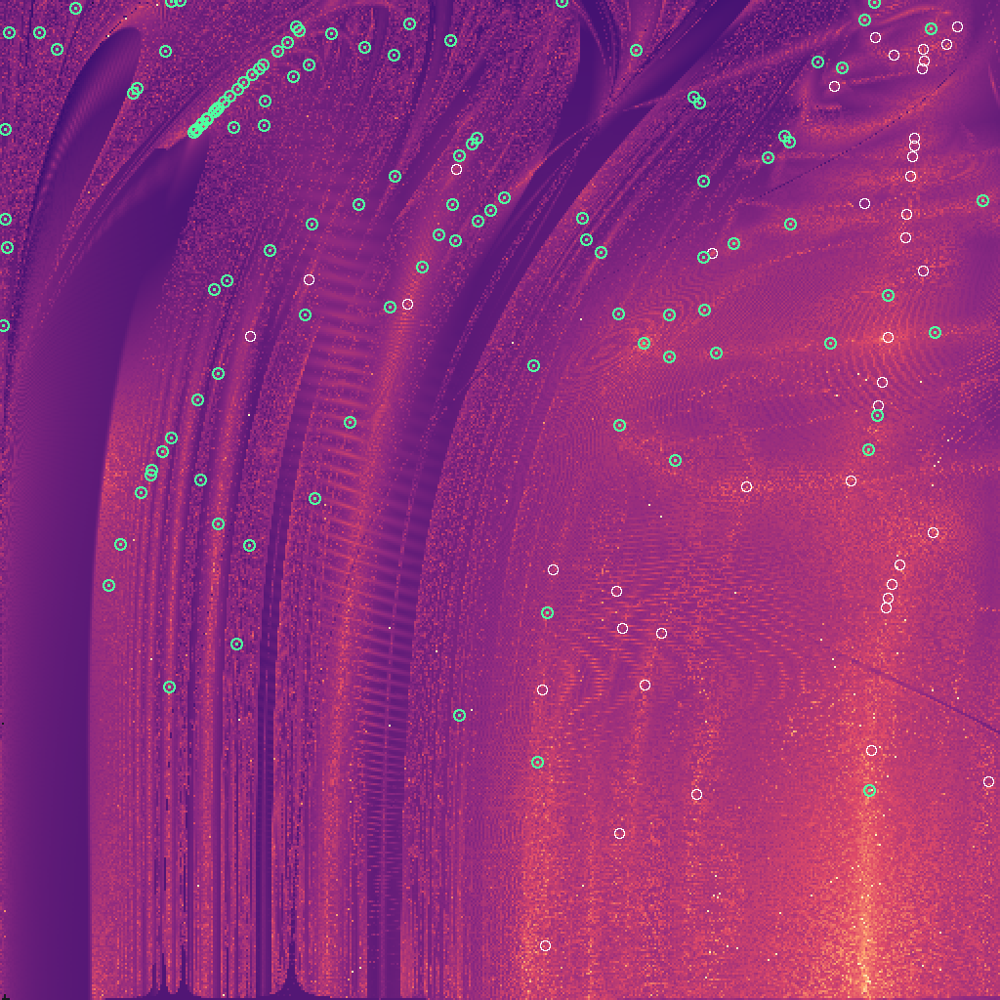

# Suchlauf euler-m3-2

2026-10-02 17:41 UTC · Euler-Ebene · Massen 1 / 1 / 2 · Fenster v₁ 0…0.75, v₂ 0…0.75 · Raster 512×512 · Perioden bis 40 · Suche über Umkehrpunkte (halbe Periode)

## Was der Lauf getan hat

| Stufe | Zahl |
|---|---|
| Rasterpunkte gerechnet | 262144 in 172 s auf 5 Fäden |
| davon durchgelaufen / Zerfall / abgebrochen / ungebunden | 163085 / 94531 / 4528 / 0 |
| Talsohlen (unter 0.3) in 4 Zielen × 6 Zeitbändern | 256859 |
| davon durch die Prüfkette | 40000 in 1323 s |
| Umkehrpunkt verfehlt | 35064 |
| Umkehrpunkt getroffen, aber nach 12τ nicht zurück (nur bis auf eine Drehung periodisch) | 695 |
| geschlossene Bahn | 4241 |
| verschiedene Orte in der Ebene | **201** |
| verschiedene Bahnen (gleiches T* auf acht Stellen einmal gezählt) | **195** |
| — bestätigt (voller Umlauf: Rest < 1e-10 und Gegenprobe < 1e-8) | 48 |
| — über den Umkehrpunkt (halber Umlauf auf 1e-11 getroffen, voller für double zu empfindlich) | 109 |
| — an der Rechengrenze | 44 |
| sicher linear stabil | 4 |
| Ausnahmen im Schwarm | 0 |

Je Ziel (Fixmenge, die nach der halben Periode getroffen wird):

| Ziel | Kandidaten | Umkehrpunkt getroffen | geschlossene Bahn |
|---|---|---|---|
| A3 | 5581 | 716 | 714 |
| B3 | 20059 | 3177 | 3126 |
| C | 11071 | 516 | 271 |
| R | 3289 | 527 | 130 |

## Bekannt oder nicht

Von den 201 Funden stehen **42** in einer der geprüften Listen, **159** in keiner. Als verschiedene Bahnen gezählt (eine Bahn kann die Ebene an mehreren Stellen kreuzen): 195, davon **156** in keiner Liste.

| Liste | Stufe | Bahnen | Bedeutung |
|---|---|---|---|
| Li/Liao 2017–2019, Šuvakov/Dmitrašinović 2013 (2364 Bahnen, mit Klassen) | Ort | 36 | steht mit diesen Anfangswerten in der Liste |
| | Lage | 6 | gleiches T* auf acht Stellen: Listenbahn, an anderer Stelle getroffen |
| | Klasse | 32 | Klasse in der Liste, aber anderes T*: weitere Bahn derselben Familie |
| | keine | 127 | Klasse nicht in der Liste |
| Hristov u. a. | — | — | nur für gleiche Massen; hier nicht anwendbar |

**Für die Massen 1 / 1 / 2 gibt es als Vergleich nur Li und Liao: 237 Bahnen, je Klasse eine, davon 30 mit T bis 40.** Die großen Listen von Hristov u. a. gelten nur für gleiche Massen. „In keiner Liste“ sagt in diesem Lauf deshalb wenig: fast alles, was eine Suche bei diesen Massen findet, steht in keiner Liste, weil es kaum eine gibt.

„In keiner Liste“ heißt genau das und nicht „neu“. Die Listen sind in sich begrenzt: Li und Liao führen je Klasse eine Bahn bis T = 200, gefunden auf einem Raster von 4000²; Hristov u. a. führen die Euler-Ebene bis T* = 211 und den freien Fall bis T* = 80 (mit Punktsymmetrie bis 120).

**Satelliten:** 5 der 159 Funde außerhalb der Listen laufen mehrmals fast den Weg einer anderen Bahn dieses Laufs oder der Liste, bevor sie sich schließen (Wort das k-fache, T* das k-fache); bei 5 davon ist die Grundbahn gelistet. Das sind eigene Bahnen, aber keine unerklärten — um eine stabile Bahn herum gibt es solche Begleiter regelmäßig. Sie sind in der Tabelle unten in der Spalte „Listen“ benannt.

## Gegenrichtung: was der Lauf von den Listen wiederfindet

| Liste | Bahnen im Fenster mit T bis 40 | gefunden | Anteil |
|---|---|---|---|
| Li/Liao, 2013 | 15 | 15 | 100 % |

Karte: hell = die Bahn kommt bis zur halben Höchstperiode einer Fixmenge nahe. Weißer Ring = Fund, der in einer Liste steht (nur bei bis zu 3000 Funden gezeichnet). Grüner Punkt = Fund, der in keiner Liste steht. Rotes Kreuz = Bahn aus Li/Liao, die der Lauf verpasst hat.

## Funde in keiner Liste (159)

| v₁ | v₂ | T | T* | Rest (voller Umlauf) | Umkehrpunkt | Urteil | Stabilität | \|λ\| | engste Begegnung | Wortlänge | Listen |
|---|---|---|---|---|---|---|---|---|---|---|---|
| 0.003642764746 | 0.585223943676 | 7.83929568 | 58.4142 | 2.7e-8 | A3 2.4e-12 | über den Umkehrpunkt | instabil | 2.334e+7 | 0.001026 | 14 | — |
| 0.296004327653 | 0.617780791247 | 8.24427260 | 55.4107 | 9.3e-11 | A3 3.1e-13 | bestätigt | instabil | 9.07e+4 | 0.002446 | 12 | nur Klasse von II.C-4 |
| 0.002183827681 | 0.505582668087 | 8.50594030 | 67.7610 | 2.1e-8 | A3 1.9e-12 | über den Umkehrpunkt | instabil | 7.785e+8 | 0.001733 | 16 | — |
| 0.477093081062 | 0.711560715151 | 8.56472191 | 45.2204 | 3.0e-11 | B3 2.2e-13 | bestätigt | instabil | 6.08e+3 | 5.1e-4 | 10 | nur Klasse von II.C-2 |
| 0.233919628865 | 0.581535895890 | 9.06362846 | 64.8783 | 1.8e-9 | A3 3.6e-12 | über den Umkehrpunkt | instabil | 3.999e+5 | 0.003971 | 14 | — |
| 0.003412501675 | 0.652758891379 | 9.18232693 | 63.9731 | 5.0e-8 | A3 1.2e-12 | über den Umkehrpunkt | instabil | 2.506e+9 | 5.3e-4 | 16 | nur Klasse von II.B-1 |
| 0.482507734463 | 0.491850149508 | 9.70680829 | 64.9408 | 6.9e-12 | B3 6.7e-15 | bestätigt | instabil | 26.8 | 0.001059 | 12 | nur Klasse von I.A-2 |
| 0.162998284517 | 0.357032919134 | 9.73705565 | 83.5693 | 1.0e-7 | R 3.2e-13 | über den Umkehrpunkt | instabil | 2.034e+5 | 8.7e-5 | 0 | nur Klasse von II.D-2 |
| 0.202503013605 | 0.561581461776 | 10.03462943 | 73.9580 | 1.8e-9 | A3 9.8e-13 | über den Umkehrpunkt | instabil | 1.120e+6 | 0.005017 | 16 | — |
| 0.163361225271 | 0.469808650957 | 10.08680968 | 80.8515 | 1.1e-10 | A3 5.5e-12 | über den Umkehrpunkt | instabil | 3.81e+4 | 0.002347 | 16 | — |
| 0.147699818882 | 0.449748719785 | 10.98074451 | 89.5586 | 6.9e-10 | A3 8.7e-12 | über den Umkehrpunkt | instabil | 7.94e+4 | 0.002010 | 18 | — |
| 0.006527887984 | 0.724739067879 | 10.98658984 | 70.3854 | 4.2e-9 | B3 3.2e-12 | über den Umkehrpunkt | instabil | 2.676e+6 | 0.001336 | 16 | — |
| 0.126887936366 | 0.234533996430 | 11.12579828 | 101.2116 | 7.7e-7 | R 5.1e-13 | über den Umkehrpunkt | offen | 1.575e+6 | 1.5e-5 | 0 | nur Klasse von II.D-2 |
| 0.170081608537 | 0.539420670976 | 12.05725606 | 91.4455 | 9.7e-9 | A3 4.9e-11 | an der Rechengrenze | instabil | 4.711e+6 | 0.006293 | 20 | — |
| 0.337395858635 | 0.719084742091 | 12.07909381 | 70.3854 | 5.9e-9 | A3 2.0e-12 | über den Umkehrpunkt | instabil | 2.676e+6 | 0.001423 | 16 | — |
| 0.005071410448 | 0.563630895183 | 12.09189942 | 91.8649 | 6.2e-6 | C 1.0e-12 | über den Umkehrpunkt | instabil | 6.554e+9 | 0.003964 | 22 | — |
| 0.128381711973 | 0.421452436883 | 12.78138991 | 106.5675 | 3.8e-10 | A3 8.4e-12 | über den Umkehrpunkt | instabil | 2.435e+5 | 0.001636 | 22 | — |
| 0.160463073386 | 0.532469790467 | 13.07293380 | 99.9689 | 2.1e-9 | A3 5.9e-11 | an der Rechengrenze | instabil | 8.112e+6 | 0.006700 | 22 | — |
| 0.121929673337 | 0.410804932662 | 13.67904920 | 114.9248 | 3.9e-9 | A3 4.7e-11 | an der Rechengrenze | instabil | 3.812e+5 | 0.001521 | 24 | — |
| 0.231274947406 | 0.701001915330 | 14.47396355 | 91.1508 | 1.7e-11 | A3 5.7e-13 | bestätigt | instabil | 4.54e+4 | 0.07492 | 20 | — |
| 0.251747541470 | 0.751097697569 | 14.73711138 | 86.1439 | 4.4e-11 | C 1.6e-14 | bestätigt | instabil | 5.95e+3 | 0.06748 | 18 | — |
| 0.135088280779 | 0.748957008178 | 14.75633570 | 90.1397 | 3.4e-7 | R 1.0e-12 | über den Umkehrpunkt | offen | 6.129e+7 | 6.9e-5 | 0 | nur Klasse von II.D-2 |
| 0.357489884665 | 0.646329523745 | 14.98779328 | 94.3328 | 2.1e-9 | A3 1.4e-11 | an der Rechengrenze | instabil | 1.311e+5 | 7.7e-5 | 10 | nur Klasse von II.C-1 |
| 0.344351007679 | 0.632697783559 | 15.00747173 | 96.6811 | 1.0e-7 | A3 5.1e-10 | an der Rechengrenze | instabil | 1.948e+7 | 2.7e-4 | 16 | — |
| 0.112450863121 | 0.393657268268 | 15.46311327 | 131.4270 | 2.0e-9 | A3 6.1e-12 | über den Umkehrpunkt | instabil | 8.079e+5 | 0.001358 | 28 | — |
| 0.219995535188 | 0.691879631144 | 15.58499098 | 99.6881 | 6.0e-11 | A3 2.7e-13 | bestätigt | instabil | 7.96e+4 | 0.07414 | 22 | — |
| 0.255814891544 | 1.101957106286 | 15.70590637 | 42.4554 | 3.2e-13 | C 5.2e-15 | bestätigt | instabil | 219 | 0.1330 | 10 | — |
| 0.042642021957 | 0.712635120921 | 16.05644182 | 104.2660 | 2.2e-6 | C 9.8e-13 | über den Umkehrpunkt | instabil | 4.913e+8 | 0.009758 | 22 | — |
| 0.029605002058 | 0.724957705947 | 16.30117346 | 104.3286 | 1.1e-7 | C 4.7e-14 | über den Umkehrpunkt | instabil | 1.511e+9 | 0.02326 | 22 | — |
| 0.228838030079 | 0.513125528781 | 16.82422664 | 128.0200 | 7.2e-9 | A3 3.3e-11 | an der Rechengrenze | instabil | 3.108e+5 | 5.3e-4 | 24 | Satellit 2. Ordnung von I.A-2 (T* das 1.97187-fache, Wort bis auf 4 Buchstaben) |
| 0.224400622321 | 0.726272781407 | 16.94578568 | 103.6402 | 1.7e-10 | C 4.9e-14 | über den Umkehrpunkt | instabil | 1.36e+4 | 0.06785 | 22 | — |
| 0.328809260145 | 0.573737474327 | 17.12550666 | 118.2172 | 1.2e-10 | A3 2.6e-12 | über den Umkehrpunkt | instabil | 1.15e+4 | 1.2e-4 | 22 | — |
| 0.105768975511 | 0.380175765273 | 17.23129019 | 147.7116 | 9.9e-9 | A3 4.7e-11 | an der Rechengrenze | instabil | 1.494e+6 | 0.001248 | 32 | — |
| 0.291964831841 | 0.519098406049 | 17.42575304 | 128.6030 | 1.9e-8 | A3 2.0e-11 | an der Rechengrenze | instabil | 3.712e+5 | 5.4e-4 | 12 | — |
| 0.128507423595 | 0.748436284637 | 17.55354905 | 107.4687 | 1.7e-6 | R 3.8e-11 | an der Rechengrenze | offen | 7.378e+7 | 1.5e-5 | 0 | nur Klasse von II.D-2 |
| 0.261880979502 | 0.432539665237 | 17.57664364 | 140.0154 | 2.4e-8 | C 4.6e-11 | an der Rechengrenze | instabil | 2.184e+6 | 5.9e-4 | 2 | — |
| 0.102495197940 | 0.683243210413 | 17.66249091 | 117.9071 | 9.9e-9 | A3 1.3e-11 | an der Rechengrenze | instabil | 3.909e+7 | 0.001048 | 26 | — |
| 0.420948509432 | 0.748294713428 | 17.98534388 | 94.6587 | 2.2e-9 | C 3.4e-12 | über den Umkehrpunkt | instabil | 2.338e+5 | 0.05600 | 18 | — |
| 0.235478372002 | 0.375920156789 | 18.03897128 | 150.1117 | 1.5e-7 | C 5.7e-13 | über den Umkehrpunkt | offen | 4.047e+7 | 3.8e-4 | 4 | — |
| 0.215252580245 | 0.717915905698 | 18.07870612 | 112.1689 | 1.7e-10 | C 3.2e-14 | über den Umkehrpunkt | instabil | 1.87e+4 | 0.06762 | 24 | — |
| 0.186891002420 | 0.340490201628 | 18.52049186 | 159.3159 | 5.8e-6 | C 3.1e-10 | an der Rechengrenze | offen | 5.379e+8 | 2.7e-4 | 22 | nur Klasse von I.B-5 |
| 0.150033043021 | 0.389665957214 | 18.61219994 | 157.4251 | 8.4e-8 | A3 4.5e-11 | an der Rechengrenze | offen | 1.078e+8 | 1.0e-4 | 26 | — |
| 0.268457803004 | 0.596390323701 | 18.64328818 | 129.7117 | 1.8e-6 | A3 1.5e-11 | an der Rechengrenze | instabil | 2.310e+9 | 0.004503 | 26 | — |
| 0.341324537067 | -0.568868585478 | 18.71394121 | 128.8805 | 8.2e-7 | C 9.6e-13 | über den Umkehrpunkt | instabil | 2.661e+7 | 4.5e-4 | 0 | nur Klasse von II.D-2 |
| 0.198212984314 | 0.673976005733 | 18.94374306 | 124.7301 | 1.4e-10 | A3 2.8e-12 | über den Umkehrpunkt | instabil | 2.925e+5 | 0.07202 | 28 | — |
| 0.344005306673 | 0.212820333892 | 18.97294715 | 161.7209 | 1.4e-7 | A3 1.6e-10 | an der Rechengrenze | offen | 5.594e+6 | 4.2e-5 | 30 | — |
| 0.177166087103 | 0.266710103473 | 19.00823166 | 169.1920 | 4.0e-6 | C 8.2e-13 | über den Umkehrpunkt | offen | 1.172e+9 | 3.1e-4 | 24 | — |
| 0.207909338093 | -0.711165854561 | 19.21827023 | 120.5930 | 2.5e-10 | C 7.1e-14 | über den Umkehrpunkt | instabil | 2.46e+4 | 0.06731 | 26 | — |
| 0.399971790552 | 0.475689611966 | 19.42832458 | 139.8167 | 5.1e-7 | A3 8.4e-11 | an der Rechengrenze | offen | 5.818e+6 | 1.5e-4 | 14 | — |
| 0.123921181427 | 0.711441247888 | 19.65341836 | 126.3238 | 1.3e-6 | A3 9.2e-10 | an der Rechengrenze | offen | 1.798e+9 | 4.3e-5 | 22 | — |
| 0.099924265486 | 0.679586052882 | 20.03373150 | 134.3599 | 1.3e-8 | A3 6.8e-11 | an der Rechengrenze | instabil | 7.757e+7 | 0.001257 | 30 | — |
| 0.450220920039 | 0.560197337358 | 20.05153598 | 129.4407 | 2.2e-9 | C 2.1e-12 | über den Umkehrpunkt | offen | 6.784e+5 | 1.5e-4 | 24 | — |
| 0.358170098614 | 0.583419217719 | 20.61062899 | 138.5974 | 1.3e-7 | C 6.0e-11 | an der Rechengrenze | offen | 1.144e+8 | 4.7e-4 | 2 | — |
| 0.527567042408 | 0.613901916844 | 20.71742113 | 118.0155 | 9.2e-9 | A3 4.9e-11 | an der Rechengrenze | instabil | 3.92e+4 | 5.6e-4 | 22 | — |
| 0.559721755839 | 0.384840340222 | 20.82609294 | 140.9049 | 1.9e-11 | B3 3.4e-13 | bestätigt | instabil | 1.53 | 3.7e-4 | 26 | nur Klasse von I.B-6 |
| 0.211376035407 | 1.077074736782 | 20.85970511 | 63.0480 | 1.5e-9 | B3 9.8e-12 | über den Umkehrpunkt | instabil | 2.17e+4 | 9.0e-4 | 16 | — |
| 0.196817844838 | 0.700875169765 | 21.50315780 | 137.1999 | 1.9e-10 | C 1.7e-13 | über den Umkehrpunkt | instabil | 3.89e+4 | 0.06664 | 30 | — |
| 0.592698246826 | 0.581705771461 | 21.52705138 | 118.6733 | 2.4e-12 | A3 6.9e-13 | bestätigt | instabil | 2.21 | 5.1e-4 | 22 | nur Klasse von I.B-5 |
| 0.439396756348 | 0.569520279088 | 21.55697933 | 139.0502 | 1.8e-6 | C 7.9e-10 | an der Rechengrenze | offen | 8.345e+6 | 2.2e-5 | 26 | — |
| 0.367557520843 | 0.591897355500 | 22.29357765 | 147.8016 | 2.9e-6 | C 4.6e-12 | über den Umkehrpunkt | offen | 3.204e+8 | 4.1e-4 | 4 | — |
| 0.056288927097 | 0.743183614906 | 22.36209208 | 139.5158 | 4.9e-6 | C 2.7e-13 | über den Umkehrpunkt | instabil | 3.453e+9 | 0.006942 | 34 | — |
| 0.283543555825 | 1.109070340421 | 22.51689441 | 58.0022 | 2.0e-11 | B3 1.3e-13 | bestätigt | instabil | 1.20e+4 | 0.02262 | 14 | — |
| 0.647968812771 | 0.734944422724 | 23.14436275 | 95.9116 | 5.4e-12 | C 1.6e-13 | bestätigt | instabil | 35.2 | 0.008342 | 18 | nur Klasse von I.B-4 |
| 0.113627257223 | 0.396930301471 | 23.22003098 | 196.9505 | 4.5e-7 | A3 3.0e-11 | an der Rechengrenze | instabil | 2.782e+8 | 0.001107 | 40 | — |
| 0.353865435299 | 0.641248683377 | 23.22652534 | 147.3620 | 9.6e-7 | R 4.8e-13 | über den Umkehrpunkt | instabil | 6.898e+7 | 6.2e-4 | 0 | nur Klasse von II.D-2 |
| 0.188798809848 | -0.693345796722 | 23.78534278 | 153.5634 | 1.9e-9 | C 2.0e-14 | über den Umkehrpunkt | instabil | 5.63e+4 | 0.06601 | 34 | — |
| 0.524541569387 | 0.672577838610 | 23.97428825 | 127.3869 | 9.6e-8 | A3 5.0e-11 | an der Rechengrenze | instabil | 2.808e+6 | 0.006344 | 24 | — |
| 0.089999446906 | 0.341038114898 | 25.02585971 | 219.3584 | 1.2e-8 | A3 9.4e-12 | über den Umkehrpunkt | instabil | 9.824e+6 | 9.9e-4 | 50 | — |
| 0.377921017130 | 0.601353134758 | 25.35987497 | 165.4210 | 2.6e-6 | C 3.1e-12 | über den Umkehrpunkt | offen | 1.345e+9 | 3.0e-4 | 8 | — |
| 0.194089431865 | 0.697999842644 | 25.47853242 | 163.2866 | 1.1e-9 | B3 2.5e-12 | über den Umkehrpunkt | instabil | 9.920e+6 | 0.01448 | 36 | — |
| 0.339304087235 | 0.595865440634 | 25.51433631 | 171.3532 | 8.0e-8 | B3 4.4e-13 | über den Umkehrpunkt | instabil | 9.024e+6 | 0.001650 | 32 | — |
| 0.520318953221 | 0.676695696622 | 25.73616973 | 136.5945 | 2.5e-8 | B3 1.5e-11 | an der Rechengrenze | instabil | 1.004e+7 | 0.007362 | 26 | — |
| 0.316167698965 | 0.549120728015 | 25.77398387 | 183.2134 | 5.6e-9 | B3 7.7e-11 | an der Rechengrenze | instabil | 3.56e+4 | 2.2e-4 | 22 | — |
| 0.526556036345 | 0.780022899497 | 25.79424950 | 116.2610 | 1.5e-7 | C 2.6e-13 | über den Umkehrpunkt | instabil | 5.492e+7 | 0.02355 | 24 | — |
| 0.182699873029 | 0.687559140197 | 26.06001936 | 169.7445 | 1.1e-9 | C 1.0e-14 | über den Umkehrpunkt | instabil | 2.221e+5 | 0.06545 | 38 | — |
| 0.436168424138 | 0.586001643156 | 26.06490042 | 165.7728 | 4.6e-6 | C 5.2e-12 | über den Umkehrpunkt | offen | 2.315e+8 | 3.8e-5 | 32 | — |
| 0.306619913255 | 0.731935297094 | 26.16148295 | 152.6098 | 8.0e-6 | R 1.4e-13 | über den Umkehrpunkt | instabil | 2.308e+10 | 0.01029 | 0 | nur Klasse von II.D-2 |
| 0.425976547877 | 0.948883429358 | 26.29846348 | 93.9142 | 8.2e-11 | A3 8.9e-13 | bestätigt | instabil | 1.85e+4 | 0.01409 | 22 | — |
| 0.393889065600 | 0.794006655563 | 26.64416407 | 133.5484 | 1.2e-8 | C 7.1e-14 | über den Umkehrpunkt | instabil | 4.783e+6 | 0.06778 | 30 | — |
| 0.174698293055 | 0.654035509249 | 26.72544330 | 181.2902 | 3.0e-9 | A3 1.1e-11 | an der Rechengrenze | instabil | 2.006e+6 | 0.06810 | 42 | — |
| 0.760598454798 | 0.396674824011 | 26.73998610 | 140.9142 | 2.7e-12 | C 5.9e-11 | bestätigt | instabil | 1.94 | 0.002278 | 26 | nur Klasse von I.B-6 |
| 0.736586605281 | 0.599084169508 | 26.79249241 | 118.6733 | 1.0e-11 | B3 1.8e-13 | bestätigt | instabil | 2.21 | 5.9e-4 | 22 | nur Klasse von I.B-5 |
| 0.177885193701 | 0.682949538344 | 28.32585685 | 185.7829 | 3.0e-9 | C 6.0e-14 | über den Umkehrpunkt | instabil | 7.087e+5 | 0.06496 | 42 | — |
| 0.295134352322 | 0.708475866521 | 28.47554999 | 172.4070 | 1.4e-8 | C 2.2e-13 | über den Umkehrpunkt | instabil | 7.237e+8 | 0.002396 | 38 | — |
| 0.463453928158 | 0.514428376667 | 29.17535650 | 194.4161 | 2.5e-6 | R 3.6e-12 | über den Umkehrpunkt | offen | 1.628e+7 | 2.8e-4 | 0 | nur Klasse von II.D-2 |
| 0.452276588141 | 0.835718749773 | 29.64528870 | 131.0876 | 2.7e-6 | C 6.8e-12 | über den Umkehrpunkt | instabil | 7.695e+7 | 0.006155 | 30 | — |
| 0.342133370774 | 0.802457457333 | 29.64964728 | 152.3735 | 6.3e-9 | C 8.2e-14 | über den Umkehrpunkt | instabil | 6.584e+6 | 0.06547 | 34 | — |
| 0.358943764112 | -1.156091227644 | 31.17384068 | 61.2799 | 2.9e-12 | C 9.8e-15 | bestätigt | instabil | 1.31e+3 | 0.1396 | 14 | — |
| 0.207630039230 | 0.928037997395 | 31.21073440 | 137.7971 | 9.9e-7 | C 3.1e-10 | an der Rechengrenze | offen | 8.46e+4 | 5.4e-6 | 34 | — |
| 0.273118328933 | 0.714185554460 | 31.23736020 | 189.8785 | 3.4e-6 | C 1.8e-12 | über den Umkehrpunkt | offen | 6.467e+9 | 0.002457 | 54 | — |
| 0.172279077952 | 0.677531335986 | 31.70807303 | 209.6304 | 6.8e-9 | C 7.0e-12 | über den Umkehrpunkt | instabil | 2.124e+6 | 0.06433 | 48 | — |
| 0.429619425902 | 0.918616649666 | 31.74335389 | 121.2204 | 8.4e-8 | C 9.5e-14 | über den Umkehrpunkt | instabil | 1.263e+7 | 0.02551 | 26 | — |
| 0.493961990914 | 0.843576685219 | 31.80756720 | 132.4854 | 7.5e-10 | C 1.1e-13 | über den Umkehrpunkt | instabil | 1.444e+5 | 0.03277 | 30 | — |
| 0.622428803436 | 0.492487134523 | 33.39552350 | 194.7697 | 5.5e-12 | B3 1.8e-13 | bestätigt | instabil | 1.03 | 0.005696 | 36 | Satellit 3. Ordnung von I.A-2 (T* das 3.00000-fache) |
| 0.221841704883 | 0.729656298967 | 33.96548327 | 207.0277 | 4.7e-8 | C 2.4e-13 | über den Umkehrpunkt | instabil | 5.186e+7 | 0.06085 | 44 | — |
| 0.248252295656 | 0.724188429120 | 34.19517351 | 207.5913 | 8.3e-6 | C 3.1e-13 | über den Umkehrpunkt | instabil | 7.811e+9 | 0.06065 | 46 | — |
| 0.419036890660 | 0.855720902815 | 34.28749478 | 150.7934 | 2.3e-9 | C 3.9e-14 | über den Umkehrpunkt | instabil | 5.473e+6 | 0.02204 | 34 | — |
| 0.197522650264 | 0.655819893837 | 34.68528895 | 233.1547 | 5.9e-6 | C 4.4e-12 | über den Umkehrpunkt | instabil | 5.404e+9 | 0.02180 | 52 | — |
| 0.149983273827 | -1.156942071618 | 35.01991371 | 83.0243 | 1.9e-6 | B3 8.9e-10 | an der Rechengrenze | offen | 1.152e+6 | 2.9e-4 | 18 | — |
| 0.167978396408 | 0.673334465363 | 35.07191423 | 233.2796 | 6.9e-9 | C 2.5e-13 | über den Umkehrpunkt | instabil | 4.753e+6 | 0.06381 | 54 | — |
| 0.081182458828 | 0.310877977551 | 35.14459486 | 312.6656 | 1.5e-7 | A3 1.7e-10 | an der Rechengrenze | instabil | 4.447e+7 | 8.4e-4 | 74 | — |
| 0.586093345636 | 0.868704780392 | 36.49241870 | 127.5967 | 1.6e-9 | C 1.2e-13 | über den Umkehrpunkt | instabil | 2.120e+5 | 0.04066 | 26 | — |
| 0.274850122689 | -1.103186554134 | 36.76253157 | 97.4127 | 6.1e-10 | B3 2.5e-12 | über den Umkehrpunkt | instabil | 2.36e+4 | 0.1015 | 22 | — |
| 0.739084167780 | 0.832851080149 | 37.08460481 | 106.4864 | 6.6e-9 | C 2.8e-13 | über den Umkehrpunkt | instabil | 3.168e+5 | 0.003906 | 20 | — |
| 0.700662067534 | 0.499994071967 | 37.14570403 | 194.7697 | 4.4e-12 | B3 1.9e-13 | bestätigt | instabil | 1.03 | 0.006115 | 36 | Satellit 3. Ordnung von I.A-2 (T* das 3.00000-fache) |
| 0.464336721823 | 0.430972914544 | 38.09350177 | 270.8191 | 1.4e-9 | A3 4.6e-11 | an der Rechengrenze | offen | 196 | 2.8e-5 | 50 | — |
| 0.514420434987 | 0.992554402974 | 38.18391009 | 108.0340 | 1.2e-8 | C 4.6e-13 | über den Umkehrpunkt | instabil | 2.79e+4 | 0.002886 | 26 | — |
| 0.698108844429 | 0.728131929358 | 38.65831233 | 149.6068 | 1.0e-11 | B3 5.8e-14 | bestätigt | offen | 1.09 | 0.001971 | 28 | nur Klasse von II.A-1 |
| 0.501848500970 | 0.481778375312 | 39.12337975 | 259.7056 | 1.7e-11 | A3 1.8e-12 | bestätigt | instabil | 2.69 | 0.001468 | 48 | Satellit 4. Ordnung von I.A-2 (T* das 4.00020-fache) |
| 0.163568270466 | 0.668991454128 | 39.53197945 | 264.5736 | 3.8e-8 | C 7.2e-14 | über den Umkehrpunkt | instabil | 1.099e+7 | 0.06324 | 62 | — |
| 0.161766108910 | 0.667204596551 | 41.75256116 | 280.1374 | 1.4e-8 | C 6.9e-13 | über den Umkehrpunkt | instabil | 1.565e+7 | 0.06300 | 66 | — |
| 0.575574487489 | 0.631252106438 | 42.65132608 | 226.1224 | 2.2e-9 | C 1.0e-11 | an der Rechengrenze | offen | 3.24e+4 | 4.2e-4 | 42 | — |
| 0.160168052082 | 0.665613982813 | 43.96751672 | 295.6542 | 7.5e-9 | C 8.5e-15 | über den Umkehrpunkt | instabil | 2.156e+7 | 0.06278 | 70 | — |
| 0.283736053960 | 1.108854953199 | 45.00574492 | 116.0004 | 4.0e-7 | C 1.2e-13 | über den Umkehrpunkt | instabil | 1.206e+8 | 0.02408 | 28 | — |
| 0.410191972854 | 0.290210304490 | 46.19371445 | 368.8627 | 7.0e-9 | B3 3.6e-12 | über den Umkehrpunkt | instabil | 2.702e+5 | 7.0e-4 | 68 | — |
| 0.650736798880 | 0.767157441440 | 46.25685535 | 180.2220 | 7.8e-9 | C 6.8e-12 | über den Umkehrpunkt | instabil | 5.29e+3 | 3.3e-4 | 34 | nur Klasse von II.B-3 |
| 0.783830948567 | -0.887344406227 | 47.81939203 | 105.6620 | 5.0e-8 | C 9.9e-13 | über den Umkehrpunkt | instabil | 2.729e+6 | 0.001268 | 20 | — |
| 0.415478580025 | 1.174765629588 | 47.86560204 | 78.8317 | 5.4e-12 | C 2.3e-14 | bestätigt | instabil | 4.59e+3 | 0.1448 | 18 | — |
| 0.506258263307 | 0.404352050174 | 49.51639187 | 346.7708 | 3.7e-9 | B3 9.0e-12 | über den Umkehrpunkt | offen | 24.5 | 7.4e-6 | 64 | nur Klasse von I.A-10 |
| 0.642521470361 | -0.785047083789 | 50.01091178 | 190.8150 | 2.0e-6 | C 2.9e-13 | über den Umkehrpunkt | instabil | 9.420e+7 | 0.003484 | 36 | — |
| 0.692229037289 | 0.712287369681 | 50.61177438 | 203.3020 | 9.3e-11 | C 2.3e-13 | bestätigt | instabil | 1.73 | 0.001157 | 38 | nur Klasse von I.B-7 |
| 0.491540950534 | 0.802278680645 | 52.17219956 | 235.2650 | 9.4e-7 | C 6.5e-12 | über den Umkehrpunkt | offen | 4.319e+7 | 9.3e-4 | 54 | — |
| 0.709720376190 | 0.716252546971 | 52.48145466 | 203.3026 | 2.1e-10 | C 3.2e-12 | über den Umkehrpunkt | instabil | 2.59 | 5.0e-4 | 38 | nur Klasse von I.B-7 |
| 0.155229577300 | 0.660660504523 | 52.77925970 | 357.3394 | 1.6e-7 | C 4.8e-13 | über den Umkehrpunkt | instabil | 6.166e+7 | 0.06206 | 86 | — |
| 0.102815310281 | 0.931205702862 | 52.96509956 | 240.8248 | 7.4e-8 | C 7.7e-14 | über den Umkehrpunkt | instabil | 3.239e+7 | 0.02696 | 58 | — |
| 0.756760838194 | 0.901442969110 | 54.75983353 | 124.5419 | 6.4e-7 | C 1.9e-12 | über den Umkehrpunkt | offen | 4.849e+7 | 2.5e-4 | 8 | — |
| 0.154259410649 | 0.659680378745 | 54.97186337 | 372.6818 | 1.3e-7 | C 2.8e-14 | über den Umkehrpunkt | instabil | 7.684e+7 | 0.06191 | 90 | — |
| 0.613073382446 | 0.703054627871 | 55.94825936 | 256.4967 | 1.3e-6 | R 3.7e-12 | über den Umkehrpunkt | offen | 4.043e+7 | 1.8e-4 | 0 | nur Klasse von II.D-2 |
| 0.631076636751 | 0.698789701977 | 57.07611077 | 257.0107 | 2.1e-9 | B3 7.4e-13 | über den Umkehrpunkt | instabil | 6.82e+3 | 0.003666 | 48 | nur Klasse von I.A-6 |
| 0.651967031005 | 0.156899432316 | 57.16005786 | 390.5375 | 9.5e-10 | B3 1.4e-13 | über den Umkehrpunkt | offen | 2.06 | 3.0e-5 | 72 | nur Klasse von I.A-13 |
| 0.651181731549 | 0.412366894833 | 57.53310808 | 346.7530 | 6.3e-11 | B3 1.6e-13 | bestätigt | offen | 1.06 | 1.9e-4 | 64 | nur Klasse von I.A-10 |
| 0.655712038439 | 0.747863741083 | 58.43979606 | 233.9876 | 7.6e-11 | B3 5.0e-13 | bestätigt | instabil | 295 | 0.001726 | 44 | — |
| 0.759581264299 | 0.653080660598 | 60.15280706 | 236.7831 | 1.8e-7 | C 3.3e-12 | über den Umkehrpunkt | offen | 3.975e+5 | 9.1e-4 | 44 | — |
| 0.528236689919 | 0.516997896982 | 60.16548985 | 378.4201 | 5.9e-10 | C 1.4e-10 | an der Rechengrenze | offen | 2.45 | 8.1e-5 | 70 | nur Klasse von I.B-15 |
| 0.151782627482 | 0.657167277970 | 61.52912141 | 418.5585 | 1.1e-7 | C 5.8e-13 | über den Umkehrpunkt | instabil | 1.383e+8 | 0.06152 | 102 | — |
| 0.435634745820 | -0.831619997111 | 62.44391612 | 282.7903 | 2.8e-8 | C 4.5e-14 | über den Umkehrpunkt | instabil | 7.492e+6 | 0.02212 | 66 | — |
| 0.151074357459 | 0.656445683738 | 63.70872127 | 433.8065 | 2.7e-7 | C 3.6e-13 | über den Umkehrpunkt | instabil | 1.650e+8 | 0.06141 | 106 | — |
| 0.591700395793 | 0.642894693985 | 65.04916825 | 333.4785 | 3.9e-9 | C 2.6e-11 | an der Rechengrenze | instabil | 3.90e+3 | 5.8e-4 | 62 | — |
| 0.403018587251 | 0.178270501369 | 65.07885561 | 542.5688 | 3.6e-9 | B3 4.6e-12 | über den Umkehrpunkt | offen | 6.79e+3 | 5.2e-6 | 100 | nur Klasse von I.A-19 |
| 0.451192693394 | 1.183534527088 | 65.28212644 | 95.7980 | 2.0e-11 | C 1.5e-14 | bestätigt | instabil | 1.16e+4 | 0.1490 | 22 | — |
| 0.536783574010 | 0.484978557526 | 70.81939308 | 454.4720 | 3.4e-11 | B3 2.8e-13 | bestätigt | stabil | 1.00 | 0.002656 | 84 | Satellit 7. Ordnung von I.A-2 (T* das 7.00015-fache) |
| 0.665584482804 | 0.528055110718 | 70.82092272 | 378.4057 | 4.8e-10 | C 6.2e-11 | an der Rechengrenze | offen | 1.00 | 2.3e-4 | 70 | nur Klasse von I.B-15 |
| 0.527640117608 | 0.556851712908 | 71.35317168 | 432.2286 | 3.1e-9 | B3 1.3e-10 | an der Rechengrenze | instabil | 2.64e+3 | 2.4e-4 | 80 | — |
| 0.739349703572 | -0.859681032803 | 71.93227535 | 192.6612 | 7.9e-6 | C 6.4e-13 | über den Umkehrpunkt | offen | 9.942e+8 | 0.002917 | 40 | — |
| 0.588403965981 | 0.647772052814 | 75.71233905 | 387.2024 | 3.8e-6 | B3 7.6e-12 | über den Umkehrpunkt | offen | 1.893e+7 | 7.7e-4 | 72 | — |
| 0.939315725067 | -0.817725716551 | 75.81392697 | 125.3198 | 1.2e-6 | C 8.6e-13 | über den Umkehrpunkt | instabil | 4.533e+7 | 0.007790 | 24 | — |
| 0.183849970782 | -1.114522229033 | 77.96637475 | 211.9908 | 9.6e-7 | B3 3.8e-13 | über den Umkehrpunkt | instabil | 3.117e+9 | 0.07409 | 44 | — |
| 0.501712141782 | 0.513148021448 | 78.63989471 | 508.3041 | 1.9e-8 | C 2.0e-11 | an der Rechengrenze | offen | 75.1 | 2.0e-5 | 94 | — |
| 0.147224876254 | 0.652500112720 | 78.89614683 | 540.0555 | 1.2e-6 | C 8.1e-14 | über den Umkehrpunkt | instabil | 4.637e+8 | 0.06073 | 134 | — |
| 0.457918031348 | 0.960623831916 | 79.78683817 | 266.5969 | 7.2e-6 | C 5.4e-12 | über den Umkehrpunkt | instabil | 5.733e+8 | 0.01064 | 62 | — |
| 0.509177609501 | 1.085438427319 | 79.80187699 | 165.3265 | 5.6e-6 | C 1.9e-12 | über den Umkehrpunkt | instabil | 2.690e+8 | 0.01029 | 38 | — |
| 0.146792767944 | 0.652054659478 | 81.05728233 | 555.1758 | 1.5e-7 | C 3.4e-12 | über den Umkehrpunkt | instabil | 5.258e+8 | 0.06064 | 138 | — |
| 0.657400661356 | 0.437812730022 | 81.26301958 | 476.6248 | 1.1e-9 | B3 4.8e-13 | über den Umkehrpunkt | offen | 1.00 | 1.2e-4 | 88 | — |
| 0.664429171468 | 0.293989883298 | 81.44398705 | 520.5866 | 8.8e-10 | B3 5.5e-12 | über den Umkehrpunkt | offen | 1.48 | 5.8e-5 | 96 | nur Klasse von II.A-2 |
| 0.440669170548 | 0.824929877516 | 82.52533359 | 376.4689 | 2.2e-7 | C 2.0e-12 | über den Umkehrpunkt | instabil | 9.670e+6 | 0.02220 | 90 | — |
| 0.475974268445 | 1.188388364353 | 83.17468186 | 112.4065 | 3.8e-12 | C 6.2e-14 | bestätigt | instabil | 2.39e+4 | 0.1523 | 26 | — |
| 0.583377538973 | 1.087478165842 | 84.53433968 | 148.2297 | 6.0e-8 | C 1.2e-13 | über den Umkehrpunkt | instabil | 5.655e+6 | 0.008437 | 34 | — |
| 0.494458046670 | 1.090244708210 | 87.31032235 | 182.3250 | 8.4e-6 | C 7.6e-13 | über den Umkehrpunkt | instabil | 7.305e+8 | 0.008207 | 42 | — |
| 0.144932397429 | 0.650130754730 | 91.83714490 | 630.6045 | 1.5e-6 | C 1.2e-12 | über den Umkehrpunkt | instabil | 9.281e+8 | 0.06023 | 158 | — |

## Sicher linear stabile Funde (4)

| v₁ | v₂ | T | T* | Rest (voller Umlauf) | Umkehrpunkt | Urteil | Stabilität | \|λ\| | engste Begegnung | Wortlänge | Listen |
|---|---|---|---|---|---|---|---|---|---|---|---|
| 0.665625022448 | 0.496528901367 | 11.77606015 | 64.9232 | 1.3e-12 | B3 3.6e-15 | bestätigt | stabil | 1.00 | 0.007993 | 12 | ort: I.A-2 |
| 0.679964575877 | 0.588767213530 | 24.25519648 | 118.6715 | 5.7e-12 | B3 1.9e-13 | bestätigt | stabil | 1.00 | 0.003013 | 22 | ort: I.B-5 |
| 0.669985222971 | 0.708534424783 | 48.54387723 | 203.3025 | 5.3e-11 | C 3.0e-12 | bestätigt | stabil | 1.00 | 0.002205 | 38 | ort: I.B-7 |
| 0.536783574010 | 0.484978557526 | 70.81939308 | 454.4720 | 3.4e-11 | B3 2.8e-13 | bestätigt | stabil | 1.00 | 0.002656 | 84 | Satellit 7. Ordnung von I.A-2 (T* das 7.00015-fache) |

## Alle Funde (201)

| v₁ | v₂ | T | T* | Rest (voller Umlauf) | Umkehrpunkt | Urteil | Stabilität | \|λ\| | engste Begegnung | Wortlänge | Listen |
|---|---|---|---|---|---|---|---|---|---|---|---|
| 0.003642764746 | 0.585223943676 | 7.83929568 | 58.4142 | 2.7e-8 | A3 2.4e-12 | über den Umkehrpunkt | instabil | 2.334e+7 | 0.001026 | 14 | — |
| 0.341925412948 | 0.622504284674 | 8.12774197 | 53.0179 | 5.4e-13 | A3 1.1e-13 | bestätigt | instabil | 559 | 0.008641 | 10 | ort: II.C-1 |
| 0.296004327653 | 0.617780791247 | 8.24427260 | 55.4107 | 9.3e-11 | A3 3.1e-13 | bestätigt | instabil | 9.07e+4 | 0.002446 | 12 | nur Klasse von II.C-4 |
| 0.231558963332 | 0.539784998112 | 8.43643446 | 62.7409 | 1.7e-11 | A3 1.2e-13 | bestätigt | instabil | 4.27e+3 | 0.004201 | 12 | ort: II.C-3 |
| 0.002183827681 | 0.505582668087 | 8.50594030 | 67.7610 | 2.1e-8 | A3 1.9e-12 | über den Umkehrpunkt | instabil | 7.785e+8 | 0.001733 | 16 | — |
| 0.477093081062 | 0.711560715151 | 8.56472191 | 45.2204 | 3.0e-11 | B3 2.2e-13 | bestätigt | instabil | 6.08e+3 | 5.1e-4 | 10 | nur Klasse von II.C-2 |
| 0.305722433019 | 0.521512425698 | 8.82370677 | 64.5670 | 2.4e-11 | R 1.1e-14 | bestätigt | instabil | 2.56e+3 | 0.001824 | 0 | ort: II.D-2 |
| 0.233919628865 | 0.581535895890 | 9.06362846 | 64.8783 | 1.8e-9 | A3 3.6e-12 | über den Umkehrpunkt | instabil | 3.999e+5 | 0.003971 | 14 | — |
| 0.003412501675 | 0.652758891379 | 9.18232693 | 63.9731 | 5.0e-8 | A3 1.2e-12 | über den Umkehrpunkt | instabil | 2.506e+9 | 5.3e-4 | 16 | nur Klasse von II.B-1 |
| 0.187641504073 | 0.497371449034 | 9.21744823 | 71.9447 | 1.7e-10 | A3 7.4e-12 | über den Umkehrpunkt | instabil | 1.51e+4 | 0.002932 | 14 | ort: II.C-6 |
| 0.482507734463 | 0.491850149508 | 9.70680829 | 64.9408 | 6.9e-12 | B3 6.7e-15 | bestätigt | instabil | 26.8 | 0.001059 | 12 | nur Klasse von I.A-2 |
| 0.162998284517 | 0.357032919134 | 9.73705565 | 83.5693 | 1.0e-7 | R 3.2e-13 | über den Umkehrpunkt | instabil | 2.034e+5 | 8.7e-5 | 0 | nur Klasse von II.D-2 |
| 0.202503013605 | 0.561581461776 | 10.03462943 | 73.9580 | 1.8e-9 | A3 9.8e-13 | über den Umkehrpunkt | instabil | 1.120e+6 | 0.005017 | 16 | — |
| 0.163361225271 | 0.469808650957 | 10.08680968 | 80.8515 | 1.1e-10 | A3 5.5e-12 | über den Umkehrpunkt | instabil | 3.81e+4 | 0.002347 | 16 | — |
| 0.147699818882 | 0.449748719785 | 10.98074451 | 89.5586 | 6.9e-10 | A3 8.7e-12 | über den Umkehrpunkt | instabil | 7.94e+4 | 0.002010 | 18 | — |
| 0.006527887984 | 0.724739067879 | 10.98658984 | 70.3854 | 4.2e-9 | B3 3.2e-12 | über den Umkehrpunkt | instabil | 2.676e+6 | 0.001336 | 16 | — |
| 0.126887936366 | 0.234533996430 | 11.12579828 | 101.2116 | 7.7e-7 | R 5.1e-13 | über den Umkehrpunkt | offen | 1.575e+6 | 1.5e-5 | 0 | nur Klasse von II.D-2 |
| 0.665625022448 | 0.496528901367 | 11.77606015 | 64.9232 | 1.3e-12 | B3 3.6e-15 | bestätigt | stabil | 1.00 | 0.007993 | 12 | ort: I.A-2 |
| 0.170081608537 | 0.539420670976 | 12.05725606 | 91.4455 | 9.7e-9 | A3 4.9e-11 | an der Rechengrenze | instabil | 4.711e+6 | 0.006293 | 20 | — |
| 0.337395858635 | 0.719084742091 | 12.07909381 | 70.3854 | 5.9e-9 | A3 2.0e-12 | über den Umkehrpunkt | instabil | 2.676e+6 | 0.001423 | 16 | — |
| 0.005071410448 | 0.563630895183 | 12.09189942 | 91.8649 | 6.2e-6 | C 1.0e-12 | über den Umkehrpunkt | instabil | 6.554e+9 | 0.003964 | 22 | — |
| 0.128381711973 | 0.421452436883 | 12.78138991 | 106.5675 | 3.8e-10 | A3 8.4e-12 | über den Umkehrpunkt | instabil | 2.435e+5 | 0.001636 | 22 | — |
| 0.160463073386 | 0.532469790467 | 13.07293380 | 99.9689 | 2.1e-9 | A3 5.9e-11 | an der Rechengrenze | instabil | 8.112e+6 | 0.006700 | 22 | — |
| 0.121929673337 | 0.410804932662 | 13.67904920 | 114.9248 | 3.9e-9 | A3 4.7e-11 | an der Rechengrenze | instabil | 3.812e+5 | 0.001521 | 24 | — |
| 0.231274947406 | 0.701001915330 | 14.47396355 | 91.1508 | 1.7e-11 | A3 5.7e-13 | bestätigt | instabil | 4.54e+4 | 0.07492 | 20 | — |
| 0.251747541470 | 0.751097697569 | 14.73711138 | 86.1439 | 4.4e-11 | C 1.6e-14 | bestätigt | instabil | 5.95e+3 | 0.06748 | 18 | — |
| 0.135088280779 | 0.748957008178 | 14.75633570 | 90.1397 | 3.4e-7 | R 1.0e-12 | über den Umkehrpunkt | offen | 6.129e+7 | 6.9e-5 | 0 | nur Klasse von II.D-2 |
| 0.357489884665 | 0.646329523745 | 14.98779328 | 94.3328 | 2.1e-9 | A3 1.4e-11 | an der Rechengrenze | instabil | 1.311e+5 | 7.7e-5 | 10 | nur Klasse von II.C-1 |
| 0.344351007679 | 0.632697783559 | 15.00747173 | 96.6811 | 1.0e-7 | A3 5.1e-10 | an der Rechengrenze | instabil | 1.948e+7 | 2.7e-4 | 16 | — |
| 0.112450863121 | 0.393657268268 | 15.46311327 | 131.4270 | 2.0e-9 | A3 6.1e-12 | über den Umkehrpunkt | instabil | 8.079e+5 | 0.001358 | 28 | — |
| 0.219995535188 | 0.691879631144 | 15.58499098 | 99.6881 | 6.0e-11 | A3 2.7e-13 | bestätigt | instabil | 7.96e+4 | 0.07414 | 22 | — |
| 0.255814891544 | 1.101957106286 | 15.70590637 | 42.4554 | 3.2e-13 | C 5.2e-15 | bestätigt | instabil | 219 | 0.1330 | 10 | — |
| 0.042642021957 | 0.712635120921 | 16.05644182 | 104.2660 | 2.2e-6 | C 9.8e-13 | über den Umkehrpunkt | instabil | 4.913e+8 | 0.009758 | 22 | — |
| 0.029605002058 | 0.724957705947 | 16.30117346 | 104.3286 | 1.1e-7 | C 4.7e-14 | über den Umkehrpunkt | instabil | 1.511e+9 | 0.02326 | 22 | — |
| 0.228838030079 | 0.513125528781 | 16.82422664 | 128.0200 | 7.2e-9 | A3 3.3e-11 | an der Rechengrenze | instabil | 3.108e+5 | 5.3e-4 | 24 | Satellit 2. Ordnung von I.A-2 (T* das 1.97187-fache, Wort bis auf 4 Buchstaben) |
| 0.224400622321 | 0.726272781407 | 16.94578568 | 103.6402 | 1.7e-10 | C 4.9e-14 | über den Umkehrpunkt | instabil | 1.36e+4 | 0.06785 | 22 | — |
| 0.328809260145 | 0.573737474327 | 17.12550666 | 118.2172 | 1.2e-10 | A3 2.6e-12 | über den Umkehrpunkt | instabil | 1.15e+4 | 1.2e-4 | 22 | — |
| 0.105768975511 | 0.380175765273 | 17.23129019 | 147.7116 | 9.9e-9 | A3 4.7e-11 | an der Rechengrenze | instabil | 1.494e+6 | 0.001248 | 32 | — |
| 0.291964831841 | 0.519098406049 | 17.42575304 | 128.6030 | 1.9e-8 | A3 2.0e-11 | an der Rechengrenze | instabil | 3.712e+5 | 5.4e-4 | 12 | — |
| 0.128507423595 | 0.748436284637 | 17.55354905 | 107.4687 | 1.7e-6 | R 3.8e-11 | an der Rechengrenze | offen | 7.378e+7 | 1.5e-5 | 0 | nur Klasse von II.D-2 |
| 0.261880979502 | 0.432539665237 | 17.57664364 | 140.0154 | 2.4e-8 | C 4.6e-11 | an der Rechengrenze | instabil | 2.184e+6 | 5.9e-4 | 2 | — |
| 0.102495197940 | 0.683243210413 | 17.66249091 | 117.9071 | 9.9e-9 | A3 1.3e-11 | an der Rechengrenze | instabil | 3.909e+7 | 0.001048 | 26 | — |
| 0.420948509432 | 0.748294713428 | 17.98534388 | 94.6587 | 2.2e-9 | C 3.4e-12 | über den Umkehrpunkt | instabil | 2.338e+5 | 0.05600 | 18 | — |
| 0.235478372002 | 0.375920156789 | 18.03897128 | 150.1117 | 1.5e-7 | C 5.7e-13 | über den Umkehrpunkt | offen | 4.047e+7 | 3.8e-4 | 4 | — |
| 0.215252580245 | 0.717915905698 | 18.07870612 | 112.1689 | 1.7e-10 | C 3.2e-14 | über den Umkehrpunkt | instabil | 1.87e+4 | 0.06762 | 24 | — |
| 0.186891002420 | 0.340490201628 | 18.52049186 | 159.3159 | 5.8e-6 | C 3.1e-10 | an der Rechengrenze | offen | 5.379e+8 | 2.7e-4 | 22 | nur Klasse von I.B-5 |
| 0.406697789985 | 0.232297643690 | 18.56072965 | 151.9105 | 4.6e-10 | A3 7.4e-12 | über den Umkehrpunkt | instabil | 30.3 | 5.5e-5 | 28 | ort: II.C-9 |
| 0.150033043021 | 0.389665957214 | 18.61219994 | 157.4251 | 8.4e-8 | A3 4.5e-11 | an der Rechengrenze | offen | 1.078e+8 | 1.0e-4 | 26 | — |
| 0.268457803004 | 0.596390323701 | 18.64328818 | 129.7117 | 1.8e-6 | A3 1.5e-11 | an der Rechengrenze | instabil | 2.310e+9 | 0.004503 | 26 | — |
| 0.341324537067 | -0.568868585478 | 18.71394121 | 128.8805 | 8.2e-7 | C 9.6e-13 | über den Umkehrpunkt | instabil | 2.661e+7 | 4.5e-4 | 0 | nur Klasse von II.D-2 |
| 0.198212984314 | 0.673976005733 | 18.94374306 | 124.7301 | 1.4e-10 | A3 2.8e-12 | über den Umkehrpunkt | instabil | 2.925e+5 | 0.07202 | 28 | — |
| 0.344005306673 | 0.212820333892 | 18.97294715 | 161.7209 | 1.4e-7 | A3 1.6e-10 | an der Rechengrenze | offen | 5.594e+6 | 4.2e-5 | 30 | — |
| 0.177166087103 | 0.266710103473 | 19.00823166 | 169.1920 | 4.0e-6 | C 8.2e-13 | über den Umkehrpunkt | offen | 1.172e+9 | 3.1e-4 | 24 | — |
| 0.207909338093 | -0.711165854561 | 19.21827023 | 120.5930 | 2.5e-10 | C 7.1e-14 | über den Umkehrpunkt | instabil | 2.46e+4 | 0.06731 | 26 | — |
| 0.399971790552 | 0.475689611966 | 19.42832458 | 139.8167 | 5.1e-7 | A3 8.4e-11 | an der Rechengrenze | offen | 5.818e+6 | 1.5e-4 | 14 | — |
| 0.123921181427 | 0.711441247888 | 19.65341836 | 126.3238 | 1.3e-6 | A3 9.2e-10 | an der Rechengrenze | offen | 1.798e+9 | 4.3e-5 | 22 | — |
| 0.099924265486 | 0.679586052882 | 20.03373150 | 134.3599 | 1.3e-8 | A3 6.8e-11 | an der Rechengrenze | instabil | 7.757e+7 | 0.001257 | 30 | — |
| 0.450220920039 | 0.560197337358 | 20.05153598 | 129.4407 | 2.2e-9 | C 2.1e-12 | über den Umkehrpunkt | offen | 6.784e+5 | 1.5e-4 | 24 | — |
| 0.358170098614 | 0.583419217719 | 20.61062899 | 138.5974 | 1.3e-7 | C 6.0e-11 | an der Rechengrenze | offen | 1.144e+8 | 4.7e-4 | 2 | — |
| 0.527567042408 | 0.613901916844 | 20.71742113 | 118.0155 | 9.2e-9 | A3 4.9e-11 | an der Rechengrenze | instabil | 3.92e+4 | 5.6e-4 | 22 | — |
| 0.559721755839 | 0.384840340222 | 20.82609294 | 140.9049 | 1.9e-11 | B3 3.4e-13 | bestätigt | instabil | 1.53 | 3.7e-4 | 26 | nur Klasse von I.B-6 |
| 0.211376035407 | 1.077074736782 | 20.85970511 | 63.0480 | 1.5e-9 | B3 9.8e-12 | über den Umkehrpunkt | instabil | 2.17e+4 | 9.0e-4 | 16 | — |
| 0.156898626083 | 1.130214262048 | 21.04058149 | 54.9306 | 5.8e-12 | B3 1.5e-13 | bestätigt | instabil | 722 | 0.07469 | 12 | lage: II.C-4 |
| 0.196817844838 | 0.700875169765 | 21.50315780 | 137.1999 | 1.9e-10 | C 1.7e-13 | über den Umkehrpunkt | instabil | 3.89e+4 | 0.06664 | 30 | — |
| 0.592698246826 | 0.581705771461 | 21.52705138 | 118.6733 | 2.4e-12 | A3 6.9e-13 | bestätigt | instabil | 2.21 | 5.1e-4 | 22 | nur Klasse von I.B-5 |
| 0.439396756348 | 0.569520279088 | 21.55697933 | 139.0502 | 1.8e-6 | C 7.9e-10 | an der Rechengrenze | offen | 8.345e+6 | 2.2e-5 | 26 | — |
| 0.367557520843 | 0.591897355500 | 22.29357765 | 147.8016 | 2.9e-6 | C 4.6e-12 | über den Umkehrpunkt | offen | 3.204e+8 | 4.1e-4 | 4 | — |
| 0.056288927097 | 0.743183614906 | 22.36209208 | 139.5158 | 4.9e-6 | C 2.7e-13 | über den Umkehrpunkt | instabil | 3.453e+9 | 0.006942 | 34 | — |
| 0.283543555825 | 1.109070340421 | 22.51689441 | 58.0022 | 2.0e-11 | B3 1.3e-13 | bestätigt | instabil | 1.20e+4 | 0.02262 | 14 | — |
| 0.637816421267 | 0.388605251404 | 22.63131553 | 140.9039 | 5.3e-12 | B3 1.3e-13 | bestätigt | offen | 1.00 | 9.6e-4 | 26 | ort: I.B-6 |
| 0.647968812771 | 0.734944422724 | 23.14436275 | 95.9116 | 5.4e-12 | C 1.6e-13 | bestätigt | instabil | 35.2 | 0.008342 | 18 | nur Klasse von I.B-4 |
| 0.113627257223 | 0.396930301471 | 23.22003098 | 196.9505 | 4.5e-7 | A3 3.0e-11 | an der Rechengrenze | instabil | 2.782e+8 | 0.001107 | 40 | — |
| 0.353865435299 | 0.641248683377 | 23.22652534 | 147.3620 | 9.6e-7 | R 4.8e-13 | über den Umkehrpunkt | instabil | 6.898e+7 | 6.2e-4 | 0 | nur Klasse von II.D-2 |
| 0.188798809848 | -0.693345796722 | 23.78534278 | 153.5634 | 1.9e-9 | C 2.0e-14 | über den Umkehrpunkt | instabil | 5.63e+4 | 0.06601 | 34 | — |
| 0.524541569387 | 0.672577838610 | 23.97428825 | 127.3869 | 9.6e-8 | A3 5.0e-11 | an der Rechengrenze | instabil | 2.808e+6 | 0.006344 | 24 | — |
| 0.679964575877 | 0.588767213530 | 24.25519648 | 118.6715 | 5.7e-12 | B3 1.9e-13 | bestätigt | stabil | 1.00 | 0.003013 | 22 | ort: I.B-5 |
| 0.089999446906 | 0.341038114898 | 25.02585971 | 219.3584 | 1.2e-8 | A3 9.4e-12 | über den Umkehrpunkt | instabil | 9.824e+6 | 9.9e-4 | 50 | — |
| 0.377921017130 | 0.601353134758 | 25.35987497 | 165.4210 | 2.6e-6 | C 3.1e-12 | über den Umkehrpunkt | offen | 1.345e+9 | 3.0e-4 | 8 | — |
| 0.194089431865 | 0.697999842644 | 25.47853242 | 163.2866 | 1.1e-9 | B3 2.5e-12 | über den Umkehrpunkt | instabil | 9.920e+6 | 0.01448 | 36 | — |
| 0.339304087235 | 0.595865440634 | 25.51433631 | 171.3532 | 8.0e-8 | B3 4.4e-13 | über den Umkehrpunkt | instabil | 9.024e+6 | 0.001650 | 32 | — |
| 0.520318953221 | 0.676695696622 | 25.73616973 | 136.5945 | 2.5e-8 | B3 1.5e-11 | an der Rechengrenze | instabil | 1.004e+7 | 0.007362 | 26 | — |
| 0.316167698965 | 0.549120728015 | 25.77398387 | 183.2134 | 5.6e-9 | B3 7.7e-11 | an der Rechengrenze | instabil | 3.56e+4 | 2.2e-4 | 22 | — |
| 0.526556036345 | 0.780022899497 | 25.79424950 | 116.2610 | 1.5e-7 | C 2.6e-13 | über den Umkehrpunkt | instabil | 5.492e+7 | 0.02355 | 24 | — |
| 0.182699873029 | 0.687559140197 | 26.06001936 | 169.7445 | 1.1e-9 | C 1.0e-14 | über den Umkehrpunkt | instabil | 2.221e+5 | 0.06545 | 38 | — |
| 0.436168424138 | 0.586001643156 | 26.06490042 | 165.7728 | 4.6e-6 | C 5.2e-12 | über den Umkehrpunkt | offen | 2.315e+8 | 3.8e-5 | 32 | — |
| 0.306619913255 | 0.731935297094 | 26.16148295 | 152.6098 | 8.0e-6 | R 1.4e-13 | über den Umkehrpunkt | instabil | 2.308e+10 | 0.01029 | 0 | nur Klasse von II.D-2 |
| 0.425976547877 | 0.948883429358 | 26.29846348 | 93.9142 | 8.2e-11 | A3 8.9e-13 | bestätigt | instabil | 1.85e+4 | 0.01409 | 22 | — |
| 0.393889065600 | 0.794006655563 | 26.64416407 | 133.5484 | 1.2e-8 | C 7.1e-14 | über den Umkehrpunkt | instabil | 4.783e+6 | 0.06778 | 30 | — |
| 0.174698293055 | 0.654035509249 | 26.72544330 | 181.2902 | 3.0e-9 | A3 1.1e-11 | an der Rechengrenze | instabil | 2.006e+6 | 0.06810 | 42 | — |
| 0.760598454798 | 0.396674824011 | 26.73998610 | 140.9142 | 2.7e-12 | C 5.9e-11 | bestätigt | instabil | 1.94 | 0.002278 | 26 | nur Klasse von I.B-6 |
| 0.736586605281 | 0.599084169508 | 26.79249241 | 118.6733 | 1.0e-11 | B3 1.8e-13 | bestätigt | instabil | 2.21 | 5.9e-4 | 22 | nur Klasse von I.B-5 |
| 0.709684209009 | 0.768759214692 | 27.30030585 | 95.8931 | 5.6e-12 | C 6.6e-13 | bestätigt | instabil | 8.03 | 0.005261 | 18 | ort: I.B-4 |
| 0.414635024303 | 0.322101051485 | 27.64797645 | 216.9390 | 2.2e-11 | A3 1.5e-11 | bestätigt | instabil | 1.12e+3 | 0.001113 | 40 | ort: II.C-12 |
| 0.408545244137 | 0.039978123342 | 28.10614567 | 238.7309 | 4.0e-10 | A3 6.9e-12 | über den Umkehrpunkt | offen | 1.46 | 5.9e-5 | 44 | ort: I.A-5 |
| 0.177885193701 | 0.682949538344 | 28.32585685 | 185.7829 | 3.0e-9 | C 6.0e-14 | über den Umkehrpunkt | instabil | 7.087e+5 | 0.06496 | 42 | — |
| 0.295134352322 | 0.708475866521 | 28.47554999 | 172.4070 | 1.4e-8 | C 2.2e-13 | über den Umkehrpunkt | instabil | 7.237e+8 | 0.002396 | 38 | — |
| 0.463453928158 | 0.514428376667 | 29.17535650 | 194.4161 | 2.5e-6 | R 3.6e-12 | über den Umkehrpunkt | offen | 1.628e+7 | 2.8e-4 | 0 | nur Klasse von II.D-2 |
| 0.483171609234 | 0.236097241588 | 29.33392344 | 227.8065 | 3.2e-10 | B3 3.4e-12 | über den Umkehrpunkt | offen | 2.78 | 4.4e-5 | 42 | lage: II.C-13 |
| 0.452276588141 | 0.835718749773 | 29.64528870 | 131.0876 | 2.7e-6 | C 6.8e-12 | über den Umkehrpunkt | instabil | 7.695e+7 | 0.006155 | 30 | — |
| 0.342133370774 | 0.802457457333 | 29.64964728 | 152.3735 | 6.3e-9 | C 8.2e-14 | über den Umkehrpunkt | instabil | 6.584e+6 | 0.06547 | 34 | — |
| 0.534073196896 | 0.559700050540 | 30.59091979 | 183.6353 | 3.3e-11 | B3 1.5e-11 | bestätigt | instabil | 34.9 | 2.6e-4 | 34 | lage: II.C-10 |
| 0.358943764112 | -1.156091227644 | 31.17384068 | 61.2799 | 2.9e-12 | C 9.8e-15 | bestätigt | instabil | 1.31e+3 | 0.1396 | 14 | — |
| 0.207630039230 | 0.928037997395 | 31.21073440 | 137.7971 | 9.9e-7 | C 3.1e-10 | an der Rechengrenze | offen | 8.46e+4 | 5.4e-6 | 34 | — |
| 0.273118328933 | 0.714185554460 | 31.23736020 | 189.8785 | 3.4e-6 | C 1.8e-12 | über den Umkehrpunkt | offen | 6.467e+9 | 0.002457 | 54 | — |
| 0.172279077952 | 0.677531335986 | 31.70807303 | 209.6304 | 6.8e-9 | C 7.0e-12 | über den Umkehrpunkt | instabil | 2.124e+6 | 0.06433 | 48 | — |
| 0.429619425902 | 0.918616649666 | 31.74335389 | 121.2204 | 8.4e-8 | C 9.5e-14 | über den Umkehrpunkt | instabil | 1.263e+7 | 0.02551 | 26 | — |
| 0.493961990914 | 0.843576685219 | 31.80756720 | 132.4854 | 7.5e-10 | C 1.1e-13 | über den Umkehrpunkt | instabil | 1.444e+5 | 0.03277 | 30 | — |
| 0.622428803436 | 0.492487134523 | 33.39552350 | 194.7697 | 5.5e-12 | B3 1.8e-13 | bestätigt | instabil | 1.03 | 0.005696 | 36 | Satellit 3. Ordnung von I.A-2 (T* das 3.00000-fache) |
| 0.221841704883 | 0.729656298967 | 33.96548327 | 207.0277 | 4.7e-8 | C 2.4e-13 | über den Umkehrpunkt | instabil | 5.186e+7 | 0.06085 | 44 | — |
| 0.248252295656 | 0.724188429120 | 34.19517351 | 207.5913 | 8.3e-6 | C 3.1e-13 | über den Umkehrpunkt | instabil | 7.811e+9 | 0.06065 | 46 | — |
| 0.419036890660 | 0.855720902815 | 34.28749478 | 150.7934 | 2.3e-9 | C 3.9e-14 | über den Umkehrpunkt | instabil | 5.473e+6 | 0.02204 | 34 | — |
| 0.197522650264 | 0.655819893837 | 34.68528895 | 233.1547 | 5.9e-6 | C 4.4e-12 | über den Umkehrpunkt | instabil | 5.404e+9 | 0.02180 | 52 | — |
| 0.149983273827 | -1.156942071618 | 35.01991371 | 83.0243 | 1.9e-6 | B3 8.9e-10 | an der Rechengrenze | offen | 1.152e+6 | 2.9e-4 | 18 | — |
| 0.167978396408 | 0.673334465363 | 35.07191423 | 233.2796 | 6.9e-9 | C 2.5e-13 | über den Umkehrpunkt | instabil | 4.753e+6 | 0.06381 | 54 | — |
| 0.081182458828 | 0.310877977551 | 35.14459486 | 312.6656 | 1.5e-7 | A3 1.7e-10 | an der Rechengrenze | instabil | 4.447e+7 | 8.4e-4 | 74 | — |
| 0.656370463067 | 0.721098174179 | 35.71939859 | 149.6100 | 3.5e-11 | B3 2.2e-12 | bestätigt | instabil | 3.22 | 6.5e-4 | 28 | ort: II.A-1 |
| 0.586093345636 | 0.868704780392 | 36.49241870 | 127.5967 | 1.6e-9 | C 1.2e-13 | über den Umkehrpunkt | instabil | 2.120e+5 | 0.04066 | 26 | — |
| 0.699468357732 | 0.349880708292 | 36.56078926 | 216.8511 | 1.1e-11 | B3 7.9e-14 | bestätigt | offen | 1.00 | 5.8e-4 | 40 | ort: I.A-4 |
| 0.682528727091 | 0.617444406425 | 36.67623825 | 172.3764 | 1.1e-11 | B3 5.2e-14 | bestätigt | instabil | 3.56 | 0.001447 | 32 | ort: I.A-3 |
| 0.274850122689 | -1.103186554134 | 36.76253157 | 97.4127 | 6.1e-10 | B3 2.5e-12 | über den Umkehrpunkt | instabil | 2.36e+4 | 0.1015 | 22 | — |
| 0.739084167780 | 0.832851080149 | 37.08460481 | 106.4864 | 6.6e-9 | C 2.8e-13 | über den Umkehrpunkt | instabil | 3.168e+5 | 0.003906 | 20 | — |
| 0.700662067534 | 0.499994071967 | 37.14570403 | 194.7697 | 4.4e-12 | B3 1.9e-13 | bestätigt | instabil | 1.03 | 0.006115 | 36 | Satellit 3. Ordnung von I.A-2 (T* das 3.00000-fache) |
| 0.464336721823 | 0.430972914544 | 38.09350177 | 270.8191 | 1.4e-9 | A3 4.6e-11 | an der Rechengrenze | offen | 196 | 2.8e-5 | 50 | — |
| 0.514420434987 | 0.992554402974 | 38.18391009 | 108.0340 | 1.2e-8 | C 4.6e-13 | über den Umkehrpunkt | instabil | 2.79e+4 | 0.002886 | 26 | — |
| 0.461879477468 | 0.306078026265 | 38.22781173 | 292.8385 | 2.7e-10 | B3 1.3e-10 | an der Rechengrenze | offen | 10.0 | 2.7e-5 | 54 | ort: II.C-15 |
| 0.698108844429 | 0.728131929358 | 38.65831233 | 149.6068 | 1.0e-11 | B3 5.8e-14 | bestätigt | offen | 1.09 | 0.001971 | 28 | nur Klasse von II.A-1 |
| 0.464410234345 | 0.124258510969 | 38.77880808 | 314.6344 | 1.6e-10 | B3 3.3e-13 | über den Umkehrpunkt | instabil | 2.65 | 2.2e-4 | 58 | ort: I.B-12 |
| 0.501848500970 | 0.481778375312 | 39.12337975 | 259.7056 | 1.7e-11 | A3 1.8e-12 | bestätigt | instabil | 2.69 | 0.001468 | 48 | Satellit 4. Ordnung von I.A-2 (T* das 4.00020-fache) |
| 0.163568270466 | 0.668991454128 | 39.53197945 | 264.5736 | 3.8e-8 | C 7.2e-14 | über den Umkehrpunkt | instabil | 1.099e+7 | 0.06324 | 62 | — |
| 0.717501726415 | 0.729521858898 | 40.08881451 | 149.6100 | 4.7e-11 | A3 3.5e-11 | bestätigt | instabil | 3.22 | 7.0e-4 | 28 | lage: II.A-1 |
| 0.161766108910 | 0.667204596551 | 41.75256116 | 280.1374 | 1.4e-8 | C 6.9e-13 | über den Umkehrpunkt | instabil | 1.565e+7 | 0.06300 | 66 | — |
| 0.575574487489 | 0.631252106438 | 42.65132608 | 226.1224 | 2.2e-9 | C 1.0e-11 | an der Rechengrenze | offen | 3.24e+4 | 4.2e-4 | 42 | — |
| 0.160168052082 | 0.665613982813 | 43.96751672 | 295.6542 | 7.5e-9 | C 8.5e-15 | über den Umkehrpunkt | instabil | 2.156e+7 | 0.06278 | 70 | — |
| 0.283736053960 | 1.108854953199 | 45.00574492 | 116.0004 | 4.0e-7 | C 1.2e-13 | über den Umkehrpunkt | instabil | 1.206e+8 | 0.02408 | 28 | — |
| 0.410191972854 | 0.290210304490 | 46.19371445 | 368.8627 | 7.0e-9 | B3 3.6e-12 | über den Umkehrpunkt | instabil | 2.702e+5 | 7.0e-4 | 68 | — |
| 0.650736798880 | 0.767157441440 | 46.25685535 | 180.2220 | 7.8e-9 | C 6.8e-12 | über den Umkehrpunkt | instabil | 5.29e+3 | 3.3e-4 | 34 | nur Klasse von II.B-3 |
| 0.658793778488 | 0.445486742978 | 46.53598647 | 270.7780 | 4.0e-11 | C 1.4e-10 | bestätigt | offen | 1.00 | 3.7e-4 | 50 | ort: I.B-10 |
| 0.674678068641 | 0.325941697713 | 47.17687028 | 292.7880 | 2.7e-10 | C 9.0e-11 | an der Rechengrenze | offen | 1.03 | 2.4e-4 | 54 | ort: I.B-11 |
| 0.783830948567 | -0.887344406227 | 47.81939203 | 105.6620 | 5.0e-8 | C 9.9e-13 | über den Umkehrpunkt | instabil | 2.729e+6 | 0.001268 | 20 | — |
| 0.415478580025 | 1.174765629588 | 47.86560204 | 78.8317 | 5.4e-12 | C 2.3e-14 | bestätigt | instabil | 4.59e+3 | 0.1448 | 18 | — |
| 0.669985222971 | 0.708534424783 | 48.54387723 | 203.3025 | 5.3e-11 | C 3.0e-12 | bestätigt | stabil | 1.00 | 0.002205 | 38 | ort: I.B-7 |
| 0.691991089907 | 0.546032613130 | 49.15471903 | 248.5495 | 7.1e-11 | C 1.3e-12 | bestätigt | instabil | 1.43 | 8.0e-4 | 46 | ort: I.B-9 |
| 0.684338481383 | 0.631741944656 | 49.16550255 | 226.0697 | 3.0e-11 | C 8.9e-12 | bestätigt | instabil | 6.99 | 8.4e-4 | 42 | ort: I.B-8 |
| 0.506258263307 | 0.404352050174 | 49.51639187 | 346.7708 | 3.7e-9 | B3 9.0e-12 | über den Umkehrpunkt | offen | 24.5 | 7.4e-6 | 64 | nur Klasse von I.A-10 |
| 0.642521470361 | -0.785047083789 | 50.01091178 | 190.8150 | 2.0e-6 | C 2.9e-13 | über den Umkehrpunkt | instabil | 9.420e+7 | 0.003484 | 36 | — |
| 0.521933151430 | 0.153783342080 | 50.55494440 | 390.5479 | 7.3e-11 | B3 1.5e-12 | bestätigt | offen | 1.41 | 1.4e-4 | 72 | ort: I.A-13 |
| 0.692229037289 | 0.712287369681 | 50.61177438 | 203.3020 | 9.3e-11 | C 2.3e-13 | bestätigt | instabil | 1.73 | 0.001157 | 38 | nur Klasse von I.B-7 |
| 0.550338549255 | 0.566649244213 | 51.54812424 | 302.3104 | 5.4e-11 | B3 4.5e-12 | bestätigt | instabil | 89.2 | 3.0e-4 | 56 | lage: I.A-9 |
| 0.491540950534 | 0.802278680645 | 52.17219956 | 235.2650 | 9.4e-7 | C 6.5e-12 | über den Umkehrpunkt | offen | 4.319e+7 | 9.3e-4 | 54 | — |
| 0.709720376190 | 0.716252546971 | 52.48145466 | 203.3026 | 2.1e-10 | C 3.2e-12 | über den Umkehrpunkt | instabil | 2.59 | 5.0e-4 | 38 | nur Klasse von I.B-7 |
| 0.155229577300 | 0.660660504523 | 52.77925970 | 357.3394 | 1.6e-7 | C 4.8e-13 | über den Umkehrpunkt | instabil | 6.166e+7 | 0.06206 | 86 | — |
| 0.102815310281 | 0.931205702862 | 52.96509956 | 240.8248 | 7.4e-8 | C 7.7e-14 | über den Umkehrpunkt | instabil | 3.239e+7 | 0.02696 | 58 | — |
| 0.756760838194 | 0.901442969110 | 54.75983353 | 124.5419 | 6.4e-7 | C 1.9e-12 | über den Umkehrpunkt | offen | 4.849e+7 | 2.5e-4 | 8 | — |
| 0.154259410649 | 0.659680378745 | 54.97186337 | 372.6818 | 1.3e-7 | C 2.8e-14 | über den Umkehrpunkt | instabil | 7.684e+7 | 0.06191 | 90 | — |
| 0.613073382446 | 0.703054627871 | 55.94825936 | 256.4967 | 1.3e-6 | R 3.7e-12 | über den Umkehrpunkt | offen | 4.043e+7 | 1.8e-4 | 0 | nur Klasse von II.D-2 |
| 0.631076636751 | 0.698789701977 | 57.07611077 | 257.0107 | 2.1e-9 | B3 7.4e-13 | über den Umkehrpunkt | instabil | 6.82e+3 | 0.003666 | 48 | nur Klasse von I.A-6 |
| 0.651967031005 | 0.156899432316 | 57.16005786 | 390.5375 | 9.5e-10 | B3 1.4e-13 | über den Umkehrpunkt | offen | 2.06 | 3.0e-5 | 72 | nur Klasse von I.A-13 |
| 0.651181731549 | 0.412366894833 | 57.53310808 | 346.7530 | 6.3e-11 | B3 1.6e-13 | bestätigt | offen | 1.06 | 1.9e-4 | 64 | nur Klasse von I.A-10 |
| 0.655712038439 | 0.747863741083 | 58.43979606 | 233.9876 | 7.6e-11 | B3 5.0e-13 | bestätigt | instabil | 295 | 0.001726 | 44 | — |
| 0.668717692075 | 0.311344744038 | 58.51014370 | 368.7222 | 6.7e-10 | B3 1.3e-13 | über den Umkehrpunkt | offen | 1.13 | 1.3e-4 | 68 | ort: I.A-12 |
| 0.759581264299 | 0.653080660598 | 60.15280706 | 236.7831 | 1.8e-7 | C 3.3e-12 | über den Umkehrpunkt | offen | 3.975e+5 | 9.1e-4 | 44 | — |
| 0.528236689919 | 0.516997896982 | 60.16548985 | 378.4201 | 5.9e-10 | C 1.4e-10 | an der Rechengrenze | offen | 2.45 | 8.1e-5 | 70 | nur Klasse von I.B-15 |
| 0.678688060394 | 0.571266337482 | 60.39458502 | 302.2916 | 1.5e-10 | B3 1.5e-13 | über den Umkehrpunkt | offen | 1.00 | 4.5e-4 | 56 | ort: I.A-8 |
| 0.151782627482 | 0.657167277970 | 61.52912141 | 418.5585 | 1.1e-7 | C 5.8e-13 | über den Umkehrpunkt | instabil | 1.383e+8 | 0.06152 | 102 | — |
| 0.685262186529 | 0.640326295554 | 61.65492173 | 279.7582 | 8.6e-11 | B3 1.2e-12 | bestätigt | instabil | 9.75 | 5.4e-4 | 52 | ort: I.A-7 |
| 0.435634745820 | -0.831619997111 | 62.44391612 | 282.7903 | 2.8e-8 | C 4.5e-14 | über den Umkehrpunkt | instabil | 7.492e+6 | 0.02212 | 66 | — |
| 0.692544472390 | 0.703830666329 | 63.11113348 | 256.9914 | 1.1e-10 | B3 2.2e-13 | über den Umkehrpunkt | offen | 1.30 | 6.6e-4 | 48 | ort: I.A-6 |
| 0.151074357459 | 0.656445683738 | 63.70872127 | 433.8065 | 2.7e-7 | C 3.6e-13 | über den Umkehrpunkt | instabil | 1.650e+8 | 0.06141 | 106 | — |
| 0.741232808876 | 0.163431378033 | 63.76010145 | 390.5479 | 9.8e-9 | B3 3.3e-10 | an der Rechengrenze | offen | 15.2 | 5.8e-6 | 72 | lage: I.A-13 |
| 0.591700395793 | 0.642894693985 | 65.04916825 | 333.4785 | 3.9e-9 | C 2.6e-11 | an der Rechengrenze | instabil | 3.90e+3 | 5.8e-4 | 62 | — |
| 0.403018587251 | 0.178270501369 | 65.07885561 | 542.5688 | 3.6e-9 | B3 4.6e-12 | über den Umkehrpunkt | offen | 6.79e+3 | 5.2e-6 | 100 | nur Klasse von I.A-19 |
| 0.451192693394 | 1.183534527088 | 65.28212644 | 95.7980 | 2.0e-11 | C 1.5e-14 | bestätigt | instabil | 1.16e+4 | 0.1490 | 22 | — |
| 0.466590031236 | 0.278547085870 | 67.35693854 | 520.6541 | 3.4e-10 | B3 9.1e-12 | über den Umkehrpunkt | offen | 1.30 | 1.2e-4 | 96 | ort: I.A-18 |
| 0.752035691074 | 0.582670157385 | 68.52591546 | 302.3104 | 1.8e-10 | B3 9.7e-12 | über den Umkehrpunkt | instabil | 89.3 | 6.2e-4 | 56 | ort: I.A-9 |
| 0.666011001690 | 0.301323038565 | 69.95861007 | 444.6549 | 4.9e-10 | C 5.4e-10 | an der Rechengrenze | offen | 1.00 | 8.4e-5 | 82 | ort: I.B-18 |
| 0.661561452250 | 0.462942672260 | 70.11793891 | 400.6339 | 3.9e-11 | C 2.0e-10 | bestätigt | offen | 1.00 | 1.8e-4 | 74 | ort: I.B-16 |
| 0.536783574010 | 0.484978557526 | 70.81939308 | 454.4720 | 3.4e-11 | B3 2.8e-13 | bestätigt | stabil | 1.00 | 0.002656 | 84 | Satellit 7. Ordnung von I.A-2 (T* das 7.00015-fache) |
| 0.665584482804 | 0.528055110718 | 70.82092272 | 378.4057 | 4.8e-10 | C 6.2e-11 | an der Rechengrenze | offen | 1.00 | 2.3e-4 | 70 | nur Klasse von I.B-15 |
| 0.527640117608 | 0.556851712908 | 71.35317168 | 432.2286 | 3.1e-9 | B3 1.3e-10 | an der Rechengrenze | instabil | 2.64e+3 | 2.4e-4 | 80 | — |
| 0.739349703572 | -0.859681032803 | 71.93227535 | 192.6612 | 7.9e-6 | C 6.4e-13 | über den Umkehrpunkt | offen | 9.942e+8 | 0.002917 | 40 | — |
| 0.685880068833 | 0.646104368670 | 74.15771913 | 333.4443 | 1.2e-10 | C 1.9e-11 | an der Rechengrenze | instabil | 11.1 | 3.7e-4 | 62 | ort: I.B-14 |
| 0.691693593851 | 0.697981519851 | 75.46128793 | 310.6779 | 1.0e-10 | C 4.0e-11 | an der Rechengrenze | offen | 1.00 | 4.4e-4 | 58 | ort: I.B-13 |
| 0.588403965981 | 0.647772052814 | 75.71233905 | 387.2024 | 3.8e-6 | B3 7.6e-12 | über den Umkehrpunkt | offen | 1.893e+7 | 7.7e-4 | 72 | — |
| 0.939315725067 | -0.817725716551 | 75.81392697 | 125.3198 | 1.2e-6 | C 8.6e-13 | über den Umkehrpunkt | instabil | 4.533e+7 | 0.007790 | 24 | — |
| 0.183849970782 | -1.114522229033 | 77.96637475 | 211.9908 | 9.6e-7 | B3 3.8e-13 | über den Umkehrpunkt | instabil | 3.117e+9 | 0.07409 | 44 | — |
| 0.501712141782 | 0.513148021448 | 78.63989471 | 508.3041 | 1.9e-8 | C 2.0e-11 | an der Rechengrenze | offen | 75.1 | 2.0e-5 | 94 | — |
| 0.625853096474 | 0.684987690535 | 78.68761305 | 364.3775 | 1.8e-10 | B3 1.4e-12 | über den Umkehrpunkt | instabil | 48.4 | 0.002384 | 68 | ort: I.A-11 |
| 0.495661778298 | 0.274976842345 | 78.74235576 | 596.5582 | 9.2e-10 | C 2.4e-11 | an der Rechengrenze | offen | 15.8 | 1.4e-4 | 110 | ort: I.B-26 |
| 0.147224876254 | 0.652500112720 | 78.89614683 | 540.0555 | 1.2e-6 | C 8.1e-14 | über den Umkehrpunkt | instabil | 4.637e+8 | 0.06073 | 134 | — |
| 0.457918031348 | 0.960623831916 | 79.78683817 | 266.5969 | 7.2e-6 | C 5.4e-12 | über den Umkehrpunkt | instabil | 5.733e+8 | 0.01064 | 62 | — |
| 0.509177609501 | 1.085438427319 | 79.80187699 | 165.3265 | 5.6e-6 | C 1.9e-12 | über den Umkehrpunkt | instabil | 2.690e+8 | 0.01029 | 38 | — |
| 0.653485353079 | 0.186583008858 | 80.19964711 | 542.4017 | 2.9e-9 | B3 1.9e-11 | an der Rechengrenze | offen | 9.47 | 2.2e-5 | 100 | ort: I.A-19 |
| 0.648406700137 | 0.597155240753 | 81.03185633 | 409.7260 | 1.7e-10 | B3 1.1e-12 | über den Umkehrpunkt | offen | 1.48 | 7.4e-4 | 76 | ort: I.A-14 |
| 0.146792767944 | 0.652054659478 | 81.05728233 | 555.1758 | 1.5e-7 | C 3.4e-12 | über den Umkehrpunkt | instabil | 5.258e+8 | 0.06064 | 138 | — |
| 0.657400661356 | 0.437812730022 | 81.26301958 | 476.6248 | 1.1e-9 | B3 4.8e-13 | über den Umkehrpunkt | offen | 1.00 | 1.2e-4 | 88 | — |
| 0.664429171468 | 0.293989883298 | 81.44398705 | 520.5866 | 8.8e-10 | B3 5.5e-12 | über den Umkehrpunkt | offen | 1.48 | 5.8e-5 | 96 | nur Klasse von II.A-2 |
| 0.440669170548 | 0.824929877516 | 82.52533359 | 376.4689 | 2.2e-7 | C 2.0e-12 | über den Umkehrpunkt | instabil | 9.670e+6 | 0.02220 | 90 | — |
| 0.475974268445 | 1.188388364353 | 83.17468186 | 112.4065 | 3.8e-12 | C 6.2e-14 | bestätigt | instabil | 2.39e+4 | 0.1523 | 26 | — |
| 0.583377538973 | 1.087478165842 | 84.53433968 | 148.2297 | 6.0e-8 | C 1.2e-13 | über den Umkehrpunkt | instabil | 5.655e+6 | 0.008437 | 34 | — |
| 0.494458046670 | 1.090244708210 | 87.31032235 | 182.3250 | 8.4e-6 | C 7.6e-13 | über den Umkehrpunkt | instabil | 7.305e+8 | 0.008207 | 42 | — |
| 0.144932397429 | 0.650130754730 | 91.83714490 | 630.6045 | 1.5e-6 | C 1.2e-12 | über den Umkehrpunkt | instabil | 9.281e+8 | 0.06023 | 158 | — |

## Nachprüfung in erhöhter Genauigkeit (2026-10-02 17:41 UTC)

201 Funde (alle), Festkomma mit 320 Bit, Taylorreihe der Ordnung 40, Ziel 30 Stellen; Gegenprobe mit 448 Bit und Ordnung 52. Rechenzeit zusammen 145 min auf 5 Fäden.

| Urteil | Bahnen |
|---|---|
| belegt (Rest unter 1e-30, beide Rechnungen einig, Korrektur unter 1e-5) | **201** |
| belegt, aber verschoben | 0 |
| offen (Newton kam nicht unter 1e-30) | 0 |
| Zeitlimit | 0 |
| Ausnahmen | 0 |

Stabilität in erhöhter Genauigkeit (61 Bahnen): stabil **13**, an der Grenze 6, instabil 42, Zeitlimit 0, abgebrochen 0.

| a | b | T | Rest | Rest (448 Bit) | Korrektur gegen double | Rest in double | wahrer Rest dort | Schritte | s | Stabilität (double) | Stabilität (genau) | Abstand zur Grenze | Listen | Urteil |
|---|---|---|---|---|---|---|---|---|---|---|---|---|---|---|
| 0.0036427647464714650028 | 0.5852239436764285520830 | 7.83929567658853636525 | 6.5e-34 | 6.5e-34 | 5.2e-13 | 2.7e-8 | 3.6e-9 | 1185 | 19 | instabil | — | — | in keiner | belegt |
| 0.3419254129480661834954 | 0.6225042846741688961889 | 8.12774196938297144901 | 3.3e-39 | 4.3e-38 | 1.2e-14 | 5.4e-13 | 8.3e-12 | 774 | 9 | instabil | — | — | ort: II.C-1 | belegt |
| 0.2960043276533233993056 | 0.6177807912474590426085 | 8.24427260084321574329 | 1.0e-38 | 1.5e-38 | 3.0e-14 | 9.3e-11 | 7.8e-10 | 978 | 13 | instabil | — | — | in keiner | belegt |
| 0.2315589633321865384119 | 0.5397849981117267325044 | 8.43643445835164440171 | 6.5e-38 | 7.8e-38 | 1.3e-13 | 1.7e-11 | 4.3e-12 | 1126 | 16 | instabil | — | — | ort: II.C-3 | belegt |
| 0.0021838276806711303471 | 0.5055826680869869167852 | 8.50594029691342718053 | 1.7e-34 | 1.7e-34 | 3.4e-13 | 2.1e-8 | 3.5e-9 | 1279 | 25 | instabil | — | — | in keiner | belegt |
| 0.4770930810619436396581 | 0.7115607151513132658966 | 8.56472191037011251785 | 2.8e-34 | 2.8e-34 | 3.5e-13 | 3.0e-11 | 7.7e-12 | 812 | 11 | instabil | — | — | in keiner | belegt |
| 0.3057224330190281614229 | 0.5215124256980401865361 | 8.82370676554626597398 | 2.9e-34 | 2.9e-34 | 1.1e-13 | 2.4e-11 | 8.2e-11 | 1126 | 15 | instabil | — | — | ort: II.D-2 | belegt |
| 0.2339196288649625640955 | 0.5815358958900092791400 | 9.06362845909482385588 | 5.8e-35 | 5.8e-35 | 1.9e-14 | 1.8e-9 | 1.6e-9 | 1171 | 18 | instabil | — | — | in keiner | belegt |
| 0.0034125016749680689186 | 0.6527588913793057517295 | 9.18232693471961682697 | 2.1e-32 | 2.1e-32 | 3.1e-13 | 5.0e-8 | 8.3e-7 | 1378 | 36 | instabil | — | — | in keiner | belegt |
| 0.1876415040729273433628 | 0.4973714490336533413124 | 9.21744823155374470657 | 2.0e-37 | 1.9e-37 | 1.5e-13 | 1.7e-10 | 4.3e-11 | 1504 | 22 | instabil | — | — | ort: II.C-6 | belegt |
| 0.4825077344632902629339 | 0.4918501495080695851649 | 9.70680828578912808166 | 3.3e-31 | 3.3e-31 | 7.2e-13 | 6.9e-12 | 3.3e-12 | 1225 | 16 | instabil | — | — | in keiner | belegt |
| 0.1629982845161014859212 | 0.3570329191281518881273 | 9.73705565256902491343 | 4.8e-31 | 4.8e-31 | 2.3e-11 | 1.0e-7 | 2.1e-8 | 2218 | 54 | instabil | — | — | in keiner | belegt |
| 0.2025030136045512207445 | 0.5615814617763321503801 | 10.0346294345942713870 | 9.6e-34 | 9.6e-34 | 2.6e-13 | 1.8e-9 | 1.4e-9 | 1417 | 22 | instabil | — | — | in keiner | belegt |
| 0.1633612252707830387263 | 0.4698086509566715716451 | 10.0868096802763813994 | 6.2e-35 | 6.2e-35 | 1.1e-12 | 1.1e-10 | 6.9e-10 | 1795 | 28 | instabil | — | — | in keiner | belegt |
| 0.1476998188814895325339 | 0.4497487197848024759510 | 10.9807445094502519552 | 2.3e-33 | 2.3e-33 | 3.4e-12 | 6.9e-10 | 1.7e-9 | 2154 | 34 | instabil | — | — | in keiner | belegt |
| 0.0065278879838019716019 | 0.7247390678794969953014 | 10.9865898357326850212 | 1.0e-31 | 1.0e-31 | 1.4e-12 | 4.2e-9 | 5.0e-9 | 1083 | 16 | instabil | — | — | in keiner | belegt |
| 0.1268879363666091264919 | 0.2345339964299893420967 | 11.1257982806121877928 | 1.8e-38 | 5.7e-37 | 1.6e-11 | 7.7e-7 | 2.8e-7 | 3477 | 97 | offen | instabil | -1.6e+6 | in keiner | belegt |
| 0.6656250224475303504183 | 0.4965289013667073819840 | 11.7760601480060698004 | 2.6e-37 | 9.7e-37 | 5.0e-13 | 1.3e-12 | 1.9e-13 | 1042 | 13 | stabil | stabil | 0.01940 | ort: I.A-2 | belegt |
| 0.1700816085368728659347 | 0.5394206709762069427820 | 12.0572560592695309243 | 1.1e-32 | 1.1e-32 | 2.1e-13 | 9.7e-9 | 6.1e-10 | 1840 | 30 | instabil | — | — | in keiner | belegt |
| 0.3373958586353104328621 | 0.7190847420912344152807 | 12.0790938143456241139 | 1.3e-31 | 1.3e-31 | 1.2e-13 | 5.9e-9 | 7.1e-9 | 1083 | 17 | instabil | — | — | in keiner | belegt |
| 0.0050714104478765939866 | 0.5636308951831884669137 | 12.0918994171292461961 | 1.0e-33 | 1.0e-33 | 2.2e-13 | 6.2e-6 | 3.7e-6 | 1366 | 33 | instabil | — | — | in keiner | belegt |
| 0.1283817119727182162390 | 0.4214524368824920843975 | 12.7813899114653352741 | 4.1e-32 | 4.1e-32 | 4.7e-14 | 3.8e-10 | 1.9e-10 | 2876 | 45 | instabil | — | — | in keiner | belegt |
| 0.1604630733864214936159 | 0.5324697904671576892445 | 13.0729337981003331987 | 5.6e-37 | 5.6e-37 | 2.4e-13 | 2.1e-9 | 1.9e-8 | 2089 | 40 | instabil | — | — | in keiner | belegt |
| 0.1219296733372853371060 | 0.4108049326619565616884 | 13.6790492023570012119 | 6.4e-32 | 6.4e-32 | 7.6e-13 | 3.9e-9 | 1.3e-9 | 3095 | 51 | instabil | — | — | in keiner | belegt |
| 0.2312749474058226934155 | 0.7010019153296129367710 | 14.4739635541953010456 | 4.7e-33 | 4.7e-33 | 6.7e-15 | 1.7e-11 | 1.4e-11 | 1069 | 13 | instabil | — | — | in keiner | belegt |
| 0.2517475414698401090620 | 0.7510976975687826353657 | 14.7371113820266088114 | 2.0e-32 | 2.0e-32 | 2.2e-14 | 4.4e-11 | 1.7e-11 | 791 | 9 | instabil | — | — | in keiner | belegt |
| 0.1350882807789464389261 | 0.7489570081782427977171 | 14.7563357022969267219 | 9.5e-35 | 9.5e-35 | 4.2e-12 | 3.4e-7 | 6.5e-7 | 2524 | 68 | offen | instabil | -6.1e+7 | in keiner | belegt |
| 0.3574898846646816775492 | 0.6463295237451793957354 | 14.9877932752246653920 | 1.4e-32 | 1.4e-32 | 2.6e-12 | 2.1e-9 | 3.9e-9 | 1713 | 39 | instabil | — | — | in keiner | belegt |
| 0.3443510076787286986710 | 0.6326977835594272059129 | 15.0074717256154061289 | 9.4e-33 | 9.4e-33 | 3.8e-12 | 1.0e-7 | 6.7e-7 | 2047 | 46 | instabil | — | — | in keiner | belegt |
| 0.1124508631208123229719 | 0.3936572682677441979161 | 15.4631132680774368876 | 4.5e-37 | 4.6e-37 | 3.5e-12 | 2.0e-9 | 7.1e-9 | 3796 | 71 | instabil | — | — | in keiner | belegt |
| 0.2199955351881507423601 | 0.6918796311436336895474 | 15.5849909766882641690 | 6.8e-32 | 6.8e-32 | 4.8e-14 | 6.0e-11 | 4.9e-11 | 1220 | 14 | instabil | — | — | in keiner | belegt |
| 0.2558148915440105546132 | 1.1019571062858584800788 | 15.7059063703371018522 | 1.7e-35 | 1.7e-35 | 1.3e-13 | 3.2e-13 | 2.3e-12 | 528 | 5 | instabil | — | — | in keiner | belegt |
| 0.0426420219565408620204 | 0.7126351209208338788338 | 16.0564418234041126657 | 1.9e-31 | 1.9e-31 | 8.7e-14 | 2.2e-6 | 5.5e-8 | 1521 | 29 | instabil | — | — | in keiner | belegt |
| 0.0296050020579426179790 | 0.7249577059466556941247 | 16.3011734612266458079 | 4.9e-34 | 4.9e-34 | 2.2e-14 | 1.1e-7 | 3.2e-7 | 1382 | 27 | instabil | — | — | in keiner | belegt |
| 0.2288380300794180901304 | 0.5131255287809899075422 | 16.8242266436367356597 | 1.6e-35 | 1.6e-35 | 2.1e-12 | 7.2e-9 | 6.7e-9 | 2289 | 41 | instabil | — | — | in keiner | belegt |
| 0.2244006223207368453475 | 0.7262727814068455877366 | 16.9457856807978249718 | 5.8e-32 | 5.8e-32 | 2.5e-15 | 1.7e-10 | 7.7e-12 | 1025 | 12 | instabil | — | — | in keiner | belegt |
| 0.3288092601450139908468 | 0.5737374743268743154297 | 17.1255066558274138870 | 2.0e-33 | 2.0e-33 | 3.2e-11 | 1.2e-10 | 5.4e-9 | 1955 | 41 | instabil | — | — | in keiner | belegt |
| 0.1057689755109711627195 | 0.3801757652731343958046 | 17.2312901946607129261 | 5.2e-31 | 5.2e-31 | 1.3e-12 | 9.9e-9 | 9.3e-9 | 4504 | 76 | instabil | — | — | in keiner | belegt |
| 0.2919648318407425133261 | 0.5190984060494235177043 | 17.4257530425010957069 | 4.0e-34 | 4.0e-34 | 2.7e-12 | 1.9e-8 | 2.5e-8 | 2197 | 46 | instabil | — | — | in keiner | belegt |
| 0.1285074235949497777098 | 0.7484362846366591416408 | 17.5535490458723138190 | 3.1e-34 | 3.1e-34 | 2.7e-12 | 1.7e-6 | 5.0e-7 | 3649 | 109 | offen | instabil | -7.5e+7 | in keiner | belegt |
| 0.2618809795022425516940 | 0.4325396652374329008394 | 17.5766436413439394215 | 9.7e-33 | 9.7e-33 | 3.5e-12 | 2.4e-8 | 3.2e-7 | 2629 | 62 | instabil | — | — | in keiner | belegt |
| 0.1024951979396951681197 | 0.6832432104129945726883 | 17.6624909063207609862 | 1.1e-31 | 1.1e-31 | 1.3e-13 | 9.9e-9 | 1.6e-9 | 3205 | 62 | instabil | — | — | in keiner | belegt |
| 0.4209485094318106550493 | 0.7482947134279720027165 | 17.9853438815145257864 | 2.7e-35 | 2.7e-35 | 1.2e-14 | 2.2e-9 | 1.6e-9 | 1044 | 14 | instabil | — | — | in keiner | belegt |
| 0.2354783720017031102639 | 0.3759201567885951500749 | 18.0389712797835908663 | 1.6e-34 | 1.6e-34 | 2.8e-12 | 1.5e-7 | 3.0e-6 | 3050 | 77 | offen | instabil | -4.0e+7 | in keiner | belegt |
| 0.2152525802450174588768 | 0.7179159056975266987868 | 18.0787061188859735863 | 5.3e-32 | 5.3e-32 | 1.6e-14 | 1.7e-10 | 4.2e-12 | 1146 | 13 | instabil | — | — | in keiner | belegt |
| 0.1868910024203003938093 | 0.3404902016283959279394 | 18.5204918619769369886 | 2.3e-37 | 1.5e-37 | 5.7e-12 | 5.8e-6 | 2.9e-5 | 3562 | 117 | offen | instabil | -5.4e+8 | in keiner | belegt |
| 0.4066977899846289578731 | 0.2322976436903617397701 | 18.5607296542418452435 | 8.6e-31 | 8.6e-31 | 1.1e-11 | 4.6e-10 | 3.6e-11 | 3553 | 60 | instabil | — | — | ort: II.C-9 | belegt |
| 0.1500330430213174380749 | 0.3896659572147037865285 | 18.6121999380846322170 | 4.7e-31 | 4.7e-31 | 3.0e-11 | 8.4e-8 | 9.3e-6 | 3832 | 97 | offen | instabil | -1.1e+8 | in keiner | belegt |
| 0.2684578030040542462144 | 0.5963903237005802845078 | 18.6432881784797279722 | 6.6e-34 | 6.6e-34 | 8.3e-12 | 1.8e-6 | 2.7e-6 | 2034 | 50 | instabil | — | — | in keiner | belegt |
| 0.3413245370670768403655 | -0.568868585477661162063 | 18.7139412142833626726 | 6.9e-36 | 7.1e-36 | 2.0e-12 | 8.2e-7 | 4.0e-7 | 2308 | 56 | instabil | — | — | in keiner | belegt |
| 0.1982129843137810991768 | 0.6739760057333360589814 | 18.9437430564519357714 | 2.1e-39 | 4.8e-39 | 1.4e-14 | 1.4e-10 | 6.5e-10 | 1684 | 24 | instabil | — | — | in keiner | belegt |
| 0.3440053066730531731781 | 0.2128203338919814871530 | 18.9729471468479780539 | 5.7e-31 | 5.7e-31 | 1.2e-11 | 1.4e-7 | 1.8e-6 | 3865 | 105 | offen | instabil | -5.6e+6 | in keiner | belegt |
| 0.1771660871033850569634 | 0.2667101034733223023685 | 19.0082316567099090740 | 5.1e-31 | 5.1e-31 | 2.0e-12 | 4.0e-6 | 5.4e-5 | 4160 | 132 | offen | instabil | -1.2e+9 | in keiner | belegt |
| 0.2079093380932050450754 | -0.711165854561472361747 | 19.2182702262127922437 | 2.9e-40 | 5.7e-39 | 9.5e-14 | 2.5e-10 | 6.9e-11 | 1269 | 17 | instabil | — | — | in keiner | belegt |
| 0.3999717905519463805559 | 0.4756896119653999132092 | 19.4283245830829495684 | 7.1e-32 | 7.1e-32 | 6.0e-13 | 5.1e-7 | 3.0e-6 | 2662 | 62 | offen | instabil | -5.8e+6 | in keiner | belegt |
| 0.1239211814272710548242 | 0.7114412478884922681988 | 19.6534183622551640585 | 5.1e-31 | 5.1e-31 | 4.2e-11 | 1.3e-6 | 2.4e-6 | 3462 | 117 | offen | instabil | -1.8e+9 | in keiner | belegt |
| 0.0999242654857733353928 | 0.6795860528815252565697 | 20.0337314961486332849 | 2.8e-31 | 2.8e-31 | 3.4e-12 | 1.3e-8 | 3.1e-8 | 3820 | 76 | instabil | — | — | in keiner | belegt |
| 0.4502209200395741710123 | 0.5601973373575704614745 | 20.0515359845444689604 | 1.4e-32 | 1.4e-32 | 3.6e-13 | 2.2e-9 | 3.2e-7 | 2586 | 78 | offen | instabil | -6.8e+5 | in keiner | belegt |
| 0.3581700986136761649574 | 0.5834192177192687290221 | 20.6106289873825386528 | 5.9e-34 | 5.9e-34 | 3.6e-12 | 1.3e-7 | 6.4e-7 | 2353 | 60 | offen | instabil | -1.1e+8 | in keiner | belegt |
| 0.5275670424074818250274 | 0.6139019168426847245375 | 20.7174211260628214454 | 9.2e-33 | 9.2e-33 | 4.3e-11 | 9.2e-9 | 1.8e-8 | 1824 | 35 | instabil | — | — | in keiner | belegt |
| 0.5597217558397870549504 | 0.3848403402217733178738 | 20.8260929430174009408 | 2.8e-31 | 2.8e-31 | 2.5e-11 | 1.9e-11 | 9.9e-12 | 2763 | 48 | instabil | — | — | in keiner | belegt |
| 0.2113760354071161507970 | 1.0770747367823428422350 | 20.8597051138601219734 | 6.1e-35 | 6.0e-35 | 1.0e-12 | 1.5e-9 | 2.3e-9 | 1194 | 20 | instabil | — | — | in keiner | belegt |
| 0.1568986260825374512172 | 1.1302142620481035666334 | 21.0405814914138271082 | 4.3e-34 | 4.3e-34 | 3.3e-14 | 5.8e-12 | 8.7e-12 | 567 | 6 | instabil | — | — | lage: II.C-4 | belegt |
| 0.1968178448377573827677 | 0.7008751697648301345890 | 21.5031577987550928304 | 2.3e-39 | 3.0e-39 | 1.5e-13 | 1.9e-10 | 7.9e-10 | 1446 | 20 | instabil | — | — | in keiner | belegt |
| 0.5926982468253082000128 | 0.5817057714613174341319 | 21.5270513752179547225 | 9.6e-33 | 9.6e-33 | 4.1e-12 | 2.4e-12 | 1.9e-11 | 1906 | 26 | instabil | — | — | in keiner | belegt |
| 0.4393967563482428316924 | 0.5695202790876852284174 | 21.5569793315712356347 | 2.7e-36 | 3.5e-36 | 2.7e-11 | 1.8e-6 | 2.9e-6 | 2907 | 88 | offen | instabil | -8.3e+6 | in keiner | belegt |
| 0.3675575208426669496441 | 0.5918973554995765415320 | 22.2935776546851153730 | 2.1e-35 | 2.1e-35 | 6.0e-12 | 2.9e-6 | 5.0e-7 | 2408 | 70 | offen | instabil | -3.2e+8 | in keiner | belegt |
| 0.0562889270969177418304 | 0.7431836149055206110858 | 22.3620920756148684940 | 7.8e-34 | 7.8e-34 | 2.1e-13 | 4.9e-6 | 5.0e-6 | 2598 | 60 | instabil | — | — | in keiner | belegt |
| 0.2835435558248154430550 | 1.1090703404213423841123 | 22.5168944069526507297 | 1.6e-31 | 1.6e-31 | 1.3e-14 | 2.0e-11 | 7.5e-11 | 799 | 9 | instabil | — | — | in keiner | belegt |
| 0.6378164212658794470177 | 0.3886052514037524788265 | 22.6313155327401933587 | 2.0e-35 | 5.4e-35 | 1.4e-11 | 5.3e-12 | 1.9e-11 | 2627 | 42 | offen | stabil | 9.9e-5 | ort: I.B-6 | belegt |
| 0.6479688127705375898209 | 0.7349444227242622403963 | 23.1443627463769972271 | 1.3e-34 | 1.3e-34 | 7.4e-13 | 5.4e-12 | 5.0e-12 | 1273 | 16 | instabil | — | — | in keiner | belegt |
| 0.1136272572227435230980 | 0.3969303014712491123881 | 23.2200309845103319670 | 5.9e-33 | 5.9e-33 | 4.4e-12 | 4.5e-7 | 9.0e-7 | 4911 | 109 | instabil | — | — | in keiner | belegt |
| 0.3538654352990337126757 | 0.6412486833772298986250 | 23.2265253396984732266 | 2.5e-34 | 2.5e-34 | 3.0e-13 | 9.6e-7 | 1.4e-6 | 2453 | 61 | instabil | — | — | in keiner | belegt |
| 0.1887988098475514106477 | -0.693345796721836197420 | 23.7853427821926148616 | 1.3e-36 | 1.3e-36 | 1.3e-13 | 1.9e-9 | 6.1e-10 | 1685 | 23 | instabil | — | — | in keiner | belegt |
| 0.5245415693873575041895 | 0.6725778386097765495899 | 23.9742882523348890272 | 2.8e-36 | 2.6e-36 | 4.3e-13 | 9.6e-8 | 3.7e-7 | 1841 | 35 | instabil | — | — | in keiner | belegt |
| 0.6799645758777465047934 | 0.5887672135299999212765 | 24.2551964833084614797 | 6.2e-37 | 2.4e-35 | 1.4e-11 | 5.7e-12 | 3.0e-12 | 1823 | 24 | stabil | stabil | 4.4e-4 | ort: I.B-5 | belegt |
| 0.0899994469059195453111 | 0.3410381148979492035499 | 25.0258597051118035182 | 1.8e-34 | 1.8e-34 | 8.8e-12 | 1.2e-8 | 9.6e-9 | 7415 | 149 | instabil | — | — | in keiner | belegt |
| 0.3779210171296420734350 | 0.6013531347577110221305 | 25.3598749681593661356 | 7.5e-35 | 7.5e-35 | 5.6e-12 | 2.6e-6 | 5.5e-5 | 2718 | 83 | offen | instabil | -1.3e+9 | in keiner | belegt |
| 0.1940894318654592247993 | 0.6979998426436650117694 | 25.4785324155838125754 | 2.9e-34 | 2.9e-34 | 1.4e-13 | 1.1e-9 | 4.7e-8 | 1889 | 28 | instabil | — | — | in keiner | belegt |
| 0.3393040872345400052441 | 0.5958654406339320275041 | 25.5143363058868876593 | 1.1e-33 | 1.1e-33 | 1.2e-12 | 8.0e-8 | 2.9e-7 | 2663 | 55 | instabil | — | — | in keiner | belegt |
| 0.5203189532211424056935 | 0.6766956966215197245931 | 25.7361697258121646895 | 3.6e-31 | 3.6e-31 | 3.7e-13 | 2.5e-8 | 2.2e-7 | 1965 | 33 | instabil | — | — | in keiner | belegt |
| 0.3161676989644802295981 | 0.5491207280147997473951 | 25.7739838736691520410 | 6.4e-35 | 6.4e-35 | 3.2e-11 | 5.6e-9 | 7.0e-9 | 2946 | 55 | instabil | — | — | in keiner | belegt |
| 0.5265560363453956388746 | 0.7800228994971447591773 | 25.7942494955465907144 | 6.1e-34 | 6.1e-34 | 2.8e-13 | 1.5e-7 | 8.2e-7 | 1474 | 25 | instabil | — | — | in keiner | belegt |
| 0.1826998730294908225579 | 0.6875591401970680806735 | 26.0600193550184983579 | 1.3e-36 | 1.3e-36 | 5.5e-14 | 1.1e-9 | 1.8e-9 | 1973 | 28 | instabil | — | — | in keiner | belegt |
| 0.4361684241376934059781 | 0.5860016431563356066288 | 26.0649004228527206884 | 2.8e-32 | 2.8e-32 | 9.1e-11 | 4.6e-6 | 8.9e-5 | 3185 | 117 | offen | instabil | -2.3e+8 | in keiner | belegt |
| 0.3066199132552477798980 | 0.7319352970937499967056 | 26.1614829545846888363 | 8.5e-36 | 8.5e-36 | 9.3e-14 | 8.0e-6 | 7.0e-5 | 2514 | 62 | instabil | — | — | in keiner | belegt |
| 0.4259765478774039311311 | 0.9488834293582147257081 | 26.2984634841261156841 | 5.4e-36 | 5.3e-36 | 1.8e-12 | 8.2e-11 | 3.1e-10 | 1388 | 19 | instabil | — | — | in keiner | belegt |
| 0.3938890656003154975298 | 0.7940066555629135423139 | 26.6441640703081479153 | 4.7e-33 | 4.7e-33 | 3.3e-14 | 1.2e-8 | 8.0e-9 | 1440 | 21 | instabil | — | — | in keiner | belegt |
| 0.1746982930553496123750 | 0.6540355092486698239750 | 26.7254432954746079407 | 1.4e-36 | 1.4e-36 | 9.9e-14 | 3.0e-9 | 6.7e-10 | 2679 | 39 | instabil | — | — | in keiner | belegt |
| 0.7605984547984553727328 | 0.3966748240114625468780 | 26.7399861019649855487 | 2.4e-31 | 2.4e-31 | 1.9e-12 | 2.7e-12 | 1.1e-12 | 2569 | 30 | instabil | — | — | in keiner | belegt |
| 0.7365866052807308980265 | 0.5990841695083302885828 | 26.7924924130503489852 | 1.3e-34 | 6.7e-35 | 1.2e-11 | 1.0e-11 | 5.7e-12 | 1905 | 30 | instabil | — | — | in keiner | belegt |
| 0.7096842090093654383700 | 0.7687592146923372311092 | 27.3003058493558379814 | 6.4e-34 | 6.5e-34 | 2.9e-12 | 5.6e-12 | 2.4e-12 | 1350 | 16 | instabil | — | — | ort: I.B-4 | belegt |
| 0.4146350243033551380079 | 0.3221010514849209889620 | 27.6479764546488844784 | 8.2e-34 | 8.2e-34 | 4.7e-12 | 2.2e-11 | 1.5e-10 | 4201 | 66 | instabil | — | — | ort: II.C-12 | belegt |
| 0.4085452441263148888525 | 0.0399781233494522311534 | 28.1061456743594364305 | 1.1e-32 | 1.2e-32 | 3.7e-10 | 4.0e-10 | 6.7e-10 | 9024 | 213 | offen | stabil | 2.6e-5 | ort: I.A-5 | belegt |
| 0.1778851937011117679126 | 0.6829495383435995339558 | 28.3258568484124210612 | 4.3e-36 | 4.3e-36 | 3.2e-14 | 3.0e-9 | 5.6e-10 | 2162 | 32 | instabil | — | — | in keiner | belegt |
| 0.2951343523218265341892 | 0.7084758665214189397069 | 28.4755499886729408989 | 4.3e-33 | 4.3e-33 | 1.5e-13 | 1.4e-8 | 8.9e-7 | 2698 | 51 | instabil | — | — | in keiner | belegt |
| 0.4634539281574069747327 | 0.5144283766673894753218 | 29.1753565035616601971 | 2.1e-38 | 5.2e-36 | 3.6e-12 | 2.5e-6 | 8.2e-6 | 3772 | 102 | offen | instabil | -1.6e+7 | in keiner | belegt |
| 0.4831716092344991930544 | 0.2360972415881791192188 | 29.3339234418341969338 | 9.7e-31 | 9.7e-31 | 1.9e-11 | 3.2e-10 | 3.5e-11 | 5320 | 141 | offen | instabil | -1.196 | lage: II.C-13 | belegt |
| 0.4522765881413880769367 | 0.8357187497734724433511 | 29.6452886983293695937 | 1.7e-32 | 1.7e-32 | 1.1e-13 | 2.7e-6 | 3.1e-7 | 1736 | 35 | instabil | — | — | in keiner | belegt |
| 0.3421333707735903250011 | 0.8024574573334880330336 | 29.6496472831723154874 | 2.3e-32 | 2.3e-32 | 1.2e-13 | 6.3e-9 | 2.8e-8 | 1659 | 24 | instabil | — | — | in keiner | belegt |
| 0.5340731968939276728758 | 0.5597000505390919503306 | 30.5909197930117523619 | 2.9e-32 | 2.9e-32 | 5.4e-11 | 3.3e-11 | 2.0e-10 | 2884 | 48 | instabil | — | — | lage: II.C-10 | belegt |
| 0.3589437641120156139563 | -1.156091227644020298453 | 31.1738406830880915993 | 4.1e-35 | 4.1e-35 | 5.7e-14 | 2.9e-12 | 2.3e-12 | 824 | 8 | instabil | — | — | in keiner | belegt |
| 0.2076300392354022757979 | 0.9280379973992390616126 | 31.2107344034791321976 | 2.7e-31 | 2.7e-31 | 3.4e-10 | 9.9e-7 | 1.3e-6 | 2651 | 66 | offen | instabil | -8.434e+4 | in keiner | belegt |
| 0.2731183289333960693811 | 0.7141855544605007042205 | 31.2373601990104670262 | 2.3e-33 | 2.3e-33 | 1.8e-14 | 3.4e-6 | 2.0e-5 | 4182 | 98 | offen | instabil | -6.5e+9 | in keiner | belegt |
| 0.1722790779517221998883 | 0.6775313359859957987303 | 31.7080730325426383762 | 8.6e-34 | 8.6e-34 | 3.4e-13 | 6.8e-9 | 6.4e-9 | 2571 | 37 | instabil | — | — | in keiner | belegt |
| 0.4296194259015916162481 | 0.9186166496661535870435 | 31.7433538944040275975 | 4.7e-38 | 6.2e-38 | 6.3e-13 | 8.4e-8 | 2.4e-7 | 1559 | 26 | instabil | — | — | in keiner | belegt |
| 0.4939619909135416277761 | 0.8435766852194363519028 | 31.8075671957571432460 | 2.3e-37 | 2.2e-37 | 1.2e-13 | 7.5e-10 | 5.8e-10 | 1957 | 27 | instabil | — | — | in keiner | belegt |
| 0.6224288034364507818751 | 0.4924871345227222782771 | 33.3955235004188138645 | 4.2e-36 | 1.4e-35 | 1.2e-11 | 5.5e-12 | 5.1e-12 | 3134 | 41 | instabil | — | — | in keiner | belegt |
| 0.2218417048828822358941 | 0.7296562989671942978496 | 33.9654832707536758184 | 9.5e-37 | 9.4e-37 | 1.6e-13 | 4.7e-8 | 2.4e-7 | 2010 | 34 | instabil | — | — | in keiner | belegt |
| 0.2482522956561209641829 | 0.7241884291204505246264 | 34.1951735072113786550 | 3.9e-33 | 3.9e-33 | 1.9e-13 | 8.3e-6 | 1.1e-5 | 2362 | 52 | instabil | — | — | in keiner | belegt |
| 0.4190368906603222633622 | 0.8557209028148266137330 | 34.2874947795555834939 | 6.9e-33 | 6.9e-33 | 2.4e-13 | 2.3e-9 | 4.4e-8 | 2037 | 31 | instabil | — | — | in keiner | belegt |
| 0.1975226502641326223988 | 0.6558198938371991908585 | 34.6852889539848380525 | 1.6e-33 | 1.6e-33 | 1.6e-13 | 5.9e-6 | 6.0e-6 | 3472 | 78 | instabil | — | — | in keiner | belegt |
| 0.1499832738279957919898 | -1.156942071618030455526 | 35.0199137072722325154 | 6.4e-33 | 6.4e-33 | 5.5e-10 | 1.9e-6 | 2.6e-6 | 1220 | 34 | offen | instabil | -1.2e+6 | in keiner | belegt |
| 0.1679783964078379977582 | 0.6733344653631341787855 | 35.0719142273540157596 | 3.8e-34 | 3.8e-34 | 2.2e-13 | 6.9e-9 | 1.8e-8 | 2846 | 42 | instabil | — | — | in keiner | belegt |
| 0.0811824588282143336417 | 0.3108779775517453905788 | 35.1445948641429814500 | 4.7e-33 | 4.7e-33 | 8.8e-13 | 1.5e-7 | 2.7e-7 | 11206 | 268 | instabil | — | — | in keiner | belegt |
| 0.6563704630672520329497 | 0.7210981741786867997464 | 35.7193985896961092626 | 2.7e-34 | 2.5e-34 | 1.9e-11 | 3.5e-11 | 1.1e-11 | 2116 | 34 | instabil | — | — | ort: II.A-1 | belegt |
| 0.5860933456364917614840 | 0.8687047803919478521849 | 36.4924186995207099504 | 2.4e-36 | 2.4e-36 | 5.5e-14 | 1.6e-9 | 1.6e-9 | 1361 | 17 | instabil | — | — | in keiner | belegt |
| 0.6994683577324569382936 | 0.3498807082924557192288 | 36.5607892564665539469 | 1.9e-34 | 3.8e-34 | 1.1e-11 | 1.1e-11 | 2.1e-11 | 4189 | 64 | offen | instabil | -7.7e-6 | ort: I.A-4 | belegt |
| 0.6825287270906877957585 | 0.6174444064248313779643 | 36.6762382456891506504 | 6.4e-33 | 6.4e-33 | 2.3e-11 | 1.1e-11 | 1.2e-11 | 2581 | 35 | instabil | — | — | ort: I.A-3 | belegt |
| 0.2748501226887725029047 | -1.103186554134087950926 | 36.7625315652452534907 | 4.8e-39 | 1.5e-38 | 5.8e-14 | 6.1e-10 | 2.6e-10 | 1108 | 15 | instabil | — | — | in keiner | belegt |
| 0.7390841677802154756128 | 0.8328510801488372364045 | 37.0846048128507025815 | 1.8e-35 | 1.8e-35 | 6.5e-13 | 6.6e-9 | 3.6e-9 | 1511 | 25 | instabil | — | — | in keiner | belegt |
| 0.7006620675342585143594 | 0.4999940719673434289182 | 37.1457040265512480929 | 3.0e-32 | 3.0e-32 | 1.2e-11 | 4.4e-12 | 2.1e-12 | 3133 | 37 | instabil | — | — | in keiner | belegt |
| 0.4643367218287453795837 | 0.4309729145463582135356 | 38.0935017692930739763 | 6.7e-32 | 6.7e-32 | 1.9e-10 | 1.4e-9 | 1.9e-9 | 5671 | 186 | offen | instabil | -192.8 | in keiner | belegt |
| 0.5144204349870127792318 | 0.9925544029743557446427 | 38.1839100888542674226 | 1.0e-37 | 1.2e-36 | 6.3e-12 | 1.2e-8 | 3.9e-8 | 2214 | 35 | instabil | — | — | in keiner | belegt |
| 0.4618794774460125237934 | 0.3060780262623632093257 | 38.2278117281871808547 | 5.2e-31 | 5.2e-31 | 8.9e-10 | 2.7e-10 | 1.0e-9 | 6017 | 153 | offen | instabil | -8.110 | ort: II.C-15 | belegt |
| 0.6981088444293285450366 | 0.7281319293584703808958 | 38.6583123281399695015 | 3.5e-34 | 2.8e-34 | 9.7e-13 | 1.0e-11 | 1.4e-11 | 2172 | 30 | offen | instabil | -0.007462 | in keiner | belegt |
| 0.4644102343449530585720 | 0.1242585109685446872576 | 38.7788080828637427424 | 3.1e-33 | 3.2e-33 | 1.3e-11 | 1.6e-10 | 4.3e-11 | 8859 | 145 | instabil | — | — | ort: I.B-12 | belegt |
| 0.5018485009695339964408 | 0.4817783753113595031496 | 39.1233797535985405801 | 1.2e-31 | 1.2e-31 | 1.2e-11 | 1.7e-11 | 5.0e-11 | 4389 | 61 | instabil | — | — | in keiner | belegt |
| 0.1635682704662127420765 | 0.6689914541276107914877 | 39.5319794456988636784 | 3.7e-32 | 3.7e-32 | 6.2e-14 | 3.8e-8 | 2.6e-9 | 3369 | 50 | instabil | — | — | in keiner | belegt |
| 0.7175017264153052047952 | 0.7295218588982091406878 | 40.0888145053634887518 | 1.4e-31 | 1.4e-31 | 1.6e-11 | 4.7e-11 | 2.9e-11 | 2116 | 30 | instabil | — | — | lage: II.A-1 | belegt |
| 0.1617661089101125541785 | 0.6672045965511915661443 | 41.7525611552543085633 | 1.9e-32 | 1.9e-32 | 1.5e-13 | 1.4e-8 | 1.7e-8 | 3632 | 53 | instabil | — | — | in keiner | belegt |
| 0.5755744874888762128198 | 0.6312521064383551032517 | 42.6513260845491812876 | 6.4e-34 | 6.4e-34 | 4.9e-13 | 2.2e-9 | 6.0e-9 | 3452 | 72 | offen | instabil | -3.236e+4 | in keiner | belegt |
| 0.1601680520819594311801 | 0.6656139828134297160611 | 43.9675167182584795262 | 1.1e-32 | 1.1e-32 | 2.2e-14 | 7.5e-9 | 3.4e-8 | 3897 | 57 | instabil | — | — | in keiner | belegt |
| 0.2837360539604380138487 | 1.1088549531992699595480 | 45.0057449248096263100 | 6.0e-34 | 6.0e-34 | 1.4e-13 | 4.0e-7 | 2.7e-7 | 1621 | 28 | instabil | — | — | in keiner | belegt |
| 0.4101919728544582373042 | 0.2902103044900580958625 | 46.1937144536390414114 | 1.3e-31 | 1.3e-31 | 8.3e-13 | 7.0e-9 | 5.1e-9 | 7725 | 135 | instabil | — | — | in keiner | belegt |
| 0.6507367988795499019762 | 0.7671574414397774987167 | 46.2568553484074381022 | 5.9e-33 | 5.9e-33 | 7.2e-12 | 7.8e-9 | 4.9e-9 | 2666 | 50 | instabil | — | — | in keiner | belegt |
| 0.6587937784877076501957 | 0.4454867429780663357374 | 46.5359864728987917055 | 1.2e-33 | 6.4e-34 | 2.1e-11 | 4.0e-11 | 2.0e-11 | 4788 | 82 | offen | stabil | 2.2e-11 | ort: I.B-10 | belegt |
| 0.6746780686415700455405 | 0.3259416977105129610691 | 47.1768702770626064054 | 7.2e-33 | 7.7e-33 | 7.3e-11 | 2.7e-10 | 6.0e-11 | 5894 | 102 | offen | stabil | 1.3e-14 | ort: I.B-11 | belegt |
| 0.7838309485665582192746 | -0.887344406227144574746 | 47.8193920266071357046 | 6.5e-32 | 6.5e-32 | 4.2e-13 | 5.0e-8 | 2.7e-8 | 1847 | 40 | instabil | — | — | in keiner | belegt |
| 0.4154785800247014911651 | 1.1747656295878546688021 | 47.8656020385846911648 | 4.5e-33 | 4.5e-33 | 6.3e-14 | 5.4e-12 | 1.1e-11 | 1117 | 12 | instabil | — | — | in keiner | belegt |
| 0.6699852229709948489385 | 0.7085344247830658873768 | 48.5438772337282297219 | 2.8e-34 | 3.1e-34 | 1.5e-11 | 5.3e-11 | 6.9e-12 | 2903 | 39 | stabil | stabil | 0.7337 | ort: I.B-7 | belegt |
| 0.6919910899082342335542 | 0.5460326131296461832894 | 49.1547190321580721323 | 1.8e-31 | 1.8e-31 | 7.3e-11 | 7.1e-11 | 1.5e-11 | 4015 | 59 | instabil | — | — | ort: I.B-9 | belegt |
| 0.6843384813828501874399 | 0.6317419446555866969700 | 49.1655025529788064248 | 5.7e-32 | 5.7e-32 | 1.5e-12 | 3.0e-11 | 1.0e-11 | 3436 | 48 | instabil | — | — | ort: I.B-8 | belegt |
| 0.5062582633784604361764 | 0.4043520501880313346293 | 49.5163918749110497358 | 2.1e-33 | 2.2e-33 | 2.6e-9 | 3.7e-9 | 2.7e-9 | 7268 | 141 | offen | instabil | -3.777 | in keiner | belegt |
| 0.6425214703607996621068 | -0.785047083788499403757 | 50.0109117768890309695 | 3.8e-32 | 3.8e-32 | 6.9e-13 | 2.0e-6 | 8.6e-7 | 2539 | 52 | instabil | — | — | in keiner | belegt |
| 0.5219331514291936139939 | 0.1537833420789329654563 | 50.5549444035728791876 | 7.6e-31 | 7.6e-31 | 7.8e-11 | 7.3e-11 | 3.9e-10 | 10197 | 203 | offen | instabil | -6.8e-6 | ort: I.A-13 | belegt |
| 0.6922290372897957317343 | 0.7122873696806476394612 | 50.6117743757791276153 | 2.7e-33 | 2.8e-33 | 9.3e-11 | 9.3e-11 | 4.4e-11 | 3015 | 45 | instabil | — | — | in keiner | belegt |
| 0.5503385492567591799521 | 0.5666492442136507971842 | 51.5481242408321993819 | 7.5e-32 | 7.5e-32 | 7.0e-11 | 5.4e-11 | 5.0e-10 | 4853 | 80 | instabil | — | — | lage: I.A-9 | belegt |
| 0.4915409505341182906351 | 0.8022786806450995829826 | 52.1721995589933868323 | 3.5e-31 | 3.5e-31 | 6.9e-12 | 9.4e-7 | 1.4e-6 | 4957 | 95 | offen | instabil | -4.3e+7 | in keiner | belegt |
| 0.7097203761894980653479 | 0.7162525469704183538548 | 52.4814546643184578862 | 8.1e-33 | 7.6e-33 | 6.1e-11 | 2.1e-10 | 8.0e-11 | 3122 | 47 | instabil | — | — | in keiner | belegt |
| 0.1552295772998673272773 | 0.6606605045234189678403 | 52.7792596955370834717 | 6.3e-36 | 6.3e-36 | 1.9e-13 | 1.6e-7 | 7.7e-8 | 4749 | 82 | instabil | — | — | in keiner | belegt |
| 0.1028153102814275825536 | 0.9312057028619453392987 | 52.9650995646783278119 | 5.9e-35 | 5.9e-35 | 9.0e-13 | 7.4e-8 | 2.8e-7 | 3895 | 70 | instabil | — | — | in keiner | belegt |
| 0.7567608381940327335604 | 0.9014429691105844150249 | 54.7598335307430247883 | 3.5e-31 | 3.5e-31 | 4.3e-11 | 6.4e-7 | 2.8e-6 | 2110 | 53 | offen | instabil | -4.8e+7 | in keiner | belegt |
| 0.1542594106493207145475 | 0.6596803787446176150694 | 54.9718633650982178446 | 9.9e-38 | 9.4e-38 | 1.6e-13 | 1.3e-7 | 2.0e-9 | 5006 | 91 | instabil | — | — | in keiner | belegt |
| 0.6130733824460434749829 | 0.7030546278705095296138 | 55.9482593554556410285 | 1.5e-31 | 1.5e-31 | 7.6e-12 | 1.3e-6 | 1.3e-5 | 3943 | 111 | offen | instabil | -4.0e+7 | in keiner | belegt |
| 0.6310766367508722408565 | 0.6987897019765814723225 | 57.0761107683045410770 | 6.9e-34 | 6.9e-34 | 9.9e-12 | 2.1e-9 | 3.3e-9 | 3628 | 55 | instabil | — | — | in keiner | belegt |
| 0.6519670310031837273248 | 0.1568994323167822329637 | 57.1600578586091302138 | 9.0e-32 | 8.7e-32 | 4.9e-11 | 9.5e-10 | 2.3e-10 | 10612 | 391 | offen | an der Grenze | -7.2e-25 | in keiner | belegt |
| 0.6511817315488244508186 | 0.4123668948327987685606 | 57.5331080797139137164 | 1.2e-31 | 1.2e-31 | 7.4e-12 | 6.3e-11 | 1.1e-11 | 6383 | 107 | offen | stabil | 3.1e-14 | in keiner | belegt |
| 0.6557120384393389239562 | 0.7478637410832533730751 | 58.4397960587478208714 | 1.5e-33 | 1.5e-33 | 8.9e-12 | 7.6e-11 | 9.5e-11 | 3370 | 48 | instabil | — | — | in keiner | belegt |
| 0.6687176920740070379327 | 0.3113447440382856033798 | 58.5101436950521160017 | 2.2e-33 | 3.5e-33 | 1.7e-11 | 6.7e-10 | 9.6e-11 | 7612 | 140 | offen | an der Grenze | -1.5e-21 | ort: I.A-12 | belegt |
| 0.7595812642993015234590 | 0.6530806605976023896982 | 60.1528070574055304049 | 3.9e-36 | 2.7e-36 | 1.8e-11 | 1.8e-7 | 3.2e-7 | 3891 | 87 | offen | instabil | -4.0e+5 | in keiner | belegt |
| 0.5282366899189342252946 | 0.5169978969822151395000 | 60.1654898500850957191 | 3.4e-32 | 3.5e-32 | 1.7e-12 | 5.9e-10 | 7.5e-11 | 6820 | 142 | offen | instabil | -0.9592 | in keiner | belegt |
| 0.6786880603955731666570 | 0.5712663374817713217534 | 60.3945850160996182381 | 3.2e-33 | 3.1e-33 | 1.7e-10 | 1.5e-10 | 1.0e-10 | 4803 | 80 | offen | stabil | 4.1e-9 | ort: I.A-8 | belegt |
| 0.1517826274817311357322 | 0.6571672779702675394661 | 61.5291214117130033091 | 2.3e-35 | 2.3e-35 | 2.1e-13 | 1.1e-7 | 3.7e-7 | 5786 | 104 | instabil | — | — | in keiner | belegt |
| 0.6852621865272157882924 | 0.6403262955533922232043 | 61.6549217282760162593 | 5.7e-33 | 5.8e-33 | 1.1e-10 | 8.6e-11 | 2.1e-10 | 4286 | 66 | instabil | — | — | ort: I.A-7 | belegt |
| 0.4356347458196328368430 | -0.831619997110549037859 | 62.4439161184191614706 | 3.5e-31 | 3.5e-31 | 1.1e-12 | 2.8e-8 | 1.5e-8 | 5295 | 81 | instabil | — | — | in keiner | belegt |
| 0.6925444723900989632823 | 0.7038306663290252916282 | 63.1111334783489520495 | 8.7e-32 | 8.7e-32 | 9.5e-13 | 1.1e-10 | 1.4e-12 | 3823 | 58 | offen | stabil | 3.3e-4 | ort: I.A-6 | belegt |
| 0.1510743574594505565862 | 0.6564456837381025783550 | 63.7087212746849344162 | 3.0e-36 | 3.0e-36 | 1.2e-13 | 2.7e-7 | 3.9e-9 | 6048 | 104 | instabil | — | — | in keiner | belegt |
| 0.7412328088708703944802 | 0.1634313780333279877499 | 63.7601014494763729489 | 9.2e-33 | 1.1e-32 | 2.6e-10 | 9.8e-9 | 2.3e-9 | 11029 | 215 | offen | instabil | -0.002868 | lage: I.A-13 | belegt |
| 0.5917003957924927026455 | 0.6428946939850123286505 | 65.0491682458943100392 | 2.6e-31 | 2.6e-31 | 2.9e-11 | 3.9e-9 | 5.5e-9 | 4963 | 88 | instabil | — | — | in keiner | belegt |
| 0.4030185872666418800390 | 0.1782705013673222345198 | 65.0788556079748944122 | 3.0e-34 | 3.2e-34 | 5.4e-10 | 3.6e-9 | 1.1e-7 | 13803 | 326 | offen | instabil | -6404 | in keiner | belegt |
| 0.4511926933937412862516 | 1.1835345270876889947023 | 65.2821264401087459351 | 2.5e-33 | 2.5e-33 | 4.2e-13 | 2.0e-11 | 3.5e-11 | 1460 | 15 | instabil | — | — | in keiner | belegt |
| 0.4665900312323843084131 | 0.2785470858693430813864 | 67.3569385398741288170 | 5.5e-32 | 5.5e-32 | 2.3e-10 | 3.4e-10 | 2.2e-10 | 10990 | 226 | offen | instabil | -0.01396 | ort: I.A-18 | belegt |
| 0.7520356910739864423968 | 0.5826701573846947233920 | 68.5259154608605126210 | 5.4e-35 | 4.9e-35 | 1.5e-11 | 1.8e-10 | 2.5e-10 | 4801 | 77 | instabil | — | — | ort: I.A-9 | belegt |
| 0.6660110016889512705019 | 0.3013230385643898996350 | 69.9586100733198070832 | 9.2e-32 | 9.4e-32 | 1.5e-11 | 4.9e-10 | 1.8e-10 | 9298 | 215 | offen | an der Grenze | 9.8e-26 | ort: I.B-18 | belegt |
| 0.6615614522489113925807 | 0.4629426722600559508560 | 70.1179389060684874056 | 7.8e-31 | 7.8e-31 | 9.8e-11 | 3.9e-11 | 4.7e-11 | 6996 | 132 | offen | stabil | 2.7e-14 | ort: I.B-16 | belegt |
| 0.5367835740098323555907 | 0.4849785575258463271419 | 70.8193930794695358781 | 3.6e-34 | 2.8e-34 | 3.2e-11 | 3.4e-11 | 8.7e-12 | 7392 | 102 | stabil | stabil | 0.7659 | in keiner | belegt |
| 0.6655844828043521391140 | 0.5280551107181693517799 | 70.8209227202650734434 | 4.7e-32 | 4.7e-32 | 5.8e-12 | 4.8e-10 | 9.6e-12 | 6252 | 107 | offen | stabil | 1.2e-10 | in keiner | belegt |
| 0.5276401176090407928167 | 0.5568517129081804052087 | 71.3531716805571714799 | 7.2e-33 | 7.2e-33 | 4.9e-12 | 3.1e-9 | 7.0e-9 | 7130 | 137 | instabil | — | — | in keiner | belegt |
| 0.7393497035723321109112 | -0.859681032802520404102 | 71.9322753485595757639 | 7.9e-35 | 7.9e-35 | 1.5e-12 | 7.9e-6 | 1.0e-5 | 2688 | 72 | offen | instabil | -9.9e+8 | in keiner | belegt |
| 0.6858800688331920183866 | 0.6461043686699869023979 | 74.1577191328446609933 | 1.7e-31 | 1.7e-31 | 1.7e-11 | 1.2e-10 | 4.3e-11 | 5130 | 84 | instabil | — | — | ort: I.B-14 | belegt |
| 0.6916935938520287448189 | 0.6979815198514960289470 | 75.4612879313135747798 | 1.8e-34 | 1.2e-33 | 1.8e-10 | 1.0e-10 | 9.6e-11 | 4622 | 71 | offen | instabil | -9.7e-4 | ort: I.B-13 | belegt |
| 0.5884039659803590898127 | 0.6477720528133925075012 | 75.7123390478733287645 | 1.4e-34 | 1.3e-34 | 3.2e-11 | 3.8e-6 | 2.2e-5 | 5983 | 154 | offen | instabil | -1.9e+7 | in keiner | belegt |
| 0.9393157250666812401223 | -0.817725716551468853283 | 75.8139269667535430422 | 3.8e-31 | 3.8e-31 | 1.5e-11 | 1.2e-6 | 4.9e-6 | 2392 | 56 | instabil | — | — | in keiner | belegt |
| 0.1838499707822571798131 | -1.114522229032895105179 | 77.9663747544074011168 | 2.7e-36 | 2.7e-36 | 2.5e-13 | 9.6e-7 | 1.7e-5 | 2435 | 48 | instabil | — | — | in keiner | belegt |
| 0.5017121417815414054811 | 0.5131480214475591275441 | 78.6398947075175830908 | 9.3e-37 | 5.2e-35 | 1.4e-10 | 1.9e-8 | 6.3e-10 | 9533 | 186 | offen | instabil | -41.79 | in keiner | belegt |
| 0.6258530964744555082126 | 0.6849876905354980465821 | 78.6876130462296800752 | 1.3e-33 | 1.2e-33 | 2.4e-11 | 1.8e-10 | 7.8e-11 | 5228 | 74 | instabil | — | — | ort: I.A-11 | belegt |
| 0.4956617782953740664386 | 0.2749768423384344116147 | 78.7423557555085277442 | 8.5e-33 | 8.4e-33 | 6.0e-10 | 9.2e-10 | 6.9e-10 | 12885 | 268 | offen | instabil | -13.86 | ort: I.B-26 | belegt |
| 0.1472248762542688106564 | 0.6525001127195090440896 | 78.8961468262969165659 | 6.8e-32 | 6.8e-32 | 1.5e-13 | 1.2e-6 | 2.0e-7 | 7562 | 139 | instabil | — | — | in keiner | belegt |
| 0.4579180313477642991496 | 0.9606238319158280145993 | 79.7868381715255970461 | 4.8e-32 | 4.8e-32 | 5.3e-12 | 7.2e-6 | 3.0e-5 | 3334 | 69 | instabil | — | — | in keiner | belegt |
| 0.5091776095009741585948 | 1.0854384273192001110951 | 79.8018769891715545776 | 3.3e-32 | 3.3e-32 | 5.2e-12 | 5.6e-6 | 1.2e-5 | 3888 | 83 | instabil | — | — | in keiner | belegt |
| 0.6534853530629767551830 | 0.1865830088589620212266 | 80.1996471053267170471 | 7.0e-36 | 8.8e-34 | 1.9e-9 | 2.9e-9 | 1.8e-9 | 13720 | 280 | offen | an der Grenze | 7.1e-25 | ort: I.A-19 | belegt |
| 0.6484067001428281331504 | 0.5971552407533905907629 | 81.0318563316330897618 | 5.6e-31 | 5.6e-31 | 7.3e-10 | 1.7e-10 | 9.7e-11 | 6410 | 96 | offen | instabil | -0.1347 | ort: I.A-14 | belegt |
| 0.1467927679439808143158 | 0.6520546594777404651967 | 81.0572823273220137696 | 4.0e-36 | 4.0e-36 | 1.2e-12 | 1.5e-7 | 4.3e-8 | 7820 | 143 | instabil | — | — | in keiner | belegt |
| 0.6574006613532760138256 | 0.4378127300214066711002 | 81.2630195841021801916 | 1.3e-31 | 1.3e-31 | 1.8e-10 | 1.1e-9 | 3.0e-10 | 8546 | 182 | offen | an der Grenze | 8.7e-20 | in keiner | belegt |
| 0.6644291714674400582934 | 0.2939898832972215045744 | 81.4439870485111201605 | 2.7e-35 | 2.9e-33 | 1.5e-11 | 8.8e-10 | 3.5e-10 | 11120 | 192 | offen | an der Grenze | -3.5e-25 | in keiner | belegt |
| 0.4406691705484100480033 | 0.8249298775157296321959 | 82.5253335915114424084 | 9.3e-34 | 9.3e-34 | 2.5e-12 | 2.2e-7 | 1.9e-7 | 7769 | 141 | instabil | — | — | in keiner | belegt |
| 0.4759742684451617318877 | 1.1883883643527372425662 | 83.1746818617401448291 | 9.7e-31 | 9.7e-31 | 3.5e-13 | 3.8e-12 | 1.1e-10 | 1809 | 19 | instabil | — | — | in keiner | belegt |
| 0.5833775389726873855767 | 1.0874781658418828944659 | 84.5343396756831841096 | 1.9e-33 | 1.9e-33 | 2.0e-12 | 6.0e-8 | 9.4e-8 | 3025 | 52 | instabil | — | — | in keiner | belegt |
| 0.4944580466701546340556 | 1.0902447082104894417179 | 87.3103223503882143318 | 1.2e-33 | 1.2e-33 | 3.3e-12 | 8.4e-6 | 3.3e-5 | 4372 | 104 | instabil | — | — | in keiner | belegt |
| 0.1449323974287874844304 | 0.6501307547301505650862 | 91.8371448990856125931 | 4.2e-31 | 4.2e-31 | 4.5e-14 | 1.5e-6 | 5.7e-7 | 9099 | 147 | instabil | — | — | in keiner | belegt |
