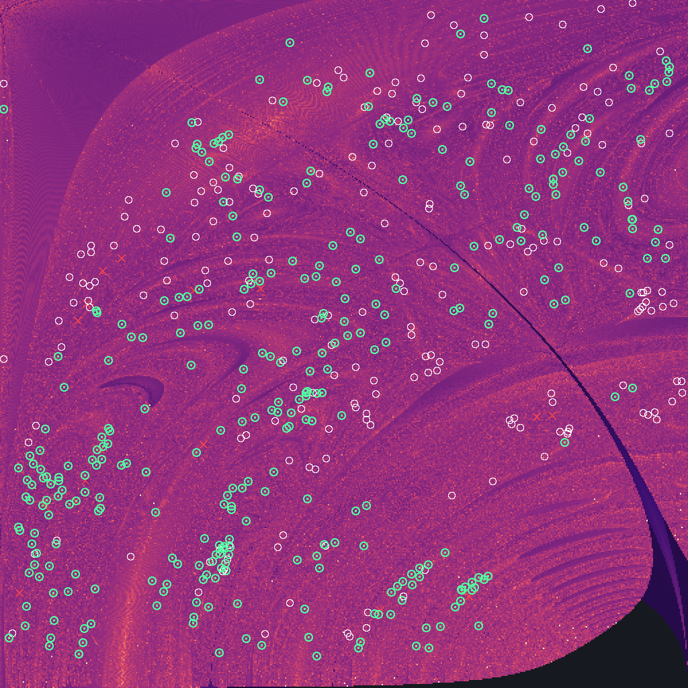

# Suchlauf fall-gleich-1

2026-10-02 17:40 UTC · Freier Fall · Massen 1 / 1 / 1 · Fenster x₃ 0…0.5, y₃ 0…0.88 · Raster 512×512 · Perioden bis 16 · Suche über Umkehrpunkte (halbe Periode)

## Was der Lauf getan hat

| Stufe | Zahl |
|---|---|
| Rasterpunkte gerechnet | 262144 in 135 s auf 11 Fäden |
| davon durchgelaufen / Zerfall / abgebrochen / ungebunden | 182175 / 68611 / 11358 / 0 |
| Talsohlen (unter 0.3) in 8 Zielen × 6 Zeitbändern | 673077 |
| davon durch die Prüfkette | 40000 in 997 s |
| Umkehrpunkt verfehlt | 36546 |
| Umkehrpunkt getroffen, aber nach 12τ nicht zurück (nur bis auf eine Drehung periodisch) | 2423 |
| geschlossene Bahn | 1031 |
| verschiedene Orte in der Ebene | **554** |
| verschiedene Bahnen (gleiches T* auf acht Stellen einmal gezählt) | **463** |
| — bestätigt (voller Umlauf: Rest < 1e-10 und Gegenprobe < 1e-8) | 5 |
| — über den Umkehrpunkt (halber Umlauf auf 1e-11 getroffen, voller für double zu empfindlich) | 242 |
| — an der Rechengrenze | 307 |
| sicher linear stabil | 0 |
| Ausnahmen im Schwarm | 0 |

Je Ziel (Fixmenge, die nach der halben Periode getroffen wird):

| Ziel | Kandidaten | Umkehrpunkt getroffen | geschlossene Bahn |
|---|---|---|---|
| A1 | 6366 | 322 | 63 |
| A2 | 5345 | 295 | 56 |
| A3 | 5992 | 497 | 102 |
| B1 | 2910 | 296 | 71 |
| B2 | 3671 | 442 | 143 |
| C | 9858 | 719 | 245 |
| B3 | 3510 | 510 | 154 |
| R | 2348 | 373 | 197 |

## Bekannt oder nicht

Von den 554 Funden stehen **222** in einer der geprüften Listen, **332** in keiner. Als verschiedene Bahnen gezählt (eine Bahn kann die Ebene an mehreren Stellen kreuzen): 463, davon **301** in keiner Liste.

| Liste | Stufe | Bahnen | Bedeutung |
|---|---|---|---|
| Li/Liao 2017–2019, Šuvakov/Dmitrašinović 2013 (2364 Bahnen, mit Klassen) | Ort | 14 | steht mit diesen Anfangswerten in der Liste |
| | Lage | 14 | gleiches T* auf acht Stellen: Listenbahn, an anderer Stelle getroffen |
| | Klasse | 0 | Klasse in der Liste, aber anderes T*: weitere Bahn derselben Familie |
| | keine | 526 | Klasse nicht in der Liste |
| Hristov u. a. (29442 Anfangswerte, gleiche Massen) | Ort | 117 | steht mit diesen Anfangswerten in der Liste |
| | Lage | 100 | gleiches T* auf acht Stellen: Listenbahn, an anderer Stelle getroffen |
| | keine | 337 | weder Ort noch T* in der Liste |

Trennschärfe: die 117 Ortstreffer liegen im Median 2.5e-13 und höchstens 2.7e-11 vom Listenwert (Schwelle 1e-6), ihr T* weicht höchstens 1.8e-10 ab; die 88 übrigen haben ihren nächsten Listennachbarn mindestens 9.5e-5 entfernt (Median 0.002200).

„In keiner Liste“ heißt genau das und nicht „neu“. Die Listen sind in sich begrenzt: Li und Liao führen je Klasse eine Bahn bis T = 200, gefunden auf einem Raster von 4000²; Hristov u. a. führen die Euler-Ebene bis T* = 211 und den freien Fall bis T* = 80 (mit Punktsymmetrie bis 120).

## Gegenrichtung: was der Lauf von den Listen wiederfindet

| Liste | Bahnen im Fenster mit T bis 16 | gefunden | Anteil |
|---|---|---|---|
| Li/Liao, 2013 | 30 | 14 | 47 % |
| Hristov u. a. | 28819 | 115 | 0.4 % |
| — davon T < 10 | 24525 | 91 | 0.4 % |
| — davon T < 20 | 4294 | 24 | 0.6 % |

Verpasst aus Li/Liao: F-3 (T 4.5), F-5 (T 5.0), F-7 (T 5.4), F-9 (T 5.2), F-11 (T 4.3), F-12 (T 4.3), F-13 (T 6.0), F-16 (T 6.5), F-17 (T 8.1), F-20 (T 8.8), F-21 (T 5.4), F-23 (T 8.5), F-24 (T 9.4), F-26 (T 10.0), F-28 (T 11.8), F-30 (T 6.2).

Karte: hell = die Bahn kommt bis zur halben Höchstperiode einer Fixmenge nahe. Weißer Ring = Fund, der in einer Liste steht (nur bei bis zu 3000 Funden gezeichnet). Grüner Punkt = Fund, der in keiner Liste steht. Rotes Kreuz = Bahn aus Li/Liao, die der Lauf verpasst hat.

## Funde in keiner Liste (332)

| x₃ | y₃ | T | T* | Rest (voller Umlauf) | Umkehrpunkt | Urteil | Stabilität | \|λ\| | engste Begegnung | Wortlänge | Listen |
|---|---|---|---|---|---|---|---|---|---|---|---|
| 0.311679959207 | 0.050443082013 | 4.76110995 | 95.0452 | 3.6e-6 | C 1.8e-10 | an der Rechengrenze | offen | 2.592e+5 | 8.3e-7 | 44 | — |
| 0.309548579499 | 0.076428142171 | 5.01652088 | 94.9601 | 3.1e-8 | R 1.3e-10 | an der Rechengrenze | offen | 4.08e+4 | 2.0e-6 | 44 | — |
| 0.319864040173 | 0.078370157429 | 5.18391399 | 102.3427 | 3.4e-6 | C 3.7e-10 | an der Rechengrenze | offen | 1.657e+5 | 1.8e-6 | 48 | — |
| 0.283733396149 | 0.093345569658 | 5.25962919 | 87.4099 | 2.1e-7 | C 2.8e-11 | an der Rechengrenze | offen | 3.47e+4 | 7.4e-6 | 40 | — |
| 0.302414294632 | 0.053657183951 | 5.38267691 | 102.4281 | 4.2e-6 | C 2.6e-10 | an der Rechengrenze | offen | 1.689e+6 | 1.2e-6 | 48 | — |
| 0.274946970983 | 0.093244209210 | 5.39625985 | 87.0872 | 5.0e-9 | R 1.9e-10 | an der Rechengrenze | offen | 422 | 9.3e-6 | 40 | — |
| 0.272212761308 | 0.094738222451 | 5.48028794 | 87.4609 | 6.5e-9 | C 8.4e-11 | an der Rechengrenze | offen | 5.52e+3 | 1.0e-5 | 40 | — |
| 0.347538799954 | 0.078879043184 | 5.48430802 | 124.1041 | 3.4e-6 | C 1.1e-10 | an der Rechengrenze | offen | 5.870e+5 | 7.2e-7 | 60 | — |
| 0.291760647373 | 0.111756806618 | 5.51852559 | 91.0709 | 1.0e-7 | R 5.1e-10 | an der Rechengrenze | offen | 1.96e+4 | 8.7e-6 | 42 | — |
| 0.261609118110 | 0.058041313792 | 5.87105795 | 94.7222 | 2.2e-7 | C 6.3e-10 | an der Rechengrenze | offen | 1.420e+5 | 4.7e-6 | 44 | — |
| 0.330652174442 | 0.103420378246 | 5.99599510 | 116.6670 | 4.3e-6 | C 4.4e-10 | an der Rechengrenze | offen | 7.55e+4 | 2.5e-6 | 56 | — |
| 0.284320846938 | 0.121988471328 | 5.99730535 | 94.7343 | 3.8e-9 | C 5.4e-11 | an der Rechengrenze | instabil | 3.19e+3 | 1.4e-5 | 44 | — |
| 0.288586577144 | 0.129689214055 | 6.24375321 | 98.3366 | 7.3e-9 | R 9.6e-11 | an der Rechengrenze | instabil | 3.02e+3 | 1.4e-5 | 46 | — |
| 0.299453628039 | 0.131639454473 | 6.28973858 | 101.9029 | 2.1e-8 | C 1.9e-11 | an der Rechengrenze | offen | 7.76e+3 | 1.1e-5 | 48 | — |
| 0.260156233629 | 0.050872782704 | 6.30608971 | 101.8911 | 2.5e-6 | C 7.4e-10 | an der Rechengrenze | offen | 5.586e+5 | 2.1e-7 | 48 | — |
| 0.334469414166 | 0.110722918333 | 6.39182197 | 123.7281 | 4.5e-7 | C 9.0e-11 | an der Rechengrenze | offen | 6.58e+4 | 2.7e-6 | 60 | — |
| 0.292394441290 | 0.135940068998 | 6.48604467 | 101.9191 | 4.1e-9 | C 6.6e-11 | an der Rechengrenze | instabil | 2.77e+3 | 1.5e-5 | 48 | — |
| 0.189903239293 | 0.054339277162 | 6.50227479 | 86.6628 | 2.9e-7 | C 7.4e-12 | über den Umkehrpunkt | offen | 1.252e+6 | 1.0e-5 | 40 | — |
| 0.304556216959 | 0.142007246275 | 6.79204620 | 109.0244 | 7.6e-10 | R 1.1e-11 | an der Rechengrenze | offen | 3.85e+3 | 1.2e-5 | 52 | — |
| 0.242940525928 | 0.185528880070 | 6.82543693 | 87.0872 | 3.6e-10 | R 2.5e-11 | an der Rechengrenze | instabil | 421 | 1.1e-5 | 40 | — |
| 0.299046951960 | 0.145597481700 | 6.95972831 | 109.0320 | 3.4e-8 | C 6.5e-10 | an der Rechengrenze | instabil | 2.15e+3 | 1.5e-5 | 52 | — |
| 0.221314933644 | 0.100644191104 | 6.98864749 | 96.3092 | 2.7e-8 | R 1.9e-10 | an der Rechengrenze | offen | 1.77e+4 | 4.1e-5 | 42 | — |
| 0.335510786200 | 0.124851955635 | 7.00240372 | 130.4152 | 8.3e-8 | R 9.6e-10 | an der Rechengrenze | offen | 6.98e+3 | 3.6e-6 | 64 | — |
| 0.334913427768 | 0.125282071552 | 7.04642403 | 130.7743 | 2.3e-8 | C 6.4e-11 | an der Rechengrenze | offen | 6.89e+4 | 1.7e-6 | 64 | — |
| 0.271937556001 | 0.432039543308 | 7.34988349 | 62.7526 | 7.7e-8 | R 1.6e-11 | an der Rechengrenze | instabil | 3.984e+6 | 3.3e-4 | 30 | — |
| 0.304802817603 | 0.152644657987 | 7.41814084 | 116.0857 | 2.7e-9 | C 2.3e-11 | an der Rechengrenze | instabil | 1.36e+3 | 1.5e-5 | 56 | — |
| 0.337804041612 | 0.129142008962 | 7.43219250 | 137.7324 | 6.8e-7 | C 4.5e-10 | an der Rechengrenze | offen | 6.87e+4 | 1.4e-6 | 68 | — |
| 0.410066814364 | 0.313934659085 | 7.48340979 | 86.2138 | 3.8e-6 | C 3.9e-10 | an der Rechengrenze | offen | 2.222e+6 | 3.0e-6 | 40 | — |
| 0.211401016325 | 0.351080636020 | 7.51245431 | 70.7803 | 7.7e-8 | B1 3.9e-13 | über den Umkehrpunkt | offen | 1.317e+7 | 8.6e-4 | 32 | — |
| 0.223232414373 | 0.241700280378 | 7.55146755 | 85.2613 | 1.7e-7 | R 5.8e-10 | an der Rechengrenze | instabil | 2.486e+5 | 1.4e-4 | 38 | — |
| 0.342596394889 | 0.124579933451 | 7.55583116 | 144.6290 | 5.0e-6 | C 9.9e-10 | an der Rechengrenze | offen | 4.80e+4 | 2.9e-6 | 72 | — |
| 0.230011017644 | 0.040776618889 | 7.60692523 | 112.6389 | 6.7e-7 | C 2.7e-10 | an der Rechengrenze | offen | 2.489e+5 | 5.2e-8 | 48 | — |
| 0.159374372234 | 0.045024123716 | 7.66764900 | 96.8467 | 7.0e-6 | C 3.3e-11 | an der Rechengrenze | offen | 1.569e+6 | 2.7e-6 | 40 | — |
| 0.311000058755 | 0.156991795286 | 7.82023253 | 123.0900 | 2.7e-9 | C 8.6e-10 | an der Rechengrenze | instabil | 1.73e+3 | 1.3e-5 | 60 | — |
| 0.344591299851 | 0.127709895949 | 7.93853199 | 151.5228 | 4.3e-8 | C 1.8e-10 | an der Rechengrenze | offen | 4.20e+4 | 2.9e-6 | 76 | — |
| 0.222183641910 | -0.372940922341 | 8.00351821 | 73.3820 | 2.9e-9 | C 1.0e-12 | über den Umkehrpunkt | instabil | 2.95e+4 | 7.8e-4 | 30 | — |
| 0.229802200803 | 0.376092080622 | 8.01382641 | 73.3952 | 6.7e-9 | R 1.7e-11 | an der Rechengrenze | instabil | 3.70e+4 | 6.8e-4 | 30 | — |
| 0.222147479208 | 0.377115008873 | 8.05552748 | 73.3952 | 1.2e-9 | R 1.9e-11 | an der Rechengrenze | instabil | 3.70e+4 | 6.8e-4 | 30 | — |
| 0.446598611958 | 0.371716081486 | 8.05993945 | 80.7196 | 3.1e-7 | B1 8.1e-10 | an der Rechengrenze | offen | 2.92e+4 | 1.2e-6 | 36 | — |
| 0.201702850074 | 0.351984049320 | 8.11442926 | 75.9473 | 1.6e-7 | B1 2.8e-12 | über den Umkehrpunkt | instabil | 4.229e+6 | 0.001040 | 34 | — |
| 0.178886294707 | 0.062396974952 | 8.11894846 | 105.4040 | 3.3e-6 | C 1.0e-10 | an der Rechengrenze | offen | 1.601e+6 | 4.0e-5 | 44 | — |
| 0.181956542590 | 0.516458038853 | 8.14952089 | 60.7902 | 9.7e-9 | R 6.7e-11 | an der Rechengrenze | instabil | 2.23e+4 | 2.8e-4 | 26 | — |
| 0.342534664932 | 0.134976901702 | 8.19381281 | 151.5431 | 3.1e-7 | C 1.2e-10 | an der Rechengrenze | offen | 8.12e+4 | 7.0e-7 | 76 | — |
| 0.143520466597 | 0.463406378891 | 8.22634759 | 65.1068 | 1.5e-9 | R 1.3e-11 | an der Rechengrenze | instabil | 1.844e+5 | 8.4e-5 | 28 | — |
| 0.226372125044 | 0.341068083967 | 8.24183304 | 79.5461 | 3.3e-8 | B2 2.8e-12 | über den Umkehrpunkt | instabil | 5.375e+6 | 6.1e-4 | 34 | — |
| 0.201965229928 | 0.365102021300 | 8.26652360 | 75.9227 | 9.5e-8 | B1 5.4e-13 | über den Umkehrpunkt | instabil | 6.374e+6 | 0.001104 | 34 | — |
| 0.221953313408 | 0.342557601475 | 8.28332552 | 79.5461 | 1.9e-8 | B2 7.1e-13 | über den Umkehrpunkt | instabil | 8.408e+6 | 6.7e-4 | 34 | — |
| 0.459388206525 | 0.383363550295 | 8.28661709 | 80.7411 | 9.8e-7 | B1 2.4e-11 | an der Rechengrenze | offen | 4.898e+6 | 4.8e-6 | 36 | — |
| 0.197481160126 | 0.354829513790 | 8.42303501 | 78.3372 | 1.7e-9 | C 7.0e-12 | über den Umkehrpunkt | instabil | 3.20e+4 | 0.001142 | 32 | — |
| 0.224332341288 | 0.064501653137 | 8.43227172 | 121.0675 | 2.2e-6 | C 1.4e-11 | an der Rechengrenze | offen | 2.463e+6 | 1.1e-8 | 51 | — |
| 0.042090708107 | 0.423789796080 | 8.66527547 | 70.7850 | 2.5e-7 | B3 5.6e-13 | über den Umkehrpunkt | offen | 1.757e+9 | 3.6e-5 | 28 | — |
| 0.159046822529 | 0.182497527061 | 8.72350612 | 98.9439 | 2.0e-10 | B3 6.1e-13 | über den Umkehrpunkt | instabil | 2.33e+4 | 5.9e-4 | 40 | — |
| 0.018102128533 | 0.078642491543 | 8.72732049 | 96.2980 | 1.1e-7 | R 4.7e-11 | an der Rechengrenze | offen | 4.729e+6 | 7.5e-6 | 42 | — |
| 0.006314939716 | 0.064022879528 | 8.75852776 | 96.9910 | 4.4e-7 | R 5.7e-11 | an der Rechengrenze | offen | 5.425e+7 | 1.8e-6 | 46 | — |
| 0.483607850281 | 0.548843406347 | 8.78568080 | 62.7570 | 3.4e-7 | R 2.1e-10 | an der Rechengrenze | instabil | 6.171e+5 | 1.6e-4 | 30 | — |
| 0.184952948220 | 0.345664830289 | 8.85033371 | 82.8436 | 4.8e-9 | C 1.1e-11 | an der Rechengrenze | instabil | 1.025e+5 | 0.001375 | 34 | — |
| 0.020897215106 | 0.146534100897 | 9.03608354 | 96.3355 | 2.0e-8 | R 4.0e-11 | an der Rechengrenze | offen | 5.067e+5 | 7.0e-6 | 42 | — |
| 0.034949884789 | 0.220742960531 | 9.11144446 | 91.9692 | 2.6e-10 | B3 5.6e-13 | über den Umkehrpunkt | instabil | 6.96e+3 | 0.005698 | 40 | — |
| 0.057038247052 | 0.042984363397 | 9.13356110 | 103.2477 | 4.7e-7 | R 3.9e-10 | an der Rechengrenze | offen | 8.288e+6 | 1.1e-5 | 46 | — |
| 0.160231805287 | 0.328804308962 | 9.21346128 | 87.0960 | 5.8e-8 | C 4.8e-12 | über den Umkehrpunkt | instabil | 3.863e+5 | 8.1e-4 | 36 | — |
| 0.175782888760 | 0.340290599812 | 9.28160944 | 87.1071 | 3.4e-9 | C 7.0e-12 | über den Umkehrpunkt | instabil | 1.244e+5 | 0.001584 | 36 | — |
| 0.198862823292 | 0.275856979219 | 9.29592068 | 97.1363 | 7.2e-7 | R 6.8e-11 | an der Rechengrenze | offen | 1.705e+9 | 8.3e-6 | 50 | — |
| 0.344028450818 | 0.564356463642 | 9.30761736 | 66.0502 | 7.7e-6 | B1 1.9e-11 | an der Rechengrenze | offen | 9.930e+7 | 1.1e-6 | 28 | — |
| 0.354964876867 | 0.465095877458 | 9.31302175 | 76.7521 | 3.4e-7 | B3 3.3e-11 | an der Rechengrenze | offen | 1.934e+5 | 1.3e-5 | 32 | — |
| 0.347825508371 | 0.140824540388 | 9.31671276 | 172.0532 | 1.5e-6 | C 9.6e-10 | an der Rechengrenze | offen | 9.74e+4 | 5.9e-8 | 88 | — |
| 0.175650623364 | 0.254824028587 | 9.35699750 | 98.6841 | 7.6e-10 | B3 1.8e-12 | über den Umkehrpunkt | instabil | 1.83e+4 | 8.8e-4 | 40 | — |
| 0.231890550434 | 0.152978391833 | 9.38758505 | 123.6386 | 8.1e-7 | R 1.3e-10 | an der Rechengrenze | offen | 1.837e+7 | 8.4e-5 | 54 | — |
| 0.233658003634 | 0.427987908517 | 9.39075404 | 79.7099 | 2.9e-7 | B2 2.5e-12 | über den Umkehrpunkt | instabil | 1.643e+7 | 7.4e-4 | 34 | — |
| 0.068898662715 | 0.126457022164 | 9.48124186 | 104.1567 | 7.2e-8 | C 5.6e-12 | über den Umkehrpunkt | instabil | 1.526e+6 | 4.7e-4 | 44 | — |
| 0.172552404618 | 0.650887935915 | 9.58588265 | 61.1848 | 5.8e-7 | B1 2.5e-11 | an der Rechengrenze | offen | 1.435e+6 | 8.0e-7 | 26 | — |
| 0.163435071639 | 0.652855372078 | 9.58597317 | 61.0495 | 8.5e-6 | B2 1.3e-11 | an der Rechengrenze | offen | 1.481e+8 | 1.3e-5 | 26 | — |
| 0.038554590991 | 0.121092330522 | 9.61182899 | 104.5024 | 8.5e-7 | C 2.2e-12 | über den Umkehrpunkt | instabil | 5.810e+7 | 0.001291 | 44 | — |
| 0.225770643286 | 0.660905323297 | 9.62495951 | 60.7759 | 2.0e-6 | B2 1.6e-10 | an der Rechengrenze | offen | 1.589e+7 | 1.1e-6 | 26 | — |
| 0.203652696612 | 0.415808757778 | 9.62511780 | 82.3143 | 5.6e-8 | C 9.9e-13 | über den Umkehrpunkt | instabil | 2.866e+6 | 0.001288 | 34 | — |
| 0.252216753075 | 0.450675190166 | 9.66999526 | 79.8325 | 2.4e-8 | B1 5.4e-13 | über den Umkehrpunkt | instabil | 5.97e+4 | 5.1e-4 | 38 | — |
| 0.402548005662 | 0.490980820385 | 9.69911581 | 76.7521 | 1.3e-8 | B2 1.2e-11 | an der Rechengrenze | offen | 1.934e+5 | 1.4e-5 | 36 | — |
| 0.161972865156 | 0.621478784180 | 9.69920235 | 63.9139 | 1.1e-7 | C 4.4e-11 | an der Rechengrenze | offen | 5.202e+5 | 2.3e-6 | 26 | — |
| 0.323484412773 | 0.172939140358 | 9.70748708 | 151.1385 | 5.5e-9 | R 1.1e-10 | an der Rechengrenze | instabil | 420 | 4.0e-6 | 76 | — |
| 0.035531382555 | 0.155737122331 | 9.78379476 | 103.9948 | 2.9e-9 | R 8.5e-12 | über den Umkehrpunkt | instabil | 3.055e+5 | 0.001412 | 44 | — |
| 0.212350124490 | 0.545744235164 | 9.80007558 | 70.7498 | 8.6e-6 | B2 2.6e-11 | an der Rechengrenze | offen | 3.579e+7 | 1.2e-4 | 30 | — |
| 0.215685187975 | 0.163412985840 | 9.80910451 | 123.4870 | 5.9e-6 | B3 3.5e-11 | an der Rechengrenze | offen | 1.174e+8 | 3.3e-5 | 56 | — |
| 0.275525490222 | 0.547355181167 | 9.82168455 | 71.1475 | 9.8e-7 | B3 1.9e-11 | an der Rechengrenze | offen | 3.357e+6 | 1.1e-6 | 32 | — |
| 0.351691439979 | 0.138274878582 | 9.83054946 | 185.6133 | 1.0e-7 | R 9.0e-10 | an der Rechengrenze | offen | 2.42e+4 | 3.0e-6 | 96 | — |
| 0.210131109447 | 0.334252268228 | 9.87550886 | 95.3518 | 5.4e-6 | B2 2.0e-12 | über den Umkehrpunkt | offen | 3.507e+8 | 8.1e-4 | 42 | — |
| 0.168920704621 | 0.603029467662 | 9.91450070 | 66.7073 | 7.1e-8 | B3 3.0e-12 | über den Umkehrpunkt | offen | 5.346e+5 | 3.9e-5 | 28 | — |
| 0.250027756942 | 0.468488768339 | 9.92682379 | 79.8327 | 1.2e-8 | B1 2.0e-12 | über den Umkehrpunkt | instabil | 7.77e+4 | 5.3e-4 | 38 | — |
| 0.329854997074 | 0.536785379367 | 9.93056509 | 73.2036 | 3.9e-6 | R 8.0e-10 | an der Rechengrenze | offen | 1.540e+7 | 2.8e-6 | 30 | — |
| 0.287825177846 | 0.510388873387 | 9.95337513 | 75.9087 | 1.3e-6 | B1 7.6e-12 | über den Umkehrpunkt | offen | 1.203e+7 | 6.9e-5 | 34 | — |
| 0.061016055541 | -0.075758404434 | 9.95773865 | 111.7069 | 5.3e-6 | C 1.8e-11 | an der Rechengrenze | offen | 3.072e+7 | 1.1e-4 | 48 | — |
| 0.119199403781 | 0.494785856979 | 10.02499291 | 76.1243 | 2.5e-6 | B3 1.5e-12 | über den Umkehrpunkt | offen | 3.332e+8 | 8.1e-4 | 32 | — |
| 0.163902241988 | 0.149182057244 | 10.06419695 | 118.9635 | 1.2e-6 | C 2.1e-11 | an der Rechengrenze | offen | 3.681e+6 | 3.4e-4 | 48 | — |
| 0.175415164850 | 0.382164660850 | 10.09807784 | 89.5078 | 1.4e-6 | B1 1.7e-12 | über den Umkehrpunkt | instabil | 1.280e+8 | 0.001934 | 42 | — |
| 0.280488551461 | 0.441845833722 | 10.15984726 | 85.6407 | 2.9e-6 | B1 7.3e-12 | über den Umkehrpunkt | offen | 2.903e+7 | 2.5e-4 | 40 | — |
| 0.120924942111 | 0.132050168939 | 10.16236599 | 115.8912 | 5.5e-8 | B3 4.2e-12 | über den Umkehrpunkt | instabil | 2.183e+6 | 6.6e-4 | 48 | — |
| 0.039149625862 | 0.085920869357 | 10.16769667 | 112.4801 | 2.0e-6 | C 1.0e-11 | an der Rechengrenze | offen | 1.665e+8 | 7.3e-5 | 48 | — |
| 0.194882386378 | 0.627391233463 | 10.18586218 | 66.7396 | 7.4e-9 | B3 1.9e-11 | an der Rechengrenze | offen | 3.60e+4 | 1.7e-5 | 28 | — |
| 0.013083009400 | 0.204977010694 | 10.19315129 | 103.9535 | 5.1e-10 | R 2.5e-12 | über den Umkehrpunkt | instabil | 2.182e+5 | 9.1e-5 | 46 | — |
| 0.392980698863 | 0.714157561070 | 10.22951314 | 60.1937 | 3.0e-9 | R 3.1e-11 | an der Rechengrenze | instabil | 1.46e+4 | 4.6e-5 | 30 | — |
| 0.237862616707 | 0.407186444726 | 10.24381226 | 89.8012 | 6.4e-6 | B3 6.6e-12 | über den Umkehrpunkt | offen | 2.615e+7 | 2.2e-5 | 44 | — |
| 0.026229952980 | 0.171476166408 | 10.28746813 | 107.8996 | 1.5e-9 | R 2.2e-12 | über den Umkehrpunkt | instabil | 3.066e+6 | 0.001534 | 46 | — |
| 0.222843334272 | 0.645157611060 | 10.29471579 | 66.1495 | 1.5e-8 | R 1.2e-10 | an der Rechengrenze | offen | 3.986e+6 | 5.6e-6 | 28 | — |
| 0.171803188925 | 0.576935621770 | 10.35224163 | 71.7699 | 3.4e-8 | B3 2.8e-12 | über den Umkehrpunkt | instabil | 5.151e+5 | 1.3e-4 | 32 | — |
| 0.060132929554 | 0.057987914137 | 10.43499794 | 117.7083 | 1.3e-6 | R 1.6e-10 | an der Rechengrenze | offen | 8.010e+6 | 1.7e-5 | 54 | — |
| 0.028082699996 | 0.142170050313 | 10.50166040 | 112.4280 | 6.5e-8 | C 1.9e-13 | über den Umkehrpunkt | instabil | 6.837e+7 | 0.001865 | 48 | — |
| 0.428024870020 | 0.727869878887 | 10.54499056 | 60.7902 | 2.3e-10 | R 6.9e-12 | über den Umkehrpunkt | instabil | 2.23e+4 | 3.4e-4 | 28 | — |
| 0.267769801041 | 0.743038159764 | 10.58670423 | 61.1848 | 5.7e-6 | B1 4.0e-10 | an der Rechengrenze | offen | 1.282e+6 | 2.2e-6 | 26 | — |
| 0.071105403800 | 0.226052594330 | 10.66306077 | 108.3279 | 4.1e-8 | R 1.7e-11 | an der Rechengrenze | offen | 6.908e+6 | 2.0e-4 | 46 | — |
| 0.258267482975 | 0.535804506584 | 10.68006785 | 78.4356 | 4.6e-7 | R 8.9e-10 | an der Rechengrenze | offen | 3.725e+5 | 4.1e-6 | 32 | — |
| 0.129753188146 | 0.498897954360 | 10.70144821 | 80.9759 | 1.7e-8 | B3 3.0e-12 | über den Umkehrpunkt | instabil | 8.262e+6 | 7.4e-4 | 36 | — |
| 0.279311335764 | 0.477262553194 | 10.72107019 | 85.6427 | 1.1e-7 | B1 3.1e-12 | über den Umkehrpunkt | offen | 8.563e+5 | 2.5e-4 | 40 | — |
| 0.036548346987 | 0.063312755015 | 10.77138185 | 120.0229 | 2.5e-6 | C 2.9e-11 | an der Rechengrenze | offen | 8.175e+6 | 5.4e-5 | 52 | — |
| 0.329669434293 | 0.482226216900 | 10.85599089 | 86.7630 | 4.0e-7 | R 4.3e-11 | an der Rechengrenze | offen | 3.174e+7 | 4.1e-5 | 36 | — |
| 0.196173559592 | 0.423462923037 | 10.88183599 | 91.8620 | 5.6e-6 | C 7.4e-12 | über den Umkehrpunkt | offen | 8.978e+7 | 6.9e-4 | 42 | — |
| 0.168148019400 | 0.227592515669 | 10.92699114 | 118.5876 | 1.8e-8 | C 1.4e-12 | über den Umkehrpunkt | instabil | 1.511e+6 | 8.0e-4 | 48 | — |
| 0.123623778123 | 0.575040663183 | 10.93108489 | 75.7222 | 6.2e-8 | R 3.9e-10 | an der Rechengrenze | offen | 1.112e+5 | 1.0e-5 | 36 | — |
| 0.405931581365 | 0.536804745593 | 10.93229265 | 80.4884 | 1.3e-6 | B1 5.8e-12 | über den Umkehrpunkt | offen | 6.023e+8 | 7.4e-5 | 36 | — |
| 0.229545257683 | 0.526190534503 | 10.94163043 | 81.1140 | 2.4e-8 | B3 5.2e-12 | über den Umkehrpunkt | offen | 1.491e+5 | 3.9e-5 | 36 | — |
| 0.394071936661 | 0.579220341405 | 10.94403134 | 75.9087 | 4.2e-6 | B1 5.4e-11 | an der Rechengrenze | offen | 1.203e+7 | 6.5e-5 | 34 | — |
| 0.176830374795 | 0.407095615870 | 10.95730557 | 93.9781 | 7.3e-6 | B3 3.3e-12 | über den Umkehrpunkt | offen | 2.963e+8 | 1.2e-4 | 44 | — |
| 0.354554351361 | 0.142425286425 | 10.95757001 | 205.8433 | 1.5e-7 | C 6.3e-10 | an der Rechengrenze | offen | 1.16e+4 | 3.0e-6 | 108 | — |
| 0.135798109426 | 0.500015285185 | 11.00530007 | 83.2300 | 4.0e-6 | C 5.0e-12 | über den Umkehrpunkt | offen | 7.648e+7 | 7.0e-4 | 38 | — |
| -0.207784295702 | -0.331771686739 | 11.00870349 | 106.5336 | 9.8e-6 | B1 4.2e-12 | über den Umkehrpunkt | offen | 1.435e+9 | 8.3e-4 | 46 | — |
| 0.370144704111 | 0.719467761174 | 11.01146194 | 64.6208 | 6.8e-10 | R 3.0e-12 | über den Umkehrpunkt | instabil | 2.983e+5 | 2.0e-4 | 28 | — |
| 0.384372450208 | 0.638132501751 | 11.01707839 | 70.8725 | 9.6e-6 | B1 2.4e-11 | an der Rechengrenze | offen | 5.628e+7 | 2.4e-5 | 32 | — |
| 0.165942678776 | 0.707494631717 | 11.02113219 | 66.2896 | 4.0e-7 | B2 1.4e-11 | an der Rechengrenze | offen | 4.374e+6 | 3.5e-5 | 30 | — |
| 0.196775365953 | 0.530100026350 | 11.03876176 | 81.1152 | 3.0e-8 | B3 1.2e-12 | über den Umkehrpunkt | offen | 5.597e+5 | 1.9e-4 | 36 | — |
| 0.233918703827 | 0.377301456165 | 11.05084159 | 101.2216 | 4.6e-6 | B2 8.5e-12 | über den Umkehrpunkt | offen | 2.076e+7 | 1.4e-4 | 44 | — |
| 0.410470002452 | 0.496112112942 | 11.08435473 | 86.9540 | 3.7e-6 | R 6.2e-10 | an der Rechengrenze | offen | 2.483e+6 | 2.5e-5 | 40 | — |
| 0.072691115245 | 0.229161317701 | 11.09946805 | 112.5028 | 8.6e-7 | C 3.8e-12 | über den Umkehrpunkt | offen | 1.548e+7 | 1.5e-4 | 48 | — |
| 0.042472767464 | 0.265102162312 | 11.10568802 | 107.6922 | 9.8e-10 | R 3.6e-12 | über den Umkehrpunkt | instabil | 9.15e+4 | 1.0e-4 | 48 | — |
| 0.273081716335 | 0.490705388947 | 11.13159423 | 87.1157 | 7.5e-8 | C 9.2e-11 | an der Rechengrenze | instabil | 2.434e+5 | 2.4e-4 | 42 | — |
| 0.042308812600 | 0.268556126735 | 11.14903041 | 107.7391 | 3.1e-7 | R 9.1e-11 | an der Rechengrenze | offen | 3.880e+7 | 1.9e-5 | 48 | — |
| 0.229747922084 | 0.168102966786 | 11.20667111 | 143.6595 | 4.4e-7 | R 6.8e-11 | an der Rechengrenze | offen | 4.345e+6 | 3.4e-5 | 64 | — |
| 0.302932524925 | 0.753815685869 | 11.21024663 | 63.9139 | 8.4e-8 | C 8.4e-11 | an der Rechengrenze | offen | 5.212e+5 | 6.4e-8 | 26 | — |
| 0.095175236177 | 0.448812230504 | 11.21295557 | 89.5693 | 1.5e-6 | B1 5.5e-13 | über den Umkehrpunkt | offen | 5.029e+8 | 0.001700 | 42 | — |
| 0.142311135338 | 0.689721004206 | 11.22787469 | 68.7853 | 3.0e-7 | C 2.3e-12 | über den Umkehrpunkt | instabil | 4.831e+6 | 2.0e-4 | 28 | — |
| 0.292809149187 | 0.715806760626 | 11.24451707 | 66.7396 | 4.8e-8 | B2 3.1e-10 | an der Rechengrenze | offen | 3.59e+4 | 1.9e-5 | 30 | — |
| 0.072229275624 | 0.242873160171 | 11.24619840 | 112.4605 | 1.7e-7 | C 2.2e-12 | über den Umkehrpunkt | instabil | 4.925e+6 | 4.8e-4 | 48 | — |
| 0.139109711141 | 0.722608835201 | 11.29488706 | 66.9317 | 7.6e-7 | R 1.8e-10 | an der Rechengrenze | instabil | 2.017e+7 | 1.3e-4 | 28 | — |
| 0.169061527618 | 0.255344948875 | 11.32067963 | 118.6332 | 5.0e-8 | C 4.7e-13 | über den Umkehrpunkt | instabil | 6.275e+7 | 0.001004 | 48 | — |
| 0.264326493504 | 0.181645728961 | 11.33144729 | 151.5199 | 6.3e-6 | C 2.3e-10 | an der Rechengrenze | offen | 1.183e+7 | 5.3e-5 | 68 | — |
| 0.321494236464 | 0.687967823488 | 11.35371921 | 69.3108 | 4.0e-7 | R 2.8e-10 | an der Rechengrenze | offen | 1.378e+6 | 2.6e-6 | 28 | — |
| 0.025120442353 | 0.157198004406 | 11.37623844 | 120.5134 | 9.2e-6 | C 2.4e-12 | über den Umkehrpunkt | instabil | 2.454e+9 | 0.001678 | 52 | — |
| 0.035656982520 | 0.053079737559 | 11.40368195 | 127.3981 | 8.2e-7 | C 3.7e-11 | an der Rechengrenze | offen | 1.573e+8 | 4.5e-5 | 56 | — |
| 0.023078235657 | 0.259165576222 | 11.45873739 | 111.4092 | 1.1e-9 | R 7.2e-12 | über den Umkehrpunkt | instabil | 2.905e+5 | 1.5e-4 | 50 | — |
| 0.190383158680 | 0.427887695730 | 11.47511548 | 96.1219 | 7.2e-6 | C 5.8e-12 | über den Umkehrpunkt | offen | 1.249e+8 | 3.1e-5 | 46 | — |
| 0.151604139558 | 0.102844933358 | 11.49623218 | 139.0334 | 4.6e-6 | B3 1.7e-10 | an der Rechengrenze | offen | 5.502e+6 | 2.0e-4 | 56 | — |
| 0.205426601110 | 0.749442180629 | 11.50767132 | 66.2896 | 7.0e-7 | B3 1.2e-11 | an der Rechengrenze | offen | 4.374e+6 | 3.6e-5 | 28 | — |
| 0.333820056250 | 0.485532960347 | 11.56405494 | 91.9930 | 5.4e-6 | C 3.0e-10 | an der Rechengrenze | offen | 3.506e+6 | 3.1e-5 | 38 | — |
| 0.247989007711 | 0.347657978374 | 11.59786862 | 112.2383 | 4.5e-6 | B2 8.7e-12 | über den Umkehrpunkt | offen | 9.040e+7 | 3.1e-6 | 50 | — |
| 0.324708617815 | 0.743471678096 | 11.60019443 | 66.7073 | 2.6e-8 | B2 3.0e-12 | über den Umkehrpunkt | offen | 5.346e+5 | 4.4e-5 | 30 | — |
| 0.151212313867 | 0.464430954032 | 11.60561608 | 91.8694 | 5.6e-8 | C 3.4e-12 | über den Umkehrpunkt | offen | 5.957e+6 | 5.3e-4 | 42 | — |
| 0.138481463054 | 0.412629495381 | 11.62906695 | 97.8973 | 2.0e-6 | B1 3.3e-12 | über den Umkehrpunkt | offen | 4.019e+7 | 2.8e-4 | 48 | — |
| 0.088141912860 | 0.464614414577 | 11.66613924 | 91.4040 | 4.4e-7 | C 8.5e-11 | an der Rechengrenze | offen | 1.365e+6 | 2.9e-4 | 38 | — |
| 0.237516740422 | 0.761990578208 | 11.68971989 | 66.4081 | 7.9e-8 | R 7.8e-11 | an der Rechengrenze | offen | 2.894e+6 | 1.8e-5 | 28 | — |
| 0.024037384751 | 0.286587691577 | 11.74632839 | 111.1652 | 4.3e-9 | R 7.3e-12 | über den Umkehrpunkt | instabil | 5.172e+6 | 5.2e-5 | 50 | — |
| 0.238494605304 | 0.768193665624 | 11.74968893 | 66.3391 | 3.4e-7 | B3 2.2e-10 | an der Rechengrenze | instabil | 8.255e+6 | 1.1e-4 | 28 | — |
| 0.131102476251 | 0.453508476976 | 11.76049104 | 93.9898 | 2.9e-7 | B3 1.7e-12 | über den Umkehrpunkt | offen | 7.740e+6 | 9.6e-4 | 44 | — |
| 0.478253885420 | 0.586100687123 | 11.77626842 | 79.8325 | 2.5e-8 | B1 2.3e-12 | über den Umkehrpunkt | instabil | 5.97e+4 | 5.8e-4 | 38 | — |
| 0.250703074807 | 0.497428379015 | 11.81432053 | 91.2618 | 2.0e-7 | C 2.6e-11 | an der Rechengrenze | offen | 6.380e+5 | 4.8e-5 | 46 | — |
| 0.232044988228 | 0.540035127031 | 11.83782154 | 86.2412 | 2.7e-6 | C 3.4e-10 | an der Rechengrenze | offen | 1.095e+7 | 2.8e-5 | 36 | — |
| 0.147244246623 | 0.138731906538 | 11.89200621 | 138.9372 | 4.6e-8 | B3 4.1e-12 | über den Umkehrpunkt | instabil | 3.263e+5 | 1.9e-4 | 56 | — |
| 0.142797464233 | 0.301158076636 | 11.93155226 | 115.7669 | 8.7e-7 | B2 2.5e-12 | über den Umkehrpunkt | instabil | 1.648e+7 | 0.002323 | 52 | — |
| 0.459367611308 | 0.598925052593 | 11.93529748 | 79.8326 | 7.2e-8 | R 2.7e-11 | an der Rechengrenze | offen | 5.04e+4 | 5.9e-4 | 38 | — |
| 0.459086126009 | 0.599072599309 | 11.93700889 | 79.8327 | 2.7e-8 | B1 1.1e-11 | an der Rechengrenze | instabil | 7.77e+4 | 6.0e-4 | 38 | — |
| 0.476065528025 | 0.569449406524 | 11.94765572 | 82.9542 | 1.7e-7 | R 8.5e-11 | an der Rechengrenze | instabil | 7.890e+5 | 4.4e-4 | 40 | — |
| 0.177261515149 | 0.509525031954 | 11.95092130 | 89.8549 | 4.3e-6 | B3 1.2e-11 | an der Rechengrenze | offen | 3.723e+7 | 7.2e-5 | 44 | — |
| 0.470286099130 | 0.549292964793 | 11.96154101 | 85.6407 | 2.1e-7 | B1 6.6e-12 | über den Umkehrpunkt | offen | 2.904e+7 | 2.8e-4 | 40 | — |
| 0.362858891124 | 0.573154453535 | 11.96680271 | 83.8671 | 5.6e-7 | R 6.9e-10 | an der Rechengrenze | offen | 1.480e+6 | 7.1e-6 | 38 | — |
| 0.103585031803 | 0.447843752122 | 11.98339807 | 95.9577 | 2.7e-8 | C 3.4e-12 | über den Umkehrpunkt | instabil | 5.929e+6 | 0.001625 | 40 | — |
| 0.167221497342 | 0.179329927306 | 12.01001760 | 138.0289 | 2.5e-7 | A3 2.7e-12 | über den Umkehrpunkt | instabil | 7.342e+5 | 4.8e-4 | 56 | — |
| 0.165169652935 | 0.245408228730 | 12.02965268 | 127.2710 | 2.1e-7 | C 2.0e-12 | über den Umkehrpunkt | instabil | 2.402e+7 | 9.8e-4 | 52 | — |
| 0.050485620822 | 0.234785703691 | 12.03801225 | 120.4273 | 3.9e-9 | C 8.1e-13 | über den Umkehrpunkt | instabil | 5.67e+4 | 0.003945 | 52 | — |
| 0.234862136028 | 0.478668915812 | 12.04690919 | 95.2118 | 1.1e-6 | R 2.3e-10 | an der Rechengrenze | offen | 1.574e+7 | 1.2e-4 | 40 | — |
| 0.128950669814 | 0.157914148345 | 12.08452943 | 135.9981 | 6.3e-6 | C 3.6e-12 | über den Umkehrpunkt | offen | 8.954e+7 | 1.5e-4 | 56 | — |
| 0.144595252616 | 0.156522473740 | 12.10282274 | 138.6799 | 1.3e-7 | B3 8.1e-12 | über den Umkehrpunkt | instabil | 5.314e+6 | 5.7e-4 | 56 | — |
| 0.042056083238 | 0.245277089776 | 12.15023635 | 120.0966 | 4.1e-9 | R 4.5e-12 | über den Umkehrpunkt | instabil | 1.177e+6 | 0.001705 | 52 | — |
| 0.061409915741 | 0.250176667488 | 12.18874700 | 120.5467 | 3.4e-7 | C 1.1e-12 | über den Umkehrpunkt | instabil | 3.160e+7 | 0.001892 | 52 | — |
| 0.395619463480 | 0.521518721203 | 12.20108733 | 91.9930 | 5.1e-6 | C 8.7e-11 | an der Rechengrenze | offen | 3.506e+6 | 3.2e-5 | 42 | — |
| 0.223096439830 | 0.776469183202 | 12.27116049 | 68.7853 | 3.4e-7 | C 5.0e-12 | über den Umkehrpunkt | instabil | 4.831e+6 | 2.1e-4 | 28 | — |
| 0.433188856471 | 0.571499573806 | 12.27247206 | 85.6427 | 1.2e-6 | B1 8.2e-12 | über den Umkehrpunkt | offen | 8.562e+5 | 2.8e-4 | 40 | — |
| 0.364891333059 | 0.765123080731 | 12.37791383 | 69.3018 | 9.5e-6 | C 5.1e-11 | an der Rechengrenze | offen | 5.705e+7 | 1.2e-4 | 28 | — |
| 0.356701429111 | 0.735723765269 | 12.42295674 | 71.7699 | 4.7e-8 | B2 2.9e-12 | über den Umkehrpunkt | instabil | 5.151e+5 | 1.5e-4 | 32 | — |
| 0.424262844011 | 0.588700670484 | 12.45131795 | 84.9542 | 5.1e-7 | B2 3.2e-12 | über den Umkehrpunkt | offen | 5.500e+7 | 2.5e-4 | 40 | — |
| 0.087859572010 | 0.284189526696 | 12.46226588 | 120.1168 | 1.8e-8 | C 2.2e-12 | über den Umkehrpunkt | instabil | 7.047e+5 | 1.7e-4 | 52 | — |
| 0.024831831846 | 0.197448210600 | 12.47344568 | 128.1833 | 1.3e-7 | C 2.9e-13 | über den Umkehrpunkt | instabil | 1.145e+7 | 0.002283 | 56 | — |
| 0.091880284086 | 0.286926174172 | 12.48042502 | 120.1225 | 2.5e-9 | C 3.7e-12 | über den Umkehrpunkt | instabil | 1.61e+4 | 4.1e-5 | 52 | — |
| 0.452708192524 | 0.639891073029 | 12.54983255 | 79.7172 | 1.0e-7 | B3 4.2e-11 | an der Rechengrenze | offen | 1.184e+5 | 6.4e-6 | 44 | — |
| 0.172340603148 | 0.107454517122 | 12.57529405 | 156.4302 | 9.3e-6 | B3 5.0e-11 | an der Rechengrenze | offen | 3.226e+7 | 1.4e-4 | 64 | — |
| 0.118792248353 | 0.122691587681 | 12.58508131 | 144.1932 | 1.1e-6 | C 6.5e-12 | über den Umkehrpunkt | offen | 1.004e+8 | 6.0e-4 | 60 | — |
| 0.002442523515 | 0.739872678933 | 12.67560054 | 73.9136 | 5.6e-6 | R 1.6e-10 | an der Rechengrenze | offen | 4.905e+9 | 2.1e-6 | 44 | — |
| 0.401878390228 | 0.643430895624 | 12.71869146 | 81.1143 | 1.1e-7 | R 4.6e-10 | an der Rechengrenze | offen | 1.031e+5 | 2.5e-5 | 38 | — |
| 0.369090200331 | 0.764296305824 | 12.80345230 | 71.7048 | 7.7e-8 | B2 5.7e-13 | über den Umkehrpunkt | offen | 1.751e+8 | 1.4e-4 | 32 | — |
| 0.401660797234 | 0.650330287041 | 12.82552801 | 81.1140 | 1.0e-8 | B2 6.3e-12 | über den Umkehrpunkt | offen | 1.491e+5 | 4.3e-5 | 38 | — |
| 0.030769647445 | 0.232981630875 | 12.89742549 | 128.6573 | 9.5e-8 | R 6.1e-11 | an der Rechengrenze | offen | 2.984e+8 | 4.3e-6 | 56 | — |
| 0.065683132072 | 0.081998153672 | 12.92843879 | 145.0644 | 4.8e-6 | C 6.4e-12 | über den Umkehrpunkt | offen | 9.793e+7 | 8.3e-5 | 60 | — |
| 0.069704904343 | 0.284283426223 | 12.95746192 | 124.0886 | 4.0e-6 | R 4.1e-10 | an der Rechengrenze | instabil | 1.172e+8 | 1.7e-4 | 54 | — |
| 0.044891483049 | 0.252562497854 | 13.07087316 | 128.3812 | 1.4e-6 | C 1.5e-12 | über den Umkehrpunkt | instabil | 4.340e+8 | 0.003597 | 56 | — |
| 0.225243129550 | 0.404896443506 | 13.10495724 | 114.7227 | 2.8e-6 | R 3.4e-10 | an der Rechengrenze | offen | 1.686e+8 | 5.5e-5 | 80 | — |
| 0.049252621622 | 0.122538451264 | 13.11429728 | 143.0218 | 2.2e-7 | R 7.8e-11 | an der Rechengrenze | instabil | 9.579e+6 | 3.6e-4 | 58 | — |
| 0.426849825206 | 0.817536904316 | 13.12374968 | 69.1312 | 7.9e-7 | C 1.3e-11 | an der Rechengrenze | offen | 6.218e+6 | 1.7e-4 | 28 | — |
| 0.258156723813 | 0.225586488619 | 13.14585646 | 159.8502 | 4.1e-6 | B3 3.8e-10 | an der Rechengrenze | offen | 1.411e+6 | 9.4e-5 | 76 | — |
| 0.178654917345 | 0.212887654962 | 13.20241188 | 147.6170 | 1.5e-8 | B3 2.5e-12 | über den Umkehrpunkt | offen | 9.177e+5 | 1.4e-4 | 60 | — |
| 0.358129970762 | 0.478395031693 | 13.23693803 | 106.7663 | 2.7e-6 | B3 3.7e-10 | an der Rechengrenze | offen | 9.267e+7 | 6.1e-6 | 44 | — |
| 0.243022842910 | 0.441180391210 | 13.23722263 | 110.5312 | 2.6e-6 | B2 1.0e-11 | an der Rechengrenze | offen | 3.906e+7 | 6.0e-4 | 48 | — |
| 0.061394454487 | 0.271922797718 | 13.23827409 | 128.0979 | 1.3e-8 | C 6.3e-13 | über den Umkehrpunkt | instabil | 6.678e+5 | 0.003839 | 56 | — |
| 0.148306560448 | 0.191103415269 | 13.26416323 | 147.3162 | 1.2e-6 | B3 9.8e-12 | über den Umkehrpunkt | offen | 1.052e+8 | 2.6e-4 | 60 | — |
| 0.013982159890 | 0.201209117843 | 13.27996623 | 135.8666 | 1.5e-7 | C 1.5e-12 | über den Umkehrpunkt | instabil | 6.305e+7 | 0.002949 | 60 | — |
| 0.217314512517 | 0.368970025417 | 13.27997298 | 122.1964 | 5.0e-6 | A1 1.6e-11 | an der Rechengrenze | instabil | 3.433e+7 | 8.1e-4 | 52 | — |
| 0.112795870222 | 0.224363440163 | 13.29420979 | 138.3648 | 1.9e-6 | B3 7.6e-12 | über den Umkehrpunkt | instabil | 7.233e+7 | 0.001624 | 56 | — |
| 0.403553016480 | 0.681985897033 | 13.31539750 | 81.1038 | 8.9e-7 | R 4.5e-10 | an der Rechengrenze | offen | 4.074e+6 | 1.7e-4 | 38 | — |
| 0.012985864004 | 0.281348518384 | 13.37343460 | 127.1156 | 1.4e-7 | R 1.0e-11 | an der Rechengrenze | instabil | 1.288e+9 | 7.4e-4 | 56 | — |
| 0.223038573070 | 0.378932789700 | 13.44961961 | 122.2584 | 6.8e-6 | A3 1.6e-11 | an der Rechengrenze | offen | 2.571e+8 | 3.0e-4 | 52 | — |
| 0.409032739296 | 0.691583403492 | 13.47520600 | 81.1152 | 2.2e-8 | B2 2.9e-13 | über den Umkehrpunkt | offen | 5.597e+5 | 2.2e-4 | 38 | — |
| 0.105957751838 | 0.275851765631 | 13.47793422 | 132.1473 | 9.7e-7 | R 1.2e-10 | an der Rechengrenze | instabil | 6.411e+7 | 3.7e-4 | 56 | — |
| 0.073520418659 | 0.292540548376 | 13.48488519 | 128.1611 | 4.5e-7 | C 5.8e-13 | über den Umkehrpunkt | instabil | 1.324e+8 | 0.002232 | 56 | — |
| 0.110504129662 | 0.136367004396 | 13.51177187 | 152.0550 | 1.6e-6 | C 5.0e-12 | über den Umkehrpunkt | offen | 3.465e+8 | 8.7e-4 | 64 | — |
| 0.457020384527 | 0.782591817168 | 13.57880497 | 73.5693 | 2.9e-8 | C 1.6e-12 | über den Umkehrpunkt | instabil | 9.668e+5 | 7.2e-4 | 34 | — |
| 0.021535468382 | 0.296290766302 | 13.62654597 | 127.6605 | 6.2e-6 | C 1.5e-11 | an der Rechengrenze | offen | 1.179e+9 | 8.7e-5 | 56 | — |
| 0.165993448655 | 0.169758923845 | 13.63607480 | 158.1624 | 6.2e-7 | B3 2.1e-12 | über den Umkehrpunkt | offen | 6.183e+6 | 4.3e-4 | 64 | — |
| 0.054477342278 | -0.145090539203 | 13.64891191 | 147.0932 | 2.2e-6 | B3 3.8e-12 | über den Umkehrpunkt | offen | 5.595e+8 | 2.3e-4 | 60 | — |
| 0.261553295846 | 0.453599359502 | 13.69966300 | 112.8827 | 3.4e-6 | C 1.0e-12 | über den Umkehrpunkt | offen | 4.415e+8 | 4.1e-4 | 46 | — |
| 0.033578530135 | 0.239883864760 | 13.69982016 | 135.8642 | 7.3e-8 | C 3.8e-13 | über den Umkehrpunkt | instabil | 4.444e+6 | 0.003088 | 60 | — |
| 0.266080667694 | 0.232561688109 | 13.76109463 | 166.9904 | 2.6e-6 | B3 7.9e-10 | an der Rechengrenze | instabil | 9.80e+4 | 1.1e-4 | 80 | — |
| 0.018761328148 | 0.243667690115 | 13.79073221 | 135.9982 | 8.4e-7 | C 1.0e-12 | über den Umkehrpunkt | offen | 1.347e+10 | 0.002358 | 60 | — |
| 0.351597776481 | 0.856270712776 | 13.80275953 | 70.9608 | 4.5e-6 | B2 4.0e-13 | über den Umkehrpunkt | offen | 5.013e+9 | 3.8e-4 | 34 | — |
| 0.155318402176 | 0.696487657685 | 13.80779487 | 84.0000 | 7.1e-6 | B1 4.9e-10 | an der Rechengrenze | offen | 8.968e+7 | 8.7e-5 | 36 | — |
| 0.162841011786 | 0.235013884050 | 13.82375000 | 147.8853 | 5.4e-8 | R 2.5e-11 | an der Rechengrenze | instabil | 6.628e+6 | 4.9e-5 | 60 | — |
| -0.162417472746 | -0.180106949516 | 13.85295251 | 158.1574 | 3.5e-8 | B3 4.9e-12 | über den Umkehrpunkt | instabil | 2.122e+5 | 5.4e-4 | 64 | — |
| 0.113712680347 | 0.104665252218 | 13.88233963 | 160.1186 | 6.0e-6 | C 5.6e-12 | über den Umkehrpunkt | offen | 2.932e+8 | 4.8e-4 | 68 | — |
| 0.151813358767 | 0.672840797514 | 13.88258712 | 86.5523 | 5.1e-6 | R 2.4e-10 | an der Rechengrenze | offen | 7.648e+8 | 1.9e-5 | 36 | — |
| 0.334453568187 | 0.836144733897 | 14.02889062 | 73.6163 | 3.3e-8 | R 6.5e-11 | an der Rechengrenze | instabil | 4.642e+6 | 1.9e-5 | 32 | — |
| 0.019662736678 | 0.265583935248 | 14.03801860 | 135.5922 | 5.8e-7 | C 5.3e-13 | über den Umkehrpunkt | instabil | 9.153e+7 | 0.002647 | 60 | — |
| 0.341188605499 | 0.672988422745 | 14.05450886 | 87.1209 | 1.8e-7 | C 6.9e-11 | an der Rechengrenze | offen | 1.338e+6 | 7.3e-5 | 38 | — |
| 0.334434198768 | 0.642299750446 | 14.18521566 | 91.1881 | 4.9e-6 | R 2.7e-10 | an der Rechengrenze | offen | 8.565e+7 | 2.7e-5 | 40 | — |
| 0.485639539422 | 0.787598471845 | 14.20691444 | 76.1243 | 8.8e-7 | B2 1.1e-12 | über den Umkehrpunkt | offen | 3.332e+8 | 0.001018 | 36 | — |
| 0.049357734429 | 0.283940110144 | 14.27202982 | 135.9920 | 4.3e-6 | C 4.7e-12 | über den Umkehrpunkt | instabil | 2.803e+8 | 0.005327 | 60 | — |
| 0.066969075116 | 0.291597605581 | 14.27760662 | 135.5658 | 5.8e-9 | C 5.9e-13 | über den Umkehrpunkt | instabil | 1.976e+5 | 0.003485 | 60 | — |
| 0.070196135465 | 0.479420186017 | 14.27888439 | 109.7818 | 7.9e-7 | C 6.9e-12 | über den Umkehrpunkt | offen | 2.852e+7 | 1.5e-4 | 44 | — |
| 0.486203580423 | 0.793959783335 | 14.29102136 | 76.0909 | 5.1e-7 | B1 8.7e-13 | über den Umkehrpunkt | offen | 1.278e+8 | 0.001001 | 34 | — |
| 0.458344385733 | 0.766832358952 | 14.29454848 | 78.6598 | 3.9e-7 | C 1.2e-12 | über den Umkehrpunkt | offen | 2.022e+7 | 7.6e-4 | 36 | — |
| 0.069595761040 | 0.482457974144 | 14.32821958 | 109.7754 | 6.7e-6 | C 2.1e-11 | an der Rechengrenze | offen | 5.849e+7 | 2.7e-4 | 44 | — |
| 0.125091523888 | 0.166013185593 | 14.36616545 | 159.8997 | 1.1e-6 | C 1.6e-12 | über den Umkehrpunkt | offen | 3.628e+9 | 9.7e-4 | 68 | — |
| 0.235191457623 | 0.183162074682 | 14.39342652 | 181.9022 | 3.5e-6 | C 8.3e-12 | über den Umkehrpunkt | instabil | 5.123e+7 | 3.9e-5 | 84 | — |
| 0.215280271177 | 0.430550480865 | 14.40427935 | 121.1221 | 1.3e-7 | B2 4.2e-12 | über den Umkehrpunkt | instabil | 5.535e+6 | 0.001068 | 54 | — |
| 0.074706846091 | 0.308516408988 | 14.46385061 | 135.1522 | 5.2e-7 | R 9.3e-11 | an der Rechengrenze | offen | 4.685e+7 | 1.2e-4 | 60 | — |
| 0.021301384728 | 0.240127076483 | 14.48342497 | 143.3377 | 3.3e-8 | C 6.2e-13 | über den Umkehrpunkt | instabil | 1.033e+7 | 0.003617 | 64 | — |
| 0.077978909849 | 0.311903220020 | 14.55194345 | 135.6007 | 2.7e-6 | C 5.4e-12 | über den Umkehrpunkt | offen | 1.971e+8 | 0.002296 | 60 | — |
| 0.261875199140 | 0.573813870887 | 14.63595532 | 102.4001 | 5.7e-7 | B1 2.4e-11 | an der Rechengrenze | offen | 5.403e+6 | 1.6e-5 | 42 | — |
| 0.456050097213 | 0.622352638083 | 14.66713708 | 95.1930 | 4.7e-6 | C 4.7e-11 | an der Rechengrenze | instabil | 4.308e+5 | 4.6e-5 | 48 | — |
| 0.168049937091 | 0.232303984723 | 14.67025753 | 158.2467 | 1.2e-7 | A3 2.1e-12 | über den Umkehrpunkt | instabil | 6.198e+6 | 8.3e-4 | 64 | — |
| 0.036431411056 | 0.260463775245 | 14.73170723 | 143.3366 | 4.3e-8 | C 1.8e-12 | über den Umkehrpunkt | instabil | 7.188e+5 | 0.003661 | 64 | — |
| 0.120558215743 | 0.633242275708 | 14.77247484 | 96.0037 | 9.0e-6 | R 3.9e-10 | an der Rechengrenze | offen | 1.617e+9 | 1.0e-4 | 42 | — |
| 0.254496118216 | 0.582443870675 | 14.79705095 | 102.3904 | 8.5e-6 | B2 5.0e-11 | an der Rechengrenze | offen | 5.222e+7 | 1.1e-8 | 39 | — |
| 0.296387418629 | 0.725979603333 | 14.81447315 | 86.9682 | 1.4e-7 | R 7.2e-10 | an der Rechengrenze | offen | 5.54e+4 | 2.6e-6 | 38 | — |
| 0.483908348423 | 0.801522886853 | 14.85262501 | 78.5449 | 4.3e-8 | C 2.3e-12 | über den Umkehrpunkt | instabil | 2.124e+6 | 9.2e-4 | 36 | — |
| 0.475623012851 | 0.772900136910 | 14.86025630 | 80.9759 | 3.9e-8 | B2 8.9e-13 | über den Umkehrpunkt | offen | 8.262e+6 | 9.2e-4 | 38 | — |
| 0.392764384196 | 0.676617016770 | 14.93105617 | 91.6492 | 2.6e-7 | R 1.8e-11 | an der Rechengrenze | offen | 2.801e+7 | 1.4e-4 | 42 | — |
| 0.271091545997 | 0.694897270516 | 15.00864596 | 91.2107 | 3.2e-6 | R 6.2e-10 | an der Rechengrenze | offen | 7.294e+6 | 2.6e-6 | 40 | — |
| 0.188235094876 | 0.636439099768 | 15.03359322 | 97.5041 | 3.2e-7 | B1 3.1e-10 | an der Rechengrenze | offen | 6.200e+5 | 6.4e-6 | 42 | — |
| 0.029199401572 | 0.279327219918 | 15.03555714 | 143.4264 | 7.8e-6 | C 8.0e-12 | über den Umkehrpunkt | instabil | 1.048e+9 | 0.003324 | 64 | — |
| 0.158684644802 | 0.698714097134 | 15.04444711 | 91.3121 | 7.9e-8 | R 8.6e-11 | an der Rechengrenze | instabil | 5.376e+6 | 6.8e-5 | 40 | — |
| 0.142437594433 | 0.109414372624 | 15.04669614 | 178.8734 | 2.0e-7 | B3 7.1e-12 | über den Umkehrpunkt | offen | 4.211e+6 | 2.8e-4 | 72 | — |
| 0.465397159781 | 0.701198342628 | 15.06542625 | 88.7782 | 7.4e-6 | B3 7.2e-12 | über den Umkehrpunkt | offen | 9.213e+7 | 3.1e-4 | 52 | — |
| 0.161677132725 | 0.703883563647 | 15.08072500 | 91.0467 | 1.1e-6 | R 1.3e-10 | an der Rechengrenze | offen | 1.569e+8 | 2.8e-5 | 40 | — |
| -0.471790165234 | 0.764251936906 | 15.12835959 | 83.2300 | 8.6e-7 | C 2.0e-12 | über den Umkehrpunkt | offen | 7.648e+7 | 8.7e-4 | 38 | — |
| 0.070248546601 | 0.304169771709 | 15.23938689 | 142.8923 | 1.4e-8 | C 3.4e-13 | über den Umkehrpunkt | instabil | 3.323e+5 | 0.003353 | 64 | — |
| 0.143098790680 | 0.695287231312 | 15.29474707 | 93.1666 | 2.5e-6 | R 1.5e-10 | an der Rechengrenze | offen | 2.473e+9 | 2.0e-4 | 38 | — |
| 0.028983599726 | 0.303377458511 | 15.35652856 | 142.9308 | 5.2e-7 | C 6.1e-12 | über den Umkehrpunkt | offen | 1.411e+9 | 0.001195 | 64 | — |
| 0.032745504432 | 0.330929092637 | 15.36101256 | 138.9320 | 4.2e-8 | R 2.4e-11 | an der Rechengrenze | instabil | 9.052e+6 | 4.8e-4 | 62 | — |
| 0.188352390922 | 0.777920122453 | 15.46858979 | 86.7267 | 4.9e-6 | C 1.7e-11 | an der Rechengrenze | offen | 4.555e+7 | 2.3e-4 | 40 | — |
| 0.459416686199 | 0.587018613851 | 15.56802657 | 105.8308 | 3.0e-6 | R 7.4e-11 | an der Rechengrenze | offen | 4.316e+7 | 5.0e-4 | 52 | — |
| 0.031298922368 | 0.267815762059 | 15.61017144 | 150.6654 | 1.9e-9 | C 1.3e-12 | über den Umkehrpunkt | instabil | 2.25e+4 | 0.004146 | 68 | — |
| 0.268740772464 | 0.786130677816 | 15.62993309 | 86.5441 | 2.5e-7 | R 6.8e-11 | an der Rechengrenze | offen | 3.866e+7 | 1.7e-4 | 36 | — |
| 0.033462935906 | 0.269888200459 | 15.63685772 | 150.6654 | 3.4e-9 | C 7.4e-13 | über den Umkehrpunkt | instabil | 9.39e+4 | 0.004142 | 68 | — |
| 0.337486699692 | 0.630761423274 | 15.71236780 | 102.4001 | 5.0e-6 | B1 2.4e-11 | an der Rechengrenze | offen | 5.402e+6 | 1.0e-8 | 41 | — |
| 0.484432736411 | 0.774781116950 | 15.73374335 | 85.4061 | 9.3e-6 | B2 1.0e-12 | über den Umkehrpunkt | offen | 3.587e+9 | 0.001011 | 40 | — |
| 0.241468219910 | 0.565651416492 | 15.87085613 | 112.0473 | 9.9e-6 | B1 1.7e-11 | an der Rechengrenze | offen | 7.350e+7 | 4.4e-5 | 52 | — |
| 0.179993220352 | 0.263833296580 | 16.06122725 | 167.9630 | 3.6e-6 | A3 1.0e-11 | an der Rechengrenze | offen | 1.259e+8 | 8.7e-4 | 68 | — |
| 0.019102002862 | 0.103583598688 | 16.13162055 | 176.1521 | 1.9e-6 | B3 1.4e-12 | über den Umkehrpunkt | instabil | 7.977e+7 | 0.002287 | 76 | — |
| 0.040721474364 | 0.184328878123 | 16.15487297 | 168.3584 | 7.5e-7 | B3 6.3e-13 | über den Umkehrpunkt | offen | 1.143e+9 | 0.002668 | 72 | — |
| 0.244124593697 | 0.519308735936 | 16.24007799 | 121.6968 | 3.5e-6 | B1 8.4e-11 | an der Rechengrenze | offen | 6.785e+5 | 2.7e-6 | 56 | — |
| 0.221401410625 | 0.522960237419 | 16.36438484 | 121.6973 | 3.4e-6 | B1 3.0e-11 | an der Rechengrenze | offen | 9.370e+6 | 5.9e-5 | 56 | — |
| 0.079476727034 | 0.328490411431 | 16.40363068 | 150.1228 | 1.7e-6 | C 2.6e-12 | über den Umkehrpunkt | offen | 2.023e+8 | 0.002681 | 68 | — |
| 0.233595779609 | 0.472619154877 | 16.50406446 | 131.4950 | 5.3e-6 | A3 2.2e-11 | an der Rechengrenze | offen | 1.181e+6 | 2.0e-4 | 56 | — |
| 0.283222544375 | 0.724277873612 | 16.56433743 | 97.5041 | 9.6e-7 | B1 2.2e-10 | an der Rechengrenze | offen | 6.201e+5 | 6.8e-6 | 42 | — |
| 0.183821178821 | 0.529372885533 | 16.57262286 | 121.7049 | 9.9e-7 | B1 1.5e-12 | über den Umkehrpunkt | offen | 1.703e+8 | 4.4e-5 | 56 | — |
| 0.078699245194 | 0.418555381020 | 16.63941896 | 137.3322 | 1.7e-6 | C 1.9e-11 | an der Rechengrenze | offen | 2.041e+9 | 5.2e-4 | 62 | — |
| 0.163579572882 | 0.159096707815 | 16.94964345 | 198.2433 | 4.5e-6 | B3 8.0e-12 | über den Umkehrpunkt | offen | 1.684e+8 | 3.7e-4 | 80 | — |
| 0.023118953372 | 0.184143190399 | 16.96142780 | 176.1096 | 6.6e-6 | B3 1.9e-12 | über den Umkehrpunkt | offen | 8.976e+8 | 1.6e-8 | 64 | — |
| 0.073908174664 | 0.320532544799 | 17.05694151 | 157.2528 | 3.8e-7 | C 2.1e-12 | über den Umkehrpunkt | instabil | 1.100e+7 | 0.003298 | 72 | — |
| 0.375428089147 | 0.588298055187 | 17.06069880 | 117.0704 | 1.8e-6 | B2 7.2e-11 | an der Rechengrenze | offen | 1.391e+7 | 9.3e-6 | 54 | — |
| 0.104905290204 | 0.356840632083 | 17.10055363 | 152.5970 | 2.9e-6 | C 8.9e-11 | an der Rechengrenze | offen | 3.148e+8 | 7.7e-4 | 70 | — |
| 0.436129139508 | 0.659458879924 | 17.17221446 | 106.8336 | 4.8e-6 | C 2.3e-11 | an der Rechengrenze | offen | 9.828e+7 | 4.0e-5 | 0 | — |
| 0.298755983222 | 0.709286335353 | 17.18484675 | 102.6662 | 5.9e-6 | B1 1.7e-11 | an der Rechengrenze | offen | 3.600e+7 | 2.8e-5 | 44 | — |
| 0.078837793807 | 0.332076399156 | 17.25545194 | 157.2564 | 8.6e-9 | C 3.5e-13 | über den Umkehrpunkt | offen | 1.711e+8 | 0.002892 | 72 | — |
| 0.156849736123 | 0.169846715202 | 17.28380565 | 198.2281 | 1.3e-7 | B3 1.2e-12 | über den Umkehrpunkt | offen | 4.532e+6 | 5.3e-4 | 80 | — |
| 0.146593895532 | 0.684753320869 | 17.37849772 | 107.0120 | 9.2e-6 | B1 1.4e-11 | an der Rechengrenze | offen | 1.660e+8 | 1.5e-4 | 46 | — |
| 0.380930807693 | 0.605237650989 | 17.41509815 | 116.8190 | 1.6e-6 | B2 3.9e-11 | an der Rechengrenze | offen | 3.628e+5 | 9.7e-7 | 56 | — |
| 0.055252500564 | 0.239005693806 | 17.65269722 | 176.1415 | 6.4e-9 | B3 1.2e-12 | über den Umkehrpunkt | instabil | 6.986e+5 | 0.003693 | 76 | — |
| 0.933847630250 | 0.322192524332 | 17.92991695 | 118.9635 | 4.8e-7 | C 7.0e-12 | über den Umkehrpunkt | offen | 3.681e+6 | 5.1e-4 | 56 | — |
| 0.356691188968 | 0.772576699530 | 18.05146477 | 100.4166 | 2.5e-7 | C 1.8e-11 | an der Rechengrenze | offen | 3.530e+6 | 6.5e-5 | 42 | — |
| 0.140588201337 | 0.090180955359 | 18.21627869 | 218.7837 | 9.2e-7 | B3 7.1e-12 | über den Umkehrpunkt | offen | 3.534e+7 | 1.7e-4 | 88 | — |
| 0.378537696094 | 0.571536660475 | 18.21975760 | 127.8659 | 8.8e-6 | A1 1.2e-10 | an der Rechengrenze | offen | 3.442e+7 | 1.6e-5 | 56 | — |
| 0.841069901609 | -0.456811161198 | 18.42615154 | 118.5876 | 1.4e-7 | C 5.7e-12 | über den Umkehrpunkt | instabil | 1.511e+6 | 0.001128 | 56 | — |
| 0.156343874678 | 0.140346859065 | 18.49027577 | 218.2309 | 6.6e-6 | A3 7.6e-11 | an der Rechengrenze | offen | 1.043e+8 | 1.8e-4 | 88 | — |
| 0.403718612938 | 0.630686009452 | 18.78792367 | 121.6968 | 6.0e-6 | B1 9.8e-11 | an der Rechengrenze | offen | 6.842e+5 | 3.2e-7 | 56 | — |
| 0.389340193597 | 0.628073387718 | 18.82948976 | 122.5806 | 3.0e-6 | A2 6.3e-11 | an der Rechengrenze | offen | 3.196e+7 | 6.5e-6 | 54 | — |
| 0.154482086949 | 0.161477200670 | 18.91750723 | 218.2294 | 1.6e-6 | A3 4.7e-12 | über den Umkehrpunkt | offen | 9.598e+6 | 5.0e-4 | 88 | — |
| 0.144619469854 | 0.509885771627 | 18.92878297 | 141.6394 | 1.4e-6 | A2 3.6e-11 | an der Rechengrenze | offen | 2.438e+8 | 5.8e-4 | 64 | — |
| 0.457658830964 | 0.504552250820 | 19.01160523 | 146.3603 | 9.5e-6 | A1 7.3e-10 | an der Rechengrenze | offen | 1.042e+7 | 1.1e-4 | 68 | — |
| 0.275922579018 | 0.720969968528 | 19.10919163 | 112.9264 | 7.2e-7 | C 9.5e-10 | an der Rechengrenze | offen | 1.896e+6 | 2.7e-6 | 48 | — |
| 0.408671976007 | 0.658716915865 | 19.45683941 | 121.6973 | 3.6e-6 | B1 4.1e-12 | über den Umkehrpunkt | offen | 9.371e+6 | 6.6e-5 | 56 | — |
| 0.210218576764 | 0.825306731635 | 19.65575332 | 105.2995 | 1.7e-6 | B3 1.9e-12 | über den Umkehrpunkt | instabil | 6.297e+7 | 0.002140 | 52 | — |
| 0.314275918898 | 0.748789914749 | 19.68145673 | 112.6731 | 3.3e-6 | C 9.1e-10 | an der Rechengrenze | offen | 4.899e+6 | 5.3e-6 | 48 | — |
| 0.140098536642 | 0.082877089872 | 19.80642211 | 238.7334 | 7.4e-6 | B3 1.0e-11 | an der Rechengrenze | offen | 9.469e+7 | 8.7e-5 | 96 | — |
| 0.420264456923 | 0.674019380010 | 19.84916108 | 121.7064 | 2.7e-6 | B1 8.0e-12 | über den Umkehrpunkt | offen | 2.144e+8 | 1.3e-4 | 56 | — |
| 0.192186499640 | 0.250601143938 | 20.20351336 | 217.6503 | 9.8e-6 | A3 1.5e-11 | an der Rechengrenze | offen | 8.565e+6 | 5.8e-4 | 88 | — |
| 0.149959613170 | 0.144003691066 | 20.41801843 | 238.2204 | 4.1e-7 | B3 4.2e-12 | über den Umkehrpunkt | offen | 1.974e+7 | 2.1e-5 | 96 | — |
| 0.188275197926 | 0.519880928132 | 20.47380015 | 152.2022 | 4.2e-6 | B3 3.6e-11 | an der Rechengrenze | offen | 1.500e+7 | 2.4e-4 | 68 | — |
| 0.414537577151 | 0.707101947402 | 20.59105036 | 121.7054 | 1.2e-6 | B1 1.2e-11 | an der Rechengrenze | offen | 2.514e+7 | 3.1e-4 | 56 | — |
| 0.161612996242 | 0.177469307405 | 20.75579722 | 237.4352 | 5.8e-7 | A3 4.0e-12 | über den Umkehrpunkt | offen | 7.087e+6 | 5.3e-4 | 96 | — |
| 0.046267075380 | 0.384163141092 | 20.85895495 | 178.2246 | 1.2e-6 | B3 2.2e-10 | an der Rechengrenze | offen | 1.565e+7 | 1.3e-6 | 80 | — |
| 0.501095652059 | 0.857109804137 | 20.95201307 | 104.8398 | 9.4e-6 | C 1.2e-10 | an der Rechengrenze | offen | 2.284e+8 | 5.7e-5 | 42 | — |
| 0.159891076872 | 0.171272045342 | 21.10868095 | 242.6069 | 7.3e-8 | C 7.2e-11 | an der Rechengrenze | instabil | 7.197e+5 | 4.8e-4 | 98 | — |
| 0.451767904103 | 1.306688713918 | 22.62004856 | 83.2300 | 4.2e-6 | C 1.3e-11 | an der Rechengrenze | offen | 7.648e+7 | 0.001134 | 36 | — |
| 0.292516576581 | 0.649516041886 | 22.92947078 | 146.4564 | 4.7e-6 | B1 4.8e-10 | an der Rechengrenze | offen | 8.920e+6 | 7.4e-6 | 64 | — |
| 0.279278425356 | 0.726736653057 | 24.45053497 | 143.5936 | 2.9e-6 | A1 1.2e-10 | an der Rechengrenze | offen | 2.471e+8 | 3.7e-6 | 62 | — |
| 0.425102406028 | 0.698765695629 | 25.55755050 | 152.2022 | 2.3e-6 | B2 3.0e-12 | über den Umkehrpunkt | offen | 1.500e+7 | 2.8e-4 | 70 | — |
| 0.166503840938 | 0.189741963829 | 25.80804014 | 292.8180 | 1.6e-6 | B3 1.8e-11 | an der Rechengrenze | offen | 7.144e+7 | 4.5e-4 | 120 | — |
| 0.942781215200 | 0.698840363307 | 26.87080265 | 128.0979 | 1.2e-8 | C 8.7e-13 | über den Umkehrpunkt | instabil | 6.678e+5 | 0.006154 | 72 | — |
| 0.160576419261 | 0.152890992555 | 27.51614402 | 322.6247 | 6.8e-6 | C 1.5e-11 | an der Rechengrenze | offen | 3.142e+7 | 3.3e-4 | 130 | — |

## Sicher linear stabile Funde (0)

| x₃ | y₃ | T | T* | Rest (voller Umlauf) | Umkehrpunkt | Urteil | Stabilität | \|λ\| | engste Begegnung | Wortlänge | Listen |
|---|---|---|---|---|---|---|---|---|---|---|---|

## Alle Funde (554)

| x₃ | y₃ | T | T* | Rest (voller Umlauf) | Umkehrpunkt | Urteil | Stabilität | \|λ\| | engste Begegnung | Wortlänge | Listen |
|---|---|---|---|---|---|---|---|---|---|---|---|
| 0.201807361600 | 0.179327578002 | 1.66132640 | 20.0098 | 2.3e-9 | R 2.5e-11 | an der Rechengrenze | instabil | 5.53e+3 | 2.3e-4 | 8 | lage: F-1 |
| 0.205388653180 | 0.195266841926 | 1.68963649 | 20.0097 | 2.8e-10 | R 4.0e-12 | über den Umkehrpunkt | instabil | 3.45e+3 | 2.6e-4 | 8 | ort: F-2 |
| 0.002685365688 | 0.420513923413 | 1.78039153 | 14.5717 | 1.0e-10 | A1 5.1e-14 | über den Umkehrpunkt | instabil | 5.014e+6 | 0.009914 | 4 | Hristov: ort |
| 0.020706715449 | 0.313355036086 | 2.17409693 | 20.0098 | 2.5e-11 | R 2.8e-13 | bestätigt | instabil | 5.53e+3 | 2.8e-4 | 8 | ort: F-1 |
| 0.025745286001 | 0.334835861892 | 2.22322977 | 20.0097 | 6.7e-12 | R 2.5e-13 | bestätigt | instabil | 3.45e+3 | 3.2e-4 | 8 | lage: F-2 |
| 0.267272899482 | 0.096040733787 | 2.32252860 | 36.4218 | 1.2e-7 | R 1.4e-10 | an der Rechengrenze | offen | 1.713e+7 | 2.7e-6 | 16 | Hristov: ort |
| 0.816754966802 | 0.364506265870 | 2.69836474 | 20.0097 | 5.2e-10 | R 6.9e-12 | über den Umkehrpunkt | instabil | 3.45e+3 | 3.6e-4 | 8 | lage: F-2 |
| 0.224833451430 | 0.281494888447 | 3.33031952 | 35.3120 | 6.8e-9 | R 1.6e-11 | an der Rechengrenze | instabil | 1.431e+5 | 1.8e-4 | 14 | Hristov: ort |
| 0.400274025296 | 0.376207371607 | 4.01969606 | 39.5836 | 2.9e-6 | B3 5.5e-11 | an der Rechengrenze | offen | 5.769e+5 | 3.3e-6 | 16 | Hristov: ort |
| 0.370274488239 | 0.342411882077 | 4.69248673 | 49.3522 | 1.3e-7 | B2 1.9e-11 | an der Rechengrenze | offen | 3.291e+5 | 1.9e-5 | 24 | Hristov: ort |
| 0.154901074304 | 0.646087037287 | 4.75785268 | 30.5184 | 7.5e-10 | B3 2.4e-13 | über den Umkehrpunkt | instabil | 2.26e+4 | 2.3e-5 | 12 | Hristov: ort |
| 0.311679959207 | 0.050443082013 | 4.76110995 | 95.0452 | 3.6e-6 | C 1.8e-10 | an der Rechengrenze | offen | 2.592e+5 | 8.3e-7 | 44 | — |
| 0.064779366379 | 0.513962514228 | 4.77017184 | 35.2567 | 3.7e-10 | R 3.3e-13 | über den Umkehrpunkt | instabil | 1.112e+5 | 8.3e-5 | 14 | Hristov: ort |
| 0.358098880381 | 0.263748583138 | 4.83948201 | 61.6218 | 3.8e-6 | B2 8.3e-11 | an der Rechengrenze | offen | 9.652e+6 | 2.5e-6 | 30 | Hristov: ort |
| 0.314233405045 | 0.538482529750 | 4.86720030 | 35.7689 | 5.7e-9 | B2 1.3e-11 | an der Rechengrenze | offen | 9.34e+3 | 4.9e-6 | 16 | ort: F-6 |
| 0.308969300809 | 0.423672769182 | 4.89149422 | 42.8082 | 2.4e-9 | C 1.3e-11 | an der Rechengrenze | offen | 1.77e+3 | 1.3e-4 | 18 | ort: F-10 |
| 0.312923021823 | 0.425115081618 | 4.89762126 | 42.8069 | 1.6e-9 | R 1.0e-11 | über den Umkehrpunkt | instabil | 550 | 1.2e-4 | 18 | Hristov: ort |
| 0.266351115647 | 0.342696466742 | 4.98639767 | 49.2305 | 1.2e-7 | B2 3.5e-12 | über den Umkehrpunkt | offen | 2.005e+6 | 2.6e-4 | 22 | Hristov: ort |
| 0.309548579499 | 0.076428142171 | 5.01652088 | 94.9601 | 3.1e-8 | R 1.3e-10 | an der Rechengrenze | offen | 4.08e+4 | 2.0e-6 | 44 | — |
| 0.371615352902 | 0.336465924452 | 5.02468439 | 53.6208 | 2.8e-8 | B2 1.2e-10 | an der Rechengrenze | offen | 4.450e+5 | 1.8e-5 | 26 | Hristov: ort |
| 0.354443989718 | 0.565075269896 | 5.04638327 | 35.7689 | 3.6e-9 | B3 7.9e-12 | über den Umkehrpunkt | offen | 9.34e+3 | 4.9e-6 | 16 | lage: F-6 |
| 0.413529137904 | 0.331610378812 | 5.05726750 | 55.6449 | 2.0e-6 | C 3.1e-10 | an der Rechengrenze | offen | 1.001e+6 | 2.2e-6 | 24 | Hristov: ort |
| 0.287113686188 | 0.525209858438 | 5.11832918 | 38.2344 | 2.9e-9 | C 5.1e-12 | über den Umkehrpunkt | offen | 3.96e+3 | 1.5e-5 | 16 | ort: F-8 |
| 0.042558119747 | 0.468949943646 | 5.12685554 | 39.8043 | 8.4e-9 | R 1.1e-11 | an der Rechengrenze | instabil | 6.273e+5 | 8.0e-5 | 16 | Hristov: ort |
| 0.298731703680 | 0.451306759668 | 5.13058648 | 42.8069 | 6.8e-10 | R 7.5e-12 | über den Umkehrpunkt | instabil | 550 | 1.2e-4 | 18 | Hristov: ort |
| 0.184672935538 | 0.575374077407 | 5.15863910 | 35.8587 | 2.0e-10 | B2 8.4e-13 | über den Umkehrpunkt | instabil | 1.32e+3 | 1.4e-4 | 16 | ort: F-4 |
| 0.098960878544 | 0.587176960249 | 5.17281768 | 35.3120 | 1.3e-9 | R 1.1e-11 | an der Rechengrenze | instabil | 1.431e+5 | 2.5e-4 | 14 | Hristov: ort |
| 0.319864040173 | 0.078370157429 | 5.18391399 | 102.3427 | 3.4e-6 | C 3.7e-10 | an der Rechengrenze | offen | 1.657e+5 | 1.8e-6 | 48 | — |
| 0.495027468137 | 0.391496283861 | 5.18844439 | 49.3522 | 1.6e-9 | B3 1.5e-12 | über den Umkehrpunkt | offen | 3.291e+5 | 2.0e-5 | 24 | Hristov: lage |
| 0.298477274373 | 0.461893751744 | 5.21643933 | 42.8069 | 4.1e-10 | R 4.6e-12 | über den Umkehrpunkt | offen | 216 | 1.2e-4 | 18 | Hristov: ort |
| 0.064124032094 | 0.495150739256 | 5.22794461 | 39.4650 | 1.9e-8 | R 1.9e-10 | an der Rechengrenze | instabil | 3.13e+4 | 8.5e-6 | 16 | Hristov: ort |
| 0.283733396149 | 0.093345569658 | 5.25962919 | 87.4099 | 2.1e-7 | C 2.8e-11 | an der Rechengrenze | offen | 3.47e+4 | 7.4e-6 | 40 | — |
| 0.467208299880 | 0.351095873581 | 5.27854385 | 55.6449 | 5.0e-6 | C 5.7e-10 | an der Rechengrenze | offen | 1.009e+6 | 2.3e-6 | 28 | Hristov: lage |
| 0.090090221495 | 0.602453662278 | 5.28387238 | 35.4642 | 4.4e-10 | R 1.1e-12 | über den Umkehrpunkt | instabil | 1.657e+5 | 6.0e-4 | 14 | Hristov: ort |
| 0.319445181776 | 0.416850188357 | 5.30640104 | 47.1342 | 1.9e-7 | C 1.2e-11 | an der Rechengrenze | offen | 1.209e+6 | 9.5e-5 | 20 | Hristov: ort |
| 0.378002852883 | 0.332830143520 | 5.34472222 | 57.7238 | 1.5e-7 | B2 1.1e-11 | an der Rechengrenze | offen | 5.274e+5 | 1.4e-5 | 28 | Hristov: ort |
| 0.068623330995 | 0.519095187424 | 5.36657839 | 39.4466 | 6.9e-10 | R 3.8e-12 | über den Umkehrpunkt | instabil | 8.31e+4 | 5.3e-5 | 16 | Hristov: ort |
| 0.412494356608 | 0.327604573974 | 5.37290883 | 59.7200 | 1.1e-6 | C 2.4e-10 | an der Rechengrenze | offen | 1.610e+6 | 2.4e-6 | 26 | Hristov: ort |
| 0.302414294632 | 0.053657183951 | 5.38267691 | 102.4281 | 4.2e-6 | C 2.6e-10 | an der Rechengrenze | offen | 1.689e+6 | 1.2e-6 | 48 | — |
| 0.300686120580 | 0.396741774113 | 5.38337342 | 49.2018 | 3.6e-8 | B2 7.6e-13 | über den Umkehrpunkt | offen | 2.305e+6 | 1.4e-4 | 22 | Hristov: ort |
| 0.273818501638 | 0.763404005181 | 5.39210754 | 30.5184 | 3.4e-9 | B2 1.2e-13 | über den Umkehrpunkt | instabil | 2.26e+4 | 2.5e-5 | 14 | Hristov: lage |
| 0.210415634067 | 0.108082930523 | 5.39524497 | 72.0126 | 6.0e-9 | C 5.1e-12 | über den Umkehrpunkt | instabil | 4.20e+3 | 6.2e-5 | 32 | ort: F-18 |
| 0.274946970983 | 0.093244209210 | 5.39625985 | 87.0872 | 5.0e-9 | R 1.9e-10 | an der Rechengrenze | offen | 422 | 9.3e-6 | 40 | — |
| 0.266203500421 | 0.076410161486 | 5.44737170 | 87.4606 | 1.9e-7 | C 2.0e-10 | an der Rechengrenze | offen | 4.57e+4 | 7.5e-6 | 40 | ort: F-22 |
| 0.272212761308 | 0.094738222451 | 5.48028794 | 87.4609 | 6.5e-9 | C 8.4e-11 | an der Rechengrenze | offen | 5.52e+3 | 1.0e-5 | 40 | — |
| 0.347538799954 | 0.078879043184 | 5.48430802 | 124.1041 | 3.4e-6 | C 1.1e-10 | an der Rechengrenze | offen | 5.870e+5 | 7.2e-7 | 60 | — |
| 0.291760647373 | 0.111756806618 | 5.51852559 | 91.0709 | 1.0e-7 | R 5.1e-10 | an der Rechengrenze | offen | 1.96e+4 | 8.7e-6 | 42 | — |
| 0.379070283300 | 0.586568861843 | 5.56055083 | 38.2344 | 5.0e-9 | C 4.9e-12 | über den Umkehrpunkt | offen | 3.96e+3 | 1.5e-5 | 16 | lage: F-8 |
| 0.406640399635 | 0.327585597048 | 5.56464516 | 61.7128 | 4.9e-6 | B2 2.2e-10 | an der Rechengrenze | offen | 1.249e+6 | 3.6e-6 | 30 | Hristov: ort |
| 0.465963896672 | 0.505147239961 | 5.57402357 | 42.8069 | 3.1e-11 | R 3.8e-12 | bestätigt | instabil | 550 | 1.3e-4 | 20 | Hristov: lage |
| 0.467297077466 | 0.505073751273 | 5.57474847 | 42.8069 | 9.2e-10 | R 7.6e-11 | an der Rechengrenze | instabil | 216 | 1.3e-4 | 20 | Hristov: lage |
| 0.470068655840 | 0.508043597336 | 5.60524200 | 42.8082 | 2.8e-11 | R 4.7e-12 | über den Umkehrpunkt | offen | 1.77e+3 | 1.4e-4 | 20 | lage: F-10 |
| 0.470768928329 | 0.348526365014 | 5.62825456 | 59.7200 | 3.7e-6 | C 4.2e-10 | an der Rechengrenze | offen | 1.580e+6 | 2.5e-6 | 32 | Hristov: lage |
| 0.411865426631 | 0.324548511989 | 5.68471312 | 63.6844 | 6.7e-6 | C 4.0e-10 | an der Rechengrenze | offen | 2.191e+6 | 2.5e-6 | 28 | Hristov: ort |
| 0.065699772329 | 0.565291832865 | 5.71205181 | 39.8846 | 4.6e-10 | R 9.1e-13 | über den Umkehrpunkt | instabil | 4.750e+5 | 0.001713 | 16 | Hristov: ort |
| 0.269019543313 | 0.336351031521 | 5.73000800 | 57.3117 | 1.2e-6 | B2 6.9e-12 | über den Umkehrpunkt | offen | 1.655e+7 | 1.5e-4 | 26 | Hristov: ort |
| 0.292795305497 | 0.117006211573 | 5.78104048 | 94.7047 | 7.3e-8 | C 2.6e-11 | an der Rechengrenze | offen | 1.51e+4 | 1.0e-5 | 44 | ort: F-25 |
| 0.449006813174 | 0.536216589105 | 5.83872899 | 42.8069 | 1.0e-9 | R 4.1e-12 | über den Umkehrpunkt | instabil | 550 | 1.3e-4 | 20 | Hristov: lage |
| 0.311012324266 | 0.402706310215 | 5.86680338 | 53.2703 | 2.9e-7 | B2 5.9e-12 | über den Umkehrpunkt | offen | 9.747e+6 | 7.6e-5 | 24 | Hristov: ort |
| 0.261609118110 | 0.058041313792 | 5.87105795 | 94.7222 | 2.2e-7 | C 6.3e-10 | an der Rechengrenze | offen | 1.420e+5 | 4.7e-6 | 44 | — |
| 0.495846425138 | 0.377501858356 | 5.87418297 | 57.7238 | 2.0e-7 | B3 2.2e-11 | an der Rechengrenze | offen | 5.271e+5 | 1.5e-5 | 32 | Hristov: lage |
| 0.475606892164 | 0.352504439889 | 5.87918763 | 61.7128 | 9.7e-6 | B3 4.3e-10 | an der Rechengrenze | offen | 1.231e+6 | 3.4e-7 | 36 | Hristov: lage |
| 0.229010230497 | 0.279323788417 | 5.88740520 | 62.8923 | 4.7e-9 | R 5.8e-11 | an der Rechengrenze | offen | 5.72e+4 | 3.0e-5 | 26 | Hristov: ort |
| 0.438378429483 | 0.542822128142 | 5.88790444 | 42.8069 | 7.8e-9 | R 5.2e-11 | an der Rechengrenze | offen | 216 | 1.3e-4 | 20 | Hristov: lage |
| 0.401293736901 | 0.365472280710 | 5.97267841 | 60.2710 | 2.5e-7 | A1 1.9e-10 | an der Rechengrenze | offen | 8.69e+4 | 9.4e-8 | 24 | Hristov: ort |
| 0.192491447313 | 0.068744695172 | 5.97478047 | 79.4029 | 8.0e-9 | C 3.4e-12 | über den Umkehrpunkt | offen | 7.48e+4 | 3.5e-5 | 36 | Hristov: ort |
| 0.330652174442 | 0.103420378246 | 5.99599510 | 116.6670 | 4.3e-6 | C 4.4e-10 | an der Rechengrenze | offen | 7.55e+4 | 2.5e-6 | 56 | — |
| 0.284320846938 | 0.121988471328 | 5.99730535 | 94.7343 | 3.8e-9 | C 5.4e-11 | an der Rechengrenze | instabil | 3.19e+3 | 1.4e-5 | 44 | — |
| 0.469465641251 | 0.493165307636 | 6.01948666 | 47.1342 | 3.3e-7 | C 2.0e-11 | an der Rechengrenze | offen | 1.209e+6 | 1.0e-4 | 24 | Hristov: lage |
| 0.050171104030 | 0.524663867601 | 6.03768754 | 44.0615 | 1.8e-9 | R 3.6e-12 | über den Umkehrpunkt | instabil | 8.806e+5 | 0.001607 | 18 | Hristov: ort |
| 0.328265722551 | 0.245504011730 | 6.05310618 | 77.9759 | 8.8e-7 | A1 1.9e-11 | an der Rechengrenze | offen | 4.254e+6 | 3.1e-5 | 36 | Hristov: ort |
| 0.356020551086 | 0.719368342544 | 6.09938319 | 35.8587 | 9.2e-11 | B3 2.4e-12 | bestätigt | instabil | 1.32e+3 | 1.6e-4 | 16 | lage: F-4 |
| 0.488406203592 | 0.366335778701 | 6.10145931 | 61.7149 | 1.8e-6 | B3 5.0e-10 | an der Rechengrenze | offen | 6.982e+5 | 9.2e-6 | 36 | Hristov: lage |
| 0.093346692301 | 0.624215575891 | 6.10157381 | 40.0114 | 2.0e-8 | R 3.4e-11 | an der Rechengrenze | instabil | 1.778e+6 | 2.1e-4 | 16 | Hristov: ort |
| 0.166398534951 | 0.665141670539 | 6.22197751 | 39.1102 | 1.3e-7 | R 5.3e-10 | an der Rechengrenze | offen | 5.37e+3 | 6.7e-7 | 16 | Hristov: ort |
| 0.452842126082 | 0.386375019285 | 6.22708908 | 60.2710 | 4.0e-8 | A1 4.4e-11 | an der Rechengrenze | offen | 8.85e+4 | 7.3e-7 | 26 | Hristov: lage |
| 0.395555487350 | 0.295217641963 | 6.23880477 | 75.1310 | 9.6e-6 | C 1.6e-10 | an der Rechengrenze | offen | 1.130e+7 | 6.2e-6 | 34 | Hristov: ort |
| 0.288586577144 | 0.129689214055 | 6.24375321 | 98.3366 | 7.3e-9 | R 9.6e-11 | an der Rechengrenze | instabil | 3.02e+3 | 1.4e-5 | 46 | — |
| 0.299453628039 | 0.131639454473 | 6.28973858 | 101.9029 | 2.1e-8 | C 1.9e-11 | an der Rechengrenze | offen | 7.76e+3 | 1.1e-5 | 48 | — |
| 0.260156233629 | 0.050872782704 | 6.30608971 | 101.8911 | 2.5e-6 | C 7.4e-10 | an der Rechengrenze | offen | 5.586e+5 | 2.1e-7 | 48 | — |
| 0.317281525730 | 0.405740633250 | 6.32235196 | 57.2262 | 9.8e-7 | B2 4.0e-12 | über den Umkehrpunkt | offen | 2.783e+7 | 1.3e-5 | 26 | Hristov: ort |
| 0.502734897028 | 0.496857397408 | 6.37305076 | 49.2018 | 5.7e-7 | B3 1.3e-11 | an der Rechengrenze | offen | 2.305e+6 | 1.6e-4 | 28 | Hristov: lage |
| 0.334469414166 | 0.110722918333 | 6.39182197 | 123.7281 | 4.5e-7 | C 9.0e-11 | an der Rechengrenze | offen | 6.58e+4 | 2.7e-6 | 60 | — |
| 0.257431682111 | 0.363199196998 | 6.40400196 | 60.7269 | 1.3e-9 | A1 1.7e-12 | über den Umkehrpunkt | instabil | 673 | 3.7e-4 | 26 | ort: F-15 |
| 0.466874305414 | 0.487410090340 | 6.47990609 | 51.2666 | 1.3e-6 | C 4.6e-11 | an der Rechengrenze | offen | 8.462e+6 | 8.6e-5 | 28 | Hristov: lage |
| 0.292394441290 | 0.135940068998 | 6.48604467 | 101.9191 | 4.1e-9 | C 6.6e-11 | an der Rechengrenze | instabil | 2.77e+3 | 1.5e-5 | 48 | — |
| 0.189903239293 | 0.054339277162 | 6.50227479 | 86.6628 | 2.9e-7 | C 7.4e-12 | über den Umkehrpunkt | offen | 1.252e+6 | 1.0e-5 | 40 | — |
| 0.174584802130 | 0.319018113582 | 6.50614208 | 62.8227 | 1.4e-8 | R 7.4e-12 | über den Umkehrpunkt | instabil | 1.376e+6 | 2.8e-5 | 26 | Hristov: ort |
| 0.476997251336 | 0.343194987922 | 6.63601915 | 71.3835 | 5.2e-6 | C 1.7e-10 | an der Rechengrenze | offen | 3.254e+6 | 2.9e-6 | 44 | Hristov: lage |
| 0.064868210309 | 0.486025524637 | 6.65227118 | 50.7407 | 1.9e-7 | A3 4.5e-12 | über den Umkehrpunkt | offen | 1.685e+7 | 9.7e-5 | 20 | Hristov: ort |
| 0.035139745057 | 0.416465006547 | 6.71011965 | 55.2373 | 3.4e-8 | R 2.1e-11 | an der Rechengrenze | instabil | 4.321e+6 | 5.1e-4 | 22 | Hristov: ort |
| 0.351363976122 | 0.834614295311 | 6.73387082 | 35.3120 | 1.2e-9 | R 7.0e-12 | über den Umkehrpunkt | instabil | 1.431e+5 | 2.9e-4 | 16 | Hristov: lage |
| 0.212846845640 | 0.383752132699 | 6.75844313 | 60.7177 | 1.3e-9 | R 5.7e-12 | über den Umkehrpunkt | instabil | 3.506e+5 | 1.5e-4 | 26 | Hristov: ort |
| 0.304556216959 | 0.142007246275 | 6.79204620 | 109.0244 | 7.6e-10 | R 1.1e-11 | an der Rechengrenze | offen | 3.85e+3 | 1.2e-5 | 52 | — |
| 0.489143928444 | 0.491157149868 | 6.80887811 | 53.2703 | 6.3e-8 | B3 2.1e-12 | über den Umkehrpunkt | offen | 9.746e+6 | 9.2e-5 | 32 | Hristov: lage |
| 0.329760963007 | 0.847145932554 | 6.82304531 | 35.4642 | 1.5e-10 | R 8.3e-13 | über den Umkehrpunkt | instabil | 1.657e+5 | 7.1e-4 | 16 | Hristov: lage |
| 0.242940525928 | 0.185528880070 | 6.82543693 | 87.0872 | 3.6e-10 | R 2.5e-11 | an der Rechengrenze | instabil | 421 | 1.1e-5 | 40 | — |
| 0.242555274680 | 0.399456118853 | 6.83171878 | 60.7087 | 5.6e-10 | A1 1.1e-12 | über den Umkehrpunkt | instabil | 2.20e+4 | 5.8e-4 | 26 | Hristov: ort |
| 0.044505835372 | 0.435516303857 | 6.83608243 | 55.1200 | 6.1e-8 | R 1.2e-11 | an der Rechengrenze | instabil | 7.152e+6 | 5.0e-4 | 22 | Hristov: ort |
| 0.236137941471 | 0.181197343975 | 6.85758480 | 87.0873 | 1.0e-9 | R 2.4e-11 | an der Rechengrenze | instabil | 457 | 1.2e-5 | 40 | lage: F-21 |
| 0.209797740964 | 0.290395859926 | 6.85906539 | 70.7775 | 4.0e-8 | B1 2.6e-12 | über den Umkehrpunkt | offen | 2.607e+7 | 5.6e-4 | 30 | Hristov: ort |
| 0.408767743160 | 0.848266528385 | 6.88149686 | 35.3384 | 2.8e-10 | R 1.4e-12 | über den Umkehrpunkt | instabil | 8.96e+4 | 4.9e-5 | 16 | lage: F-5 |
| 0.258404315592 | 0.410224950507 | 6.90982937 | 60.7603 | 1.0e-8 | R 2.0e-11 | an der Rechengrenze | instabil | 7.35e+4 | 4.3e-4 | 26 | Hristov: ort |
| 0.464815538575 | 0.483960118869 | 6.94170164 | 55.2692 | 2.9e-6 | C 2.3e-11 | an der Rechengrenze | offen | 2.833e+7 | 8.0e-5 | 32 | Hristov: lage |
| 0.299046951960 | 0.145597481700 | 6.95972831 | 109.0320 | 3.4e-8 | C 6.5e-10 | an der Rechengrenze | instabil | 2.15e+3 | 1.5e-5 | 52 | — |
| 0.221314933644 | 0.100644191104 | 6.98864749 | 96.3092 | 2.7e-8 | R 1.9e-10 | an der Rechengrenze | offen | 1.77e+4 | 4.1e-5 | 42 | — |
| 0.335510786200 | 0.124851955635 | 7.00240372 | 130.4152 | 8.3e-8 | R 9.6e-10 | an der Rechengrenze | offen | 6.98e+3 | 3.6e-6 | 64 | — |
| 0.334913427768 | 0.125282071552 | 7.04642403 | 130.7743 | 2.3e-8 | C 6.4e-11 | an der Rechengrenze | offen | 6.89e+4 | 1.7e-6 | 64 | — |
| 0.145861398963 | 0.635153112179 | 7.05889551 | 45.8068 | 4.3e-8 | C 8.6e-12 | über den Umkehrpunkt | offen | 1.568e+6 | 2.9e-5 | 18 | Hristov: ort |
| 0.378139273486 | 0.748675563799 | 7.09464708 | 40.3253 | 2.8e-10 | R 3.8e-12 | über den Umkehrpunkt | instabil | 1.24e+4 | 1.2e-5 | 18 | Hristov: lage |
| 0.008705734777 | 0.069730450213 | 7.14572636 | 79.0018 | 7.1e-9 | R 2.2e-11 | an der Rechengrenze | instabil | 5.193e+5 | 7.9e-6 | 36 | Hristov: ort |
| 0.265953668765 | 0.350605165846 | 7.15562804 | 69.6624 | 3.5e-6 | A1 2.6e-12 | über den Umkehrpunkt | offen | 8.255e+7 | 1.5e-5 | 32 | Hristov: ort |
| 0.273180245378 | 0.375956591388 | 7.19037706 | 67.2852 | 4.5e-6 | R 8.5e-10 | an der Rechengrenze | offen | 1.339e+7 | 1.8e-4 | 30 | Hristov: ort |
| 0.173153250085 | 0.653631753239 | 7.20469645 | 45.8506 | 4.2e-8 | A2 1.9e-11 | an der Rechengrenze | offen | 1.756e+5 | 2.0e-6 | 18 | Hristov: ort |
| 0.232171870733 | 0.657519775717 | 7.21474799 | 45.7248 | 7.0e-8 | A2 2.4e-10 | an der Rechengrenze | offen | 2.000e+5 | 1.3e-6 | 18 | Hristov: ort |
| 0.082532328301 | 0.565060489829 | 7.24386590 | 50.6296 | 9.9e-8 | A3 4.4e-13 | über den Umkehrpunkt | instabil | 4.396e+7 | 4.0e-4 | 20 | Hristov: ort |
| 0.311687109607 | 0.612719726940 | 7.25293725 | 48.3765 | 3.7e-7 | B2 2.6e-10 | an der Rechengrenze | offen | 4.233e+5 | 2.1e-6 | 22 | Hristov: lage |
| 0.481631641310 | 0.487332493424 | 7.25372888 | 57.2262 | 3.7e-6 | B3 1.1e-11 | an der Rechengrenze | offen | 2.783e+7 | 2.6e-5 | 36 | Hristov: lage |
| 0.308503576921 | 0.149994918648 | 7.29388212 | 116.0834 | 1.7e-9 | C 1.5e-12 | über den Umkehrpunkt | offen | 1.36e+3 | 1.3e-5 | 56 | ort: F-29 |
| 0.345324612806 | 0.439314781498 | 7.31518649 | 62.8923 | 6.8e-8 | R 6.9e-11 | an der Rechengrenze | offen | 5.72e+4 | 3.5e-5 | 26 | Hristov: ort |
| 0.271937556001 | 0.432039543308 | 7.34988349 | 62.7526 | 7.7e-8 | R 1.6e-11 | an der Rechengrenze | instabil | 3.984e+6 | 3.3e-4 | 30 | — |
| 0.053275157029 | 0.492020252934 | 7.35208027 | 55.6554 | 7.6e-7 | C 6.0e-12 | über den Umkehrpunkt | offen | 1.613e+8 | 7.4e-5 | 22 | Hristov: ort |
| 0.256057305913 | 0.678969856781 | 7.39056127 | 45.7248 | 6.6e-8 | A3 2.5e-10 | an der Rechengrenze | offen | 2.000e+5 | 1.3e-6 | 18 | Hristov: lage |
| 0.463197404140 | 0.481588749262 | 7.39997718 | 59.1783 | 3.9e-6 | C 3.9e-11 | an der Rechengrenze | offen | 6.859e+7 | 7.4e-5 | 36 | Hristov: lage |
| 0.304802817603 | 0.152644657987 | 7.41814084 | 116.0857 | 2.7e-9 | C 2.3e-11 | an der Rechengrenze | instabil | 1.36e+3 | 1.5e-5 | 56 | — |
| 0.337804041612 | 0.129142008962 | 7.43219250 | 137.7324 | 6.8e-7 | C 4.5e-10 | an der Rechengrenze | offen | 6.87e+4 | 1.4e-6 | 68 | — |
| 0.236823431491 | 0.293127514905 | 7.46447310 | 78.4870 | 5.6e-8 | R 7.8e-11 | an der Rechengrenze | offen | 5.701e+6 | 7.4e-5 | 32 | Hristov: ort |
| 0.383306206047 | 0.557600858889 | 7.47873040 | 53.5009 | 5.7e-9 | R 2.8e-11 | an der Rechengrenze | offen | 1.68e+4 | 7.0e-5 | 24 | Hristov: lage |
| 0.410066814364 | 0.313934659085 | 7.48340979 | 86.2138 | 3.8e-6 | C 3.9e-10 | an der Rechengrenze | offen | 2.222e+6 | 3.0e-6 | 40 | — |
| 0.321240187573 | 0.502877463677 | 7.50376018 | 58.0632 | 1.7e-7 | R 7.4e-11 | an der Rechengrenze | offen | 1.203e+6 | 1.1e-5 | 24 | Hristov: ort |
| 0.211401016325 | 0.351080636020 | 7.51245431 | 70.7803 | 7.7e-8 | B1 3.9e-13 | über den Umkehrpunkt | offen | 1.317e+7 | 8.6e-4 | 32 | — |
| 0.437303464278 | 0.694546162707 | 7.52307315 | 44.9178 | 2.3e-9 | R 4.9e-13 | über den Umkehrpunkt | offen | 1.13e+4 | 1.2e-5 | 22 | lage: F-13 |
| 0.223232414373 | 0.241700280378 | 7.55146755 | 85.2613 | 1.7e-7 | R 5.8e-10 | an der Rechengrenze | instabil | 2.486e+5 | 1.4e-4 | 38 | — |
| 0.342596394889 | 0.124579933451 | 7.55583116 | 144.6290 | 5.0e-6 | C 9.9e-10 | an der Rechengrenze | offen | 4.80e+4 | 2.9e-6 | 72 | — |
| 0.060241921289 | 0.517167763457 | 7.55930868 | 55.6564 | 4.6e-8 | C 1.6e-12 | über den Umkehrpunkt | instabil | 2.875e+7 | 3.0e-4 | 22 | Hristov: ort |
| 0.121038384565 | 0.520922222939 | 7.57179949 | 55.7796 | 2.7e-10 | A2 4.9e-12 | über den Umkehrpunkt | instabil | 6.925e+6 | 4.4e-4 | 22 | Hristov: ort |
| 0.143215190575 | 1.204214113330 | 7.58962825 | 30.5184 | 9.4e-9 | B2 1.0e-11 | über den Umkehrpunkt | instabil | 2.26e+4 | 3.1e-5 | 14 | Hristov: lage |
| 0.293397541514 | 0.507000704829 | 7.59629320 | 58.2499 | 2.0e-8 | B3 1.9e-10 | an der Rechengrenze | offen | 1.124e+5 | 1.0e-4 | 24 | Hristov: ort |
| 0.230011017644 | 0.040776618889 | 7.60692523 | 112.6389 | 6.7e-7 | C 2.7e-10 | an der Rechengrenze | offen | 2.489e+5 | 5.2e-8 | 48 | — |
| 0.148713148936 | 0.533951338368 | 7.64443590 | 55.6190 | 2.3e-10 | R 3.3e-12 | über den Umkehrpunkt | instabil | 1.736e+6 | 3.8e-4 | 22 | Hristov: ort |
| 0.193823375717 | 0.606375110217 | 7.64822622 | 51.3160 | 1.3e-9 | A1 7.6e-12 | über den Umkehrpunkt | instabil | 3.41e+3 | 5.1e-5 | 20 | ort: F-14 |
| 0.305259084271 | 0.543848254169 | 7.66482718 | 55.8887 | 2.8e-7 | R 6.1e-10 | an der Rechengrenze | offen | 1.274e+5 | 1.6e-6 | 24 | Hristov: ort |
| 0.159374372234 | 0.045024123716 | 7.66764900 | 96.8467 | 7.0e-6 | C 3.3e-11 | an der Rechengrenze | offen | 1.569e+6 | 2.7e-6 | 40 | — |
| 0.290461106785 | 0.517524984369 | 7.71753726 | 58.2878 | 2.1e-9 | R 9.2e-11 | an der Rechengrenze | offen | 2.36e+4 | 3.8e-5 | 24 | Hristov: ort |
| 0.195462120396 | 0.547423611555 | 7.74526860 | 55.7104 | 1.0e-7 | A2 2.3e-10 | an der Rechengrenze | instabil | 4.027e+5 | 1.9e-4 | 22 | Hristov: ort |
| 0.352676650519 | 0.439027766021 | 7.78110302 | 67.0257 | 2.4e-8 | R 4.6e-11 | an der Rechengrenze | offen | 4.131e+5 | 2.5e-5 | 28 | Hristov: ort |
| 0.380478326801 | 0.505930994152 | 7.80077058 | 60.2738 | 6.8e-6 | R 6.7e-10 | an der Rechengrenze | offen | 1.064e+7 | 5.6e-6 | 26 | Hristov: lage |
| 0.311000058755 | 0.156991795286 | 7.82023253 | 123.0900 | 2.7e-9 | C 8.6e-10 | an der Rechengrenze | instabil | 1.73e+3 | 1.3e-5 | 60 | — |
| 0.436400334110 | 0.868327531164 | 7.85869892 | 39.4469 | 3.2e-10 | R 2.7e-12 | über den Umkehrpunkt | instabil | 1.38e+4 | 6.5e-5 | 20 | lage: F-7 |
| 0.263025538485 | 0.480499350741 | 7.90026639 | 62.6227 | 2.1e-7 | R 7.4e-11 | an der Rechengrenze | offen | 3.450e+5 | 7.3e-5 | 26 | Hristov: ort |
| 0.264625587299 | 0.742451385519 | 7.92714584 | 45.8506 | 2.1e-8 | A3 8.1e-12 | über den Umkehrpunkt | offen | 1.762e+5 | 4.6e-7 | 18 | Hristov: lage |
| 0.344591299851 | 0.127709895949 | 7.93853199 | 151.5228 | 4.3e-8 | C 1.8e-10 | an der Rechengrenze | offen | 4.20e+4 | 2.9e-6 | 76 | — |
| 0.459228595054 | 0.875678010715 | 7.94365837 | 39.4466 | 1.1e-9 | R 3.8e-12 | über den Umkehrpunkt | instabil | 8.31e+4 | 6.9e-5 | 20 | Hristov: lage |
| 0.140849266940 | 0.655319434894 | 7.96557098 | 50.5828 | 3.8e-7 | R 1.7e-10 | an der Rechengrenze | instabil | 1.383e+7 | 1.3e-4 | 20 | Hristov: ort |
| 0.222183641910 | -0.372940922341 | 8.00351821 | 73.3820 | 2.9e-9 | C 1.0e-12 | über den Umkehrpunkt | instabil | 2.95e+4 | 7.8e-4 | 30 | — |
| 0.229802200803 | 0.376092080622 | 8.01382641 | 73.3952 | 6.7e-9 | R 1.7e-11 | an der Rechengrenze | instabil | 3.70e+4 | 6.8e-4 | 30 | — |
| 0.501267023487 | 0.878845925122 | 8.03919312 | 39.4650 | 2.7e-8 | R 3.1e-10 | an der Rechengrenze | offen | 3.13e+4 | 1.1e-5 | 14 | Hristov: lage |
| 0.226909975526 | 0.377410715646 | 8.04103169 | 73.3952 | 3.2e-9 | A2 5.7e-13 | über den Umkehrpunkt | instabil | 1.460e+5 | 7.3e-4 | 30 | Hristov: ort |
| 0.222147479208 | 0.377115008873 | 8.05552748 | 73.3952 | 1.2e-9 | R 1.9e-11 | an der Rechengrenze | instabil | 3.70e+4 | 6.8e-4 | 30 | — |
| 0.446598611958 | 0.371716081486 | 8.05993945 | 80.7196 | 3.1e-7 | B1 8.1e-10 | an der Rechengrenze | offen | 2.92e+4 | 1.2e-6 | 36 | — |
| 0.041011751297 | 0.188202288684 | 8.10104742 | 84.1725 | 5.7e-11 | R 5.8e-13 | bestätigt | instabil | 7.71e+4 | 0.003191 | 36 | ort: F-19 |
| 0.201702850074 | 0.351984049320 | 8.11442926 | 75.9473 | 1.6e-7 | B1 2.8e-12 | über den Umkehrpunkt | instabil | 4.229e+6 | 0.001040 | 34 | — |
| 0.178886294707 | 0.062396974952 | 8.11894846 | 105.4040 | 3.3e-6 | C 1.0e-10 | an der Rechengrenze | offen | 1.601e+6 | 4.0e-5 | 44 | — |
| 0.473124449008 | 0.482495762214 | 8.14407699 | 64.9087 | 3.9e-6 | B3 3.5e-12 | über den Umkehrpunkt | offen | 1.238e+8 | 6.9e-5 | 44 | Hristov: lage |
| 0.253730685918 | 0.065257915196 | 8.14716173 | 127.2052 | 4.7e-7 | B3 9.2e-12 | über den Umkehrpunkt | offen | 1.464e+6 | 7.3e-6 | 52 | Hristov: lage |
| 0.181956542590 | 0.516458038853 | 8.14952089 | 60.7902 | 9.7e-9 | R 6.7e-11 | an der Rechengrenze | instabil | 2.23e+4 | 2.8e-4 | 26 | — |
| 0.264221904730 | 0.633608246048 | 8.18191260 | 53.2647 | 1.4e-8 | R 2.7e-11 | an der Rechengrenze | offen | 4.89e+4 | 5.1e-8 | 22 | Hristov: ort |
| 0.150513436010 | 0.516932867766 | 8.18270392 | 60.7603 | 1.6e-9 | R 5.4e-12 | über den Umkehrpunkt | instabil | 7.35e+4 | 4.8e-4 | 26 | Hristov: ort |
| 0.287101753383 | 0.774051722343 | 8.18757737 | 45.8068 | 1.0e-8 | C 3.9e-12 | über den Umkehrpunkt | offen | 1.569e+6 | 2.6e-5 | 18 | Hristov: lage |
| 0.180668166264 | 0.520637764163 | 8.19259286 | 60.7880 | 7.5e-10 | A1 4.0e-12 | über den Umkehrpunkt | instabil | 8.42e+3 | 2.9e-4 | 26 | Hristov: ort |
| 0.342534664932 | 0.134976901702 | 8.19381281 | 151.5431 | 3.1e-7 | C 1.2e-10 | an der Rechengrenze | offen | 8.12e+4 | 7.0e-7 | 76 | — |
| 0.252414440659 | 0.069338139969 | 8.21381252 | 127.1970 | 2.8e-6 | A3 3.0e-10 | an der Rechengrenze | offen | 1.803e+5 | 8.6e-6 | 52 | Hristov: lage |
| 0.387162885122 | 0.562843472635 | 8.21652942 | 58.3316 | 2.2e-8 | R 7.8e-11 | an der Rechengrenze | offen | 6.97e+4 | 9.1e-5 | 28 | Hristov: lage |
| 0.143520466597 | 0.463406378891 | 8.22634759 | 65.1068 | 1.5e-9 | R 1.3e-11 | an der Rechengrenze | instabil | 1.844e+5 | 8.4e-5 | 28 | — |
| 0.480796496253 | 0.506137671323 | 8.23321925 | 62.9333 | 2.1e-7 | R 1.5e-10 | an der Rechengrenze | offen | 4.852e+5 | 1.6e-4 | 32 | Hristov: lage |
| 0.226372125044 | 0.341068083967 | 8.24183304 | 79.5461 | 3.3e-8 | B2 2.8e-12 | über den Umkehrpunkt | instabil | 5.375e+6 | 6.1e-4 | 34 | — |
| 0.201965229928 | 0.365102021300 | 8.26652360 | 75.9227 | 9.5e-8 | B1 5.4e-13 | über den Umkehrpunkt | instabil | 6.374e+6 | 0.001104 | 34 | — |
| 0.221953313408 | 0.342557601475 | 8.28332552 | 79.5461 | 1.9e-8 | B2 7.1e-13 | über den Umkehrpunkt | instabil | 8.408e+6 | 6.7e-4 | 34 | — |
| 0.459388206525 | 0.383363550295 | 8.28661709 | 80.7411 | 9.8e-7 | B1 2.4e-11 | an der Rechengrenze | offen | 4.898e+6 | 4.8e-6 | 36 | — |
| 0.394947832706 | 0.571893859290 | 8.31441833 | 58.2499 | 4.4e-8 | B2 5.1e-11 | an der Rechengrenze | offen | 1.124e+5 | 1.1e-4 | 28 | Hristov: lage |
| 0.126700493194 | 0.476140453944 | 8.32295177 | 64.6792 | 2.6e-7 | A2 5.5e-13 | über den Umkehrpunkt | instabil | 6.835e+6 | 9.8e-4 | 26 | Hristov: ort |
| 0.024885975314 | 0.171057275972 | 8.39618633 | 88.0685 | 1.3e-10 | R 1.2e-12 | über den Umkehrpunkt | instabil | 1.23e+4 | 0.003656 | 38 | lage: F-20 |
| 0.181566953768 | 0.490908316110 | 8.39822701 | 64.6704 | 2.5e-8 | A2 1.3e-12 | über den Umkehrpunkt | offen | 1.495e+5 | 2.2e-4 | 26 | Hristov: ort |
| 0.197481160126 | 0.354829513790 | 8.42303501 | 78.3372 | 1.7e-9 | C 7.0e-12 | über den Umkehrpunkt | instabil | 3.20e+4 | 0.001142 | 32 | — |
| 0.224332341288 | 0.064501653137 | 8.43227172 | 121.0675 | 2.2e-6 | C 1.4e-11 | an der Rechengrenze | offen | 2.463e+6 | 1.1e-8 | 51 | — |
| 0.065851732481 | 0.556831647162 | 8.47466004 | 59.7268 | 4.1e-6 | A3 2.8e-13 | über den Umkehrpunkt | instabil | 1.607e+9 | 0.001274 | 24 | Hristov: ort |
| 0.317145647789 | 0.714154062234 | 8.64666500 | 51.3160 | 3.6e-10 | A1 6.6e-13 | über den Umkehrpunkt | instabil | 3.41e+3 | 5.5e-5 | 22 | lage: F-14 |
| 0.404930526152 | 0.570538733969 | 8.65847101 | 60.7177 | 1.8e-7 | R 7.0e-11 | an der Rechengrenze | offen | 3.506e+5 | 1.7e-4 | 28 | Hristov: lage |
| 0.042090708107 | 0.423789796080 | 8.66527547 | 70.7850 | 2.5e-7 | B3 5.6e-13 | über den Umkehrpunkt | offen | 1.757e+9 | 3.6e-5 | 28 | — |
| 0.238537601987 | 0.330630949095 | 8.69391496 | 86.0028 | 7.1e-6 | A3 1.4e-11 | an der Rechengrenze | offen | 1.027e+9 | 4.6e-4 | 36 | Hristov: ort |
| 0.353017882108 | 0.719966369924 | 8.69435569 | 51.0992 | 4.0e-9 | R 2.4e-11 | an der Rechengrenze | instabil | 1.835e+5 | 1.1e-4 | 20 | Hristov: lage |
| 0.159046822529 | 0.182497527061 | 8.72350612 | 98.9439 | 2.0e-10 | B3 6.1e-13 | über den Umkehrpunkt | instabil | 2.33e+4 | 5.9e-4 | 40 | — |
| 0.018102128533 | 0.078642491543 | 8.72732049 | 96.2980 | 1.1e-7 | R 4.7e-11 | an der Rechengrenze | offen | 4.729e+6 | 7.5e-6 | 42 | — |
| 0.006314939716 | 0.064022879528 | 8.75852776 | 96.9910 | 4.4e-7 | R 5.7e-11 | an der Rechengrenze | offen | 5.425e+7 | 1.8e-6 | 46 | — |
| 0.483607850281 | 0.548843406347 | 8.78568080 | 62.7570 | 3.4e-7 | R 2.1e-10 | an der Rechengrenze | instabil | 6.171e+5 | 1.6e-4 | 30 | — |
| 0.184952948220 | 0.345664830289 | 8.85033371 | 82.8436 | 4.8e-9 | C 1.1e-11 | an der Rechengrenze | instabil | 1.025e+5 | 0.001375 | 34 | — |
| 0.486562704777 | 0.566246140005 | 8.99996046 | 62.6211 | 4.4e-8 | R 2.6e-11 | an der Rechengrenze | offen | 1.444e+6 | 6.8e-5 | 30 | Hristov: lage |
| 0.020897215106 | 0.146534100897 | 9.03608354 | 96.3355 | 2.0e-8 | R 4.0e-11 | an der Rechengrenze | offen | 5.067e+5 | 7.0e-6 | 42 | — |
| 0.199741272448 | 0.341246753091 | 9.04669344 | 85.9143 | 2.3e-6 | A1 1.1e-11 | an der Rechengrenze | offen | 8.116e+7 | 0.001020 | 36 | Hristov: ort |
| 0.034949884789 | 0.220742960531 | 9.11144446 | 91.9692 | 2.6e-10 | B3 5.6e-13 | über den Umkehrpunkt | instabil | 6.96e+3 | 0.005698 | 40 | — |
| 0.057038247052 | 0.042984363397 | 9.13356110 | 103.2477 | 4.7e-7 | R 3.9e-10 | an der Rechengrenze | offen | 8.288e+6 | 1.1e-5 | 46 | — |
| 0.218889744124 | 0.356450056819 | 9.17797710 | 86.1297 | 8.0e-7 | A3 4.2e-12 | über den Umkehrpunkt | offen | 1.782e+8 | 7.7e-4 | 36 | Hristov: ort |
| 0.160231805287 | 0.328804308962 | 9.21346128 | 87.0960 | 5.8e-8 | C 4.8e-12 | über den Umkehrpunkt | instabil | 3.863e+5 | 8.1e-4 | 36 | — |
| 0.175782888760 | 0.340290599812 | 9.28160944 | 87.1071 | 3.4e-9 | C 7.0e-12 | über den Umkehrpunkt | instabil | 1.244e+5 | 0.001584 | 36 | — |
| 0.198862823292 | 0.275856979219 | 9.29592068 | 97.1363 | 7.2e-7 | R 6.8e-11 | an der Rechengrenze | offen | 1.705e+9 | 8.3e-6 | 50 | — |
| 0.387816233347 | 0.698832552633 | 9.30194322 | 55.7104 | 2.7e-8 | A3 4.5e-12 | über den Umkehrpunkt | offen | 4.027e+5 | 2.1e-4 | 26 | Hristov: lage |
| 0.344028450818 | 0.564356463642 | 9.30761736 | 66.0502 | 7.7e-6 | B1 1.9e-11 | an der Rechengrenze | offen | 9.930e+7 | 1.1e-6 | 28 | — |
| 0.354964876867 | 0.465095877458 | 9.31302175 | 76.7521 | 3.4e-7 | B3 3.3e-11 | an der Rechengrenze | offen | 1.934e+5 | 1.3e-5 | 32 | — |
| 0.347825508371 | 0.140824540388 | 9.31671276 | 172.0532 | 1.5e-6 | C 9.6e-10 | an der Rechengrenze | offen | 9.74e+4 | 5.9e-8 | 88 | — |
| 0.175650623364 | 0.254824028587 | 9.35699750 | 98.6841 | 7.6e-10 | B3 1.8e-12 | über den Umkehrpunkt | instabil | 1.83e+4 | 8.8e-4 | 40 | — |
| 0.231890550434 | 0.152978391833 | 9.38758505 | 123.6386 | 8.1e-7 | R 1.3e-10 | an der Rechengrenze | offen | 1.837e+7 | 8.4e-5 | 54 | — |
| 0.233658003634 | 0.427987908517 | 9.39075404 | 79.7099 | 2.9e-7 | B2 2.5e-12 | über den Umkehrpunkt | instabil | 1.643e+7 | 7.4e-4 | 34 | — |
| 0.313161951865 | 0.859900245456 | 9.40735547 | 48.4273 | 3.9e-8 | R 7.9e-12 | über den Umkehrpunkt | instabil | 1.163e+7 | 1.7e-5 | 26 | Hristov: lage |
| 0.367923465736 | 0.675792435010 | 9.43970092 | 58.1744 | 4.7e-7 | R 6.6e-10 | an der Rechengrenze | offen | 7.983e+5 | 8.6e-5 | 26 | Hristov: lage |
| 0.335767508614 | 0.717965219815 | 9.45698737 | 55.8018 | 8.5e-9 | R 7.9e-11 | an der Rechengrenze | offen | 7.62e+4 | 4.4e-6 | 24 | Hristov: lage |
| 0.068898662715 | 0.126457022164 | 9.48124186 | 104.1567 | 7.2e-8 | C 5.6e-12 | über den Umkehrpunkt | instabil | 1.526e+6 | 4.7e-4 | 44 | — |
| 0.229973585255 | 0.773736080766 | 9.52270678 | 53.5009 | 3.5e-9 | R 3.8e-11 | an der Rechengrenze | instabil | 1.68e+4 | 8.2e-5 | 24 | Hristov: lage |
| 0.165398379020 | 0.545689062768 | 9.57037583 | 68.7854 | 2.4e-6 | R 4.5e-10 | an der Rechengrenze | offen | 7.114e+7 | 1.0e-5 | 30 | Hristov: ort |
| 0.172552404618 | 0.650887935915 | 9.58588265 | 61.1848 | 5.8e-7 | B1 2.5e-11 | an der Rechengrenze | offen | 1.435e+6 | 8.0e-7 | 26 | — |
| 0.163435071639 | 0.652855372078 | 9.58597317 | 61.0495 | 8.5e-6 | B2 1.3e-11 | an der Rechengrenze | offen | 1.481e+8 | 1.3e-5 | 26 | — |
| 0.038554590991 | 0.121092330522 | 9.61182899 | 104.5024 | 8.5e-7 | C 2.2e-12 | über den Umkehrpunkt | instabil | 5.810e+7 | 0.001291 | 44 | — |
| 0.225770643286 | 0.660905323297 | 9.62495951 | 60.7759 | 2.0e-6 | B2 1.6e-10 | an der Rechengrenze | offen | 1.589e+7 | 1.1e-6 | 26 | — |
| 0.203652696612 | 0.415808757778 | 9.62511780 | 82.3143 | 5.6e-8 | C 9.9e-13 | über den Umkehrpunkt | instabil | 2.866e+6 | 0.001288 | 34 | — |
| 0.205709741184 | 0.418479619223 | 9.65505719 | 82.3198 | 2.2e-7 | A2 1.3e-12 | über den Umkehrpunkt | instabil | 3.264e+6 | 0.001248 | 34 | Hristov: ort |
| 0.058732058631 | 0.554672262117 | 9.65814166 | 68.2098 | 4.6e-6 | A3 4.4e-13 | über den Umkehrpunkt | instabil | 1.581e+10 | 0.002045 | 28 | Hristov: ort |
| 0.252216753075 | 0.450675190166 | 9.66999526 | 79.8325 | 2.4e-8 | B1 5.4e-13 | über den Umkehrpunkt | instabil | 5.97e+4 | 5.1e-4 | 38 | — |
| 0.245842675272 | 0.789493008661 | 9.67778993 | 53.4996 | 6.7e-10 | R 5.4e-12 | über den Umkehrpunkt | instabil | 2.445e+5 | 5.4e-5 | 24 | Hristov: lage |
| 0.402548005662 | 0.490980820385 | 9.69911581 | 76.7521 | 1.3e-8 | B2 1.2e-11 | an der Rechengrenze | offen | 1.934e+5 | 1.4e-5 | 36 | — |
| 0.161972865156 | 0.621478784180 | 9.69920235 | 63.9139 | 1.1e-7 | C 4.4e-11 | an der Rechengrenze | offen | 5.202e+5 | 2.3e-6 | 26 | — |
| 0.166692451413 | 0.621599202709 | 9.70081201 | 63.9250 | 1.1e-7 | A2 4.2e-12 | über den Umkehrpunkt | offen | 6.999e+5 | 7.8e-7 | 26 | Hristov: ort |
| 0.232490041674 | 1.336567105833 | 9.70656358 | 35.8587 | 1.1e-10 | B1 1.7e-12 | über den Umkehrpunkt | instabil | 1.32e+3 | 2.1e-4 | 16 | lage: F-4 |
| 0.323484412773 | 0.172939140358 | 9.70748708 | 151.1385 | 5.5e-9 | R 1.1e-10 | an der Rechengrenze | instabil | 420 | 4.0e-6 | 76 | — |
| 0.035531382555 | 0.155737122331 | 9.78379476 | 103.9948 | 2.9e-9 | R 8.5e-12 | über den Umkehrpunkt | instabil | 3.055e+5 | 0.001412 | 44 | — |
| 0.212350124490 | 0.545744235164 | 9.80007558 | 70.7498 | 8.6e-6 | B2 2.6e-11 | an der Rechengrenze | offen | 3.579e+7 | 1.2e-4 | 30 | — |
| 0.215685187975 | 0.163412985840 | 9.80910451 | 123.4870 | 5.9e-6 | B3 3.5e-11 | an der Rechengrenze | offen | 1.174e+8 | 3.3e-5 | 56 | — |
| 0.275525490222 | 0.547355181167 | 9.82168455 | 71.1475 | 9.8e-7 | B3 1.9e-11 | an der Rechengrenze | offen | 3.357e+6 | 1.1e-6 | 32 | — |
| 0.351691439979 | 0.138274878582 | 9.83054946 | 185.6133 | 1.0e-7 | R 9.0e-10 | an der Rechengrenze | offen | 2.42e+4 | 3.0e-6 | 96 | — |
| 0.646504466710 | 0.498112273302 | 9.84466154 | 70.8046 | 4.2e-6 | B1 1.6e-11 | an der Rechengrenze | offen | 1.903e+7 | 3.2e-4 | 32 | Hristov: lage |
| 0.210131109447 | 0.334252268228 | 9.87550886 | 95.3518 | 5.4e-6 | B2 2.0e-12 | über den Umkehrpunkt | offen | 3.507e+8 | 8.1e-4 | 42 | — |
| 0.384450902236 | 0.857923647784 | 9.90799263 | 50.6296 | 1.3e-7 | A2 2.8e-13 | über den Umkehrpunkt | instabil | 4.396e+7 | 4.9e-4 | 22 | Hristov: lage |
| 0.168920704621 | 0.603029467662 | 9.91450070 | 66.7073 | 7.1e-8 | B3 3.0e-12 | über den Umkehrpunkt | offen | 5.346e+5 | 3.9e-5 | 28 | — |
| 0.250027756942 | 0.468488768339 | 9.92682379 | 79.8327 | 1.2e-8 | B1 2.0e-12 | über den Umkehrpunkt | instabil | 7.77e+4 | 5.3e-4 | 38 | — |
| 0.329854997074 | 0.536785379367 | 9.93056509 | 73.2036 | 3.9e-6 | R 8.0e-10 | an der Rechengrenze | offen | 1.540e+7 | 2.8e-6 | 30 | — |
| 0.287825177846 | 0.510388873387 | 9.95337513 | 75.9087 | 1.3e-6 | B1 7.6e-12 | über den Umkehrpunkt | offen | 1.203e+7 | 6.9e-5 | 34 | — |
| 0.061016055541 | -0.075758404434 | 9.95773865 | 111.7069 | 5.3e-6 | C 1.8e-11 | an der Rechengrenze | offen | 3.072e+7 | 1.1e-4 | 48 | — |
| 0.119199403781 | 0.494785856979 | 10.02499291 | 76.1243 | 2.5e-6 | B3 1.5e-12 | über den Umkehrpunkt | offen | 3.332e+8 | 8.1e-4 | 32 | — |
| 0.163902241988 | 0.149182057244 | 10.06419695 | 118.9635 | 1.2e-6 | C 2.1e-11 | an der Rechengrenze | offen | 3.681e+6 | 3.4e-4 | 48 | — |
| 0.175415164850 | 0.382164660850 | 10.09807784 | 89.5078 | 1.4e-6 | B1 1.7e-12 | über den Umkehrpunkt | instabil | 1.280e+8 | 0.001934 | 42 | — |
| 0.162698840431 | 0.151325936253 | 10.10471003 | 118.9939 | 1.2e-7 | B3 4.6e-12 | über den Umkehrpunkt | offen | 4.481e+6 | 3.7e-4 | 48 | Hristov: ort |
| 0.280488551461 | 0.441845833722 | 10.15984726 | 85.6407 | 2.9e-6 | B1 7.3e-12 | über den Umkehrpunkt | offen | 2.903e+7 | 2.5e-4 | 40 | — |
| 0.120924942111 | 0.132050168939 | 10.16236599 | 115.8912 | 5.5e-8 | B3 4.2e-12 | über den Umkehrpunkt | instabil | 2.183e+6 | 6.6e-4 | 48 | — |
| 0.039149625862 | 0.085920869357 | 10.16769667 | 112.4801 | 2.0e-6 | C 1.0e-11 | an der Rechengrenze | offen | 1.665e+8 | 7.3e-5 | 48 | — |
| 0.194882386378 | 0.627391233463 | 10.18586218 | 66.7396 | 7.4e-9 | B3 1.9e-11 | an der Rechengrenze | offen | 3.60e+4 | 1.7e-5 | 28 | — |
| 0.013083009400 | 0.204977010694 | 10.19315129 | 103.9535 | 5.1e-10 | R 2.5e-12 | über den Umkehrpunkt | instabil | 2.182e+5 | 9.1e-5 | 46 | — |
| 0.143595696281 | 0.723589333348 | 10.20344208 | 60.4014 | 4.1e-7 | R 7.5e-10 | an der Rechengrenze | offen | 9.659e+5 | 4.3e-6 | 24 | Hristov: ort |
| 0.392980698863 | 0.714157561070 | 10.22951314 | 60.1937 | 3.0e-9 | R 3.1e-11 | an der Rechengrenze | instabil | 1.46e+4 | 4.6e-5 | 30 | — |
| 0.237862616707 | 0.407186444726 | 10.24381226 | 89.8012 | 6.4e-6 | B3 6.6e-12 | über den Umkehrpunkt | offen | 2.615e+7 | 2.2e-5 | 44 | — |
| 0.026229952980 | 0.171476166408 | 10.28746813 | 107.8996 | 1.5e-9 | R 2.2e-12 | über den Umkehrpunkt | instabil | 3.066e+6 | 0.001534 | 46 | — |
| 0.222843334272 | 0.645157611060 | 10.29471579 | 66.1495 | 1.5e-8 | R 1.2e-10 | an der Rechengrenze | offen | 3.986e+6 | 5.6e-6 | 28 | — |
| 0.426870023938 | 0.708955642191 | 10.32723168 | 60.7880 | 1.1e-9 | A1 2.4e-12 | über den Umkehrpunkt | instabil | 8.42e+3 | 3.4e-4 | 28 | Hristov: lage |
| 0.152353684713 | 0.161124373813 | 10.33408782 | 118.9520 | 1.0e-8 | B3 3.1e-12 | über den Umkehrpunkt | instabil | 8.40e+4 | 5.2e-4 | 48 | ort: F-27 |
| 0.171803188925 | 0.576935621770 | 10.35224163 | 71.7699 | 3.4e-8 | B3 2.8e-12 | über den Umkehrpunkt | instabil | 5.151e+5 | 1.3e-4 | 32 | — |
| 0.002311992663 | 0.772789711555 | 10.37365084 | 58.6290 | 8.4e-8 | R 4.7e-12 | über den Umkehrpunkt | instabil | 1.134e+9 | 9.4e-5 | 34 | Hristov: ort |
| 0.445193931108 | 0.792821403536 | 10.37530722 | 55.7796 | 8.9e-8 | A3 1.4e-12 | über den Umkehrpunkt | instabil | 6.925e+6 | 5.4e-4 | 26 | Hristov: lage |
| 0.060132929554 | 0.057987914137 | 10.43499794 | 117.7083 | 1.3e-6 | R 1.6e-10 | an der Rechengrenze | offen | 8.010e+6 | 1.7e-5 | 54 | — |
| 0.178543287838 | 0.322996192954 | 10.46865474 | 100.7708 | 4.1e-6 | A2 2.2e-12 | über den Umkehrpunkt | offen | 2.980e+8 | 0.001345 | 44 | Hristov: ort |
| 0.028082699996 | 0.142170050313 | 10.50166040 | 112.4280 | 6.5e-8 | C 1.9e-13 | über den Umkehrpunkt | instabil | 6.837e+7 | 0.001865 | 48 | — |
| 0.373300223914 | 0.344821625136 | 10.52648186 | 110.2560 | 5.7e-6 | A2 2.1e-11 | an der Rechengrenze | offen | 8.263e+7 | 1.7e-5 | 49 | Hristov: ort |
| 0.428024870020 | 0.727869878887 | 10.54499056 | 60.7902 | 2.3e-10 | R 6.9e-12 | über den Umkehrpunkt | instabil | 2.23e+4 | 3.4e-4 | 28 | — |
| 0.422930044867 | 0.729469862092 | 10.55147183 | 60.7776 | 7.4e-8 | R 1.2e-10 | an der Rechengrenze | instabil | 3.906e+5 | 4.3e-4 | 28 | Hristov: lage |
| 0.267769801041 | 0.743038159764 | 10.58670423 | 61.1848 | 5.7e-6 | B1 4.0e-10 | an der Rechengrenze | offen | 1.282e+6 | 2.2e-6 | 26 | — |
| 0.258185049625 | 0.358317161326 | 10.59620982 | 101.3462 | 6.1e-8 | A2 1.2e-11 | an der Rechengrenze | offen | 1.090e+8 | 6.0e-5 | 44 | Hristov: ort |
| 0.126890430747 | 0.695906092056 | 10.64404115 | 64.7997 | 2.0e-6 | R 4.8e-10 | an der Rechengrenze | instabil | 8.261e+7 | 1.1e-4 | 26 | Hristov: ort |
| 0.071105403800 | 0.226052594330 | 10.66306077 | 108.3279 | 4.1e-8 | R 1.7e-11 | an der Rechengrenze | offen | 6.908e+6 | 2.0e-4 | 46 | — |
| 0.258267482975 | 0.535804506584 | 10.68006785 | 78.4356 | 4.6e-7 | R 8.9e-10 | an der Rechengrenze | offen | 3.725e+5 | 4.1e-6 | 32 | — |
| 0.129753188146 | 0.498897954360 | 10.70144821 | 80.9759 | 1.7e-8 | B3 3.0e-12 | über den Umkehrpunkt | instabil | 8.262e+6 | 7.4e-4 | 36 | — |
| 0.279311335764 | 0.477262553194 | 10.72107019 | 85.6427 | 1.1e-7 | B1 3.1e-12 | über den Umkehrpunkt | offen | 8.563e+5 | 2.5e-4 | 40 | — |
| 0.411881532248 | 0.683794094606 | 10.74602356 | 65.2353 | 2.7e-8 | R 3.6e-11 | an der Rechengrenze | offen | 5.58e+4 | 3.2e-5 | 30 | Hristov: lage |
| 0.036548346987 | 0.063312755015 | 10.77138185 | 120.0229 | 2.5e-6 | C 2.9e-11 | an der Rechengrenze | offen | 8.175e+6 | 5.4e-5 | 52 | — |
| 0.442244182317 | 0.748757766310 | 10.80381733 | 60.7603 | 2.4e-10 | R 1.8e-12 | über den Umkehrpunkt | instabil | 7.35e+4 | 5.8e-4 | 28 | Hristov: lage |
| 0.329669434293 | 0.482226216900 | 10.85599089 | 86.7630 | 4.0e-7 | R 4.3e-11 | an der Rechengrenze | offen | 3.174e+7 | 4.1e-5 | 36 | — |
| 0.196173559592 | 0.423462923037 | 10.88183599 | 91.8620 | 5.6e-6 | C 7.4e-12 | über den Umkehrpunkt | offen | 8.978e+7 | 6.9e-4 | 42 | — |
| 0.466042945415 | 0.695806205101 | 10.90946720 | 64.6704 | 6.3e-9 | A3 2.6e-11 | an der Rechengrenze | offen | 1.495e+5 | 2.6e-4 | 34 | Hristov: lage |
| 0.168148019400 | 0.227592515669 | 10.92699114 | 118.5876 | 1.8e-8 | C 1.4e-12 | über den Umkehrpunkt | instabil | 1.511e+6 | 8.0e-4 | 48 | — |
| 0.123623778123 | 0.575040663183 | 10.93108489 | 75.7222 | 6.2e-8 | R 3.9e-10 | an der Rechengrenze | offen | 1.112e+5 | 1.0e-5 | 36 | — |
| 0.405931581365 | 0.536804745593 | 10.93229265 | 80.4884 | 1.3e-6 | B1 5.8e-12 | über den Umkehrpunkt | offen | 6.023e+8 | 7.4e-5 | 36 | — |
| 0.229545257683 | 0.526190534503 | 10.94163043 | 81.1140 | 2.4e-8 | B3 5.2e-12 | über den Umkehrpunkt | offen | 1.491e+5 | 3.9e-5 | 36 | — |
| 0.394071936661 | 0.579220341405 | 10.94403134 | 75.9087 | 4.2e-6 | B1 5.4e-11 | an der Rechengrenze | offen | 1.203e+7 | 6.5e-5 | 34 | — |
| 0.176830374795 | 0.407095615870 | 10.95730557 | 93.9781 | 7.3e-6 | B3 3.3e-12 | über den Umkehrpunkt | offen | 2.963e+8 | 1.2e-4 | 44 | — |
| 0.354554351361 | 0.142425286425 | 10.95757001 | 205.8433 | 1.5e-7 | C 6.3e-10 | an der Rechengrenze | offen | 1.16e+4 | 3.0e-6 | 108 | — |
| 0.135798109426 | 0.500015285185 | 11.00530007 | 83.2300 | 4.0e-6 | C 5.0e-12 | über den Umkehrpunkt | offen | 7.648e+7 | 7.0e-4 | 38 | — |
| -0.207784295702 | -0.331771686739 | 11.00870349 | 106.5336 | 9.8e-6 | B1 4.2e-12 | über den Umkehrpunkt | offen | 1.435e+9 | 8.3e-4 | 46 | — |
| 0.370144704111 | 0.719467761174 | 11.01146194 | 64.6208 | 6.8e-10 | R 3.0e-12 | über den Umkehrpunkt | instabil | 2.983e+5 | 2.0e-4 | 28 | — |
| 0.384372450208 | 0.638132501751 | 11.01707839 | 70.8725 | 9.6e-6 | B1 2.4e-11 | an der Rechengrenze | offen | 5.628e+7 | 2.4e-5 | 32 | — |
| 0.165942678776 | 0.707494631717 | 11.02113219 | 66.2896 | 4.0e-7 | B2 1.4e-11 | an der Rechengrenze | offen | 4.374e+6 | 3.5e-5 | 30 | — |
| 0.196775365953 | 0.530100026350 | 11.03876176 | 81.1152 | 3.0e-8 | B3 1.2e-12 | über den Umkehrpunkt | offen | 5.597e+5 | 1.9e-4 | 36 | — |
| 0.233918703827 | 0.377301456165 | 11.05084159 | 101.2216 | 4.6e-6 | B2 8.5e-12 | über den Umkehrpunkt | offen | 2.076e+7 | 1.4e-4 | 44 | — |
| 0.410470002452 | 0.496112112942 | 11.08435473 | 86.9540 | 3.7e-6 | R 6.2e-10 | an der Rechengrenze | offen | 2.483e+6 | 2.5e-5 | 40 | — |
| 0.072691115245 | 0.229161317701 | 11.09946805 | 112.5028 | 8.6e-7 | C 3.8e-12 | über den Umkehrpunkt | offen | 1.548e+7 | 1.5e-4 | 48 | — |
| 0.042472767464 | 0.265102162312 | 11.10568802 | 107.6922 | 9.8e-10 | R 3.6e-12 | über den Umkehrpunkt | instabil | 9.15e+4 | 1.0e-4 | 48 | — |
| 0.273081716335 | 0.490705388947 | 11.13159423 | 87.1157 | 7.5e-8 | C 9.2e-11 | an der Rechengrenze | instabil | 2.434e+5 | 2.4e-4 | 42 | — |
| 0.271710418689 | 0.392544766945 | 11.14241510 | 101.3402 | 4.0e-8 | A2 3.7e-11 | an der Rechengrenze | offen | 1.723e+5 | 3.1e-4 | 44 | Hristov: ort |
| 0.302408258875 | 0.748135565216 | 11.14706356 | 63.9250 | 9.8e-7 | B3 1.5e-10 | an der Rechengrenze | offen | 6.901e+5 | 3.6e-6 | 26 | Hristov: lage |
| 0.042308812600 | 0.268556126735 | 11.14903041 | 107.7391 | 3.1e-7 | R 9.1e-11 | an der Rechengrenze | offen | 3.880e+7 | 1.9e-5 | 48 | — |
| 0.171299913510 | -0.369569251587 | 11.16175772 | 100.4581 | 5.3e-6 | B2 1.2e-11 | an der Rechengrenze | offen | 1.364e+9 | 0.001984 | 44 | Hristov: ort |
| 0.229747922084 | 0.168102966786 | 11.20667111 | 143.6595 | 4.4e-7 | R 6.8e-11 | an der Rechengrenze | offen | 4.345e+6 | 3.4e-5 | 64 | — |
| 0.302932524925 | 0.753815685869 | 11.21024663 | 63.9139 | 8.4e-8 | C 8.4e-11 | an der Rechengrenze | offen | 5.212e+5 | 6.4e-8 | 26 | — |
| 0.095175236177 | 0.448812230504 | 11.21295557 | 89.5693 | 1.5e-6 | B1 5.5e-13 | über den Umkehrpunkt | offen | 5.029e+8 | 0.001700 | 42 | — |
| 0.142311135338 | 0.689721004206 | 11.22787469 | 68.7853 | 3.0e-7 | C 2.3e-12 | über den Umkehrpunkt | instabil | 4.831e+6 | 2.0e-4 | 28 | — |
| 0.292809149187 | 0.715806760626 | 11.24451707 | 66.7396 | 4.8e-8 | B2 3.1e-10 | an der Rechengrenze | offen | 3.59e+4 | 1.9e-5 | 30 | — |
| 0.072229275624 | 0.242873160171 | 11.24619840 | 112.4605 | 1.7e-7 | C 2.2e-12 | über den Umkehrpunkt | instabil | 4.925e+6 | 4.8e-4 | 48 | — |
| 0.139109711141 | 0.722608835201 | 11.29488706 | 66.9317 | 7.6e-7 | R 1.8e-10 | an der Rechengrenze | instabil | 2.017e+7 | 1.3e-4 | 28 | — |
| 0.169061527618 | 0.255344948875 | 11.32067963 | 118.6332 | 5.0e-8 | C 4.7e-13 | über den Umkehrpunkt | instabil | 6.275e+7 | 0.001004 | 48 | — |
| 0.264326493504 | 0.181645728961 | 11.33144729 | 151.5199 | 6.3e-6 | C 2.3e-10 | an der Rechengrenze | offen | 1.183e+7 | 5.3e-5 | 68 | — |
| 0.321494236464 | 0.687967823488 | 11.35371921 | 69.3108 | 4.0e-7 | R 2.8e-10 | an der Rechengrenze | offen | 1.378e+6 | 2.6e-6 | 28 | — |
| 0.240653601534 | 0.438614362494 | 11.36629943 | 95.1995 | 1.0e-5 | A3 7.9e-12 | über den Umkehrpunkt | offen | 8.276e+7 | 6.4e-4 | 40 | Hristov: ort |
| 0.025120442353 | 0.157198004406 | 11.37623844 | 120.5134 | 9.2e-6 | C 2.4e-12 | über den Umkehrpunkt | instabil | 2.454e+9 | 0.001678 | 52 | — |
| 0.035656982520 | 0.053079737559 | 11.40368195 | 127.3981 | 8.2e-7 | C 3.7e-11 | an der Rechengrenze | offen | 1.573e+8 | 4.5e-5 | 56 | — |
| 0.023078235657 | 0.259165576222 | 11.45873739 | 111.4092 | 1.1e-9 | R 7.2e-12 | über den Umkehrpunkt | instabil | 2.905e+5 | 1.5e-4 | 50 | — |
| 0.190383158680 | 0.427887695730 | 11.47511548 | 96.1219 | 7.2e-6 | C 5.8e-12 | über den Umkehrpunkt | offen | 1.249e+8 | 3.1e-5 | 46 | — |
| 0.151604139558 | 0.102844933358 | 11.49623218 | 139.0334 | 4.6e-6 | B3 1.7e-10 | an der Rechengrenze | offen | 5.502e+6 | 2.0e-4 | 56 | — |
| 0.205426601110 | 0.749442180629 | 11.50767132 | 66.2896 | 7.0e-7 | B3 1.2e-11 | an der Rechengrenze | offen | 4.374e+6 | 3.6e-5 | 28 | — |
| 0.333820056250 | 0.485532960347 | 11.56405494 | 91.9930 | 5.4e-6 | C 3.0e-10 | an der Rechengrenze | offen | 3.506e+6 | 3.1e-5 | 38 | — |
| 0.491749229685 | 0.391504596777 | 11.58259369 | 110.2561 | 2.5e-6 | A3 1.8e-11 | an der Rechengrenze | offen | 4.379e+6 | 1.4e-5 | 50 | Hristov: lage |
| 0.247989007711 | 0.347657978374 | 11.59786862 | 112.2383 | 4.5e-6 | B2 8.7e-12 | über den Umkehrpunkt | offen | 9.040e+7 | 3.1e-6 | 50 | — |
| 0.324708617815 | 0.743471678096 | 11.60019443 | 66.7073 | 2.6e-8 | B2 3.0e-12 | über den Umkehrpunkt | offen | 5.346e+5 | 4.4e-5 | 30 | — |
| 0.151212313867 | 0.464430954032 | 11.60561608 | 91.8694 | 5.6e-8 | C 3.4e-12 | über den Umkehrpunkt | offen | 5.957e+6 | 5.3e-4 | 42 | — |
| 0.138481463054 | 0.412629495381 | 11.62906695 | 97.8973 | 2.0e-6 | B1 3.3e-12 | über den Umkehrpunkt | offen | 4.019e+7 | 2.8e-4 | 48 | — |
| 0.088141912860 | 0.464614414577 | 11.66613924 | 91.4040 | 4.4e-7 | C 8.5e-11 | an der Rechengrenze | offen | 1.365e+6 | 2.9e-4 | 38 | — |
| 0.237516740422 | 0.761990578208 | 11.68971989 | 66.4081 | 7.9e-8 | R 7.8e-11 | an der Rechengrenze | offen | 2.894e+6 | 1.8e-5 | 28 | — |
| 0.024037384751 | 0.286587691577 | 11.74632839 | 111.1652 | 4.3e-9 | R 7.3e-12 | über den Umkehrpunkt | instabil | 5.172e+6 | 5.2e-5 | 50 | — |
| 0.238494605304 | 0.768193665624 | 11.74968893 | 66.3391 | 3.4e-7 | B3 2.2e-10 | an der Rechengrenze | instabil | 8.255e+6 | 1.1e-4 | 28 | — |
| 0.131102476251 | 0.453508476976 | 11.76049104 | 93.9898 | 2.9e-7 | B3 1.7e-12 | über den Umkehrpunkt | offen | 7.740e+6 | 9.6e-4 | 44 | — |
| 0.478253885420 | 0.586100687123 | 11.77626842 | 79.8325 | 2.5e-8 | B1 2.3e-12 | über den Umkehrpunkt | instabil | 5.97e+4 | 5.8e-4 | 38 | — |
| 0.158173511682 | 0.636768334120 | 11.78791445 | 76.3812 | 1.0e-6 | A1 5.3e-10 | an der Rechengrenze | offen | 1.513e+7 | 5.1e-6 | 30 | Hristov: ort |
| 0.250703074807 | 0.497428379015 | 11.81432053 | 91.2618 | 2.0e-7 | C 2.6e-11 | an der Rechengrenze | offen | 6.380e+5 | 4.8e-5 | 46 | — |
| 0.232044988228 | 0.540035127031 | 11.83782154 | 86.2412 | 2.7e-6 | C 3.4e-10 | an der Rechengrenze | offen | 1.095e+7 | 2.8e-5 | 36 | — |
| 0.147244246623 | 0.138731906538 | 11.89200621 | 138.9372 | 4.6e-8 | B3 4.1e-12 | über den Umkehrpunkt | instabil | 3.263e+5 | 1.9e-4 | 56 | — |
| 0.142797464233 | 0.301158076636 | 11.93155226 | 115.7669 | 8.7e-7 | B2 2.5e-12 | über den Umkehrpunkt | instabil | 1.648e+7 | 0.002323 | 52 | — |
| 0.459367611308 | 0.598925052593 | 11.93529748 | 79.8326 | 7.2e-8 | R 2.7e-11 | an der Rechengrenze | offen | 5.04e+4 | 5.9e-4 | 38 | — |
| 0.459086126009 | 0.599072599309 | 11.93700889 | 79.8327 | 2.7e-8 | B1 1.1e-11 | an der Rechengrenze | instabil | 7.77e+4 | 6.0e-4 | 38 | — |
| 0.476065528025 | 0.569449406524 | 11.94765572 | 82.9542 | 1.7e-7 | R 8.5e-11 | an der Rechengrenze | instabil | 7.890e+5 | 4.4e-4 | 40 | — |
| 0.177261515149 | 0.509525031954 | 11.95092130 | 89.8549 | 4.3e-6 | B3 1.2e-11 | an der Rechengrenze | offen | 3.723e+7 | 7.2e-5 | 44 | — |
| 0.470286099130 | 0.549292964793 | 11.96154101 | 85.6407 | 2.1e-7 | B1 6.6e-12 | über den Umkehrpunkt | offen | 2.904e+7 | 2.8e-4 | 40 | — |
| 0.362858891124 | 0.573154453535 | 11.96680271 | 83.8671 | 5.6e-7 | R 6.9e-10 | an der Rechengrenze | offen | 1.480e+6 | 7.1e-6 | 38 | — |
| 0.103585031803 | 0.447843752122 | 11.98339807 | 95.9577 | 2.7e-8 | C 3.4e-12 | über den Umkehrpunkt | instabil | 5.929e+6 | 0.001625 | 40 | — |
| 0.238458215971 | 0.475984628474 | 11.99237604 | 95.2014 | 9.0e-7 | B3 3.6e-11 | an der Rechengrenze | offen | 9.663e+5 | 2.0e-4 | 40 | Hristov: ort |
| 0.279401705270 | 0.593405992990 | 12.00206319 | 81.9942 | 5.3e-7 | A2 5.9e-10 | an der Rechengrenze | offen | 3.235e+5 | 3.5e-6 | 34 | Hristov: ort |
| 0.167221497342 | 0.179329927306 | 12.01001760 | 138.0289 | 2.5e-7 | A3 2.7e-12 | über den Umkehrpunkt | instabil | 7.342e+5 | 4.8e-4 | 56 | — |
| 0.165169652935 | 0.245408228730 | 12.02965268 | 127.2710 | 2.1e-7 | C 2.0e-12 | über den Umkehrpunkt | instabil | 2.402e+7 | 9.8e-4 | 52 | — |
| 0.050485620822 | 0.234785703691 | 12.03801225 | 120.4273 | 3.9e-9 | C 8.1e-13 | über den Umkehrpunkt | instabil | 5.67e+4 | 0.003945 | 52 | — |
| 0.234862136028 | 0.478668915812 | 12.04690919 | 95.2118 | 1.1e-6 | R 2.3e-10 | an der Rechengrenze | offen | 1.574e+7 | 1.2e-4 | 40 | — |
| 0.166695068390 | 0.181912434807 | 12.05312382 | 138.0289 | 3.7e-9 | R 2.8e-12 | über den Umkehrpunkt | instabil | 5.658e+5 | 5.0e-4 | 56 | Hristov: lage |
| 0.128950669814 | 0.157914148345 | 12.08452943 | 135.9981 | 6.3e-6 | C 3.6e-12 | über den Umkehrpunkt | offen | 8.954e+7 | 1.5e-4 | 56 | — |
| 0.144595252616 | 0.156522473740 | 12.10282274 | 138.6799 | 1.3e-7 | B3 8.1e-12 | über den Umkehrpunkt | instabil | 5.314e+6 | 5.7e-4 | 56 | — |
| 0.155012491978 | 0.596287468343 | 12.12500218 | 82.1499 | 2.6e-6 | A2 3.1e-12 | über den Umkehrpunkt | offen | 2.344e+7 | 1.1e-5 | 34 | Hristov: ort |
| 0.042056083238 | 0.245277089776 | 12.15023635 | 120.0966 | 4.1e-9 | R 4.5e-12 | über den Umkehrpunkt | instabil | 1.177e+6 | 0.001705 | 52 | — |
| 0.061409915741 | 0.250176667488 | 12.18874700 | 120.5467 | 3.4e-7 | C 1.1e-12 | über den Umkehrpunkt | instabil | 3.160e+7 | 0.001892 | 52 | — |
| 0.395619463480 | 0.521518721203 | 12.20108733 | 91.9930 | 5.1e-6 | C 8.7e-11 | an der Rechengrenze | offen | 3.506e+6 | 3.2e-5 | 42 | — |
| 0.103999662444 | 0.501971154401 | 12.20141141 | 91.7184 | 2.4e-6 | A2 1.2e-11 | an der Rechengrenze | offen | 1.406e+8 | 5.8e-4 | 38 | Hristov: ort |
| 0.119216091549 | 0.545409151084 | 12.24679498 | 87.7001 | 8.8e-6 | A3 8.1e-12 | über den Umkehrpunkt | offen | 3.540e+8 | 2.1e-5 | 36 | Hristov: ort |
| 0.223096439830 | 0.776469183202 | 12.27116049 | 68.7853 | 3.4e-7 | C 5.0e-12 | über den Umkehrpunkt | instabil | 4.831e+6 | 2.1e-4 | 28 | — |
| 0.433188856471 | 0.571499573806 | 12.27247206 | 85.6427 | 1.2e-6 | B1 8.2e-12 | über den Umkehrpunkt | offen | 8.562e+5 | 2.8e-4 | 40 | — |
| 0.370733681369 | 0.566912613248 | 12.31964813 | 87.0496 | 4.2e-6 | A3 2.1e-10 | an der Rechengrenze | offen | 1.604e+7 | 1.6e-8 | 36 | Hristov: lage |
| 0.423749233589 | 0.768022686396 | 12.35568345 | 68.3575 | 5.1e-8 | R 2.4e-11 | an der Rechengrenze | offen | 2.396e+7 | 1.5e-5 | 34 | Hristov: lage |
| 0.364891333059 | 0.765123080731 | 12.37791383 | 69.3018 | 9.5e-6 | C 5.1e-11 | an der Rechengrenze | offen | 5.705e+7 | 1.2e-4 | 28 | — |
| 0.312217153950 | 0.618390392915 | 12.37909835 | 81.9942 | 6.2e-7 | A3 1.2e-11 | an der Rechengrenze | offen | 3.325e+5 | 3.6e-6 | 34 | Hristov: lage |
| 0.356701429111 | 0.735723765269 | 12.42295674 | 71.7699 | 4.7e-8 | B2 2.9e-12 | über den Umkehrpunkt | instabil | 5.151e+5 | 1.5e-4 | 32 | — |
| 0.141017856134 | 0.620077701003 | 12.42466334 | 81.9470 | 1.3e-8 | A2 8.9e-12 | über den Umkehrpunkt | offen | 2.767e+6 | 8.0e-6 | 34 | Hristov: ort |
| 0.424262844011 | 0.588700670484 | 12.45131795 | 84.9542 | 5.1e-7 | B2 3.2e-12 | über den Umkehrpunkt | offen | 5.500e+7 | 2.5e-4 | 40 | — |
| 0.087859572010 | 0.284189526696 | 12.46226588 | 120.1168 | 1.8e-8 | C 2.2e-12 | über den Umkehrpunkt | instabil | 7.047e+5 | 1.7e-4 | 52 | — |
| 0.024831831846 | 0.197448210600 | 12.47344568 | 128.1833 | 1.3e-7 | C 2.9e-13 | über den Umkehrpunkt | instabil | 1.145e+7 | 0.002283 | 56 | — |
| 0.091880284086 | 0.286926174172 | 12.48042502 | 120.1225 | 2.5e-9 | C 3.7e-12 | über den Umkehrpunkt | instabil | 1.61e+4 | 4.1e-5 | 52 | — |
| 0.452708192524 | 0.639891073029 | 12.54983255 | 79.7172 | 1.0e-7 | B3 4.2e-11 | an der Rechengrenze | offen | 1.184e+5 | 6.4e-6 | 44 | — |
| 0.172340603148 | 0.107454517122 | 12.57529405 | 156.4302 | 9.3e-6 | B3 5.0e-11 | an der Rechengrenze | offen | 3.226e+7 | 1.4e-4 | 64 | — |
| 0.118792248353 | 0.122691587681 | 12.58508131 | 144.1932 | 1.1e-6 | C 6.5e-12 | über den Umkehrpunkt | offen | 1.004e+8 | 6.0e-4 | 60 | — |
| 0.187605631129 | 0.631567985262 | 12.59472509 | 82.1269 | 2.0e-8 | A2 5.6e-10 | an der Rechengrenze | offen | 6.95e+4 | 1.0e-5 | 34 | Hristov: ort |
| 0.228424314335 | 0.470753674721 | 12.61812142 | 100.6809 | 2.1e-7 | A2 1.6e-11 | an der Rechengrenze | instabil | 5.83e+4 | 1.7e-4 | 42 | Hristov: ort |
| 0.116739050431 | 0.586466412476 | 12.63220141 | 86.3694 | 2.4e-6 | A1 4.4e-11 | an der Rechengrenze | offen | 2.578e+7 | 3.9e-7 | 34 | Hristov: ort |
| 0.002442523515 | 0.739872678933 | 12.67560054 | 73.9136 | 5.6e-6 | R 1.6e-10 | an der Rechengrenze | offen | 4.905e+9 | 2.1e-6 | 44 | — |
| 0.401878390228 | 0.643430895624 | 12.71869146 | 81.1143 | 1.1e-7 | R 4.6e-10 | an der Rechengrenze | offen | 1.031e+5 | 2.5e-5 | 38 | — |
| 0.400795741560 | 0.741373927792 | 12.75955901 | 72.8376 | 2.0e-6 | R 3.9e-10 | an der Rechengrenze | offen | 6.108e+7 | 1.3e-5 | 40 | Hristov: lage |
| 0.369090200331 | 0.764296305824 | 12.80345230 | 71.7048 | 7.7e-8 | B2 5.7e-13 | über den Umkehrpunkt | offen | 1.751e+8 | 1.4e-4 | 32 | — |
| 0.401660797234 | 0.650330287041 | 12.82552801 | 81.1140 | 1.0e-8 | B2 6.3e-12 | über den Umkehrpunkt | offen | 1.491e+5 | 4.3e-5 | 38 | — |
| 0.030769647445 | 0.232981630875 | 12.89742549 | 128.6573 | 9.5e-8 | R 6.1e-11 | an der Rechengrenze | offen | 2.984e+8 | 4.3e-6 | 56 | — |
| 0.065683132072 | 0.081998153672 | 12.92843879 | 145.0644 | 4.8e-6 | C 6.4e-12 | über den Umkehrpunkt | offen | 9.793e+7 | 8.3e-5 | 60 | — |
| 0.168354557816 | 0.480635776589 | 12.93713691 | 100.6844 | 1.3e-6 | A2 5.3e-12 | über den Umkehrpunkt | offen | 2.501e+7 | 3.3e-4 | 42 | Hristov: ort |
| 0.069704904343 | 0.284283426223 | 12.95746192 | 124.0886 | 4.0e-6 | R 4.1e-10 | an der Rechengrenze | instabil | 1.172e+8 | 1.7e-4 | 54 | — |
| 0.044891483049 | 0.252562497854 | 13.07087316 | 128.3812 | 1.4e-6 | C 1.5e-12 | über den Umkehrpunkt | instabil | 4.340e+8 | 0.003597 | 56 | — |
| 0.225243129550 | 0.404896443506 | 13.10495724 | 114.7227 | 2.8e-6 | R 3.4e-10 | an der Rechengrenze | offen | 1.686e+8 | 5.5e-5 | 80 | — |
| 0.049252621622 | 0.122538451264 | 13.11429728 | 143.0218 | 2.2e-7 | R 7.8e-11 | an der Rechengrenze | instabil | 9.579e+6 | 3.6e-4 | 58 | — |
| 0.426849825206 | 0.817536904316 | 13.12374968 | 69.1312 | 7.9e-7 | C 1.3e-11 | an der Rechengrenze | offen | 6.218e+6 | 1.7e-4 | 28 | — |
| 0.258156723813 | 0.225586488619 | 13.14585646 | 159.8502 | 4.1e-6 | B3 3.8e-10 | an der Rechengrenze | offen | 1.411e+6 | 9.4e-5 | 76 | — |
| 0.178654917345 | 0.212887654962 | 13.20241188 | 147.6170 | 1.5e-8 | B3 2.5e-12 | über den Umkehrpunkt | offen | 9.177e+5 | 1.4e-4 | 60 | — |
| 0.358129970762 | 0.478395031693 | 13.23693803 | 106.7663 | 2.7e-6 | B3 3.7e-10 | an der Rechengrenze | offen | 9.267e+7 | 6.1e-6 | 44 | — |
| 0.243022842910 | 0.441180391210 | 13.23722263 | 110.5312 | 2.6e-6 | B2 1.0e-11 | an der Rechengrenze | offen | 3.906e+7 | 6.0e-4 | 48 | — |
| 0.061394454487 | 0.271922797718 | 13.23827409 | 128.0979 | 1.3e-8 | C 6.3e-13 | über den Umkehrpunkt | instabil | 6.678e+5 | 0.003839 | 56 | — |
| 0.148306560448 | 0.191103415269 | 13.26416323 | 147.3162 | 1.2e-6 | B3 9.8e-12 | über den Umkehrpunkt | offen | 1.052e+8 | 2.6e-4 | 60 | — |
| 0.013982159890 | 0.201209117843 | 13.27996623 | 135.8666 | 1.5e-7 | C 1.5e-12 | über den Umkehrpunkt | instabil | 6.305e+7 | 0.002949 | 60 | — |
| 0.217314512517 | 0.368970025417 | 13.27997298 | 122.1964 | 5.0e-6 | A1 1.6e-11 | an der Rechengrenze | instabil | 3.433e+7 | 8.1e-4 | 52 | — |
| 0.112795870222 | 0.224363440163 | 13.29420979 | 138.3648 | 1.9e-6 | B3 7.6e-12 | über den Umkehrpunkt | instabil | 7.233e+7 | 0.001624 | 56 | — |
| 0.403553016480 | 0.681985897033 | 13.31539750 | 81.1038 | 8.9e-7 | R 4.5e-10 | an der Rechengrenze | offen | 4.074e+6 | 1.7e-4 | 38 | — |
| 0.161941855456 | 0.690065451962 | 13.35562576 | 81.7857 | 3.7e-6 | A1 8.1e-11 | an der Rechengrenze | offen | 2.759e+8 | 2.7e-5 | 32 | Hristov: ort |
| 0.012985864004 | 0.281348518384 | 13.37343460 | 127.1156 | 1.4e-7 | R 1.0e-11 | an der Rechengrenze | instabil | 1.288e+9 | 7.4e-4 | 56 | — |
| 0.223038573070 | 0.378932789700 | 13.44961961 | 122.2584 | 6.8e-6 | A3 1.6e-11 | an der Rechengrenze | offen | 2.571e+8 | 3.0e-4 | 52 | — |
| 0.284785945451 | 0.759263067049 | 13.45070624 | 76.3812 | 1.4e-6 | A1 2.3e-10 | an der Rechengrenze | offen | 1.518e+7 | 5.5e-6 | 32 | Hristov: lage |
| 0.144106964665 | -0.122107631428 | 13.46683684 | 158.9104 | 2.2e-8 | A3 2.5e-13 | über den Umkehrpunkt | instabil | 1.446e+6 | 3.4e-4 | 64 | Hristov: lage |
| 0.409032739296 | 0.691583403492 | 13.47520600 | 81.1152 | 2.2e-8 | B2 2.9e-13 | über den Umkehrpunkt | offen | 5.597e+5 | 2.2e-4 | 38 | — |
| 0.105957751838 | 0.275851765631 | 13.47793422 | 132.1473 | 9.7e-7 | R 1.2e-10 | an der Rechengrenze | instabil | 6.411e+7 | 3.7e-4 | 56 | — |
| 0.073520418659 | 0.292540548376 | 13.48488519 | 128.1611 | 4.5e-7 | C 5.8e-13 | über den Umkehrpunkt | instabil | 1.324e+8 | 0.002232 | 56 | — |
| 0.110504129662 | 0.136367004396 | 13.51177187 | 152.0550 | 1.6e-6 | C 5.0e-12 | über den Umkehrpunkt | offen | 3.465e+8 | 8.7e-4 | 64 | — |
| 0.457020384527 | 0.782591817168 | 13.57880497 | 73.5693 | 2.9e-8 | C 1.6e-12 | über den Umkehrpunkt | instabil | 9.668e+5 | 7.2e-4 | 34 | — |
| 0.021535468382 | 0.296290766302 | 13.62654597 | 127.6605 | 6.2e-6 | C 1.5e-11 | an der Rechengrenze | offen | 1.179e+9 | 8.7e-5 | 56 | — |
| 0.165993448655 | 0.169758923845 | 13.63607480 | 158.1624 | 6.2e-7 | B3 2.1e-12 | über den Umkehrpunkt | offen | 6.183e+6 | 4.3e-4 | 64 | — |
| 0.054477342278 | -0.145090539203 | 13.64891191 | 147.0932 | 2.2e-6 | B3 3.8e-12 | über den Umkehrpunkt | offen | 5.595e+8 | 2.3e-4 | 60 | — |
| 0.261553295846 | 0.453599359502 | 13.69966300 | 112.8827 | 3.4e-6 | C 1.0e-12 | über den Umkehrpunkt | offen | 4.415e+8 | 4.1e-4 | 46 | — |
| 0.033578530135 | 0.239883864760 | 13.69982016 | 135.8642 | 7.3e-8 | C 3.8e-13 | über den Umkehrpunkt | instabil | 4.444e+6 | 0.003088 | 60 | — |
| 0.266080667694 | 0.232561688109 | 13.76109463 | 166.9904 | 2.6e-6 | B3 7.9e-10 | an der Rechengrenze | instabil | 9.80e+4 | 1.1e-4 | 80 | — |
| 0.018761328148 | 0.243667690115 | 13.79073221 | 135.9982 | 8.4e-7 | C 1.0e-12 | über den Umkehrpunkt | offen | 1.347e+10 | 0.002358 | 60 | — |
| 0.351597776481 | 0.856270712776 | 13.80275953 | 70.9608 | 4.5e-6 | B2 4.0e-13 | über den Umkehrpunkt | offen | 5.013e+9 | 3.8e-4 | 34 | — |
| 0.155318402176 | 0.696487657685 | 13.80779487 | 84.0000 | 7.1e-6 | B1 4.9e-10 | an der Rechengrenze | offen | 8.968e+7 | 8.7e-5 | 36 | — |
| 0.162841011786 | 0.235013884050 | 13.82375000 | 147.8853 | 5.4e-8 | R 2.5e-11 | an der Rechengrenze | instabil | 6.628e+6 | 4.9e-5 | 60 | — |
| 0.161600919004 | 0.148635159915 | 13.82695629 | 163.0283 | 7.0e-6 | R 3.2e-10 | an der Rechengrenze | offen | 7.302e+8 | 7.9e-6 | 66 | Hristov: lage |
| -0.162417472746 | -0.180106949516 | 13.85295251 | 158.1574 | 3.5e-8 | B3 4.9e-12 | über den Umkehrpunkt | instabil | 2.122e+5 | 5.4e-4 | 64 | — |
| 0.113712680347 | 0.104665252218 | 13.88233963 | 160.1186 | 6.0e-6 | C 5.6e-12 | über den Umkehrpunkt | offen | 2.932e+8 | 4.8e-4 | 68 | — |
| 0.151813358767 | 0.672840797514 | 13.88258712 | 86.5523 | 5.1e-6 | R 2.4e-10 | an der Rechengrenze | offen | 7.648e+8 | 1.9e-5 | 36 | — |
| 0.288828386279 | 0.724541411659 | 13.96114449 | 82.1269 | 9.0e-9 | B3 2.6e-10 | an der Rechengrenze | offen | 6.95e+4 | 1.1e-5 | 34 | Hristov: lage |
| 0.334453568187 | 0.836144733897 | 14.02889062 | 73.6163 | 3.3e-8 | R 6.5e-11 | an der Rechengrenze | instabil | 4.642e+6 | 1.9e-5 | 32 | — |
| 0.019662736678 | 0.265583935248 | 14.03801860 | 135.5922 | 5.8e-7 | C 5.3e-13 | über den Umkehrpunkt | instabil | 9.153e+7 | 0.002647 | 60 | — |
| 0.341188605499 | 0.672988422745 | 14.05450886 | 87.1209 | 1.8e-7 | C 6.9e-11 | an der Rechengrenze | offen | 1.338e+6 | 7.3e-5 | 38 | — |
| 0.197781996752 | 0.750778676865 | 14.16885185 | 81.5348 | 9.0e-6 | A1 6.4e-10 | an der Rechengrenze | offen | 3.402e+8 | 3.5e-5 | 34 | Hristov: lage |
| 0.334434198768 | 0.642299750446 | 14.18521566 | 91.1881 | 4.9e-6 | R 2.7e-10 | an der Rechengrenze | offen | 8.565e+7 | 2.7e-5 | 40 | — |
| 0.485639539422 | 0.787598471845 | 14.20691444 | 76.1243 | 8.8e-7 | B2 1.1e-12 | über den Umkehrpunkt | offen | 3.332e+8 | 0.001018 | 36 | — |
| 0.049357734429 | 0.283940110144 | 14.27202982 | 135.9920 | 4.3e-6 | C 4.7e-12 | über den Umkehrpunkt | instabil | 2.803e+8 | 0.005327 | 60 | — |
| 0.066969075116 | 0.291597605581 | 14.27760662 | 135.5658 | 5.8e-9 | C 5.9e-13 | über den Umkehrpunkt | instabil | 1.976e+5 | 0.003485 | 60 | — |
| 0.070196135465 | 0.479420186017 | 14.27888439 | 109.7818 | 7.9e-7 | C 6.9e-12 | über den Umkehrpunkt | offen | 2.852e+7 | 1.5e-4 | 44 | — |
| 0.486203580423 | 0.793959783335 | 14.29102136 | 76.0909 | 5.1e-7 | B1 8.7e-13 | über den Umkehrpunkt | offen | 1.278e+8 | 0.001001 | 34 | — |
| 0.458344385733 | 0.766832358952 | 14.29454848 | 78.6598 | 3.9e-7 | C 1.2e-12 | über den Umkehrpunkt | offen | 2.022e+7 | 7.6e-4 | 36 | — |
| 0.069595761040 | 0.482457974144 | 14.32821958 | 109.7754 | 6.7e-6 | C 2.1e-11 | an der Rechengrenze | offen | 5.849e+7 | 2.7e-4 | 44 | — |
| 0.125091523888 | 0.166013185593 | 14.36616545 | 159.8997 | 1.1e-6 | C 1.6e-12 | über den Umkehrpunkt | offen | 3.628e+9 | 9.7e-4 | 68 | — |
| 0.235191457623 | 0.183162074682 | 14.39342652 | 181.9022 | 3.5e-6 | C 8.3e-12 | über den Umkehrpunkt | instabil | 5.123e+7 | 3.9e-5 | 84 | — |
| 0.215280271177 | 0.430550480865 | 14.40427935 | 121.1221 | 1.3e-7 | B2 4.2e-12 | über den Umkehrpunkt | instabil | 5.535e+6 | 0.001068 | 54 | — |
| 0.074706846091 | 0.308516408988 | 14.46385061 | 135.1522 | 5.2e-7 | R 9.3e-11 | an der Rechengrenze | offen | 4.685e+7 | 1.2e-4 | 60 | — |
| 0.021301384728 | 0.240127076483 | 14.48342497 | 143.3377 | 3.3e-8 | C 6.2e-13 | über den Umkehrpunkt | instabil | 1.033e+7 | 0.003617 | 64 | — |
| 0.142090178600 | 0.576745066621 | 14.50889697 | 100.4226 | 3.4e-7 | A2 2.7e-11 | an der Rechengrenze | offen | 6.833e+8 | 3.4e-5 | 43 | Hristov: ort |
| 0.334836095490 | 0.759989019993 | 14.54439136 | 82.1499 | 1.5e-6 | A3 1.2e-11 | an der Rechengrenze | offen | 2.344e+7 | 2.5e-5 | 34 | Hristov: lage |
| 0.077978909849 | 0.311903220020 | 14.55194345 | 135.6007 | 2.7e-6 | C 5.4e-12 | über den Umkehrpunkt | offen | 1.971e+8 | 0.002296 | 60 | — |
| 0.456698444197 | 0.616654732353 | 14.56270640 | 95.2014 | 1.3e-6 | A2 6.3e-12 | über den Umkehrpunkt | offen | 9.663e+5 | 2.2e-4 | 44 | Hristov: lage |
| 0.094554171546 | 0.167861020640 | 14.63181266 | 158.5838 | 6.9e-6 | A3 6.0e-12 | über den Umkehrpunkt | offen | 8.022e+7 | 1.7e-4 | 64 | Hristov: lage |
| 0.261875199140 | 0.573813870887 | 14.63595532 | 102.4001 | 5.7e-7 | B1 2.4e-11 | an der Rechengrenze | offen | 5.403e+6 | 1.6e-5 | 42 | — |
| 0.456050097213 | 0.622352638083 | 14.66713708 | 95.1930 | 4.7e-6 | C 4.7e-11 | an der Rechengrenze | instabil | 4.308e+5 | 4.6e-5 | 48 | — |
| 0.168049937091 | 0.232303984723 | 14.67025753 | 158.2467 | 1.2e-7 | A3 2.1e-12 | über den Umkehrpunkt | instabil | 6.198e+6 | 8.3e-4 | 64 | — |
| 0.036431411056 | 0.260463775245 | 14.73170723 | 143.3366 | 4.3e-8 | C 1.8e-12 | über den Umkehrpunkt | instabil | 7.188e+5 | 0.003661 | 64 | — |
| 0.305906030857 | 0.779579467337 | 14.75181097 | 81.9470 | 4.1e-7 | A3 9.9e-11 | an der Rechengrenze | offen | 2.765e+6 | 7.5e-7 | 34 | Hristov: lage |
| 0.120558215743 | 0.633242275708 | 14.77247484 | 96.0037 | 9.0e-6 | R 3.9e-10 | an der Rechengrenze | offen | 1.617e+9 | 1.0e-4 | 42 | — |
| 0.339976251325 | 0.779990381899 | 14.79497452 | 81.8609 | 3.2e-6 | B3 5.7e-10 | an der Rechengrenze | offen | 3.854e+8 | 8.4e-6 | 61 | Hristov: lage |
| 0.254496118216 | 0.582443870675 | 14.79705095 | 102.3904 | 8.5e-6 | B2 5.0e-11 | an der Rechengrenze | offen | 5.222e+7 | 1.1e-8 | 39 | — |
| 0.296387418629 | 0.725979603333 | 14.81447315 | 86.9682 | 1.4e-7 | R 7.2e-10 | an der Rechengrenze | offen | 5.54e+4 | 2.6e-6 | 38 | — |
| 0.483908348423 | 0.801522886853 | 14.85262501 | 78.5449 | 4.3e-8 | C 2.3e-12 | über den Umkehrpunkt | instabil | 2.124e+6 | 9.2e-4 | 36 | — |
| 0.475623012851 | 0.772900136910 | 14.86025630 | 80.9759 | 3.9e-8 | B2 8.9e-13 | über den Umkehrpunkt | offen | 8.262e+6 | 9.2e-4 | 38 | — |
| 0.392764384196 | 0.676617016770 | 14.93105617 | 91.6492 | 2.6e-7 | R 1.8e-11 | an der Rechengrenze | offen | 2.801e+7 | 1.4e-4 | 42 | — |
| 0.271091545997 | 0.694897270516 | 15.00864596 | 91.2107 | 3.2e-6 | R 6.2e-10 | an der Rechengrenze | offen | 7.294e+6 | 2.6e-6 | 40 | — |
| 0.188235094876 | 0.636439099768 | 15.03359322 | 97.5041 | 3.2e-7 | B1 3.1e-10 | an der Rechengrenze | offen | 6.200e+5 | 6.4e-6 | 42 | — |
| 0.029199401572 | 0.279327219918 | 15.03555714 | 143.4264 | 7.8e-6 | C 8.0e-12 | über den Umkehrpunkt | instabil | 1.048e+9 | 0.003324 | 64 | — |
| 0.158684644802 | 0.698714097134 | 15.04444711 | 91.3121 | 7.9e-8 | R 8.6e-11 | an der Rechengrenze | instabil | 5.376e+6 | 6.8e-5 | 40 | — |
| 0.142437594433 | 0.109414372624 | 15.04669614 | 178.8734 | 2.0e-7 | B3 7.1e-12 | über den Umkehrpunkt | offen | 4.211e+6 | 2.8e-4 | 72 | — |
| 0.465397159781 | 0.701198342628 | 15.06542625 | 88.7782 | 7.4e-6 | B3 7.2e-12 | über den Umkehrpunkt | offen | 9.213e+7 | 3.1e-4 | 52 | — |
| 0.161677132725 | 0.703883563647 | 15.08072500 | 91.0467 | 1.1e-6 | R 1.3e-10 | an der Rechengrenze | offen | 1.569e+8 | 2.8e-5 | 40 | — |
| -0.471790165234 | 0.764251936906 | 15.12835959 | 83.2300 | 8.6e-7 | C 2.0e-12 | über den Umkehrpunkt | offen | 7.648e+7 | 8.7e-4 | 38 | — |
| 0.070248546601 | 0.304169771709 | 15.23938689 | 142.8923 | 1.4e-8 | C 3.4e-13 | über den Umkehrpunkt | instabil | 3.323e+5 | 0.003353 | 64 | — |
| 0.164898361798 | 0.164199521065 | 15.29417243 | 178.2196 | 3.8e-6 | A3 6.4e-12 | über den Umkehrpunkt | offen | 4.848e+7 | 1.1e-5 | 72 | Hristov: lage |
| 0.143098790680 | 0.695287231312 | 15.29474707 | 93.1666 | 2.5e-6 | R 1.5e-10 | an der Rechengrenze | offen | 2.473e+9 | 2.0e-4 | 38 | — |
| 0.028983599726 | 0.303377458511 | 15.35652856 | 142.9308 | 5.2e-7 | C 6.1e-12 | über den Umkehrpunkt | offen | 1.411e+9 | 0.001195 | 64 | — |
| 0.032745504432 | 0.330929092637 | 15.36101256 | 138.9320 | 4.2e-8 | R 2.4e-11 | an der Rechengrenze | instabil | 9.052e+6 | 4.8e-4 | 62 | — |
| 0.249426680112 | 0.780281954245 | 15.46020359 | 86.2080 | 3.1e-6 | A3 1.2e-10 | an der Rechengrenze | offen | 1.413e+8 | 4.7e-5 | 38 | Hristov: lage |
| 0.188352390922 | 0.777920122453 | 15.46858979 | 86.7267 | 4.9e-6 | C 1.7e-11 | an der Rechengrenze | offen | 4.555e+7 | 2.3e-4 | 40 | — |
| 0.459416686199 | 0.587018613851 | 15.56802657 | 105.8308 | 3.0e-6 | R 7.4e-11 | an der Rechengrenze | offen | 4.316e+7 | 5.0e-4 | 52 | — |
| 0.159546412681 | 0.175959331014 | 15.59062932 | 178.2087 | 2.9e-7 | A3 5.6e-12 | über den Umkehrpunkt | instabil | 9.681e+5 | 4.7e-4 | 72 | Hristov: lage |
| 0.031298922368 | 0.267815762059 | 15.61017144 | 150.6654 | 1.9e-9 | C 1.3e-12 | über den Umkehrpunkt | instabil | 2.25e+4 | 0.004146 | 68 | — |
| 0.468377636704 | 0.625826626083 | 15.62211895 | 100.6809 | 7.8e-8 | A3 7.9e-12 | über den Umkehrpunkt | instabil | 5.83e+4 | 2.0e-4 | 50 | Hristov: lage |
| 0.268740772464 | 0.786130677816 | 15.62993309 | 86.5441 | 2.5e-7 | R 6.8e-11 | an der Rechengrenze | offen | 3.866e+7 | 1.7e-4 | 36 | — |
| 0.033462935906 | 0.269888200459 | 15.63685772 | 150.6654 | 3.4e-9 | C 7.4e-13 | über den Umkehrpunkt | instabil | 9.39e+4 | 0.004142 | 68 | — |
| 0.337486699692 | 0.630761423274 | 15.71236780 | 102.4001 | 5.0e-6 | B1 2.4e-11 | an der Rechengrenze | offen | 5.402e+6 | 1.0e-8 | 41 | — |
| 0.484432736411 | 0.774781116950 | 15.73374335 | 85.4061 | 9.3e-6 | B2 1.0e-12 | über den Umkehrpunkt | offen | 3.587e+9 | 0.001011 | 40 | — |
| 0.241468219910 | 0.565651416492 | 15.87085613 | 112.0473 | 9.9e-6 | B1 1.7e-11 | an der Rechengrenze | offen | 7.350e+7 | 4.4e-5 | 52 | — |
| 0.179993220352 | 0.263833296580 | 16.06122725 | 167.9630 | 3.6e-6 | A3 1.0e-11 | an der Rechengrenze | offen | 1.259e+8 | 8.7e-4 | 68 | — |
| 0.351485037718 | 0.809689892345 | 16.08924709 | 86.3694 | 6.9e-6 | A1 2.4e-10 | an der Rechengrenze | offen | 2.577e+7 | 4.9e-6 | 34 | Hristov: lage |
| 0.019102002862 | 0.103583598688 | 16.13162055 | 176.1521 | 1.9e-6 | B3 1.4e-12 | über den Umkehrpunkt | instabil | 7.977e+7 | 0.002287 | 76 | — |
| 0.040721474364 | 0.184328878123 | 16.15487297 | 168.3584 | 7.5e-7 | B3 6.3e-13 | über den Umkehrpunkt | offen | 1.143e+9 | 0.002668 | 72 | — |
| 0.244124593697 | 0.519308735936 | 16.24007799 | 121.6968 | 3.5e-6 | B1 8.4e-11 | an der Rechengrenze | offen | 6.785e+5 | 2.7e-6 | 56 | — |
| 0.221401410625 | 0.522960237419 | 16.36438484 | 121.6973 | 3.4e-6 | B1 3.0e-11 | an der Rechengrenze | offen | 9.370e+6 | 5.9e-5 | 56 | — |
| 0.079476727034 | 0.328490411431 | 16.40363068 | 150.1228 | 1.7e-6 | C 2.6e-12 | über den Umkehrpunkt | offen | 2.023e+8 | 0.002681 | 68 | — |
| 0.233595779609 | 0.472619154877 | 16.50406446 | 131.4950 | 5.3e-6 | A3 2.2e-11 | an der Rechengrenze | offen | 1.181e+6 | 2.0e-4 | 56 | — |
| 0.433906548336 | 0.762314452112 | 16.53796289 | 91.8607 | 6.3e-6 | A3 8.3e-12 | über den Umkehrpunkt | offen | 5.759e+7 | 5.6e-4 | 42 | Hristov: lage |
| 0.158356092645 | -2.483589816268 | 16.55513182 | 39.5836 | 4.8e-6 | B2 2.2e-10 | an der Rechengrenze | offen | 6.236e+5 | 8.4e-6 | 16 | Hristov: lage |
| 0.283222544375 | 0.724277873612 | 16.56433743 | 97.5041 | 9.6e-7 | B1 2.2e-10 | an der Rechengrenze | offen | 6.201e+5 | 6.8e-6 | 42 | — |
| 0.183821178821 | 0.529372885533 | 16.57262286 | 121.7049 | 9.9e-7 | B1 1.5e-12 | über den Umkehrpunkt | offen | 1.703e+8 | 4.4e-5 | 56 | — |
| 0.078699245194 | 0.418555381020 | 16.63941896 | 137.3322 | 1.7e-6 | C 1.9e-11 | an der Rechengrenze | offen | 2.041e+9 | 5.2e-4 | 62 | — |
| 0.163579572882 | 0.159096707815 | 16.94964345 | 198.2433 | 4.5e-6 | B3 8.0e-12 | über den Umkehrpunkt | offen | 1.684e+8 | 3.7e-4 | 80 | — |
| 0.023118953372 | 0.184143190399 | 16.96142780 | 176.1096 | 6.6e-6 | B3 1.9e-12 | über den Umkehrpunkt | offen | 8.976e+8 | 1.6e-8 | 64 | — |
| 0.073908174664 | 0.320532544799 | 17.05694151 | 157.2528 | 3.8e-7 | C 2.1e-12 | über den Umkehrpunkt | instabil | 1.100e+7 | 0.003298 | 72 | — |
| 0.375428089147 | 0.588298055187 | 17.06069880 | 117.0704 | 1.8e-6 | B2 7.2e-11 | an der Rechengrenze | offen | 1.391e+7 | 9.3e-6 | 54 | — |
| 0.269888914438 | 0.667673798672 | 17.07455184 | 106.9169 | 9.5e-6 | A3 5.0e-10 | an der Rechengrenze | offen | 3.555e+8 | 3.1e-6 | 0 | Hristov: lage |
| 0.104905290204 | 0.356840632083 | 17.10055363 | 152.5970 | 2.9e-6 | C 8.9e-11 | an der Rechengrenze | offen | 3.148e+8 | 7.7e-4 | 70 | — |
| 0.436129139508 | 0.659458879924 | 17.17221446 | 106.8336 | 4.8e-6 | C 2.3e-11 | an der Rechengrenze | offen | 9.828e+7 | 4.0e-5 | 0 | — |
| 0.298755983222 | 0.709286335353 | 17.18484675 | 102.6662 | 5.9e-6 | B1 1.7e-11 | an der Rechengrenze | offen | 3.600e+7 | 2.8e-5 | 44 | — |
| 0.078837793807 | 0.332076399156 | 17.25545194 | 157.2564 | 8.6e-9 | C 3.5e-13 | über den Umkehrpunkt | offen | 1.711e+8 | 0.002892 | 72 | — |
| 0.156849736123 | 0.169846715202 | 17.28380565 | 198.2281 | 1.3e-7 | B3 1.2e-12 | über den Umkehrpunkt | offen | 4.532e+6 | 5.3e-4 | 80 | — |
| 0.486197596781 | 0.709207174927 | 17.32032127 | 100.6844 | 1.1e-7 | A3 1.5e-11 | an der Rechengrenze | offen | 2.501e+7 | 4.0e-4 | 50 | Hristov: lage |
| 0.417825708532 | 0.716153834858 | 17.33830891 | 101.4088 | 7.4e-6 | A3 3.7e-11 | an der Rechengrenze | offen | 1.243e+8 | 3.6e-4 | 46 | Hristov: lage |
| 0.146593895532 | 0.684753320869 | 17.37849772 | 107.0120 | 9.2e-6 | B1 1.4e-11 | an der Rechengrenze | offen | 1.660e+8 | 1.5e-4 | 46 | — |
| 0.380930807693 | 0.605237650989 | 17.41509815 | 116.8190 | 1.6e-6 | B2 3.9e-11 | an der Rechengrenze | offen | 3.628e+5 | 9.7e-7 | 56 | — |
| 0.183824094091 | 0.638788204606 | 17.44995736 | 112.8750 | 9.3e-7 | A3 5.4e-10 | an der Rechengrenze | offen | 3.922e+5 | 5.6e-7 | 48 | Hristov: ort |
| 0.479262055917 | 0.813843674482 | 17.53100220 | 91.7184 | 3.2e-6 | A3 8.4e-12 | über den Umkehrpunkt | offen | 1.406e+8 | 7.4e-4 | 42 | Hristov: lage |
| 0.055252500564 | 0.239005693806 | 17.65269722 | 176.1415 | 6.4e-9 | B3 1.2e-12 | über den Umkehrpunkt | instabil | 6.986e+5 | 0.003693 | 76 | — |
| 0.933847630250 | 0.322192524332 | 17.92991695 | 118.9635 | 4.8e-7 | C 7.0e-12 | über den Umkehrpunkt | offen | 3.681e+6 | 5.1e-4 | 56 | — |
| 0.356691188968 | 0.772576699530 | 18.05146477 | 100.4166 | 2.5e-7 | C 1.8e-11 | an der Rechengrenze | offen | 3.530e+6 | 6.5e-5 | 42 | — |
| 0.140588201337 | 0.090180955359 | 18.21627869 | 218.7837 | 9.2e-7 | B3 7.1e-12 | über den Umkehrpunkt | offen | 3.534e+7 | 1.7e-4 | 88 | — |
| 0.378537696094 | 0.571536660475 | 18.21975760 | 127.8659 | 8.8e-6 | A1 1.2e-10 | an der Rechengrenze | offen | 3.442e+7 | 1.6e-5 | 56 | — |
| 0.213411535398 | 0.634911816727 | 18.24872196 | 118.6033 | 5.1e-6 | A1 2.8e-10 | an der Rechengrenze | offen | 2.280e+6 | 1.2e-5 | 50 | Hristov: ort |
| 0.841069901609 | -0.456811161198 | 18.42615154 | 118.5876 | 1.4e-7 | C 5.7e-12 | über den Umkehrpunkt | instabil | 1.511e+6 | 0.001128 | 56 | — |
| 0.156343874678 | 0.140346859065 | 18.49027577 | 218.2309 | 6.6e-6 | A3 7.6e-11 | an der Rechengrenze | offen | 1.043e+8 | 1.8e-4 | 88 | — |
| -0.858165777835 | 1.992042951981 | 18.66717996 | 49.2305 | 1.6e-7 | B2 4.2e-12 | über den Umkehrpunkt | offen | 2.005e+6 | 6.3e-4 | 22 | Hristov: lage |
| 0.403718612938 | 0.630686009452 | 18.78792367 | 121.6968 | 6.0e-6 | B1 9.8e-11 | an der Rechengrenze | offen | 6.842e+5 | 3.2e-7 | 56 | — |
| 0.389340193597 | 0.628073387718 | 18.82948976 | 122.5806 | 3.0e-6 | A2 6.3e-11 | an der Rechengrenze | offen | 3.196e+7 | 6.5e-6 | 54 | — |
| 0.154482086949 | 0.161477200670 | 18.91750723 | 218.2294 | 1.6e-6 | A3 4.7e-12 | über den Umkehrpunkt | offen | 9.598e+6 | 5.0e-4 | 88 | — |
| 0.144619469854 | 0.509885771627 | 18.92878297 | 141.6394 | 1.4e-6 | A2 3.6e-11 | an der Rechengrenze | offen | 2.438e+8 | 5.8e-4 | 64 | — |
| 0.457658830964 | 0.504552250820 | 19.01160523 | 146.3603 | 9.5e-6 | A1 7.3e-10 | an der Rechengrenze | offen | 1.042e+7 | 1.1e-4 | 68 | — |
| 0.275922579018 | 0.720969968528 | 19.10919163 | 112.9264 | 7.2e-7 | C 9.5e-10 | an der Rechengrenze | offen | 1.896e+6 | 2.7e-6 | 48 | — |
| 0.280919071821 | 0.729488615778 | 19.27705085 | 112.8750 | 8.2e-7 | B2 2.8e-10 | an der Rechengrenze | offen | 4.212e+5 | 2.1e-6 | 48 | Hristov: lage |
| 0.408671976007 | 0.658716915865 | 19.45683941 | 121.6973 | 3.6e-6 | B1 4.1e-12 | über den Umkehrpunkt | offen | 9.371e+6 | 6.6e-5 | 56 | — |
| 0.306740475414 | 0.740180388172 | 19.52182230 | 112.8285 | 3.7e-6 | A2 5.5e-10 | an der Rechengrenze | offen | 7.797e+6 | 1.1e-8 | 0 | Hristov: lage |
| 0.308622813707 | 0.823865629632 | 19.54413837 | 104.0303 | 5.4e-6 | A3 2.1e-11 | an der Rechengrenze | offen | 2.098e+9 | 5.4e-4 | 46 | Hristov: lage |
| 0.282190282659 | 0.696122544628 | 19.55292215 | 118.6033 | 2.8e-6 | B1 5.3e-10 | an der Rechengrenze | offen | 2.280e+6 | 8.6e-8 | 52 | Hristov: lage |
| 0.210218576764 | 0.825306731635 | 19.65575332 | 105.2995 | 1.7e-6 | B3 1.9e-12 | über den Umkehrpunkt | instabil | 6.297e+7 | 0.002140 | 52 | — |
| 0.314275918898 | 0.748789914749 | 19.68145673 | 112.6731 | 3.3e-6 | C 9.1e-10 | an der Rechengrenze | offen | 4.899e+6 | 5.3e-6 | 48 | — |
| 0.140098536642 | 0.082877089872 | 19.80642211 | 238.7334 | 7.4e-6 | B3 1.0e-11 | an der Rechengrenze | offen | 9.469e+7 | 8.7e-5 | 96 | — |
| 0.420264456923 | 0.674019380010 | 19.84916108 | 121.7064 | 2.7e-6 | B1 8.0e-12 | über den Umkehrpunkt | offen | 2.144e+8 | 1.3e-4 | 56 | — |
| 0.192186499640 | 0.250601143938 | 20.20351336 | 217.6503 | 9.8e-6 | A3 1.5e-11 | an der Rechengrenze | offen | 8.565e+6 | 5.8e-4 | 88 | — |
| 0.149959613170 | 0.144003691066 | 20.41801843 | 238.2204 | 4.1e-7 | B3 4.2e-12 | über den Umkehrpunkt | offen | 1.974e+7 | 2.1e-5 | 96 | — |
| 0.188275197926 | 0.519880928132 | 20.47380015 | 152.2022 | 4.2e-6 | B3 3.6e-11 | an der Rechengrenze | offen | 1.500e+7 | 2.4e-4 | 68 | — |
| 0.414537577151 | 0.707101947402 | 20.59105036 | 121.7054 | 1.2e-6 | B1 1.2e-11 | an der Rechengrenze | offen | 2.514e+7 | 3.1e-4 | 56 | — |
| 0.161612996242 | 0.177469307405 | 20.75579722 | 237.4352 | 5.8e-7 | A3 4.0e-12 | über den Umkehrpunkt | offen | 7.087e+6 | 5.3e-4 | 96 | — |
| 0.046267075380 | 0.384163141092 | 20.85895495 | 178.2246 | 1.2e-6 | B3 2.2e-10 | an der Rechengrenze | offen | 1.565e+7 | 1.3e-6 | 80 | — |
| 0.501095652059 | 0.857109804137 | 20.95201307 | 104.8398 | 9.4e-6 | C 1.2e-10 | an der Rechengrenze | offen | 2.284e+8 | 5.7e-5 | 42 | — |
| 0.159891076872 | 0.171272045342 | 21.10868095 | 242.6069 | 7.3e-8 | C 7.2e-11 | an der Rechengrenze | instabil | 7.197e+5 | 4.8e-4 | 98 | — |
| 0.451767904103 | 1.306688713918 | 22.62004856 | 83.2300 | 4.2e-6 | C 1.3e-11 | an der Rechengrenze | offen | 7.648e+7 | 0.001134 | 36 | — |
| 0.292516576581 | 0.649516041886 | 22.92947078 | 146.4564 | 4.7e-6 | B1 4.8e-10 | an der Rechengrenze | offen | 8.920e+6 | 7.4e-6 | 64 | — |
| 0.279278425356 | 0.726736653057 | 24.45053497 | 143.5936 | 2.9e-6 | A1 1.2e-10 | an der Rechengrenze | offen | 2.471e+8 | 3.7e-6 | 62 | — |
| 0.425102406028 | 0.698765695629 | 25.55755050 | 152.2022 | 2.3e-6 | B2 3.0e-12 | über den Umkehrpunkt | offen | 1.500e+7 | 2.8e-4 | 70 | — |
| 0.166503840938 | 0.189741963829 | 25.80804014 | 292.8180 | 1.6e-6 | B3 1.8e-11 | an der Rechengrenze | offen | 7.144e+7 | 4.5e-4 | 120 | — |
| -0.229534988461 | 2.862642147727 | 26.34880861 | 57.6977 | 7.5e-7 | B2 4.4e-11 | an der Rechengrenze | offen | 1.700e+6 | 5.2e-6 | 28 | Hristov: lage |
| 0.942781215200 | 0.698840363307 | 26.87080265 | 128.0979 | 1.2e-8 | C 8.7e-13 | über den Umkehrpunkt | instabil | 6.678e+5 | 0.006154 | 72 | — |
| 0.160576419261 | 0.152890992555 | 27.51614402 | 322.6247 | 6.8e-6 | C 1.5e-11 | an der Rechengrenze | offen | 3.142e+7 | 3.3e-4 | 130 | — |

## Nachprüfung in erhöhter Genauigkeit (2026-10-02 17:41 UTC)

332 Funde (in keiner Liste), Festkomma mit 320 Bit, Taylorreihe der Ordnung 40, Ziel 30 Stellen; Gegenprobe mit 448 Bit und Ordnung 52. Rechenzeit zusammen 201 min auf 5 Fäden.

| Urteil | Bahnen |
|---|---|
| belegt (Rest unter 1e-30, beide Rechnungen einig, Korrektur unter 1e-5) | **332** |
| belegt, aber verschoben | 0 |
| offen (Newton kam nicht unter 1e-30) | 0 |
| Zeitlimit | 0 |
| Ausnahmen | 0 |

Stabilität in erhöhter Genauigkeit (221 Bahnen): stabil **0**, an der Grenze 0, instabil 221, Zeitlimit 0, abgebrochen 0.

| a | b | T | Rest | Rest (448 Bit) | Korrektur gegen double | Rest in double | wahrer Rest dort | Schritte | s | Stabilität (double) | Stabilität (genau) | Abstand zur Grenze | Listen | Urteil |
|---|---|---|---|---|---|---|---|---|---|---|---|---|---|---|
| 0.3116799592239116913352 | 0.0504430820136652883719 | 4.76110994956634035925 | 1.6e-32 | 1.6e-32 | 1.2e-10 | 3.6e-6 | 1.2e-4 | 8416 | 486 | offen | instabil | -3.0e+5 | in keiner | belegt |
| 0.3095485795013577983083 | 0.0764281421686275065407 | 5.01652088369589308084 | 1.4e-34 | 9.5e-34 | 1.5e-11 | 3.1e-8 | 3.2e-6 | 5047 | 178 | offen | instabil | -3.976e+4 | in keiner | belegt |
| 0.3198640401774297614168 | 0.0783701574278153559711 | 5.18391399442298569438 | 3.0e-31 | 3.0e-31 | 3.1e-11 | 3.4e-6 | 1.9e-5 | 8031 | 322 | offen | instabil | -1.6e+5 | in keiner | belegt |
| 0.2837333961510868608075 | 0.0933455696580422247884 | 5.25962918774512114472 | 1.3e-31 | 1.3e-31 | 1.9e-11 | 2.1e-7 | 1.2e-6 | 5803 | 285 | offen | instabil | -3.471e+4 | in keiner | belegt |
| 0.3024142946372652726433 | 0.0536571839491426469048 | 5.38267691311389725762 | 2.3e-31 | 2.3e-31 | 3.0e-11 | 4.2e-6 | 1.3e-4 | 6373 | 273 | offen | instabil | -1.3e+6 | in keiner | belegt |
| 0.2749469709845609297609 | 0.0932442092092551107716 | 5.39625984956501852541 | 7.9e-32 | 7.9e-32 | 1.1e-11 | 5.0e-9 | 6.3e-9 | 4434 | 189 | offen | instabil | -419.0 | in keiner | belegt |
| 0.2722127613079857275281 | 0.0947382224506496795373 | 5.48028794408770390299 | 7.5e-31 | 7.5e-31 | 4.1e-13 | 6.5e-9 | 3.2e-9 | 4412 | 202 | offen | instabil | -5536 | in keiner | belegt |
| 0.3475387999527620860666 | 0.0788790431838749868521 | 5.48430802202884781158 | 2.5e-33 | 2.2e-33 | 7.3e-12 | 3.4e-6 | 1.3e-5 | 10083 | 429 | offen | instabil | -4.2e+5 | in keiner | belegt |
| 0.2917606473173342156304 | 0.1117568065309498532572 | 5.51852559337864990851 | 1.6e-32 | 1.6e-32 | 8.7e-11 | 1.0e-7 | 1.4e-7 | 6012 | 293 | offen | instabil | -1.965e+4 | in keiner | belegt |
| 0.2616091181112743249658 | 0.0580413137911778202698 | 5.87105794673652171376 | 6.1e-33 | 6.1e-33 | 7.5e-12 | 2.2e-7 | 6.8e-7 | 5345 | 246 | offen | instabil | -1.4e+5 | in keiner | belegt |
| 0.3306521744435478425191 | 0.1034203782455992897711 | 5.99599510088274215513 | 9.5e-33 | 9.6e-33 | 1.2e-11 | 4.3e-6 | 2.6e-6 | 8376 | 339 | offen | instabil | -7.966e+4 | in keiner | belegt |
| 0.2843208469397693506945 | 0.1219884713271435469413 | 5.99730535059674769350 | 4.0e-32 | 4.0e-32 | 1.2e-11 | 3.8e-9 | 9.7e-8 | 4625 | 137 | instabil | — | — | in keiner | belegt |
| 0.2885865771448741565164 | 0.1296892140542439023336 | 6.24375321351456977794 | 9.9e-33 | 9.9e-33 | 7.5e-12 | 7.3e-9 | 5.1e-8 | 5039 | 200 | instabil | — | — | in keiner | belegt |
| 0.2994536280390460559218 | 0.1316394544726619116885 | 6.28973858219366403553 | 8.3e-31 | 8.3e-31 | 1.0e-12 | 2.1e-8 | 3.2e-9 | 6220 | 277 | offen | instabil | -7770 | in keiner | belegt |
| 0.2601562336336236860624 | 0.0508727827024621278170 | 6.30608970735634243907 | 1.9e-31 | 1.9e-31 | 4.5e-11 | 2.5e-6 | 4.2e-6 | 5810 | 333 | offen | instabil | -5.6e+5 | in keiner | belegt |
| 0.3344694141698038578273 | 0.1107229183314844260542 | 6.39182196968234651071 | 1.2e-33 | 1.4e-33 | 3.2e-11 | 4.5e-7 | 7.0e-6 | 8694 | 339 | offen | instabil | -6.616e+4 | in keiner | belegt |
| 0.2923944412886892691859 | 0.1359400689980116067233 | 6.48604466641535329515 | 4.3e-32 | 4.3e-32 | 8.8e-12 | 4.1e-9 | 5.3e-8 | 5236 | 163 | instabil | — | — | in keiner | belegt |
| 0.1899032392924771520147 | 0.0543392771621781533720 | 6.50227479361880436892 | 7.0e-32 | 7.0e-32 | 5.2e-12 | 2.9e-7 | 4.3e-6 | 4924 | 225 | offen | instabil | -1.3e+6 | in keiner | belegt |
| 0.3045562169588562070772 | 0.1420072462747193177736 | 6.79204620232489239466 | 5.1e-34 | 5.2e-34 | 4.8e-12 | 7.6e-10 | 2.9e-8 | 6378 | 211 | offen | instabil | -3851 | in keiner | belegt |
| 0.2429405259290173443777 | 0.1855288800702246854781 | 6.82543692670446601086 | 5.9e-33 | 5.9e-33 | 4.0e-12 | 3.6e-10 | 5.9e-10 | 4435 | 162 | instabil | — | — | in keiner | belegt |
| 0.2990469519599294136620 | 0.1455974817004778506052 | 6.95972831149465326332 | 1.4e-33 | 1.3e-33 | 2.1e-12 | 3.4e-8 | 9.6e-9 | 5652 | 176 | instabil | — | — | in keiner | belegt |
| 0.2213149336436977849500 | 0.1006441911037826466069 | 6.98864749291913141273 | 6.4e-31 | 6.4e-31 | 5.2e-12 | 2.7e-8 | 5.6e-8 | 4933 | 142 | offen | instabil | -1.769e+4 | in keiner | belegt |
| 0.3355107862014666153913 | 0.1248519556338425308355 | 7.00240371838080826688 | 2.4e-32 | 2.4e-32 | 1.9e-11 | 8.3e-8 | 4.4e-7 | 6937 | 291 | offen | instabil | -7114 | in keiner | belegt |
| 0.3349134277696344686079 | 0.1252820715513886978074 | 7.04642403310978430535 | 8.4e-31 | 8.4e-31 | 1.7e-11 | 2.3e-8 | 4.9e-6 | 7081 | 407 | offen | instabil | -6.890e+4 | in keiner | belegt |
| 0.2719375560013019657402 | 0.4320395433082372946898 | 7.34988349090825797459 | 1.0e-34 | 1.0e-34 | 4.4e-13 | 7.7e-8 | 2.6e-7 | 1758 | 52 | instabil | — | — | in keiner | belegt |
| 0.3048028176033062027049 | 0.1526446579865747425373 | 7.41814083605084087282 | 8.7e-33 | 8.8e-33 | 2.1e-12 | 2.7e-9 | 6.2e-9 | 6086 | 189 | instabil | — | — | in keiner | belegt |
| 0.3378040416128932500457 | 0.1291420089616887903509 | 7.43219249709460220708 | 5.0e-40 | 7.0e-34 | 6.9e-12 | 6.8e-7 | 2.5e-6 | 7465 | 313 | offen | instabil | -7.240e+4 | in keiner | belegt |
| 0.4100668143627434499216 | 0.3139346590900796599189 | 7.48340978500395634598 | 4.4e-33 | 4.4e-33 | 2.5e-11 | 3.8e-6 | 1.0e-4 | 3948 | 185 | offen | instabil | -2.4e+6 | in keiner | belegt |
| 0.2114010163246476114588 | 0.3510806360200974050873 | 7.51245430782254765596 | 5.9e-34 | 5.9e-34 | 2.3e-13 | 7.7e-8 | 3.1e-7 | 1958 | 55 | offen | instabil | -1.3e+7 | in keiner | belegt |
| 0.2232324143725911805465 | 0.2417002803778256984648 | 7.55146754557711259920 | 8.4e-31 | 8.4e-31 | 6.0e-12 | 1.7e-7 | 5.3e-8 | 3022 | 72 | instabil | — | — | in keiner | belegt |
| 0.3425963948869789426414 | 0.1245799334515073483447 | 7.55583115752926220252 | 1.2e-36 | 4.9e-35 | 2.0e-11 | 5.0e-6 | 2.1e-6 | 9737 | 384 | offen | instabil | -4.777e+4 | in keiner | belegt |
| 0.2300110176432600075083 | 0.0407766188884253650087 | 7.60692522970012591137 | 1.2e-32 | 1.2e-32 | 2.3e-11 | 6.7e-7 | 3.4e-6 | 7029 | 303 | offen | instabil | -2.5e+5 | in keiner | belegt |
| 0.1593743722337578292204 | 0.0450241237338798702011 | 7.66764900042933824539 | 2.7e-36 | 2.4e-35 | 1.5e-10 | 7.0e-6 | 2.2e-5 | 5857 | 242 | offen | instabil | -1.6e+6 | in keiner | belegt |
| 0.3110000587552312877797 | 0.1569917952858121704528 | 7.82023253439141968146 | 1.3e-32 | 1.3e-32 | 5.0e-12 | 2.7e-9 | 1.1e-9 | 6902 | 234 | instabil | — | — | in keiner | belegt |
| 0.3445912998531338859181 | 0.1277098959474946486207 | 7.93853199091927320881 | 3.9e-36 | 1.5e-35 | 1.6e-11 | 4.3e-8 | 1.9e-6 | 10085 | 421 | offen | instabil | -4.388e+4 | in keiner | belegt |
| 0.2221836419103219173635 | -0.372940922341111232126 | 8.00351821036867522176 | 3.0e-35 | 3.0e-35 | 1.5e-13 | 2.9e-9 | 2.7e-9 | 2016 | 44 | instabil | — | — | in keiner | belegt |
| 0.2298022008029613473076 | 0.3760920806230721512554 | 8.01382640743585939991 | 1.7e-32 | 1.7e-32 | 1.2e-11 | 6.7e-9 | 1.8e-9 | 1933 | 44 | instabil | — | — | in keiner | belegt |
| 0.2221474792037970565457 | 0.3771150088721445917067 | 8.05552747842697522502 | 8.5e-36 | 8.5e-36 | 6.5e-12 | 1.2e-9 | 8.8e-10 | 1933 | 44 | instabil | — | — | in keiner | belegt |
| 0.4465986119654458971859 | 0.3717160814648830540718 | 8.05993944719870347236 | 2.5e-34 | 2.7e-34 | 1.5e-10 | 3.1e-7 | 1.2e-6 | 4467 | 158 | offen | instabil | -3.214e+4 | in keiner | belegt |
| 0.2017028500740705021544 | 0.3519840493199506297014 | 8.11442925666961405601 | 2.5e-36 | 2.6e-36 | 2.9e-14 | 1.6e-7 | 1.7e-7 | 2028 | 56 | instabil | — | — | in keiner | belegt |
| 0.1788862947081415752566 | 0.0623969749523037668707 | 8.11894846106911066580 | 3.9e-38 | 1.3e-36 | 1.9e-11 | 3.3e-6 | 4.6e-6 | 4718 | 163 | offen | instabil | -1.6e+6 | in keiner | belegt |
| 0.1819565425901626064531 | 0.5164580388530770978912 | 8.14952088690069408415 | 4.1e-32 | 4.1e-32 | 8.0e-12 | 9.7e-9 | 8.3e-9 | 2115 | 48 | instabil | — | — | in keiner | belegt |
| 0.3425346649312318326911 | 0.1349769017023205868437 | 8.19381280925873199940 | 4.7e-40 | 5.0e-34 | 4.4e-12 | 3.1e-7 | 1.3e-6 | 8286 | 339 | offen | instabil | -8.376e+4 | in keiner | belegt |
| 0.1435204665967482831409 | 0.4634063788910582215442 | 8.22634759391651549208 | 1.5e-34 | 1.5e-34 | 2.6e-12 | 1.5e-9 | 2.2e-8 | 2251 | 67 | instabil | — | — | in keiner | belegt |
| 0.2263721250441907266020 | 0.3410680839667509876988 | 8.24183304085444586286 | 3.8e-31 | 3.8e-31 | 1.3e-13 | 3.3e-8 | 3.3e-7 | 1997 | 51 | instabil | — | — | in keiner | belegt |
| 0.2019652299285469399783 | 0.3651020212998765058634 | 8.26652360491179183255 | 7.1e-33 | 7.1e-33 | 7.7e-14 | 9.5e-8 | 4.7e-7 | 2125 | 52 | instabil | — | — | in keiner | belegt |
| 0.2219533134083518327800 | 0.3425576014746277972889 | 8.28332552485019667169 | 1.8e-34 | 1.8e-34 | 5.2e-13 | 1.9e-8 | 9.8e-7 | 2007 | 49 | instabil | — | — | in keiner | belegt |
| 0.4593882065234105640903 | 0.3833635502994606306265 | 8.28661709043238481290 | 2.0e-32 | 2.1e-32 | 2.4e-11 | 9.8e-7 | 1.3e-4 | 4552 | 292 | offen | instabil | -4.9e+6 | in keiner | belegt |
| 0.1974811601256214384504 | 0.3548295137900710856821 | 8.42303501097667981894 | 8.5e-33 | 8.5e-33 | 1.6e-13 | 1.7e-9 | 2.6e-9 | 2075 | 41 | instabil | — | — | in keiner | belegt |
| 0.2243323412878720372162 | 0.0645016531363844868982 | 8.43227171586958308875 | 1.1e-33 | 1.1e-33 | 1.8e-12 | 2.2e-6 | 4.4e-6 | 7103 | 288 | offen | instabil | -2.5e+6 | in keiner | belegt |
| 0.0420907081072646083962 | 0.4237897960795466648395 | 8.66527547435001633445 | 1.0e-37 | 1.1e-37 | 4.3e-12 | 2.5e-7 | 4.8e-5 | 3169 | 127 | offen | instabil | -1.8e+9 | in keiner | belegt |
| 0.1590468225290848756801 | 0.1824975270606117118208 | 8.72350612491214758623 | 8.0e-38 | 3.4e-38 | 1.2e-12 | 2.0e-10 | 2.6e-9 | 3310 | 73 | instabil | — | — | in keiner | belegt |
| 0.0181021285331756145186 | 0.0786424915425940329640 | 8.72732049140642548268 | 1.7e-32 | 1.7e-32 | 3.6e-12 | 1.1e-7 | 2.9e-8 | 5293 | 232 | offen | instabil | -4.7e+6 | in keiner | belegt |
| 0.0063149397165179019160 | 0.0640228795211578015561 | 8.75852776205749880962 | 1.5e-32 | 1.5e-32 | 3.9e-11 | 4.4e-7 | 8.3e-8 | 6675 | 240 | offen | instabil | -5.3e+7 | in keiner | belegt |
| 0.4836078502813192765462 | 0.5488434063473175816871 | 8.78568080006270193979 | 2.7e-32 | 2.7e-32 | 5.5e-12 | 3.4e-7 | 2.6e-7 | 1930 | 54 | instabil | — | — | in keiner | belegt |
| 0.1849529482204305875926 | 0.3456648302888983279546 | 8.85033370917079754253 | 9.5e-33 | 9.5e-33 | 7.1e-14 | 4.8e-9 | 8.4e-10 | 2292 | 45 | instabil | — | — | in keiner | belegt |
| 0.0208972151057484192836 | 0.1465341008970182718237 | 9.03608353526034178813 | 3.3e-32 | 3.3e-32 | 9.3e-13 | 2.0e-8 | 1.5e-9 | 5085 | 237 | offen | instabil | -5.0e+5 | in keiner | belegt |
| 0.0349498847891243128655 | 0.2207429605312162555266 | 9.11144445813061999096 | 1.9e-36 | 1.9e-36 | 1.5e-13 | 2.6e-10 | 1.3e-10 | 3543 | 68 | instabil | — | — | in keiner | belegt |
| 0.0570382470520354983200 | 0.0429843633966149212739 | 9.13356109963053598746 | 4.1e-32 | 4.1e-32 | 1.9e-13 | 4.7e-7 | 2.8e-6 | 7165 | 585 | offen | instabil | -8.3e+6 | in keiner | belegt |
| 0.1602318052872548881055 | 0.3288043089616639910858 | 9.21346127991531345550 | 3.6e-33 | 3.6e-33 | 6.3e-13 | 5.8e-8 | 9.6e-9 | 2672 | 65 | instabil | — | — | in keiner | belegt |
| 0.1757828887601821888038 | 0.3402905998115911845121 | 9.28160944221349262887 | 2.5e-31 | 2.5e-31 | 2.4e-14 | 3.4e-9 | 9.7e-10 | 2524 | 50 | instabil | — | — | in keiner | belegt |
| 0.1988628232920939561598 | 0.2758569792192403177027 | 9.29592068441355445093 | 1.7e-31 | 1.7e-31 | 3.2e-12 | 7.2e-7 | 9.4e-6 | 4162 | 236 | offen | instabil | -1.7e+9 | in keiner | belegt |
| 0.3440284508199848160594 | 0.5643564636396722533198 | 9.30761736428690226837 | 4.8e-33 | 4.8e-33 | 2.1e-10 | 7.7e-6 | 4.1e-5 | 3077 | 174 | offen | instabil | -9.9e+7 | in keiner | belegt |
| 0.3549648768656224083822 | 0.4650958774618641280336 | 9.31302174533386383658 | 5.2e-31 | 5.2e-31 | 1.8e-11 | 3.4e-7 | 2.2e-6 | 3250 | 134 | offen | instabil | -1.9e+5 | in keiner | belegt |
| 0.3478255083691161469706 | 0.1408245403888538733451 | 9.31671275982603306408 | 2.3e-31 | 2.3e-31 | 2.5e-11 | 1.5e-6 | 8.9e-6 | 9556 | 553 | offen | instabil | -9.719e+4 | in keiner | belegt |
| 0.1756506233638590323448 | 0.2548240285872572547671 | 9.35699749503034103242 | 2.7e-33 | 2.7e-33 | 1.9e-13 | 7.6e-10 | 5.3e-10 | 2729 | 52 | instabil | — | — | in keiner | belegt |
| 0.2318905504341339575358 | 0.1529783918328570911214 | 9.38758505404274757348 | 8.2e-31 | 8.2e-31 | 5.3e-12 | 8.1e-7 | 3.3e-5 | 5488 | 254 | offen | instabil | -1.8e+7 | in keiner | belegt |
| 0.2336580036343849140139 | 0.4279879085167926889816 | 9.39075403927654614174 | 1.2e-32 | 1.2e-32 | 1.0e-12 | 2.9e-7 | 8.0e-7 | 2142 | 54 | instabil | — | — | in keiner | belegt |
| 0.0688986627147518197356 | 0.1264570221636606424598 | 9.48124185903631246983 | 4.8e-31 | 4.8e-31 | 1.3e-12 | 7.2e-8 | 1.6e-7 | 5166 | 183 | instabil | — | — | in keiner | belegt |
| 0.1725524046194206063895 | 0.6508879359132933388045 | 9.58588264492024830181 | 2.7e-31 | 2.7e-31 | 1.7e-10 | 5.8e-7 | 4.2e-6 | 2876 | 393 | offen | instabil | -1.4e+6 | in keiner | belegt |
| 0.1634350716399301282289 | 0.6528553720769037574492 | 9.58597316501166062933 | 1.3e-32 | 1.3e-32 | 6.3e-11 | 8.5e-6 | 1.5e-4 | 3011 | 174 | offen | instabil | -1.5e+8 | in keiner | belegt |
| 0.0385545909908009628922 | 0.1210923305220951380329 | 9.61182899494203911953 | 8.1e-31 | 8.1e-31 | 5.8e-13 | 8.5e-7 | 4.8e-7 | 5517 | 301 | instabil | — | — | in keiner | belegt |
| 0.2257706432826163247883 | 0.6609053233023985286926 | 9.62495950938867031464 | 1.5e-33 | 1.5e-33 | 4.6e-10 | 2.0e-6 | 3.1e-5 | 2896 | 265 | offen | instabil | -1.6e+7 | in keiner | belegt |
| 0.2036526966118303052265 | 0.4158087577780828560191 | 9.62511780356097465757 | 6.0e-32 | 6.0e-32 | 1.0e-13 | 5.6e-8 | 1.2e-7 | 2437 | 79 | instabil | — | — | in keiner | belegt |
| 0.2522167530755163377241 | 0.4506751901661889540530 | 9.66999526162120540206 | 7.8e-36 | 8.4e-36 | 5.9e-12 | 2.4e-8 | 6.2e-8 | 2110 | 71 | instabil | — | — | in keiner | belegt |
| 0.4025480056614898011952 | 0.4909808203858682396268 | 9.69911580929755858128 | 5.3e-33 | 5.3e-33 | 4.3e-12 | 1.3e-8 | 6.1e-7 | 3249 | 259 | offen | instabil | -1.9e+5 | in keiner | belegt |
| 0.1619728651589162362568 | 0.6214787841762293985397 | 9.69920235226718600539 | 2.2e-33 | 2.2e-33 | 3.2e-10 | 1.1e-7 | 2.5e-6 | 2767 | 175 | offen | instabil | -5.3e+5 | in keiner | belegt |
| 0.3234844127730370285869 | 0.1729391403576522316567 | 9.70748707721944610172 | 9.7e-32 | 9.7e-32 | 1.5e-11 | 5.5e-9 | 2.6e-9 | 8310 | 268 | instabil | — | — | in keiner | belegt |
| 0.0355313825547407264222 | 0.1557371223307633522467 | 9.78379476019027653882 | 1.5e-34 | 1.5e-34 | 1.3e-12 | 2.9e-9 | 1.0e-8 | 4408 | 179 | instabil | — | — | in keiner | belegt |
| 0.2123501244905073779495 | 0.5457442351643103764974 | 9.80007558465872153733 | 4.8e-32 | 4.8e-32 | 1.9e-12 | 8.6e-6 | 4.2e-6 | 2211 | 185 | offen | instabil | -3.6e+7 | in keiner | belegt |
| 0.2156851879746260667559 | 0.1634129858400437219104 | 9.80910450665487851806 | 5.3e-32 | 5.3e-32 | 7.6e-13 | 5.9e-6 | 1.2e-5 | 4787 | 340 | offen | instabil | -1.2e+8 | in keiner | belegt |
| 0.2755254902181757243628 | 0.5473551811755941194853 | 9.82168454668731191177 | 1.5e-33 | 1.5e-33 | 6.7e-10 | 9.8e-7 | 8.6e-5 | 2753 | 245 | offen | instabil | -3.2e+6 | in keiner | belegt |
| 0.3516914399794039961069 | 0.1382748785820862081543 | 9.83054945705701925637 | 1.7e-35 | 5.0e-35 | 3.8e-11 | 1.0e-7 | 1.7e-7 | 12354 | 308 | offen | instabil | -2.396e+4 | in keiner | belegt |
| 0.2101311094467664886844 | 0.3342522682284500174400 | 9.87550885501687954557 | 8.1e-31 | 8.1e-31 | 7.5e-13 | 5.4e-6 | 9.0e-6 | 2238 | 116 | offen | instabil | -3.5e+8 | in keiner | belegt |
| 0.1689207046206520813203 | 0.6030294676625084244633 | 9.91450070398355682682 | 1.9e-35 | 1.8e-35 | 2.0e-11 | 7.1e-8 | 2.2e-7 | 2395 | 136 | offen | instabil | -5.3e+5 | in keiner | belegt |
| 0.2500277569418039383931 | 0.4684887683388351896506 | 9.92682379369147231635 | 1.6e-33 | 1.6e-33 | 5.6e-12 | 1.2e-8 | 2.8e-8 | 2220 | 102 | instabil | — | — | in keiner | belegt |
| 0.3298549970765000695543 | 0.5367853793641487154556 | 9.93056508843664597663 | 1.1e-33 | 1.1e-33 | 5.9e-10 | 3.9e-6 | 3.8e-5 | 2854 | 203 | offen | instabil | -1.5e+7 | in keiner | belegt |
| 0.2878251778459701810595 | 0.5103888733872399419211 | 9.95337513409025181551 | 2.4e-33 | 2.4e-33 | 5.9e-12 | 1.3e-6 | 6.5e-7 | 2457 | 215 | offen | instabil | -1.2e+7 | in keiner | belegt |
| 0.0610160555409911885823 | -0.075758404434213186330 | 9.95773865188253564114 | 6.8e-32 | 6.8e-32 | 1.9e-12 | 5.3e-6 | 2.8e-6 | 6627 | 428 | offen | instabil | -3.1e+7 | in keiner | belegt |
| 0.1191994037808294365371 | 0.4947858569787666442867 | 10.0249929108661178568 | 1.7e-32 | 1.7e-32 | 3.7e-14 | 2.5e-6 | 7.8e-6 | 2442 | 148 | offen | instabil | -3.3e+8 | in keiner | belegt |
| 0.1639022419874734413613 | 0.1491820572441480229761 | 10.0641969533820110014 | 1.1e-31 | 1.1e-31 | 2.9e-12 | 1.2e-6 | 6.5e-7 | 3725 | 164 | offen | instabil | -3.7e+6 | in keiner | belegt |
| 0.1754151648496160867832 | 0.3821646608499726754828 | 10.0980778388168373046 | 6.1e-32 | 6.1e-32 | 2.4e-13 | 1.4e-6 | 2.8e-6 | 2574 | 143 | instabil | — | — | in keiner | belegt |
| 0.2804885514615949385072 | 0.4418458337221481468315 | 10.1598472629575471391 | 1.0e-31 | 1.0e-31 | 5.9e-12 | 2.9e-6 | 3.5e-5 | 2722 | 154 | offen | instabil | -2.9e+7 | in keiner | belegt |
| 0.1209249421112576847646 | 0.1320501689390963356992 | 10.1623659900800936108 | 2.1e-36 | 2.2e-36 | 8.2e-13 | 5.5e-8 | 6.5e-8 | 4893 | 228 | instabil | — | — | in keiner | belegt |
| 0.0391496258615227248246 | 0.0859208693569617233567 | 10.1676966726460866470 | 6.6e-35 | 6.6e-35 | 1.8e-12 | 2.0e-6 | 3.8e-5 | 5992 | 434 | offen | instabil | -1.7e+8 | in keiner | belegt |
| 0.1948823863772019452435 | 0.6273912334637614258304 | 10.1858621812954979962 | 1.6e-33 | 1.6e-33 | 5.0e-11 | 7.4e-9 | 5.4e-8 | 2527 | 162 | offen | instabil | -3.597e+4 | in keiner | belegt |
| 0.0130830094003479046613 | 0.2049770106938111103773 | 10.1931512882821040318 | 5.8e-31 | 5.8e-31 | 9.4e-14 | 5.1e-10 | 9.7e-10 | 4828 | 200 | instabil | — | — | in keiner | belegt |
| 0.3929806988630600501535 | 0.7141575610703821642480 | 10.2295131431499041122 | 1.8e-32 | 1.8e-32 | 2.5e-12 | 3.0e-9 | 9.8e-10 | 2106 | 119 | instabil | — | — | in keiner | belegt |
| 0.2378626167074849908960 | 0.4071864447258585823888 | 10.2438122558343087243 | 1.7e-32 | 1.7e-32 | 1.4e-11 | 6.4e-6 | 1.2e-5 | 3828 | 300 | offen | instabil | -2.6e+7 | in keiner | belegt |
| 0.0262299529802088706392 | 0.1714761664076873712135 | 10.2874681315363729663 | 4.9e-36 | 4.9e-36 | 4.8e-13 | 1.5e-9 | 2.5e-8 | 4304 | 176 | instabil | — | — | in keiner | belegt |
| 0.2228433342693714743441 | 0.6451576110599421052483 | 10.2947157889991406066 | 1.3e-31 | 1.3e-31 | 1.5e-10 | 1.5e-8 | 2.9e-6 | 2463 | 298 | offen | instabil | -4.0e+6 | in keiner | belegt |
| 0.1718031889249595229132 | 0.5769356217703757946729 | 10.3522416269966719792 | 4.7e-32 | 4.7e-32 | 1.4e-12 | 3.4e-8 | 2.5e-8 | 2583 | 110 | instabil | — | — | in keiner | belegt |
| 0.0601329295544393247244 | 0.0579879141366503304542 | 10.4349979356195330382 | 1.2e-33 | 1.2e-33 | 1.9e-11 | 1.3e-6 | 5.7e-6 | 6808 | 542 | offen | instabil | -8.0e+6 | in keiner | belegt |
| 0.0280826999961841919803 | 0.1421700503127972539611 | 10.5016603994174075673 | 6.2e-34 | 6.2e-34 | 4.7e-14 | 6.5e-8 | 1.6e-7 | 5328 | 297 | instabil | — | — | in keiner | belegt |
| 0.4280248700200490632788 | 0.7278698788872462041941 | 10.5449905636455734738 | 5.5e-33 | 5.5e-33 | 6.8e-13 | 2.3e-10 | 8.9e-10 | 2115 | 81 | instabil | — | — | in keiner | belegt |
| 0.2677698010553409165279 | 0.7430381597524072896401 | 10.5867042279441547504 | 4.1e-31 | 4.1e-31 | 1.2e-9 | 5.7e-6 | 2.6e-5 | 2870 | 446 | offen | instabil | -1.4e+6 | in keiner | belegt |
| 0.0711054038003124987719 | 0.2260525943307630305494 | 10.6630607729912325694 | 3.6e-31 | 3.6e-31 | 1.5e-11 | 4.1e-8 | 1.2e-6 | 4664 | 344 | offen | instabil | -6.9e+6 | in keiner | belegt |
| 0.2582674829776755599082 | 0.5358045065849161113002 | 10.6800678464329222334 | 5.9e-31 | 5.9e-31 | 2.4e-10 | 4.6e-7 | 3.0e-6 | 2823 | 283 | offen | instabil | -3.7e+5 | in keiner | belegt |
| 0.1297531881461616580657 | 0.4988979543597598781388 | 10.7014482099316091718 | 1.9e-31 | 1.9e-31 | 3.7e-13 | 1.7e-8 | 1.1e-7 | 2422 | 108 | instabil | — | — | in keiner | belegt |
| 0.2793113357635637877145 | 0.4772625531933803504267 | 10.7210701868102904557 | 1.5e-32 | 1.5e-32 | 1.7e-12 | 1.1e-7 | 4.2e-6 | 2800 | 167 | offen | instabil | -8.6e+5 | in keiner | belegt |
| 0.0365483469870177243033 | 0.0633127550148591802499 | 10.7713818493752860919 | 8.2e-34 | 8.2e-34 | 3.6e-12 | 2.5e-6 | 6.3e-7 | 6725 | 502 | offen | instabil | -8.2e+6 | in keiner | belegt |
| 0.3296694342869170923216 | 0.4822262169059396507382 | 10.8559908893601207118 | 1.2e-34 | 1.3e-34 | 1.0e-10 | 4.0e-7 | 3.1e-5 | 3381 | 264 | offen | instabil | -3.2e+7 | in keiner | belegt |
| 0.1961735595921691804587 | 0.4234629230374708218820 | 10.8818359856055517341 | 7.8e-35 | 7.8e-35 | 9.2e-13 | 5.6e-6 | 1.3e-6 | 2662 | 170 | offen | instabil | -9.0e+7 | in keiner | belegt |
| 0.1681480194004259328164 | 0.2275925156687755863001 | 10.9269911414929972159 | 3.0e-34 | 3.0e-34 | 1.1e-12 | 1.8e-8 | 1.0e-7 | 3472 | 144 | instabil | — | — | in keiner | belegt |
| 0.1236237781213162641394 | 0.5750406631828262902159 | 10.9310848919739989898 | 7.3e-32 | 7.3e-32 | 2.0e-10 | 6.2e-8 | 2.0e-7 | 2873 | 184 | offen | instabil | -1.1e+5 | in keiner | belegt |
| 0.4059315813652845100413 | 0.5368047455932688965351 | 10.9322926549349317375 | 9.8e-31 | 9.8e-31 | 5.2e-13 | 1.3e-6 | 2.8e-5 | 2389 | 365 | offen | instabil | -6.0e+8 | in keiner | belegt |
| 0.2295452576831705886945 | 0.5261905345033326155635 | 10.9416304316669676539 | 4.0e-31 | 4.0e-31 | 2.0e-11 | 2.4e-8 | 1.5e-7 | 2836 | 205 | offen | instabil | -1.5e+5 | in keiner | belegt |
| 0.3940719366611644997816 | 0.5792203414053069284496 | 10.9440313375224623508 | 1.5e-32 | 1.5e-32 | 3.3e-11 | 4.2e-6 | 5.6e-6 | 2455 | 206 | offen | instabil | -1.2e+7 | in keiner | belegt |
| 0.1768303747948745976062 | 0.4070956158701473314275 | 10.9573055696606452154 | 2.2e-33 | 2.2e-33 | 4.4e-13 | 7.3e-6 | 1.9e-5 | 2871 | 205 | offen | instabil | -3.0e+8 | in keiner | belegt |
| 0.3545543513661268691493 | 0.1424252864211070421128 | 10.9575700065008208601 | 1.6e-36 | 7.4e-35 | 9.7e-11 | 1.5e-7 | 1.2e-6 | 13219 | 354 | offen | instabil | -1.167e+4 | in keiner | belegt |
| 0.1357981094261451969018 | 0.5000152851854577275975 | 11.0053000650101239215 | 2.4e-32 | 2.4e-32 | 1.3e-13 | 4.0e-6 | 8.3e-7 | 2410 | 155 | offen | instabil | -7.6e+7 | in keiner | belegt |
| -0.207784295701911347397 | -0.331771686738751522043 | 11.0087034866602659572 | 2.3e-34 | 2.3e-34 | 9.7e-13 | 9.8e-6 | 2.3e-5 | 2475 | 143 | offen | instabil | -1.4e+9 | in keiner | belegt |
| 0.3701447041107800058904 | 0.7194677611741108551239 | 11.0114619370520537189 | 7.6e-32 | 7.6e-32 | 3.8e-12 | 6.8e-10 | 5.6e-8 | 2288 | 102 | instabil | — | — | in keiner | belegt |
| 0.3843724502082395538216 | 0.6381325017507578052423 | 11.0170783942426281808 | 6.1e-31 | 6.1e-31 | 3.5e-11 | 9.6e-6 | 8.8e-5 | 2423 | 169 | offen | instabil | -5.6e+7 | in keiner | belegt |
| 0.1659426787753936438570 | 0.7074946317167490451481 | 11.0211321886194884274 | 6.0e-31 | 6.0e-31 | 3.9e-11 | 4.0e-7 | 1.3e-6 | 3467 | 214 | offen | instabil | -4.4e+6 | in keiner | belegt |
| 0.1967753659526390663799 | 0.5301000263503904408205 | 11.0387617621232664283 | 1.1e-33 | 1.1e-33 | 3.3e-12 | 3.0e-8 | 1.8e-7 | 2625 | 140 | offen | instabil | -5.6e+5 | in keiner | belegt |
| 0.2339187038268610043432 | 0.3773014561649480876325 | 11.0508415875547102063 | 6.6e-34 | 6.6e-34 | 1.1e-12 | 4.6e-6 | 6.2e-6 | 2408 | 142 | offen | instabil | -2.1e+7 | in keiner | belegt |
| 0.4104700024513769504280 | 0.4961121129419251063522 | 11.0843547286538318232 | 6.0e-36 | 2.6e-35 | 3.4e-11 | 3.7e-6 | 1.0e-5 | 2800 | 206 | offen | instabil | -2.5e+6 | in keiner | belegt |
| 0.0726911152452860977357 | 0.2291613177005467936898 | 11.0994680457053371846 | 4.8e-34 | 4.8e-34 | 4.8e-12 | 8.6e-7 | 2.3e-6 | 4937 | 338 | offen | instabil | -1.5e+7 | in keiner | belegt |
| 0.0424727674635494052548 | 0.2651021623117112693593 | 11.1056880205425694610 | 3.1e-31 | 3.1e-31 | 3.2e-13 | 9.8e-10 | 8.2e-10 | 4818 | 221 | instabil | — | — | in keiner | belegt |
| 0.2730817163345260840163 | 0.4907053889472746963581 | 11.1315942326760309202 | 2.0e-32 | 2.0e-32 | 1.3e-11 | 7.5e-8 | 3.9e-9 | 2452 | 128 | instabil | — | — | in keiner | belegt |
| 0.0423088125999510364079 | 0.2685561267351918933669 | 11.1490304104128690831 | 2.7e-31 | 2.7e-31 | 2.1e-13 | 3.1e-7 | 3.9e-8 | 4997 | 368 | offen | instabil | -3.9e+7 | in keiner | belegt |
| 0.2297479220842461961843 | 0.1681029667864276383117 | 11.2066711055499290195 | 2.7e-31 | 2.7e-31 | 2.4e-12 | 4.4e-7 | 9.8e-6 | 6495 | 463 | offen | instabil | -4.3e+6 | in keiner | belegt |
| 0.3029325249323328910565 | 0.7538156858600279510333 | 11.2102466244251005068 | 1.5e-31 | 1.5e-31 | 7.4e-10 | 8.4e-8 | 5.0e-6 | 2766 | 330 | offen | instabil | -5.3e+5 | in keiner | belegt |
| 0.0951752361771377375006 | 0.4488122305035835746256 | 11.2129555673850406422 | 1.4e-31 | 1.4e-31 | 2.1e-13 | 1.5e-6 | 6.5e-6 | 2766 | 161 | offen | instabil | -5.0e+8 | in keiner | belegt |
| 0.1423111353380916035084 | 0.6897210042062020169069 | 11.2278746929971517687 | 5.4e-36 | 5.3e-36 | 8.8e-13 | 3.0e-7 | 1.1e-7 | 2692 | 138 | instabil | — | — | in keiner | belegt |
| 0.2928091491865701089485 | 0.7158067606271340523018 | 11.2445170709649467981 | 3.4e-33 | 3.4e-33 | 3.4e-11 | 4.8e-8 | 2.7e-8 | 2527 | 163 | offen | instabil | -3.597e+4 | in keiner | belegt |
| 0.0722292756235793578650 | 0.2428731601706757882373 | 11.2461983961378640182 | 2.8e-31 | 2.8e-31 | 2.3e-13 | 1.7e-7 | 7.6e-8 | 4949 | 313 | instabil | — | — | in keiner | belegt |
| 0.1391097111414824732574 | 0.7226088352004787304662 | 11.2948870648067945212 | 2.0e-33 | 2.0e-33 | 1.6e-12 | 7.6e-7 | 1.8e-6 | 2827 | 168 | instabil | — | — | in keiner | belegt |
| 0.1690615276180199659840 | 0.2553449488751076689591 | 11.3206796275164413194 | 5.9e-36 | 5.9e-36 | 2.6e-13 | 5.0e-8 | 3.9e-7 | 3018 | 151 | instabil | — | — | in keiner | belegt |
| 0.2643264935054409077030 | 0.1816457289623986416391 | 11.3314472885885490970 | 6.7e-32 | 6.7e-32 | 3.1e-12 | 6.3e-6 | 4.4e-5 | 7140 | 403 | offen | instabil | -1.2e+7 | in keiner | belegt |
| 0.3214942364655665748585 | 0.6879678234904153792760 | 11.3537192085205741315 | 1.1e-31 | 1.1e-31 | 1.5e-10 | 4.0e-7 | 7.1e-7 | 3612 | 370 | offen | instabil | -1.4e+6 | in keiner | belegt |
| 0.0251204423527064051994 | 0.1571980044060396722108 | 11.3762384368674563492 | 2.3e-33 | 2.3e-33 | 1.3e-12 | 9.2e-6 | 1.1e-6 | 4756 | 306 | instabil | — | — | in keiner | belegt |
| 0.0356569825201813270204 | 0.0530797375589168925272 | 11.4036819525213310931 | 2.1e-33 | 2.1e-33 | 1.4e-11 | 8.2e-7 | 1.6e-6 | 7566 | 224 | offen | instabil | -1.6e+8 | in keiner | belegt |
| 0.0230782356570164105027 | 0.2591655762222388957471 | 11.4587373923288408634 | 1.0e-33 | 1.0e-33 | 7.8e-13 | 1.1e-9 | 9.7e-10 | 4496 | 203 | instabil | — | — | in keiner | belegt |
| 0.1903831586804164672697 | 0.4278876957302673317279 | 11.4751154785063952502 | 2.9e-33 | 2.9e-33 | 3.8e-12 | 7.2e-6 | 1.1e-5 | 2774 | 235 | offen | instabil | -1.2e+8 | in keiner | belegt |
| 0.1516041395581870307842 | 0.1028449333584857603328 | 11.4962321827879807731 | 5.0e-33 | 5.0e-33 | 2.5e-13 | 4.6e-6 | 3.1e-6 | 4831 | 245 | offen | instabil | -5.5e+6 | in keiner | belegt |
| 0.2054266011100666818101 | 0.7494421806293243108562 | 11.5076713226688740153 | 6.8e-33 | 6.8e-33 | 5.9e-12 | 7.0e-7 | 4.1e-7 | 3468 | 212 | offen | instabil | -4.4e+6 | in keiner | belegt |
| 0.3338200562505162951218 | 0.4855329603454017975462 | 11.5640549386604490001 | 3.0e-31 | 3.0e-31 | 1.6e-11 | 5.4e-6 | 8.9e-6 | 3798 | 256 | offen | instabil | -3.5e+6 | in keiner | belegt |
| 0.2479890077104933626918 | 0.3476579783738854714564 | 11.5978686175457187891 | 1.7e-32 | 1.7e-32 | 2.1e-12 | 4.5e-6 | 4.3e-5 | 3198 | 229 | offen | instabil | -9.0e+7 | in keiner | belegt |
| 0.3247086178149293196704 | 0.7434716780962167600964 | 11.6001944333275603552 | 2.9e-34 | 2.9e-34 | 2.9e-11 | 2.6e-8 | 2.7e-7 | 2396 | 166 | offen | instabil | -5.3e+5 | in keiner | belegt |
| 0.1512123138672316844337 | 0.4644309540316100742710 | 11.6056160803543872016 | 8.9e-33 | 8.9e-33 | 2.8e-12 | 5.6e-8 | 4.4e-6 | 2692 | 169 | offen | instabil | -6.0e+6 | in keiner | belegt |
| 0.1384814630537743084699 | 0.4126294953813249167701 | 11.6290669490528050450 | 6.2e-36 | 5.4e-36 | 2.0e-13 | 2.0e-6 | 2.8e-5 | 2994 | 83 | offen | instabil | -4.0e+7 | in keiner | belegt |
| 0.0881419128604657812578 | 0.4646144145771137634299 | 11.6661392408404419971 | 1.4e-31 | 1.4e-31 | 2.1e-13 | 4.4e-7 | 6.5e-7 | 3090 | 151 | offen | instabil | -1.4e+6 | in keiner | belegt |
| 0.2375167404226339153309 | 0.7619905782082780903584 | 11.6897198876665287900 | 1.2e-32 | 1.2e-32 | 2.8e-11 | 7.9e-8 | 5.9e-7 | 3167 | 88 | offen | instabil | -2.9e+6 | in keiner | belegt |
| 0.0240373847507426701488 | 0.2865876915771902269225 | 11.7463283852455630848 | 1.8e-31 | 1.8e-31 | 7.7e-13 | 4.3e-9 | 1.9e-8 | 4853 | 108 | instabil | — | — | in keiner | belegt |
| 0.2384946053041918193283 | 0.7681936656244031332201 | 11.7496889267454474532 | 2.8e-33 | 2.8e-33 | 6.4e-14 | 3.4e-7 | 2.2e-7 | 3043 | 71 | instabil | — | — | in keiner | belegt |
| 0.1311024762506282892635 | 0.4535084769760754325430 | 11.7604910435499534467 | 3.7e-35 | 3.7e-35 | 2.5e-13 | 2.9e-7 | 1.2e-6 | 2742 | 66 | offen | instabil | -7.7e+6 | in keiner | belegt |
| 0.4782538854204687537118 | 0.5861006871225889834114 | 11.7762684219034548541 | 6.2e-37 | 9.9e-37 | 1.8e-12 | 2.5e-8 | 5.0e-8 | 2111 | 98 | instabil | — | — | in keiner | belegt |
| 0.2507030748068701488847 | 0.4974283790150080800327 | 11.8143205319481967047 | 1.6e-34 | 1.6e-34 | 1.1e-11 | 2.0e-7 | 6.4e-7 | 2580 | 65 | offen | instabil | -6.4e+5 | in keiner | belegt |
| 0.2320449882278144088917 | 0.5400351270310582685774 | 11.8378215412388116680 | 3.7e-31 | 3.7e-31 | 2.2e-12 | 2.7e-6 | 4.2e-7 | 3440 | 96 | offen | instabil | -1.1e+7 | in keiner | belegt |
| 0.1472442466231696511526 | 0.1387319065378063196928 | 11.8920062084521425238 | 6.8e-36 | 7.2e-36 | 3.0e-13 | 4.6e-8 | 4.9e-8 | 5080 | 108 | instabil | — | — | in keiner | belegt |
| 0.1427974642329875160001 | 0.3011580766355335151909 | 11.9315522600091528259 | 5.5e-35 | 5.5e-35 | 3.6e-13 | 8.7e-7 | 3.0e-7 | 3096 | 67 | instabil | — | — | in keiner | belegt |
| 0.4593676113086730092393 | 0.5989250525921324338407 | 11.9352974849998657136 | 2.7e-34 | 2.7e-34 | 5.5e-12 | 7.2e-8 | 1.2e-7 | 2148 | 40 | offen | instabil | -5.042e+4 | in keiner | belegt |
| 0.4590861260087841333292 | 0.5990725993085930966355 | 11.9370088936532106339 | 6.3e-36 | 5.9e-36 | 2.8e-13 | 2.7e-8 | 1.7e-8 | 2218 | 39 | instabil | — | — | in keiner | belegt |
| 0.4760655280254337487032 | 0.5694494065238065640672 | 11.9476557186980006756 | 1.4e-36 | 1.9e-36 | 2.6e-12 | 1.7e-7 | 2.6e-7 | 2555 | 56 | instabil | — | — | in keiner | belegt |
| 0.1772615151494609453303 | 0.5095250319538647404806 | 11.9509213011628065422 | 5.4e-32 | 5.4e-32 | 8.4e-12 | 4.3e-6 | 8.2e-6 | 3751 | 102 | offen | instabil | -3.7e+7 | in keiner | belegt |
| 0.4702860991301552838368 | 0.5492929647927961634936 | 11.9615410051900536597 | 3.9e-33 | 3.9e-33 | 2.5e-12 | 2.1e-7 | 8.1e-6 | 2722 | 65 | offen | instabil | -2.9e+7 | in keiner | belegt |
| 0.3628588911270393574663 | 0.5731544535288236026139 | 11.9668027060692838358 | 2.3e-32 | 2.3e-32 | 5.2e-10 | 5.6e-7 | 1.4e-5 | 2927 | 93 | offen | instabil | -1.5e+6 | in keiner | belegt |
| 0.1035850318034701417527 | 0.4478437521223655187350 | 11.9833980695806286188 | 4.9e-37 | 4.8e-37 | 2.6e-13 | 2.7e-8 | 2.8e-8 | 2748 | 51 | instabil | — | — | in keiner | belegt |
| 0.1672214973420694014633 | 0.1793299273058348539706 | 12.0100175985636793489 | 3.2e-37 | 3.2e-37 | 4.9e-12 | 2.5e-7 | 3.2e-7 | 4046 | 86 | instabil | — | — | in keiner | belegt |
| 0.1651696529352625558804 | 0.2454082287304624653619 | 12.0296526786977867780 | 2.4e-36 | 2.6e-36 | 1.2e-12 | 2.1e-7 | 1.4e-6 | 3601 | 75 | instabil | — | — | in keiner | belegt |
| 0.0504856208224226179069 | 0.2347857036912393590512 | 12.0380122483106617795 | 1.0e-31 | 1.0e-31 | 1.1e-13 | 3.9e-9 | 2.7e-9 | 5130 | 79 | instabil | — | — | in keiner | belegt |
| 0.2348621360273482950069 | 0.4786689158122867190200 | 12.0469091940000756686 | 2.0e-34 | 2.0e-34 | 1.4e-11 | 1.1e-6 | 1.5e-5 | 3277 | 84 | offen | instabil | -1.6e+7 | in keiner | belegt |
| 0.1289506698140980744406 | 0.1579141483446493101323 | 12.0845294348912142628 | 6.8e-32 | 6.8e-32 | 5.3e-12 | 6.3e-6 | 5.5e-6 | 5705 | 149 | offen | instabil | -9.0e+7 | in keiner | belegt |
| 0.1445952526164187188672 | 0.1565224737401318245930 | 12.1028227434462184012 | 4.3e-35 | 4.3e-35 | 1.2e-12 | 1.3e-7 | 5.5e-7 | 4681 | 105 | instabil | — | — | in keiner | belegt |
| 0.0420560832381613227419 | 0.2452770897758720840331 | 12.1502363450876340413 | 3.9e-37 | 4.0e-37 | 1.8e-13 | 4.1e-9 | 2.0e-8 | 4446 | 80 | instabil | — | — | in keiner | belegt |
| 0.0614099157414764675548 | 0.2501766674883606066620 | 12.1887469966022995366 | 1.6e-35 | 1.6e-35 | 8.0e-14 | 3.4e-7 | 8.8e-7 | 4635 | 99 | instabil | — | — | in keiner | belegt |
| 0.3956194634821726807379 | 0.5215187212009336024438 | 12.2010873303639123657 | 6.6e-34 | 6.6e-34 | 2.6e-11 | 5.1e-6 | 1.0e-5 | 3797 | 113 | offen | instabil | -3.5e+6 | in keiner | belegt |
| 0.2230964398304706386826 | 0.7764691832024428967623 | 12.2711604922554444712 | 1.1e-35 | 1.1e-35 | 2.2e-12 | 3.4e-7 | 2.0e-7 | 2693 | 60 | instabil | — | — | in keiner | belegt |
| 0.4331888564713675568961 | 0.5714995738060956863045 | 12.2724720629649532614 | 4.0e-32 | 4.0e-32 | 7.6e-13 | 1.2e-6 | 1.1e-6 | 2799 | 70 | offen | instabil | -8.6e+5 | in keiner | belegt |
| 0.3648913330587857921592 | 0.7651230807313578070091 | 12.3779138307790296266 | 4.0e-33 | 4.0e-33 | 1.3e-11 | 9.5e-6 | 1.7e-5 | 2310 | 67 | offen | instabil | -5.7e+7 | in keiner | belegt |
| 0.3567014291108581272282 | 0.7357237652690742408396 | 12.4229567393365588143 | 4.2e-31 | 4.2e-31 | 8.9e-13 | 4.7e-8 | 7.0e-9 | 2584 | 49 | instabil | — | — | in keiner | belegt |
| 0.4242628440112961211522 | 0.5887006704835419499797 | 12.4513179483786557340 | 3.3e-35 | 2.5e-35 | 2.6e-12 | 5.1e-7 | 5.2e-4 | 2364 | 100 | offen | instabil | -5.5e+7 | in keiner | belegt |
| 0.0878595720102390806092 | 0.2841895266962027258814 | 12.4622658773808383985 | 7.4e-31 | 7.4e-31 | 4.9e-13 | 1.8e-8 | 1.4e-8 | 5025 | 109 | instabil | — | — | in keiner | belegt |
| 0.0248318318460079000596 | 0.1974482105996627923333 | 12.4734456755092053088 | 6.7e-35 | 6.7e-35 | 3.3e-13 | 1.3e-7 | 1.2e-7 | 5561 | 106 | instabil | — | — | in keiner | belegt |
| 0.0918802840854086472518 | 0.2869261741727674184170 | 12.4804250190370267868 | 1.6e-32 | 1.6e-32 | 1.4e-11 | 2.5e-9 | 9.3e-8 | 4868 | 109 | instabil | — | — | in keiner | belegt |
| 0.4527081925223752835424 | 0.6398910730305953099181 | 12.5498325506210588713 | 6.9e-33 | 6.9e-33 | 7.4e-11 | 1.0e-7 | 4.2e-7 | 2655 | 85 | offen | instabil | -1.2e+5 | in keiner | belegt |
| 0.1723406031482124372681 | 0.1074545171219853912011 | 12.5752940477623076340 | 8.0e-32 | 8.0e-32 | 3.1e-12 | 9.3e-6 | 1.5e-5 | 6088 | 251 | offen | instabil | -3.2e+7 | in keiner | belegt |
| 0.1187922483527583716785 | 0.1226915876810602441809 | 12.5850813131987146896 | 8.1e-34 | 8.1e-34 | 4.6e-13 | 1.1e-6 | 1.1e-6 | 6234 | 144 | offen | instabil | -1.0e+8 | in keiner | belegt |
| 0.0024425235149446607080 | 0.7398726789329486897247 | 12.6756005360805129221 | 3.5e-32 | 3.5e-32 | 2.3e-11 | 5.6e-6 | 5.0e-8 | 4226 | 131 | offen | instabil | -6.3e+9 | in keiner | belegt |
| 0.4018783902277120740309 | 0.6434308956232221935333 | 12.7186914595308573189 | 1.6e-31 | 1.6e-31 | 1.8e-11 | 1.1e-7 | 1.2e-7 | 2769 | 88 | offen | instabil | -1.0e+5 | in keiner | belegt |
| 0.3690902003308426276104 | 0.7642963058237326448262 | 12.8034522994804187943 | 2.9e-32 | 2.9e-32 | 1.1e-13 | 7.7e-8 | 3.0e-6 | 2357 | 69 | offen | instabil | -1.8e+8 | in keiner | belegt |
| 0.4016607972323691187369 | 0.6503302870381279047279 | 12.8255280106930331460 | 5.6e-34 | 5.6e-34 | 1.9e-11 | 1.0e-8 | 5.8e-7 | 2833 | 82 | offen | instabil | -1.5e+5 | in keiner | belegt |
| 0.0307696474451889086355 | 0.2329816308752388844290 | 12.8974254880440623239 | 8.6e-31 | 8.6e-31 | 5.6e-12 | 9.5e-8 | 3.1e-6 | 6874 | 329 | offen | instabil | -2.9e+8 | in keiner | belegt |
| 0.0656831320720668270097 | 0.0819981536714572977374 | 12.9284387907086559207 | 1.0e-31 | 1.0e-31 | 2.7e-13 | 4.8e-6 | 1.1e-5 | 7145 | 196 | offen | instabil | -9.8e+7 | in keiner | belegt |
| 0.0697049043427919229807 | 0.2842834262231839301881 | 12.9574619186605032506 | 4.1e-31 | 4.1e-31 | 3.8e-13 | 4.0e-6 | 7.8e-7 | 5763 | 136 | instabil | — | — | in keiner | belegt |
| 0.0448914830489025570022 | 0.2525624978536418133066 | 13.0708731625130525110 | 2.4e-34 | 2.4e-34 | 2.4e-13 | 1.4e-6 | 1.3e-6 | 4504 | 120 | instabil | — | — | in keiner | belegt |
| 0.2252431295503518883713 | 0.4048964435056937284383 | 13.1049572386589403736 | 2.3e-31 | 2.3e-31 | 7.2e-13 | 2.8e-6 | 4.1e-6 | 3954 | 119 | offen | instabil | -1.7e+8 | in keiner | belegt |
| 0.0492526216218628446916 | 0.1225384512646634382113 | 13.1142972776540281970 | 1.0e-32 | 1.0e-32 | 5.8e-12 | 2.2e-7 | 2.5e-7 | 5336 | 119 | instabil | — | — | in keiner | belegt |
| 0.4268498252055098006534 | 0.8175369043156885061500 | 13.1237496787083291739 | 1.0e-35 | 1.1e-35 | 4.3e-12 | 7.9e-7 | 6.8e-7 | 2424 | 56 | offen | instabil | -6.2e+6 | in keiner | belegt |
| 0.2581567238128419825376 | 0.2255864886188255964971 | 13.1458564596439143511 | 2.6e-33 | 2.6e-33 | 5.6e-12 | 4.1e-6 | 1.5e-5 | 6522 | 153 | offen | instabil | -1.4e+6 | in keiner | belegt |
| 0.1786549173454998386451 | 0.2128876549625714197541 | 13.2024118776563041906 | 6.2e-36 | 6.2e-36 | 2.6e-12 | 1.5e-8 | 1.1e-7 | 4865 | 107 | offen | instabil | -9.2e+5 | in keiner | belegt |
| 0.3581299707625965179809 | 0.4783950316916249512705 | 13.2369380278012544952 | 3.3e-31 | 3.3e-31 | 2.6e-11 | 2.7e-6 | 7.1e-5 | 4023 | 187 | offen | instabil | -9.3e+7 | in keiner | belegt |
| 0.2430228429099945817706 | 0.4411803912100024289855 | 13.2372226325994080112 | 4.0e-35 | 4.0e-35 | 7.4e-12 | 2.6e-6 | 5.8e-6 | 2945 | 74 | offen | instabil | -3.9e+7 | in keiner | belegt |
| 0.0613944544870515546795 | 0.2719227977180535701756 | 13.2382740895002155491 | 2.3e-31 | 2.3e-31 | 5.1e-13 | 1.3e-8 | 8.8e-9 | 5357 | 85 | instabil | — | — | in keiner | belegt |
| 0.1483065604478507518716 | 0.1911034152694166148096 | 13.2641632292728456326 | 6.0e-33 | 6.0e-33 | 1.5e-12 | 1.2e-6 | 9.0e-7 | 4916 | 115 | offen | instabil | -1.1e+8 | in keiner | belegt |
| 0.0139821598899579137907 | 0.2012091178424963516360 | 13.2799662293838718665 | 1.0e-31 | 1.0e-31 | 4.8e-13 | 1.5e-7 | 3.9e-8 | 5846 | 119 | instabil | — | — | in keiner | belegt |
| 0.2173145125172068639740 | 0.3689700254165857579617 | 13.2799729804731715656 | 9.9e-33 | 9.9e-33 | 5.6e-13 | 5.0e-6 | 4.1e-6 | 2816 | 63 | instabil | — | — | in keiner | belegt |
| 0.1127958702220546548409 | 0.2243634401628162299575 | 13.2942097885844009869 | 1.4e-36 | 1.5e-36 | 1.8e-13 | 1.9e-6 | 5.1e-7 | 4333 | 97 | instabil | — | — | in keiner | belegt |
| 0.4035530164796273679301 | 0.6819858970341631587043 | 13.3153975042194965814 | 7.2e-34 | 7.2e-34 | 1.4e-11 | 8.9e-7 | 1.0e-6 | 2548 | 67 | offen | instabil | -4.1e+6 | in keiner | belegt |
| 0.0129858640041421016696 | 0.2813485183834126094053 | 13.3734345965006907767 | 1.1e-34 | 1.1e-34 | 4.3e-12 | 1.4e-7 | 1.6e-7 | 5138 | 121 | instabil | — | — | in keiner | belegt |
| 0.2230385730699684237995 | 0.3789327897002605859140 | 13.4496196070904222539 | 3.9e-35 | 3.9e-35 | 3.1e-13 | 6.8e-6 | 2.0e-6 | 2978 | 75 | offen | instabil | -2.6e+8 | in keiner | belegt |
| 0.4090327392960501903271 | 0.6915834034909865706954 | 13.4752059999713797380 | 1.0e-32 | 1.0e-32 | 1.2e-11 | 2.2e-8 | 1.9e-7 | 2624 | 61 | offen | instabil | -5.6e+5 | in keiner | belegt |
| 0.1059577518383344415597 | 0.2758517656315680765324 | 13.4779342225761160098 | 3.9e-32 | 3.9e-32 | 6.9e-13 | 9.7e-7 | 3.7e-6 | 5539 | 123 | instabil | — | — | in keiner | belegt |
| 0.0735204186588620542542 | 0.2925405483764133709181 | 13.4848851865787303047 | 4.9e-32 | 4.9e-32 | 1.0e-13 | 4.5e-7 | 1.4e-7 | 4631 | 99 | instabil | — | — | in keiner | belegt |
| 0.1105041296615606452148 | 0.1363670043963286159408 | 13.5117718735918427579 | 1.2e-32 | 1.2e-32 | 1.0e-12 | 1.6e-6 | 5.3e-6 | 6751 | 163 | offen | instabil | -3.5e+8 | in keiner | belegt |
| 0.4570203845268486317467 | 0.7825918171679207605726 | 13.5788049685455738502 | 3.9e-38 | 3.5e-38 | 1.8e-12 | 2.9e-8 | 5.1e-8 | 2409 | 43 | instabil | — | — | in keiner | belegt |
| 0.0215354683822078165489 | 0.2962907663014213636793 | 13.6265459703331597178 | 4.5e-31 | 4.5e-31 | 8.2e-12 | 6.2e-6 | 1.2e-6 | 5633 | 216 | offen | instabil | -1.2e+9 | in keiner | belegt |
| 0.1659934486545241816735 | 0.1697589238449885053794 | 13.6360747986309225855 | 1.5e-31 | 1.5e-31 | 1.3e-13 | 6.2e-7 | 5.3e-7 | 4899 | 94 | offen | instabil | -6.2e+6 | in keiner | belegt |
| 0.0544773422776930738925 | -0.145090539203222461203 | 13.6489119093850360169 | 8.6e-34 | 8.6e-34 | 6.6e-12 | 2.2e-6 | 1.3e-4 | 5915 | 190 | offen | instabil | -5.6e+8 | in keiner | belegt |
| 0.2615532958459215667969 | 0.4535993595024047376672 | 13.6996630048915102734 | 8.8e-31 | 8.8e-31 | 1.8e-12 | 3.4e-6 | 2.0e-4 | 2589 | 73 | offen | instabil | -4.4e+8 | in keiner | belegt |
| 0.0335785301348825155786 | 0.2398838647595510101883 | 13.6998201624214706031 | 6.7e-35 | 6.7e-35 | 3.7e-13 | 7.3e-8 | 3.5e-8 | 5744 | 112 | instabil | — | — | in keiner | belegt |
| 0.2660806676942555356428 | 0.2325616881089204008177 | 13.7610946282299088518 | 3.8e-32 | 3.8e-32 | 8.4e-13 | 2.6e-6 | 4.8e-7 | 6830 | 136 | instabil | — | — | in keiner | belegt |
| 0.0187613281477549833061 | 0.2436676901151352531868 | 13.7907322094563633530 | 2.0e-31 | 2.0e-31 | 8.5e-14 | 8.4e-7 | 1.0e-5 | 4977 | 152 | offen | instabil | -1.3e+10 | in keiner | belegt |
| 0.3515977764813722033362 | 0.8562707127762454090772 | 13.8027595283637033062 | 5.5e-31 | 5.5e-31 | 6.3e-13 | 4.5e-6 | 7.5e-6 | 2755 | 68 | offen | instabil | -5.0e+9 | in keiner | belegt |
| 0.1553184021760076865942 | 0.6964876576853691931294 | 13.8077948695004264013 | 4.2e-31 | 4.2e-31 | 8.1e-12 | 7.1e-6 | 5.6e-6 | 3374 | 80 | offen | instabil | -9.0e+7 | in keiner | belegt |
| 0.1628410117860051440111 | 0.2350138840502452085612 | 13.8237499957454103455 | 4.2e-31 | 4.2e-31 | 2.6e-12 | 5.4e-8 | 1.3e-7 | 5847 | 132 | instabil | — | — | in keiner | belegt |
| -0.162417472746387930468 | -0.180106949516036225192 | 13.8529525085262236381 | 1.2e-34 | 1.2e-34 | 2.0e-12 | 3.5e-8 | 6.3e-8 | 4981 | 87 | instabil | — | — | in keiner | belegt |
| 0.1137126803465631855798 | 0.1046652522177326671192 | 13.8823396278606871857 | 7.3e-34 | 7.3e-34 | 1.5e-12 | 6.0e-6 | 1.9e-5 | 7293 | 194 | offen | instabil | -2.9e+8 | in keiner | belegt |
| 0.1518133587666327757597 | 0.6728407975138615196141 | 13.8825871233045522641 | 7.5e-34 | 7.5e-34 | 2.4e-11 | 5.1e-6 | 8.8e-5 | 3067 | 112 | offen | instabil | -7.6e+8 | in keiner | belegt |
| 0.3344535681873943548880 | 0.8361447338970678649960 | 14.0288906247519131407 | 3.2e-32 | 3.2e-32 | 1.8e-11 | 3.3e-8 | 6.9e-8 | 2648 | 67 | instabil | — | — | in keiner | belegt |
| 0.0196627366783569776073 | 0.2655839352483407969793 | 14.0380186006442639803 | 5.3e-36 | 5.3e-36 | 6.8e-13 | 5.8e-7 | 8.4e-7 | 5970 | 133 | instabil | — | — | in keiner | belegt |
| 0.3411886054990034484264 | 0.6729884227438007676845 | 14.0545088634152780967 | 4.1e-34 | 4.1e-34 | 2.1e-11 | 1.8e-7 | 8.5e-7 | 3735 | 100 | offen | instabil | -1.3e+6 | in keiner | belegt |
| 0.3344341987678225895341 | 0.6422997504461263433804 | 14.1852156573392120574 | 3.8e-31 | 3.8e-31 | 4.6e-11 | 4.9e-6 | 5.9e-5 | 3378 | 95 | offen | instabil | -8.6e+7 | in keiner | belegt |
| 0.4856395394221252718340 | 0.7875984718450270073207 | 14.2069144375719352548 | 3.1e-33 | 3.1e-33 | 3.4e-12 | 8.8e-7 | 1.7e-5 | 2440 | 64 | offen | instabil | -3.3e+8 | in keiner | belegt |
| 0.0493577344287002966085 | 0.2839401101438496266367 | 14.2720298166488878989 | 1.5e-34 | 1.5e-34 | 1.5e-13 | 4.3e-6 | 1.5e-6 | 4829 | 118 | instabil | — | — | in keiner | belegt |
| 0.0669690751159151778876 | 0.2915976055808310566708 | 14.2776066159758147235 | 1.5e-33 | 1.5e-33 | 3.0e-14 | 5.8e-9 | 7.6e-10 | 5708 | 87 | instabil | — | — | in keiner | belegt |
| 0.0701961354650887348691 | 0.4794201860167032469773 | 14.2788843902271715650 | 5.4e-34 | 5.4e-34 | 4.8e-12 | 7.9e-7 | 3.5e-6 | 3810 | 92 | offen | instabil | -2.9e+7 | in keiner | belegt |
| 0.4862035804231181651541 | 0.7939597833352880783732 | 14.2910213552397401614 | 3.9e-33 | 3.9e-33 | 1.3e-12 | 5.1e-7 | 2.8e-6 | 2530 | 57 | offen | instabil | -1.3e+8 | in keiner | belegt |
| 0.4583443857330917442095 | 0.7668323589524235978327 | 14.2945484758695496022 | 3.8e-33 | 3.8e-33 | 5.2e-13 | 3.9e-7 | 7.5e-7 | 2484 | 52 | offen | instabil | -2.0e+7 | in keiner | belegt |
| 0.0695957610404109746564 | 0.4824579741440168044470 | 14.3282195783968114610 | 1.4e-32 | 1.4e-32 | 7.1e-12 | 6.7e-6 | 3.5e-6 | 3422 | 78 | offen | instabil | -5.8e+7 | in keiner | belegt |
| 0.1250915238881764986513 | 0.1660131855934436577984 | 14.3661654498085566772 | 2.0e-34 | 2.0e-34 | 8.5e-13 | 1.1e-6 | 1.5e-4 | 6139 | 197 | offen | instabil | -3.6e+9 | in keiner | belegt |
| 0.2351914576228400164504 | 0.1831620746815892427280 | 14.3934265172747741695 | 3.2e-34 | 3.2e-34 | 4.3e-12 | 3.5e-6 | 4.0e-5 | 8813 | 229 | instabil | — | — | in keiner | belegt |
| 0.2152802711765123986922 | 0.4305504808646309360398 | 14.4042793510548251613 | 4.9e-36 | 5.1e-36 | 7.0e-13 | 1.3e-7 | 1.9e-7 | 3383 | 70 | instabil | — | — | in keiner | belegt |
| 0.0747068460913400273708 | 0.3085164089875891168805 | 14.4638506083997250057 | 4.7e-31 | 4.7e-31 | 3.4e-12 | 5.2e-7 | 1.2e-6 | 6359 | 149 | offen | instabil | -4.7e+7 | in keiner | belegt |
| 0.0213013847275079130700 | 0.2401270764833485686146 | 14.4834249687962382017 | 1.9e-34 | 1.9e-34 | 3.1e-13 | 3.3e-8 | 1.0e-7 | 6241 | 123 | instabil | — | — | in keiner | belegt |
| 0.0779789098486902296579 | 0.3119032200204292052954 | 14.5519434474312388524 | 9.6e-31 | 9.6e-31 | 1.9e-13 | 2.7e-6 | 3.5e-6 | 4885 | 117 | offen | instabil | -2.0e+8 | in keiner | belegt |
| 0.2618751991399022909296 | 0.5738138708873868257175 | 14.6359553174192484097 | 2.9e-32 | 2.9e-32 | 2.8e-12 | 5.7e-7 | 3.2e-6 | 4460 | 145 | offen | instabil | -5.4e+6 | in keiner | belegt |
| 0.4560500972135930004502 | 0.6223526380824755451629 | 14.6671370773722491524 | 1.1e-34 | 1.3e-34 | 1.0e-11 | 4.7e-6 | 5.3e-6 | 3377 | 92 | instabil | — | — | in keiner | belegt |
| 0.1680499370910392409444 | 0.2323039847230222821721 | 14.6702575318606853940 | 1.2e-33 | 1.2e-33 | 1.8e-13 | 1.2e-7 | 2.5e-7 | 4450 | 86 | instabil | — | — | in keiner | belegt |
| 0.0364314110564699520146 | 0.2604637752446318407666 | 14.7317072263063173481 | 4.0e-35 | 4.0e-35 | 3.3e-13 | 4.3e-8 | 6.6e-9 | 6116 | 111 | instabil | — | — | in keiner | belegt |
| 0.1205582157428472806249 | 0.6332422757078218609549 | 14.7724748416086872941 | 2.4e-34 | 2.4e-34 | 4.7e-12 | 9.0e-6 | 3.2e-5 | 3074 | 91 | offen | instabil | -1.6e+9 | in keiner | belegt |
| 0.2544961182159649963412 | 0.5824438706746528473502 | 14.7970509462258405801 | 9.2e-31 | 9.2e-31 | 5.9e-11 | 8.5e-6 | 8.0e-5 | 4591 | 172 | offen | instabil | -5.2e+7 | in keiner | belegt |
| 0.2963874186299173349567 | 0.7259796033337998443483 | 14.8144731525521141140 | 3.8e-31 | 3.8e-31 | 1.2e-10 | 1.4e-7 | 2.9e-8 | 2954 | 127 | offen | instabil | -5.556e+4 | in keiner | belegt |
| 0.4839083484232547555614 | 0.8015228868524859620941 | 14.8526250148805046037 | 8.6e-37 | 8.7e-37 | 1.3e-12 | 4.3e-8 | 5.0e-8 | 2567 | 46 | instabil | — | — | in keiner | belegt |
| 0.4756230128505588932984 | 0.7729001369096383046904 | 14.8602562965235092505 | 2.5e-37 | 4.0e-37 | 1.5e-12 | 3.9e-8 | 3.5e-7 | 2422 | 53 | offen | instabil | -8.3e+6 | in keiner | belegt |
| 0.3927643841963663731447 | 0.6766170167700024934774 | 14.9310561738164848808 | 5.2e-35 | 5.2e-35 | 4.1e-12 | 2.6e-7 | 3.8e-6 | 2760 | 67 | offen | instabil | -2.8e+7 | in keiner | belegt |
| 0.2710915459961205838988 | 0.6948972705172047315596 | 15.0086459553863640876 | 7.1e-34 | 7.1e-34 | 4.6e-11 | 3.2e-6 | 2.8e-6 | 2989 | 83 | offen | instabil | -7.3e+6 | in keiner | belegt |
| 0.1882350948744129097159 | 0.6364390997696233395469 | 15.0335932237741075143 | 1.0e-32 | 1.0e-32 | 1.8e-10 | 3.2e-7 | 2.0e-7 | 3218 | 115 | offen | instabil | -6.2e+5 | in keiner | belegt |
| 0.0291994015722991421878 | 0.2793272199177048813698 | 15.0355571371511624037 | 7.6e-32 | 7.6e-32 | 2.5e-13 | 7.8e-6 | 1.5e-5 | 5190 | 148 | instabil | — | — | in keiner | belegt |
| 0.1586846448024741077819 | 0.6987140971341736406511 | 15.0444471061296577789 | 8.5e-34 | 8.5e-34 | 3.9e-11 | 7.9e-8 | 6.8e-8 | 3271 | 73 | instabil | — | — | in keiner | belegt |
| 0.1424375944325192996901 | 0.1094143726235910530826 | 15.0466961438892343639 | 1.5e-32 | 1.5e-32 | 2.3e-13 | 2.0e-7 | 7.1e-8 | 6719 | 147 | offen | instabil | -4.2e+6 | in keiner | belegt |
| 0.4653971597815090083959 | 0.7011983426281508610746 | 15.0654262500443097243 | 1.2e-33 | 1.2e-33 | 2.5e-12 | 7.4e-6 | 1.8e-5 | 2523 | 71 | offen | instabil | -9.2e+7 | in keiner | belegt |
| 0.1616771327249720693110 | 0.7038835636464842004219 | 15.0807250015077761450 | 7.6e-32 | 7.6e-32 | 1.4e-11 | 1.1e-6 | 1.6e-5 | 3460 | 98 | offen | instabil | -1.6e+8 | in keiner | belegt |
| -0.471790165233872699565 | 0.7642519369055809084478 | 15.1283595910254937968 | 1.7e-31 | 1.7e-31 | 1.1e-12 | 8.6e-7 | 2.2e-6 | 2410 | 55 | offen | instabil | -7.6e+7 | in keiner | belegt |
| 0.0702485466012796260256 | 0.3041697717085973010112 | 15.2393868917384714417 | 1.2e-34 | 1.2e-34 | 3.4e-13 | 1.4e-8 | 1.6e-9 | 5770 | 109 | instabil | — | — | in keiner | belegt |
| 0.1430987906803225369906 | 0.6952872313120104555987 | 15.2947470715747754846 | 3.9e-34 | 3.9e-34 | 1.8e-11 | 2.5e-6 | 2.1e-4 | 2888 | 83 | offen | instabil | -2.5e+9 | in keiner | belegt |
| 0.0289835997257442744925 | 0.3033774585110958167075 | 15.3565285640022231003 | 9.4e-34 | 9.4e-34 | 9.0e-13 | 5.2e-7 | 2.0e-6 | 5639 | 148 | offen | instabil | -1.4e+9 | in keiner | belegt |
| 0.0327455044319012851655 | 0.3309290926367298722934 | 15.3610125554000645567 | 6.0e-31 | 6.0e-31 | 5.3e-12 | 4.2e-8 | 3.7e-7 | 5738 | 107 | instabil | — | — | in keiner | belegt |
| 0.1883523909217478833226 | 0.7779201224533477374282 | 15.4685897887234437747 | 4.8e-32 | 4.8e-32 | 3.7e-12 | 4.9e-6 | 9.0e-6 | 3907 | 92 | offen | instabil | -4.6e+7 | in keiner | belegt |
| 0.4594166861977059243917 | 0.5870186138526835474158 | 15.5680265674731472241 | 2.4e-33 | 2.4e-33 | 1.8e-11 | 3.0e-6 | 8.5e-5 | 2611 | 78 | offen | instabil | -4.3e+7 | in keiner | belegt |
| 0.0312989223675106719579 | 0.2678157620587621885631 | 15.6101714436281847718 | 7.6e-31 | 7.6e-31 | 2.5e-12 | 1.9e-9 | 1.5e-8 | 6606 | 100 | instabil | — | — | in keiner | belegt |
| 0.2687407724636480379930 | 0.7861306778155034027773 | 15.6299330933883183380 | 3.2e-33 | 3.2e-33 | 9.3e-12 | 2.5e-7 | 3.3e-6 | 2835 | 71 | offen | instabil | -3.9e+7 | in keiner | belegt |
| 0.0334629359064138069415 | 0.2698882004585556386667 | 15.6368577190143074478 | 2.5e-33 | 2.5e-33 | 5.6e-13 | 3.4e-9 | 2.2e-10 | 6496 | 98 | instabil | — | — | in keiner | belegt |
| 0.3374866996916683689978 | 0.6307614232741729258537 | 15.7123677964655883354 | 7.4e-32 | 7.4e-32 | 7.9e-13 | 5.0e-6 | 4.1e-6 | 4460 | 130 | offen | instabil | -5.4e+6 | in keiner | belegt |
| 0.4844327364114425932028 | 0.7747811169501135433401 | 15.7337433514748032446 | 1.2e-32 | 1.2e-32 | 4.4e-14 | 9.3e-6 | 7.1e-5 | 2414 | 76 | offen | instabil | -3.6e+9 | in keiner | belegt |
| 0.2414682199098401928697 | 0.5656514164923981387172 | 15.8708561333705110882 | 9.3e-36 | 9.7e-36 | 2.2e-11 | 9.9e-6 | 5.6e-5 | 4080 | 122 | offen | instabil | -7.3e+7 | in keiner | belegt |
| 0.1799932203517765794065 | 0.2638332965803300227853 | 16.0612272520617762713 | 5.9e-33 | 5.9e-33 | 7.7e-13 | 3.6e-6 | 1.2e-5 | 4144 | 89 | offen | instabil | -1.3e+8 | in keiner | belegt |
| 0.0191020028617294126829 | 0.1035835986883727046353 | 16.1316205460603977490 | 7.3e-33 | 7.3e-33 | 9.6e-13 | 1.9e-6 | 1.3e-6 | 7628 | 176 | instabil | — | — | in keiner | belegt |
| 0.0407214743644723706905 | 0.1843288781232531343321 | 16.1548729728988781533 | 7.8e-32 | 7.8e-32 | 3.5e-14 | 7.5e-7 | 1.5e-5 | 7137 | 185 | offen | instabil | -1.1e+9 | in keiner | belegt |
| 0.2441245936820577107912 | 0.5193087359365021379717 | 16.2400779894789938414 | 2.1e-33 | 2.1e-33 | 2.9e-10 | 3.5e-6 | 1.2e-5 | 3994 | 122 | offen | instabil | -6.7e+5 | in keiner | belegt |
| 0.2214014106248896468369 | 0.5229602374190493754204 | 16.3643848369572111893 | 4.4e-34 | 4.4e-34 | 1.5e-11 | 3.4e-6 | 3.2e-6 | 3724 | 121 | offen | instabil | -9.4e+6 | in keiner | belegt |
| 0.0794767270339835856910 | 0.3284904114312193620210 | 16.4036306847943682312 | 2.4e-32 | 2.4e-32 | 5.3e-13 | 1.7e-6 | 1.4e-6 | 5513 | 137 | offen | instabil | -2.0e+8 | in keiner | belegt |
| 0.2335957796087850574316 | 0.4726191548774943813327 | 16.5040644623095293482 | 2.9e-31 | 2.9e-31 | 6.9e-12 | 5.3e-6 | 5.5e-6 | 3488 | 74 | offen | instabil | -1.2e+6 | in keiner | belegt |
| 0.2832225443743315696926 | 0.7242778736121170976559 | 16.5643374288884402675 | 4.2e-31 | 4.2e-31 | 3.9e-11 | 9.6e-7 | 1.4e-7 | 3218 | 104 | offen | instabil | -6.2e+5 | in keiner | belegt |
| 0.1838211788210902246524 | 0.5293728855330327984657 | 16.5726228559101966445 | 1.2e-32 | 1.2e-32 | 1.4e-12 | 9.9e-7 | 5.3e-6 | 3611 | 99 | offen | instabil | -1.7e+8 | in keiner | belegt |
| 0.0786992451935525211696 | 0.4185553810202356530393 | 16.6394189628065279945 | 1.6e-33 | 1.6e-33 | 3.9e-12 | 1.7e-6 | 2.3e-4 | 4073 | 136 | offen | instabil | -2.0e+9 | in keiner | belegt |
| 0.1635795728824687620500 | 0.1590967078153955752577 | 16.9496434517822357879 | 2.8e-34 | 2.8e-34 | 4.2e-14 | 4.5e-6 | 2.3e-5 | 6456 | 166 | offen | instabil | -1.7e+8 | in keiner | belegt |
| 0.0231189533722379742445 | 0.1841431903992677660585 | 16.9614278019662656327 | 1.1e-32 | 1.1e-32 | 3.4e-12 | 6.6e-6 | 1.4e-4 | 8406 | 252 | offen | instabil | -9.0e+8 | in keiner | belegt |
| 0.0739081746643799548660 | 0.3205325447988043301002 | 17.0569415078041592164 | 5.2e-36 | 5.2e-36 | 1.0e-12 | 3.8e-7 | 1.7e-7 | 6449 | 137 | instabil | — | — | in keiner | belegt |
| 0.3754280891464740906628 | 0.5882980551871610554322 | 17.0606987963442743470 | 3.9e-31 | 3.9e-31 | 9.0e-12 | 1.8e-6 | 1.6e-5 | 4332 | 145 | offen | instabil | -1.4e+7 | in keiner | belegt |
| 0.1049052902040458164741 | 0.3568406320833847424849 | 17.1005536254012577472 | 4.9e-32 | 4.9e-32 | 3.5e-12 | 2.9e-6 | 6.1e-5 | 4469 | 107 | offen | instabil | -3.1e+8 | in keiner | belegt |
| 0.4361291395070742888333 | 0.6594588799241927899771 | 17.1722144550657131399 | 5.7e-31 | 5.7e-31 | 5.0e-11 | 4.8e-6 | 4.8e-4 | 2867 | 85 | offen | instabil | -9.8e+7 | in keiner | belegt |
| 0.2987559832214582573496 | 0.7092863353538129565710 | 17.1848467480524433460 | 1.3e-31 | 1.3e-31 | 6.8e-11 | 5.9e-6 | 2.6e-5 | 3511 | 100 | offen | instabil | -3.6e+7 | in keiner | belegt |
| 0.0788377938068402548142 | 0.3320763991559143007917 | 17.2554519375569082148 | 6.6e-36 | 6.5e-36 | 3.6e-13 | 8.6e-9 | 4.0e-6 | 5875 | 143 | offen | instabil | -1.7e+8 | in keiner | belegt |
| 0.1568497361228277836026 | 0.1698467152024742330377 | 17.2838056546669356696 | 1.1e-32 | 1.1e-32 | 1.4e-12 | 1.3e-7 | 4.6e-7 | 6355 | 118 | offen | instabil | -4.5e+6 | in keiner | belegt |
| 0.1465938955318044251288 | 0.6847533208689453151265 | 17.3784977223090015314 | 2.8e-34 | 2.8e-34 | 1.2e-11 | 9.2e-6 | 6.0e-5 | 4254 | 113 | offen | instabil | -1.7e+8 | in keiner | belegt |
| 0.3809308076880647761964 | 0.6052376509853367094635 | 17.4150981510519218226 | 6.3e-32 | 6.3e-32 | 7.8e-10 | 1.6e-6 | 8.2e-6 | 4820 | 155 | offen | instabil | -4.5e+5 | in keiner | belegt |
| 0.0552525005635532561304 | 0.2390056938062766101489 | 17.6526972189562933060 | 9.3e-36 | 9.9e-36 | 2.2e-13 | 6.4e-9 | 1.0e-7 | 7067 | 128 | instabil | — | — | in keiner | belegt |
| 0.9338476302501841031959 | 0.3221925243316242888469 | 17.9299169492686288468 | 4.3e-32 | 4.3e-32 | 3.0e-12 | 4.8e-7 | 1.7e-6 | 3726 | 70 | offen | instabil | -3.7e+6 | in keiner | belegt |
| 0.3566911889677767223990 | 0.7725766995304564174010 | 18.0514647656054727804 | 7.0e-32 | 7.0e-32 | 2.6e-11 | 2.5e-7 | 1.3e-6 | 3597 | 89 | offen | instabil | -3.5e+6 | in keiner | belegt |
| 0.1405882013373369267405 | 0.0901809553587527427869 | 18.2162786896414995974 | 2.8e-31 | 2.8e-31 | 3.7e-13 | 9.2e-7 | 7.8e-7 | 8709 | 230 | offen | instabil | -3.5e+7 | in keiner | belegt |
| 0.3785376960932141058130 | 0.5715366604757848954579 | 18.2197576021019792764 | 7.1e-32 | 7.1e-32 | 3.0e-11 | 8.8e-6 | 2.3e-5 | 4424 | 115 | offen | instabil | -3.4e+7 | in keiner | belegt |
| 0.8410699016085347191123 | -0.456811161198466019191 | 18.4261515418545750925 | 8.0e-36 | 7.9e-36 | 7.9e-13 | 1.4e-7 | 3.1e-8 | 3473 | 61 | instabil | — | — | in keiner | belegt |
| 0.1563438746775940906755 | 0.1403468590649375305925 | 18.4902757663476955768 | 2.8e-33 | 2.8e-33 | 1.0e-11 | 6.6e-6 | 2.2e-5 | 7590 | 196 | offen | instabil | -1.0e+8 | in keiner | belegt |
| 0.4037186129392317504559 | 0.6306860094564798633199 | 18.7879236661078477668 | 4.7e-34 | 4.7e-34 | 6.5e-12 | 6.0e-6 | 3.2e-6 | 3995 | 118 | offen | instabil | -6.7e+5 | in keiner | belegt |
| 0.3893401935980621436322 | 0.6280733877168455960030 | 18.8294897642478216656 | 6.8e-36 | 1.9e-35 | 1.7e-10 | 3.0e-6 | 1.6e-4 | 3552 | 113 | offen | instabil | -3.2e+7 | in keiner | belegt |
| 0.1544820869489864344793 | 0.1614772006703922432134 | 18.9175072258898706934 | 1.1e-35 | 1.1e-35 | 3.1e-12 | 1.6e-6 | 3.0e-6 | 7279 | 153 | offen | instabil | -9.6e+6 | in keiner | belegt |
| 0.1446194698538470033276 | 0.5098857716273539568887 | 18.9287829666748440532 | 6.7e-32 | 6.7e-32 | 1.6e-12 | 1.4e-6 | 5.2e-6 | 4054 | 89 | offen | instabil | -2.4e+8 | in keiner | belegt |
| 0.4576588309644174800571 | 0.5045522508196292127148 | 19.0116052255082218075 | 5.3e-31 | 5.3e-31 | 6.1e-12 | 9.5e-6 | 1.0e-4 | 4572 | 125 | offen | instabil | -1.0e+7 | in keiner | belegt |
| 0.2759225790140786774469 | 0.7209699685321985471359 | 19.1091916275184824313 | 8.9e-33 | 8.9e-33 | 7.2e-10 | 7.2e-7 | 2.6e-6 | 4742 | 183 | offen | instabil | -1.9e+6 | in keiner | belegt |
| 0.4086719760067201295609 | 0.6587169158664185527918 | 19.4568394146859864145 | 3.9e-33 | 3.9e-33 | 3.8e-11 | 3.6e-6 | 7.8e-6 | 3724 | 121 | offen | instabil | -9.4e+6 | in keiner | belegt |
| 0.2102185767641586452049 | 0.8253067316348766241797 | 19.6557533242753333829 | 1.2e-34 | 1.2e-34 | 5.8e-12 | 1.7e-6 | 3.2e-6 | 4059 | 100 | instabil | — | — | in keiner | belegt |
| 0.3142759188960819669897 | 0.7487899147496192130211 | 19.6814567339030411439 | 1.5e-31 | 1.5e-31 | 1.8e-10 | 3.3e-6 | 6.0e-6 | 4040 | 134 | offen | instabil | -4.9e+6 | in keiner | belegt |
| 0.1400985366415634293772 | 0.0828770898720007094828 | 19.8064221134670821341 | 8.9e-32 | 8.9e-32 | 1.7e-12 | 7.4e-6 | 4.7e-8 | 9952 | 292 | offen | instabil | -9.5e+7 | in keiner | belegt |
| 0.4202644569225467244035 | 0.6740193800111979468772 | 19.8491610774190721764 | 2.9e-32 | 2.9e-32 | 2.6e-11 | 2.7e-6 | 1.6e-4 | 3845 | 116 | offen | instabil | -2.1e+8 | in keiner | belegt |
| 0.1921864996395115763340 | 0.2506011439378588862517 | 20.2035133584656741270 | 2.6e-32 | 2.6e-32 | 4.4e-12 | 9.8e-6 | 1.3e-5 | 6676 | 164 | offen | instabil | -8.6e+6 | in keiner | belegt |
| 0.1499596131701828355739 | 0.1440036910661309412443 | 20.4180184345313883728 | 7.4e-31 | 7.4e-31 | 1.9e-11 | 4.1e-7 | 2.2e-6 | 8879 | 218 | offen | instabil | -2.0e+7 | in keiner | belegt |
| 0.1882751979258259783035 | 0.5198809281314244638720 | 20.4738001536602177837 | 2.7e-34 | 2.7e-34 | 9.9e-12 | 4.2e-6 | 5.6e-6 | 4585 | 107 | offen | instabil | -1.5e+7 | in keiner | belegt |
| 0.4145375771510345358047 | 0.7071019474020811464930 | 20.5910503591529062801 | 3.0e-32 | 3.0e-32 | 3.3e-12 | 1.2e-6 | 4.9e-7 | 3648 | 95 | offen | instabil | -2.5e+7 | in keiner | belegt |
| 0.1616129962418857520466 | 0.1774693074054393730961 | 20.7557972212500568584 | 5.9e-37 | 5.9e-37 | 3.4e-12 | 5.8e-7 | 1.4e-6 | 7331 | 156 | offen | instabil | -7.1e+6 | in keiner | belegt |
| 0.0462670753818306534368 | 0.3841631410953365567135 | 20.8589549463123100520 | 1.2e-32 | 1.2e-32 | 1.2e-10 | 1.2e-6 | 2.1e-6 | 7196 | 197 | offen | instabil | -1.6e+7 | in keiner | belegt |
| 0.5010956520589252955811 | 0.8571098041373586205919 | 20.9520130692437770750 | 3.2e-33 | 3.2e-33 | 2.2e-13 | 9.4e-6 | 1.3e-6 | 3596 | 103 | offen | instabil | -2.3e+8 | in keiner | belegt |
| 0.1598910768724646004423 | 0.1712720453418765745450 | 21.1086809488320887735 | 2.5e-37 | 2.7e-37 | 2.5e-12 | 7.3e-8 | 9.9e-8 | 8059 | 148 | instabil | — | — | in keiner | belegt |
| 0.4517679041028878441989 | 1.3066887139177703136015 | 22.6200485554794765367 | 4.5e-32 | 4.5e-32 | 4.0e-13 | 4.2e-6 | 3.7e-7 | 2410 | 59 | offen | instabil | -7.6e+7 | in keiner | belegt |
| 0.2925165765819502588860 | 0.6495160418847984907638 | 22.9294707813366534497 | 1.2e-32 | 1.2e-32 | 2.4e-10 | 4.7e-6 | 7.1e-6 | 5348 | 171 | offen | instabil | -8.9e+6 | in keiner | belegt |
| 0.2792784253529050247643 | 0.7267366530609503026613 | 24.4505349729453606084 | 3.3e-31 | 3.3e-31 | 5.6e-10 | 2.9e-6 | 1.7e-4 | 4168 | 214 | offen | instabil | -2.5e+8 | in keiner | belegt |
| 0.4251024060277226621959 | 0.6987656956282428775767 | 25.5575505033617660931 | 7.1e-34 | 7.1e-34 | 1.6e-11 | 2.3e-6 | 2.8e-6 | 4583 | 95 | offen | instabil | -1.5e+7 | in keiner | belegt |
| 0.1665038409382607183156 | 0.1897419638287123745990 | 25.8080401388467543400 | 5.7e-32 | 5.7e-32 | 2.9e-13 | 1.6e-6 | 5.6e-6 | 7242 | 159 | offen | instabil | -7.1e+7 | in keiner | belegt |
| 0.9427812151998619508549 | 0.6988403633068813551648 | 26.8708026497261298421 | 9.6e-32 | 9.6e-32 | 9.3e-13 | 1.2e-8 | 6.0e-9 | 5359 | 83 | instabil | — | — | in keiner | belegt |
| 0.1605764192612693220598 | 0.1528909925548078317938 | 27.5161440223878708348 | 7.2e-31 | 7.2e-31 | 5.1e-12 | 6.8e-6 | 1.8e-7 | 11277 | 209 | offen | instabil | -3.1e+7 | in keiner | belegt |
