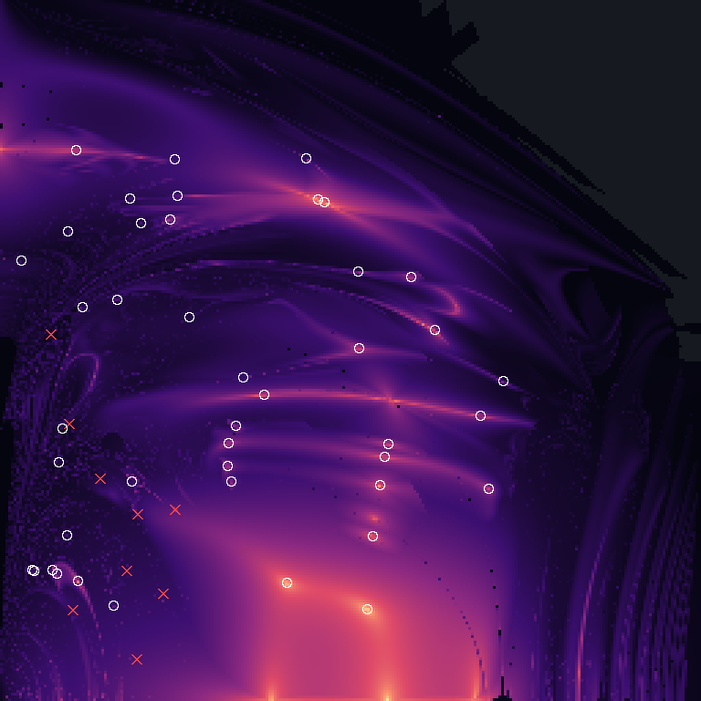

# Suchlauf probe-256

2026-10-02 17:39 UTC · Euler-Ebene · Massen 1 / 1 / 1 · Fenster v₁ 0…0.75, v₂ 0…0.75 · Raster 256×256 · Perioden bis 30 · Suche über den Wiederkehrabstand (ganze Periode)

## Was der Lauf getan hat

| Stufe | Zahl |
|---|---|
| Rasterpunkte gerechnet | 65536 in 12 s auf 11 Fäden |
| davon durchgelaufen / Zerfall / abgebrochen / ungebunden | 55848 / 6566 / 420 / 2702 |
| Talsohlen (unter 1) in undefined Zeitbändern | 1173 |
| davon durch die Prüfkette | 1173 in 104 s |
| geschlossene Bahn | 180 |
| verschiedene Orte in der Ebene | **43** |
| verschiedene Bahnen (gleiches T* auf acht Stellen einmal gezählt) | **39** |
| — bestätigt (voller Umlauf: Rest < 1e-10 und Gegenprobe < 1e-8) | 42 |
| — an der Rechengrenze | 1 |
| sicher linear stabil | 5 |
| Ausnahmen im Schwarm | 0 |

## Bekannt oder nicht

Von den 43 Funden stehen **43** in einer der geprüften Listen, **0** in keiner. Als verschiedene Bahnen gezählt (eine Bahn kann die Ebene an mehreren Stellen kreuzen): 39, davon **0** in keiner Liste.

| Liste | Stufe | Bahnen | Bedeutung |
|---|---|---|---|
| Li/Liao 2017–2019, Šuvakov/Dmitrašinović 2013 (2364 Bahnen, mit Klassen) | Ort | 21 | steht mit diesen Anfangswerten in der Liste |
| | Lage | 7 | gleiches T* auf acht Stellen: Listenbahn, an anderer Stelle getroffen |
| | Klasse | 8 | Klasse in der Liste, aber anderes T*: weitere Bahn derselben Familie |
| | keine | 7 | Klasse nicht in der Liste |
| Hristov u. a. (441985 Anfangswerte, gleiche Massen) | Ort | 43 | steht mit diesen Anfangswerten in der Liste |
| | Lage | 0 | gleiches T* auf acht Stellen: Listenbahn, an anderer Stelle getroffen |
| | keine | 0 | weder Ort noch T* in der Liste |

Trennschärfe: die 43 Ortstreffer liegen im Median 4.7e-14 und höchstens 2.4e-12 vom Listenwert (Schwelle 1e-6), ihr T* weicht höchstens 2.7e-12 ab.

„In keiner Liste“ heißt genau das und nicht „neu“. Die Listen sind in sich begrenzt: Li und Liao führen je Klasse eine Bahn bis T = 200, gefunden auf einem Raster von 4000²; Hristov u. a. führen die Euler-Ebene bis T* = 211 und den freien Fall bis T* = 80 (mit Punktsymmetrie bis 120).

## Gegenrichtung: was der Lauf von den Listen wiederfindet

| Liste | Bahnen im Fenster mit T bis 30 | gefunden | Anteil |
|---|---|---|---|
| Li/Liao, 2013 | 0 | 0 | — |
| Hristov u. a. | 0 | 0 | — |

Karte: hell = kleiner Wiederkehrabstand. Weißer Ring = Fund, der in einer Liste steht (nur bei bis zu 3000 Funden gezeichnet). Grüner Punkt = Fund, der in keiner Liste steht. Rotes Kreuz = Bahn aus Li/Liao, die der Lauf verpasst hat.

## Funde in keiner Liste (0)

| v₁ | v₂ | T | T* | Rest (voller Umlauf) | Umkehrpunkt | Urteil | Stabilität | \|λ\| | engste Begegnung | Wortlänge | Listen |
|---|---|---|---|---|---|---|---|---|---|---|---|

## Sicher linear stabile Funde (5)

| v₁ | v₂ | T | T* | Rest (voller Umlauf) | Umkehrpunkt | Urteil | Stabilität | \|λ\| | engste Begegnung | Wortlänge | Listen |
|---|---|---|---|---|---|---|---|---|---|---|---|
| 0.347116888119 | 0.532724945388 | 6.32591398 | 9.2377 | 3.2e-15 | — | bestätigt | stabil | 1.00 | 0.6905 | 4 | ort: Acht |
| 0.405915567135 | 0.230163125980 | 13.86712344 | 34.8022 | 1.4e-13 | — | bestätigt | stabil | 1.00 | 0.008337 | 14 | ort: Schmetterling III |
| 0.464445172818 | 0.396060014653 | 14.89430518 | 24.2056 | 8.0e-14 | — | bestätigt | stabil | 1.00 | 0.07947 | 10 | ort: Motte I |
| 0.411292690948 | 0.260755101360 | 20.74906501 | 49.6301 | 3.5e-13 | — | bestätigt | stabil | 1.00 | 0.005486 | 20 | ort: I.A-5 |
| 0.439165917888 | 0.452967643191 | 28.66927092 | 42.7821 | 1.1e-12 | — | bestätigt | stabil | 1.00 | 0.04970 | 18 | ort: Motte II |

## Alle Funde (43)

| v₁ | v₂ | T | T* | Rest (voller Umlauf) | Umkehrpunkt | Urteil | Stabilität | \|λ\| | engste Begegnung | Wortlänge | Listen |
|---|---|---|---|---|---|---|---|---|---|---|---|
| 0.306893420464 | 0.125506567015 | 6.23467484 | 19.9325 | 4.9e-14 | — | bestätigt | instabil | 1.78 | 0.01102 | 8 | ort: Schmetterling I |
| 0.339407411991 | 0.536184978151 | 6.29081877 | 9.2377 | 2.5e-15 | — | bestätigt | instabil | 1.10 | 0.6583 | 4 | Hristov: ort |
| 0.347116888119 | 0.532724945388 | 6.32591398 | 9.2377 | 3.2e-15 | — | bestätigt | stabil | 1.00 | 0.6905 | 4 | ort: Acht |
| 0.392955493698 | 0.097578968423 | 7.00370960 | 19.9313 | 7.1e-14 | — | bestätigt | instabil | 1.02 | 0.004099 | 8 | ort: Schmetterling II |
| 0.088005461924 | 0.421271076906 | 8.97545309 | 24.3344 | 6.4e-13 | — | bestätigt | instabil | 680 | 0.03728 | 10 | Hristov: ort |
| 0.062014409046 | 0.254787672459 | 10.09007046 | 35.0512 | 7.8e-13 | — | bestätigt | instabil | 121 | 0.04078 | 14 | Hristov: ort |
| 0.056005055936 | 0.139870726289 | 10.45366342 | 39.6448 | 1.7e-12 | — | bestätigt | instabil | 55.1 | 0.01801 | 16 | Hristov: ort |
| 0.083300071850 | 0.127889255520 | 10.46484953 | 39.6436 | 2.6e-13 | — | bestätigt | instabil | 20.7 | 0.01848 | 16 | ort: Brille |
| 0.282702090436 | 0.327208971523 | 10.96330309 | 29.6021 | 1.2e-13 | — | bestätigt | instabil | 1.91 | 0.009784 | 12 | ort: Yin-Yang I b |
| 0.066732789869 | 0.291286756903 | 13.36971106 | 44.5853 | 8.3e-13 | — | bestätigt | instabil | 334 | 0.03156 | 18 | ort: II.C-189 |
| 0.405915567135 | 0.230163125980 | 13.86712344 | 34.8022 | 1.4e-13 | — | bestätigt | stabil | 1.00 | 0.008337 | 14 | ort: Schmetterling III |
| 0.464445172818 | 0.396060014653 | 14.89430518 | 24.2056 | 8.0e-14 | — | bestätigt | stabil | 1.00 | 0.07947 | 10 | ort: Motte I |
| 0.035836843244 | 0.138442001638 | 15.62220261 | 59.4930 | 1.0e-11 | — | bestätigt | instabil | 3.68e+3 | 0.01161 | 24 | Hristov: ort |
| 0.121453416447 | 0.101202379955 | 15.74409450 | 59.4554 | 3.5e-13 | — | bestätigt | instabil | 1.31e+3 | 0.01115 | 24 | ort: I.A-7 |
| 0.244508405258 | 0.275224079621 | 16.39008490 | 49.6432 | 1.7e-12 | — | bestätigt | instabil | 8.44 | 7.7e-4 | 20 | lage: II.C-3 |
| 0.513938537460 | 0.304735919347 | 17.32883402 | 29.6021 | 1.6e-13 | — | bestätigt | instabil | 1.91 | 0.01328 | 12 | ort: Yin-Yang I a |
| 0.072656534145 | 0.501517234944 | 17.44796238 | 39.6885 | 2.4e-12 | — | bestätigt | instabil | 1.07e+3 | 0.005076 | 18 | lage: II.C-191 |
| 0.181942880483 | 0.514805997725 | 18.14136765 | 36.9090 | 5.2e-13 | — | bestätigt | instabil | 3.83 | 0.2281 | 16 | Hristov: ort |
| 0.022040268109 | 0.470356250519 | 18.90898054 | 46.9964 | 8.9e-12 | — | bestätigt | instabil | 1.77e+3 | 0.007383 | 22 | Hristov: ort |
| 0.189004891951 | 0.539762452801 | 19.73539189 | 36.9400 | 6.2e-13 | — | bestätigt | instabil | 43.8 | 0.2607 | 16 | Hristov: ort |
| 0.071329509030 | 0.176761351127 | 20.21208108 | 74.7276 | 2.3e-11 | — | bestätigt | instabil | 119 | 5.3e-4 | 30 | lage: II.C-64 |
| 0.124845074905 | 0.428794509452 | 20.56270071 | 53.9231 | 2.4e-11 | — | bestätigt | instabil | 82.4 | 4.6e-4 | 22 | lage: II.C-4 |
| 0.411292690948 | 0.260755101360 | 20.74906501 | 49.6301 | 3.5e-13 | — | bestätigt | stabil | 1.00 | 0.005486 | 20 | ort: I.A-5 |
| 0.034156397886 | 0.139200706072 | 20.85512849 | 79.4076 | 5.3e-11 | — | bestätigt | instabil | 1.69e+4 | 0.01114 | 32 | Hristov: ort |
| 0.060136433081 | 0.135819365446 | 20.88231548 | 79.2882 | 5.8e-12 | — | bestätigt | instabil | 752 | 0.01662 | 32 | Hristov: ort |
| 0.201678309263 | 0.409895543659 | 21.02051589 | 53.9231 | 1.8e-11 | — | bestätigt | instabil | 82.4 | 4.7e-4 | 22 | ort: II.C-4 |
| 0.080584225541 | 0.588836089778 | 21.27233739 | 36.7714 | 3.2e-12 | — | bestätigt | instabil | 1.31 | 0.007336 | 16 | ort: Libelle |
| 0.243384558646 | 0.250516692357 | 22.33337879 | 69.6227 | 8.3e-11 | — | bestätigt | instabil | 20.0 | 2.9e-5 | 28 | ort: II.C-8 |
| 0.138898023308 | 0.537502415024 | 23.33464606 | 46.1409 | 1.7e-12 | — | bestätigt | instabil | 431 | 0.1597 | 20 | Hristov: ort |
| 0.382741412266 | 0.458977118199 | 25.05730466 | 42.7835 | 9.5e-13 | — | bestätigt | instabil | 30.9 | 0.01595 | 18 | Hristov: ort |
| 0.259557114145 | 0.345634066418 | 25.42970948 | 68.6873 | 3.0e-12 | — | bestätigt | instabil | 155 | 0.002322 | 28 | lage: II.C-6 |
| 0.383443519950 | 0.377363694888 | 25.83923636 | 53.8569 | 1.7e-12 | — | bestätigt | instabil | 1.68 | 0.006717 | 22 | ort: Motte III |
| 0.150365547650 | 0.510957535837 | 26.08613758 | 55.2352 | 3.9e-12 | — | bestätigt | instabil | 330 | 0.08624 | 24 | Hristov: ort |
| 0.522520163382 | 0.226808387137 | 26.31938488 | 49.6432 | 4.5e-12 | — | bestätigt | instabil | 8.44 | 0.001060 | 20 | ort: II.C-3 |
| 0.537955720731 | 0.341457854438 | 26.91866962 | 39.0752 | 5.4e-14 | — | bestätigt | instabil | 56.9 | 0.06187 | 16 | ort: I.A-4 |
| 0.251733033679 | 0.294190155578 | 27.00343892 | 79.2736 | 9.6e-13 | — | bestätigt | instabil | 21.8 | 0.01258 | 32 | Hristov: ort |
| 0.140931985364 | 0.234382507754 | 27.62009989 | 94.8138 | 1.8e-10 | — | an der Rechengrenze | instabil | 116 | 5.2e-5 | 38 | lage: II.C-19 |
| 0.414912960880 | 0.274618755099 | 27.66464711 | 64.4455 | 9.6e-13 | — | bestätigt | offen | 1.02 | 0.003676 | 26 | ort: I.B-9 |
| 0.398044433461 | 0.176138333450 | 27.82341433 | 74.6945 | 2.3e-12 | — | bestätigt | offen | 1.00 | 0.001070 | 30 | ort: I.B-10 |
| 0.246618201707 | 0.234562128619 | 28.36714892 | 89.5828 | 8.2e-11 | — | bestätigt | offen | 43.5 | 1.0e-5 | 36 | lage: II.C-17 |
| 0.439165917888 | 0.452967643191 | 28.66927092 | 42.7821 | 1.1e-12 | — | bestätigt | stabil | 1.00 | 0.04970 | 18 | ort: Motte II |
| 0.327578070942 | 0.579861679719 | 29.21293407 | 36.9400 | 5.2e-13 | — | bestätigt | instabil | 43.8 | 0.3386 | 16 | Hristov: ort |
| 0.186237815960 | 0.578713866046 | 33.64141876 | 55.2035 | 5.3e-12 | — | bestätigt | instabil | 2.33 | 0.02456 | 24 | ort: I.B-7 |
