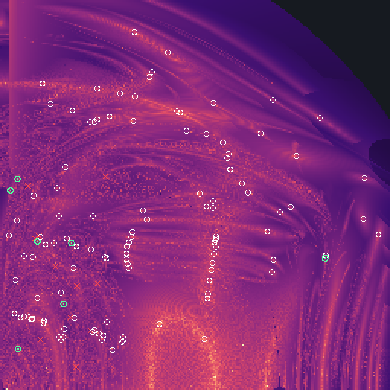

# Suchlauf probe-halb-256

2026-10-02 17:40 UTC · Euler-Ebene · Massen 1 / 1 / 1 · Fenster v₁ 0…0.75, v₂ 0…0.75 · Raster 256×256 · Perioden bis 30 · Suche über Umkehrpunkte (halbe Periode)

## Was der Lauf getan hat

| Stufe | Zahl |
|---|---|
| Rasterpunkte gerechnet | 65536 in 11 s auf 11 Fäden |
| davon durchgelaufen / Zerfall / abgebrochen / ungebunden | 58907 / 3674 / 253 / 2702 |
| Talsohlen (unter 0.3) in 8 Zielen × 6 Zeitbändern | 46042 |
| davon durch die Prüfkette | 4000 in 37 s |
| Umkehrpunkt verfehlt | 2947 |
| Umkehrpunkt getroffen, aber nach 12τ nicht zurück (nur bis auf eine Drehung periodisch) | 63 |
| geschlossene Bahn | 990 |
| verschiedene Orte in der Ebene | **119** |
| verschiedene Bahnen (gleiches T* auf acht Stellen einmal gezählt) | **113** |
| — bestätigt (voller Umlauf: Rest < 1e-10 und Gegenprobe < 1e-8) | 62 |
| — über den Umkehrpunkt (halber Umlauf auf 1e-11 getroffen, voller für double zu empfindlich) | 52 |
| — an der Rechengrenze | 5 |
| sicher linear stabil | 10 |
| Ausnahmen im Schwarm | 0 |

Je Ziel (Fixmenge, die nach der halben Periode getroffen wird):

| Ziel | Kandidaten | Umkehrpunkt getroffen | geschlossene Bahn |
|---|---|---|---|
| B1 | 374 | 61 | 55 |
| C | 658 | 77 | 64 |
| B3 | 1781 | 556 | 554 |
| B2 | 270 | 28 | 22 |
| A3 | 633 | 253 | 253 |
| R | 205 | 43 | 9 |
| A1 | 49 | 20 | 20 |
| A2 | 30 | 15 | 13 |

## Bekannt oder nicht

Von den 119 Funden stehen **112** in einer der geprüften Listen, **7** in keiner. Als verschiedene Bahnen gezählt (eine Bahn kann die Ebene an mehreren Stellen kreuzen): 113, davon **7** in keiner Liste.

| Liste | Stufe | Bahnen | Bedeutung |
|---|---|---|---|
| Li/Liao 2017–2019, Šuvakov/Dmitrašinović 2013 (2364 Bahnen, mit Klassen) | Ort | 39 | steht mit diesen Anfangswerten in der Liste |
| | Lage | 5 | gleiches T* auf acht Stellen: Listenbahn, an anderer Stelle getroffen |
| | Klasse | 15 | Klasse in der Liste, aber anderes T*: weitere Bahn derselben Familie |
| | keine | 60 | Klasse nicht in der Liste |
| Hristov u. a. (441985 Anfangswerte, gleiche Massen) | Ort | 112 | steht mit diesen Anfangswerten in der Liste |
| | Lage | 0 | gleiches T* auf acht Stellen: Listenbahn, an anderer Stelle getroffen |
| | keine | 7 | weder Ort noch T* in der Liste |

Trennschärfe: die 112 Ortstreffer liegen im Median 1.3e-14 und höchstens 4.9e-12 vom Listenwert (Schwelle 1e-6), ihr T* weicht höchstens 5.2e-12 ab; die 7 übrigen haben ihren nächsten Listennachbarn mindestens 5.0e-5 entfernt (Median 2.3e-4).

„In keiner Liste“ heißt genau das und nicht „neu“. Die Listen sind in sich begrenzt: Li und Liao führen je Klasse eine Bahn bis T = 200, gefunden auf einem Raster von 4000²; Hristov u. a. führen die Euler-Ebene bis T* = 211 und den freien Fall bis T* = 80 (mit Punktsymmetrie bis 120).

## Gegenrichtung: was der Lauf von den Listen wiederfindet

| Liste | Bahnen im Fenster mit T bis 30 | gefunden | Anteil |
|---|---|---|---|
| Li/Liao, 2013 | 29 | 18 | 62 % |
| Hristov u. a. | 10212 | 49 | 0.5 % |
| — davon T < 10 | 25 | 4 | 16.0 % |
| — davon T < 20 | 1314 | 16 | 1.2 % |
| — davon T < 30 | 8873 | 29 | 0.3 % |

Verpasst aus Li/Liao: II.C-4 (T 21.0), II.C-9 (T 21.8), II.C-19 (T 27.7), II.C-62 (T 15.6), II.C-64 (T 21.5), II.C-66 (T 26.9), II.C-189 (T 13.4), II.C-190 (T 15.3), II.C-192 (T 16.8), II.C-193 (T 22.4), II.C-197 (T 25.8).

Karte: hell = die Bahn kommt bis zur halben Höchstperiode einer Fixmenge nahe. Weißer Ring = Fund, der in einer Liste steht (nur bei bis zu 3000 Funden gezeichnet). Grüner Punkt = Fund, der in keiner Liste steht. Rotes Kreuz = Bahn aus Li/Liao, die der Lauf verpasst hat.

## Funde in keiner Liste (7)

| v₁ | v₂ | T | T* | Rest (voller Umlauf) | Umkehrpunkt | Urteil | Stabilität | \|λ\| | engste Begegnung | Wortlänge | Listen |
|---|---|---|---|---|---|---|---|---|---|---|---|
| 0.033685875914 | 0.405745798352 | 21.72584204 | 61.5748 | 8.9e-8 | A3 6.5e-12 | über den Umkehrpunkt | instabil | 2.321e+8 | 0.007356 | 34 | — |
| 0.019458196533 | 0.382971091195 | 32.22098664 | 95.1876 | 1.6e-6 | C 5.6e-14 | über den Umkehrpunkt | instabil | 9.939e+9 | 0.03482 | 82 | — |
| 0.034150805288 | 0.077728879924 | 37.77378859 | 147.3809 | 7.1e-8 | B3 5.0e-12 | über den Umkehrpunkt | instabil | 1.013e+6 | 0.003349 | 60 | — |
| 0.136243218015 | 0.281878347501 | 38.82457071 | 127.2036 | 7.5e-6 | R 1.1e-11 | an der Rechengrenze | offen | 4.290e+6 | 1.7e-5 | 0 | — |
| 0.625432026082 | 0.253282216882 | 42.02851932 | 50.7565 | 6.6e-7 | B3 1.9e-12 | über den Umkehrpunkt | instabil | 1.289e+7 | 0.001422 | 20 | — |
| 0.071064591638 | 0.284829294862 | 45.77493373 | 153.6123 | 2.0e-7 | C 4.3e-12 | über den Umkehrpunkt | instabil | 2.399e+7 | 0.002359 | 62 | nur Klasse von I.B-26 |
| 0.122421060581 | 0.165122645299 | 56.67093343 | 207.1923 | 8.9e-6 | R 9.2e-12 | über den Umkehrpunkt | offen | 4.229e+8 | 1.1e-4 | 0 | — |

## Sicher linear stabile Funde (10)

| v₁ | v₂ | T | T* | Rest (voller Umlauf) | Umkehrpunkt | Urteil | Stabilität | \|λ\| | engste Begegnung | Wortlänge | Listen |
|---|---|---|---|---|---|---|---|---|---|---|---|
| 0.347116888119 | 0.532724945388 | 6.32591398 | 9.2377 | 2.3e-14 | B2 4.5e-16 | bestätigt | stabil | 1.00 | 0.6905 | 4 | ort: Acht |
| 0.405915567135 | 0.230163125980 | 13.86712344 | 34.8022 | 4.5e-13 | B3 9.1e-14 | bestätigt | stabil | 1.00 | 0.008337 | 14 | ort: Schmetterling III |
| 0.464445172818 | 0.396060014653 | 14.89430518 | 24.2056 | 1.4e-13 | B3 9.5e-15 | bestätigt | stabil | 1.00 | 0.07947 | 10 | ort: Motte I |
| 0.411292690948 | 0.260755101360 | 20.74906501 | 49.6301 | 1.3e-12 | B3 5.7e-14 | bestätigt | stabil | 1.00 | 0.005486 | 20 | ort: I.A-5 |
| 0.439165917888 | 0.452967643191 | 28.66927092 | 42.7821 | 6.6e-12 | C 3.9e-14 | bestätigt | stabil | 1.00 | 0.04970 | 18 | ort: Motte II |
| 0.409494591304 | 0.362823165469 | 33.86775072 | 68.6734 | 9.2e-13 | B3 9.8e-14 | bestätigt | stabil | 1.00 | 0.005905 | 28 | ort: I.A-8 |
| 0.255430935651 | 0.516385839015 | 35.04308702 | 64.6554 | 1.4e-11 | B1 9.2e-15 | bestätigt | stabil | 1.00 | 0.3605 | 28 | Hristov: ort |
| 0.230256723920 | 0.569654502923 | 46.06689971 | 73.6623 | 1.1e-11 | C 1.7e-13 | bestätigt | stabil | 1.00 | 0.02944 | 32 | ort: I.B-11 |
| 0.476352764223 | 0.378943449726 | 53.47149143 | 87.4837 | 6.7e-11 | B3 4.7e-13 | bestätigt | stabil | 1.00 | 0.006738 | 36 | ort: I.A-13 |
| 0.410354995984 | 0.551985435672 | 57.54525394 | 64.6554 | 2.3e-11 | A1 1.4e-14 | bestätigt | stabil | 1.00 | 0.5018 | 28 | Hristov: ort |

## Alle Funde (119)

| v₁ | v₂ | T | T* | Rest (voller Umlauf) | Umkehrpunkt | Urteil | Stabilität | \|λ\| | engste Begegnung | Wortlänge | Listen |
|---|---|---|---|---|---|---|---|---|---|---|---|
| 0.306893420464 | 0.125506567015 | 6.23467484 | 19.9325 | 8.0e-14 | B3 5.5e-15 | bestätigt | instabil | 1.78 | 0.01102 | 8 | ort: Schmetterling I |
| 0.339407411991 | 0.536184978151 | 6.29081877 | 9.2377 | 9.1e-15 | B3 8.3e-16 | bestätigt | instabil | 1.10 | 0.6583 | 4 | Hristov: ort |
| 0.347116888119 | 0.532724945388 | 6.32591398 | 9.2377 | 2.3e-14 | B2 4.5e-16 | bestätigt | stabil | 1.00 | 0.6905 | 4 | ort: Acht |
| 0.392955493698 | 0.097578968423 | 7.00370960 | 19.9313 | 1.8e-13 | B3 9.1e-15 | bestätigt | instabil | 1.02 | 0.004099 | 8 | ort: Schmetterling II |
| 0.064909326168 | 0.372600330298 | 10.04564848 | 29.9369 | 9.7e-10 | C 4.1e-14 | über den Umkehrpunkt | instabil | 1.380e+5 | 0.001263 | 12 | Hristov: ort |
| 0.062014409046 | 0.254787672459 | 10.09007046 | 35.0512 | 1.4e-12 | C 7.6e-14 | bestätigt | instabil | 121 | 0.04078 | 14 | Hristov: ort |
| 0.056005055936 | 0.139870726289 | 10.45366342 | 39.6448 | 1.4e-12 | C 3.2e-14 | bestätigt | instabil | 55.1 | 0.01801 | 16 | Hristov: ort |
| 0.083300071850 | 0.127889255520 | 10.46484953 | 39.6436 | 5.7e-13 | C 2.4e-14 | bestätigt | instabil | 20.7 | 0.01848 | 16 | ort: Brille |
| 0.032685660378 | 0.325235097170 | 10.76509178 | 34.6371 | 1.1e-8 | C 2.5e-13 | über den Umkehrpunkt | instabil | 2.835e+6 | 0.004409 | 14 | Hristov: ort |
| 0.282702090436 | 0.327208971523 | 10.96330309 | 29.6021 | 2.2e-13 | B3 1.8e-14 | bestätigt | instabil | 1.91 | 0.009784 | 12 | ort: Yin-Yang I b |
| 0.405915567135 | 0.230163125980 | 13.86712344 | 34.8022 | 4.5e-13 | B3 9.1e-14 | bestätigt | stabil | 1.00 | 0.008337 | 14 | ort: Schmetterling III |
| 0.045559785920 | 0.256817934670 | 14.41366488 | 50.1425 | 1.8e-11 | B3 8.1e-14 | bestätigt | instabil | 6.62e+3 | 0.04132 | 20 | Hristov: ort |
| 0.464445172818 | 0.396060014653 | 14.89430518 | 24.2056 | 1.4e-13 | B3 9.5e-15 | bestätigt | stabil | 1.00 | 0.07947 | 10 | ort: Motte I |
| 0.027158147213 | 0.146858947754 | 15.69170749 | 59.5533 | 2.5e-10 | B3 7.4e-14 | über den Umkehrpunkt | instabil | 3.28e+4 | 0.009495 | 24 | Hristov: ort |
| 0.121453416447 | 0.101202379955 | 15.74409450 | 59.4554 | 1.9e-12 | B3 2.9e-13 | bestätigt | instabil | 1.31e+3 | 0.01115 | 24 | ort: I.A-7 |
| 0.244508405258 | 0.275224079621 | 16.39008490 | 49.6432 | 6.3e-12 | A3 1.6e-13 | bestätigt | instabil | 8.44 | 7.7e-4 | 20 | lage: II.C-3 |
| 0.513938537460 | 0.304735919347 | 17.32883402 | 29.6021 | 3.2e-13 | A3 3.2e-14 | bestätigt | instabil | 1.91 | 0.01328 | 12 | ort: Yin-Yang I a |
| 0.181942880483 | 0.514805997725 | 18.14136765 | 36.9090 | 3.4e-12 | A3 3.1e-13 | bestätigt | instabil | 3.83 | 0.2281 | 16 | Hristov: ort |
| 0.029281974779 | 0.211320895571 | 19.29450246 | 70.1060 | 1.2e-8 | C 9.1e-14 | über den Umkehrpunkt | instabil | 9.450e+6 | 0.02402 | 28 | Hristov: ort |
| 0.017044259343 | 0.297292274471 | 19.79855452 | 66.1078 | 2.2e-7 | C 2.6e-13 | über den Umkehrpunkt | instabil | 4.301e+9 | 0.01547 | 30 | Hristov: ort |
| 0.071329509030 | 0.176761351127 | 20.21208108 | 74.7276 | 1.4e-11 | B3 4.6e-13 | bestätigt | instabil | 119 | 5.3e-4 | 30 | lage: II.C-64 |
| 0.124845074905 | 0.428794509452 | 20.56270071 | 53.9231 | 2.4e-11 | A3 1.0e-12 | bestätigt | instabil | 82.4 | 4.6e-4 | 22 | lage: II.C-4 |
| 0.117135595237 | 0.186593873722 | 20.69978926 | 74.7795 | 1.0e-10 | B3 4.1e-13 | über den Umkehrpunkt | instabil | 5.79e+3 | 0.03033 | 30 | Hristov: ort |
| 0.411292690948 | 0.260755101360 | 20.74906501 | 49.6301 | 1.3e-12 | B3 5.7e-14 | bestätigt | stabil | 1.00 | 0.005486 | 20 | ort: I.A-5 |
| 0.045713705152 | 0.140934070360 | 20.87577013 | 79.2797 | 1.4e-10 | C 1.3e-13 | über den Umkehrpunkt | instabil | 4.89e+4 | 0.01536 | 32 | Hristov: ort |
| 0.060136433081 | 0.135819365446 | 20.88231548 | 79.2882 | 2.6e-11 | A3 6.5e-13 | bestätigt | instabil | 752 | 0.01662 | 32 | Hristov: ort |
| 0.113693093317 | 0.101277465539 | 20.91473163 | 79.2469 | 1.9e-10 | C 1.0e-13 | über den Umkehrpunkt | instabil | 1.69e+4 | 0.01132 | 32 | Hristov: ort |
| 0.083632024082 | 0.133007119089 | 20.98395936 | 79.2882 | 3.7e-11 | B3 6.0e-13 | bestätigt | instabil | 752 | 0.01668 | 32 | Hristov: ort |
| 0.080584225541 | 0.588836089778 | 21.27233739 | 36.7714 | 4.4e-12 | C 8.7e-15 | bestätigt | instabil | 1.31 | 0.007336 | 16 | ort: Libelle |
| 0.142540755738 | 0.138162555858 | 21.58651977 | 79.3478 | 1.3e-10 | C 3.4e-13 | über den Umkehrpunkt | instabil | 3.01e+4 | 0.01663 | 32 | Hristov: ort |
| 0.033685875914 | 0.405745798352 | 21.72584204 | 61.5748 | 8.9e-8 | A3 6.5e-12 | über den Umkehrpunkt | instabil | 2.321e+8 | 0.007356 | 34 | — |
| 0.243384558647 | 0.250516692357 | 22.33337879 | 69.6227 | 2.2e-10 | B3 1.3e-12 | über den Umkehrpunkt | instabil | 19.9 | 2.9e-5 | 28 | ort: II.C-8 |
| 0.138898023308 | 0.537502415024 | 23.33464606 | 46.1409 | 3.3e-12 | A3 3.7e-14 | bestätigt | instabil | 431 | 0.1597 | 20 | Hristov: ort |
| 0.383443519950 | 0.377363694888 | 25.83923636 | 53.8569 | 3.4e-12 | A3 2.1e-13 | bestätigt | instabil | 1.68 | 0.006717 | 22 | ort: Motte III |
| 0.039015142028 | 0.138695838106 | 26.03746813 | 99.1004 | 4.6e-9 | B3 2.4e-13 | über den Umkehrpunkt | instabil | 1.370e+6 | 0.01274 | 40 | Hristov: ort |
| 0.117003239188 | 0.095842488674 | 26.12460662 | 99.0438 | 8.2e-10 | B3 4.3e-12 | über den Umkehrpunkt | instabil | 2.601e+5 | 0.01014 | 40 | Hristov: ort |
| 0.522520163382 | 0.226808387137 | 26.31938488 | 49.6432 | 2.3e-12 | B3 8.4e-13 | bestätigt | instabil | 8.44 | 0.001060 | 20 | ort: II.C-3 |
| 0.123299298262 | 0.116971223959 | 26.48445275 | 99.2933 | 1.6e-10 | B3 1.4e-12 | über den Umkehrpunkt | instabil | 1.29e+4 | 0.007678 | 40 | Hristov: ort |
| 0.537955720731 | 0.341457854438 | 26.91866962 | 39.0752 | 5.0e-13 | B3 2.2e-14 | bestätigt | instabil | 56.9 | 0.06187 | 16 | ort: I.A-4 |
| 0.251733033679 | 0.294190155578 | 27.00343892 | 79.2736 | 5.8e-12 | B3 6.1e-14 | bestätigt | instabil | 21.8 | 0.01258 | 32 | Hristov: ort |
| 0.177438945379 | 0.111469391838 | 27.20769467 | 99.1605 | 1.3e-10 | B3 2.7e-12 | über den Umkehrpunkt | instabil | 2.98e+4 | 0.01195 | 40 | Hristov: ort |
| 0.198593120267 | 0.104717319212 | 27.57952650 | 99.2777 | 4.5e-11 | B3 8.9e-13 | bestätigt | instabil | 1.67e+4 | 0.01058 | 40 | Hristov: ort |
| 0.140931985364 | 0.234382507754 | 27.62009989 | 94.8138 | 9.6e-10 | A3 1.5e-10 | an der Rechengrenze | instabil | 116 | 5.2e-5 | 38 | lage: II.C-19 |
| 0.414912960880 | 0.274618755099 | 27.66464711 | 64.4455 | 4.1e-12 | B3 1.1e-12 | bestätigt | instabil | 1.02 | 0.003676 | 26 | ort: I.B-9 |
| 0.203812611344 | 0.252688535689 | 27.69108922 | 89.3650 | 3.7e-10 | A3 1.9e-11 | an der Rechengrenze | instabil | 5.09e+3 | 9.7e-5 | 28 | Hristov: ort |
| 0.398044433461 | 0.176138333450 | 27.82341433 | 74.6945 | 1.2e-11 | A3 1.0e-12 | bestätigt | offen | 1.00 | 0.001070 | 30 | ort: I.B-10 |
| 0.236185580609 | 0.093800691510 | 28.35042643 | 99.2933 | 7.0e-11 | B3 2.5e-12 | bestätigt | instabil | 1.29e+4 | 0.008034 | 40 | Hristov: ort |
| 0.246618201711 | 0.234562128618 | 28.36714892 | 89.5828 | 1.2e-10 | B3 1.0e-11 | an der Rechengrenze | offen | 45.0 | 1.0e-5 | 36 | lage: II.C-17 |
| 0.439165917888 | 0.452967643191 | 28.66927092 | 42.7821 | 6.6e-12 | C 3.9e-14 | bestätigt | stabil | 1.00 | 0.04970 | 18 | ort: Motte II |
| 0.215476330520 | 0.075960127880 | 28.85519365 | 103.5127 | 1.4e-9 | B3 3.3e-12 | über den Umkehrpunkt | instabil | 2.474e+5 | 0.002821 | 42 | Hristov: ort |
| 0.061194390615 | 0.136317762044 | 31.33879260 | 118.9324 | 2.3e-10 | C 6.9e-13 | über den Umkehrpunkt | instabil | 2.34e+4 | 0.01786 | 48 | Hristov: ort |
| 0.084336787017 | 0.131040749642 | 31.45233868 | 118.9315 | 4.2e-10 | C 2.3e-13 | über den Umkehrpunkt | instabil | 1.07e+4 | 0.01719 | 48 | Hristov: ort |
| 0.019458196533 | 0.382971091195 | 32.22098664 | 95.1876 | 1.6e-6 | C 5.6e-14 | über den Umkehrpunkt | instabil | 9.939e+9 | 0.03482 | 82 | — |
| 0.181342135083 | 0.115597436012 | 32.81422681 | 119.0631 | 7.6e-11 | C 1.8e-13 | bestätigt | instabil | 22.5 | 0.01304 | 48 | Hristov: ort |
| 0.189555211341 | 0.108736426542 | 32.90848157 | 119.0623 | 1.1e-9 | C 1.2e-12 | über den Umkehrpunkt | instabil | 3.75e+4 | 0.01151 | 48 | Hristov: ort |
| 0.186237815959 | 0.578713866046 | 33.64141876 | 55.2035 | 3.6e-12 | C 2.5e-13 | bestätigt | instabil | 2.33 | 0.02456 | 24 | ort: I.B-7 |
| 0.205366024191 | 0.129707941609 | 33.66079115 | 119.1787 | 4.8e-10 | C 4.4e-13 | über den Umkehrpunkt | instabil | 4.211e+5 | 0.01543 | 48 | Hristov: ort |
| 0.209661504927 | 0.525702388967 | 33.86151867 | 64.6517 | 3.2e-12 | A1 1.3e-14 | bestätigt | instabil | 7.15 | 0.3441 | 28 | Hristov: ort |
| 0.409494591304 | 0.362823165469 | 33.86775072 | 68.6734 | 9.2e-13 | B3 9.8e-14 | bestätigt | stabil | 1.00 | 0.005905 | 28 | ort: I.A-8 |
| 0.412102872517 | 0.283383749688 | 34.24704997 | 79.2555 | 4.6e-12 | B3 5.8e-14 | bestätigt | offen | 1.01 | 0.003132 | 32 | ort: I.A-10 |
| 0.402712168929 | 0.210015508499 | 34.71201537 | 89.5601 | 2.5e-11 | B3 2.5e-13 | bestätigt | offen | 1.00 | 0.001068 | 36 | ort: I.A-14 |
| 0.255430935651 | 0.516385839015 | 35.04308702 | 64.6554 | 1.4e-11 | B1 9.2e-15 | bestätigt | stabil | 1.00 | 0.3605 | 28 | Hristov: ort |
| 0.086427017672 | 0.279278620275 | 35.40837887 | 118.9939 | 5.6e-8 | R 2.9e-13 | über den Umkehrpunkt | offen | 4.481e+6 | 8.4e-4 | 0 | Hristov: ort |
| 0.442590855256 | 0.423513834737 | 35.83346441 | 57.7280 | 5.9e-12 | B3 9.0e-14 | bestätigt | instabil | 5.53 | 0.008855 | 24 | ort: I.A-6 |
| 0.128331671092 | 0.290852743477 | 36.57359900 | 119.0846 | 3.7e-6 | R 2.3e-12 | über den Umkehrpunkt | offen | 1.706e+7 | 3.4e-4 | 0 | Hristov: ort |
| 0.287301072700 | 0.601635268451 | 36.62599425 | 46.1429 | 1.8e-11 | B3 3.5e-14 | bestätigt | instabil | 254 | 0.2191 | 20 | Hristov: ort |
| 0.274436556876 | 0.344872940464 | 37.02818997 | 98.2987 | 3.1e-10 | B3 2.7e-12 | über den Umkehrpunkt | instabil | 375 | 0.001563 | 40 | ort: I.A-48 |
| 0.615040722870 | 0.522615854447 | 37.32052360 | 15.0484 | 2.3e-12 | B3 8.6e-15 | bestätigt | instabil | 84.9 | 0.5026 | 8 | ort: I.A-3 |
| 0.034150805288 | 0.077728879924 | 37.77378859 | 147.3809 | 7.1e-8 | B3 5.0e-12 | über den Umkehrpunkt | instabil | 1.013e+6 | 0.003349 | 60 | — |
| 0.178632609186 | 0.334316243842 | 38.05458670 | 113.2500 | 9.1e-10 | C 4.8e-12 | über den Umkehrpunkt | instabil | 2.00e+4 | 0.01966 | 46 | Hristov: ort |
| 0.103912540523 | 0.282693961884 | 38.25399802 | 127.2062 | 4.4e-6 | R 1.1e-11 | an der Rechengrenze | offen | 1.739e+7 | 1.7e-5 | 0 | Hristov: ort |
| 0.242884571619 | 0.261373338795 | 38.69293078 | 119.2733 | 1.9e-11 | B3 9.5e-14 | bestätigt | instabil | 175 | 0.005073 | 48 | Hristov: ort |
| 0.146661019566 | 0.275283210821 | 38.76502150 | 127.1970 | 1.4e-7 | R 2.6e-12 | über den Umkehrpunkt | offen | 1.803e+5 | 2.4e-5 | 0 | Hristov: ort |
| 0.136243218015 | 0.281878347501 | 38.82457071 | 127.2036 | 7.5e-6 | R 1.1e-11 | an der Rechengrenze | offen | 4.290e+6 | 1.7e-5 | 0 | — |
| 0.236370133334 | 0.101333510402 | 39.84594281 | 139.1310 | 2.7e-9 | B3 1.9e-12 | über den Umkehrpunkt | instabil | 1.316e+5 | 0.009281 | 56 | Hristov: ort |
| 0.414348148387 | 0.288103109513 | 41.12605536 | 94.0628 | 6.0e-12 | C 1.1e-11 | bestätigt | offen | 1.00 | 0.002392 | 38 | ort: I.B-15 |
| 0.625432026082 | 0.253282216882 | 42.02851932 | 50.7565 | 6.6e-7 | B3 1.9e-12 | über den Umkehrpunkt | instabil | 1.289e+7 | 0.001422 | 20 | — |
| 0.626110440504 | 0.258062894598 | 42.57056450 | 50.7407 | 5.7e-7 | R 5.3e-13 | über den Umkehrpunkt | offen | 1.685e+7 | 3.3e-4 | 0 | Hristov: ort |
| 0.429089814887 | 0.475313290357 | 42.82996610 | 61.2901 | 7.0e-12 | C 2.2e-13 | bestätigt | instabil | 6.97 | 0.04115 | 26 | ort: I.B-8 |
| 0.195520480335 | 0.095704266755 | 43.82214567 | 158.6589 | 3.5e-7 | C 4.6e-13 | über den Umkehrpunkt | instabil | 3.860e+7 | 0.008986 | 64 | Hristov: ort |
| 0.525576925120 | 0.250125352858 | 43.86985381 | 79.2774 | 1.9e-11 | B3 3.8e-13 | bestätigt | instabil | 21.3 | 0.003291 | 32 | ort: I.A-9 |
| 0.071064591638 | 0.284829294862 | 45.77493373 | 153.6123 | 2.0e-7 | C 4.3e-12 | über den Umkehrpunkt | instabil | 2.399e+7 | 0.002359 | 62 | nur Klasse von I.B-26 |
| 0.700195471317 | 0.407171853052 | 45.87219814 | 17.7905 | 4.2e-12 | C 1.3e-14 | bestätigt | instabil | 339 | 0.3223 | 8 | Hristov: ort |
| 0.230256723920 | 0.569654502923 | 46.06689971 | 73.6623 | 1.1e-11 | C 1.7e-13 | bestätigt | stabil | 1.00 | 0.02944 | 32 | ort: I.B-11 |
| 0.396049465056 | 0.352941393016 | 46.13407355 | 98.2894 | 5.4e-11 | B3 6.6e-12 | bestätigt | offen | 1.00 | 0.001158 | 40 | ort: I.A-15 |
| 0.253893790465 | 0.303574612405 | 47.88401532 | 138.5096 | 8.5e-11 | B3 2.6e-13 | bestätigt | instabil | 261 | 0.003148 | 56 | Hristov: ort |
| 0.415250570636 | 0.291346180809 | 47.92549772 | 108.8685 | 2.2e-11 | B3 2.9e-13 | bestätigt | offen | 1.00 | 0.001980 | 44 | ort: I.A-19 |
| 0.524681032360 | 0.558089498740 | 48.10441368 | 30.6057 | 1.0e-9 | C 7.5e-12 | über den Umkehrpunkt | instabil | 40.2 | 1.2e-4 | 14 | Hristov: ort |
| 0.408210815498 | 0.243685190411 | 48.48685136 | 119.2413 | 6.1e-12 | B3 3.9e-13 | bestätigt | offen | 1.00 | 8.3e-4 | 48 | ort: I.A-21 |
| 0.399128764341 | 0.184708119927 | 48.66737686 | 129.4496 | 2.9e-11 | B3 5.3e-13 | bestätigt | offen | 1.00 | 3.9e-4 | 52 | ort: I.A-26 |
| 0.174656186856 | 0.269572123017 | 48.91592938 | 158.5838 | 1.4e-6 | R 5.4e-13 | über den Umkehrpunkt | offen | 8.022e+7 | 3.7e-4 | 0 | Hristov: ort |
| 0.200915080836 | 0.254721914403 | 49.22650264 | 158.9104 | 3.2e-8 | R 3.8e-13 | über den Umkehrpunkt | instabil | 1.446e+6 | 8.2e-4 | 0 | Hristov: ort |
| 0.436419267357 | 0.445709547667 | 49.59540332 | 76.2979 | 8.3e-11 | B3 1.6e-13 | bestätigt | instabil | 2.99 | 0.01565 | 32 | ort: I.A-11 |
| 0.358087004101 | 0.497695449098 | 49.63150661 | 79.7797 | 1.3e-10 | C 5.1e-13 | über den Umkehrpunkt | instabil | 189 | 0.01544 | 34 | ort: I.B-13 |
| 0.244805065855 | 0.241757580726 | 50.68324749 | 159.2085 | 1.9e-9 | B3 3.6e-12 | über den Umkehrpunkt | offen | 891 | 2.0e-5 | 64 | Hristov: ort |
| 0.322191333119 | 0.647984894407 | 51.39314309 | 46.0125 | 4.6e-11 | B1 1.1e-15 | bestätigt | instabil | 1.06e+4 | 0.2981 | 20 | Hristov: ort |
| 0.109156575861 | 0.387760994270 | 51.40841281 | 146.8445 | 4.3e-9 | B3 7.5e-12 | über den Umkehrpunkt | instabil | 4.91e+3 | 6.7e-4 | 60 | Hristov: ort |
| 0.568991007454 | 0.449428949707 | 51.96453653 | 46.0639 | 3.4e-12 | B1 4.4e-15 | bestätigt | instabil | 13.5 | 0.4214 | 20 | Hristov: ort |
| 0.060395458396 | 0.135122552960 | 52.19047809 | 198.2202 | 2.7e-7 | C 4.3e-13 | über den Umkehrpunkt | instabil | 2.332e+6 | 0.01550 | 80 | Hristov: ort |
| 0.476352764223 | 0.378943449726 | 53.47149143 | 87.4837 | 6.7e-11 | B3 4.7e-13 | bestätigt | stabil | 1.00 | 0.006738 | 36 | ort: I.A-13 |
| 0.396529317634 | 0.492290167016 | 53.74677265 | 79.7794 | 1.9e-10 | C 8.4e-14 | über den Umkehrpunkt | instabil | 21.0 | 0.03023 | 34 | Hristov: ort |
| 0.409251985030 | 0.349834314137 | 54.32610921 | 113.0953 | 2.5e-11 | C 2.4e-12 | bestätigt | offen | 1.08 | 0.001966 | 46 | ort: I.B-18 |
| 0.257850009431 | 0.687875705944 | 55.64504576 | 46.0157 | 5.4e-10 | B1 3.8e-15 | über den Umkehrpunkt | instabil | 2.32e+4 | 0.1603 | 20 | Hristov: ort |
| 0.558625303611 | 0.351335129914 | 55.71412397 | 72.6442 | 5.6e-12 | C 1.9e-13 | bestätigt | instabil | 5.02 | 0.01499 | 30 | Hristov: ort |
| 0.077503034779 | 0.294158587887 | 56.52327079 | 187.2657 | 4.6e-7 | B3 1.8e-12 | über den Umkehrpunkt | instabil | 2.696e+6 | 0.005246 | 76 | Hristov: ort |
| 0.234528544559 | 0.091561766577 | 56.54765407 | 198.5121 | 8.9e-6 | C 4.3e-12 | über den Umkehrpunkt | instabil | 2.377e+8 | 0.007544 | 80 | Hristov: ort |
| 0.122421060581 | 0.165122645299 | 56.67093343 | 207.1923 | 8.9e-6 | R 9.2e-12 | über den Umkehrpunkt | offen | 4.229e+8 | 1.1e-4 | 0 | — |
| 0.410354995984 | 0.551985435672 | 57.54525394 | 64.6554 | 2.3e-11 | A1 1.4e-14 | bestätigt | stabil | 1.00 | 0.5018 | 28 | Hristov: ort |
| 0.113203837386 | 0.333570417227 | 58.13280980 | 180.4269 | 2.3e-8 | C 2.5e-12 | über den Umkehrpunkt | instabil | 4.80e+4 | 0.01738 | 74 | Hristov: ort |
| 0.172819315835 | 0.514405194860 | 58.32879758 | 119.8869 | 1.0e-10 | B3 6.8e-14 | über den Umkehrpunkt | instabil | 170 | 0.1910 | 52 | Hristov: ort |
| 0.259062982983 | 0.564315461201 | 59.17519463 | 92.1299 | 5.0e-12 | C 6.4e-14 | bestätigt | instabil | 14.5 | 0.03090 | 40 | ort: I.B-16 |
| 0.246696124577 | 0.282955701074 | 59.64612681 | 178.5704 | 2.5e-10 | B3 5.2e-12 | über den Umkehrpunkt | instabil | 2.26e+3 | 6.0e-4 | 72 | Hristov: ort |
| 0.415169125943 | 0.295340909804 | 61.32282881 | 138.4773 | 5.3e-11 | B3 2.7e-13 | bestätigt | offen | 1.01 | 0.001611 | 56 | ort: I.A-27 |
| 0.500617716291 | 0.493599071831 | 63.01648612 | 64.6517 | 2.8e-11 | B1 2.5e-14 | bestätigt | instabil | 7.15 | 0.5206 | 28 | Hristov: ort |
| 0.292241622091 | 0.611059480253 | 77.42461994 | 92.2144 | 4.6e-10 | B1 1.0e-13 | über den Umkehrpunkt | instabil | 2.64e+3 | 0.2394 | 40 | Hristov: ort |
| 0.186577649021 | 0.519633961404 | 87.85164586 | 175.3891 | 3.8e-10 | B2 1.5e-14 | über den Umkehrpunkt | instabil | 1.90e+3 | 0.2538 | 76 | Hristov: ort |
| 0.096368453551 | 0.549457111453 | 89.10541168 | 174.6910 | 1.4e-8 | A2 8.5e-12 | über den Umkehrpunkt | offen | 1.36e+3 | 0.001024 | 76 | Hristov: ort |
| 0.698073258027 | 0.328500922253 | 100.84541054 | 60.8858 | 7.4e-10 | B1 1.2e-14 | über den Umkehrpunkt | instabil | 2.54e+3 | 0.2225 | 28 | Hristov: ort |
| 0.728003098884 | 0.298598362461 | 143.78064664 | 74.0564 | 2.8e-7 | B1 5.6e-14 | über den Umkehrpunkt | instabil | 1.230e+7 | 0.1840 | 36 | Hristov: ort |

## Nachprüfung in erhöhter Genauigkeit (2026-10-02 17:41 UTC)

7 Funde (in keiner Liste), Festkomma mit 320 Bit, Taylorreihe der Ordnung 40, Ziel 30 Stellen; Gegenprobe mit 448 Bit und Ordnung 52. Rechenzeit zusammen 20 min auf 5 Fäden.

| Urteil | Bahnen |
|---|---|
| belegt (Rest unter 1e-30, beide Rechnungen einig, Korrektur unter 1e-5) | **7** |
| belegt, aber verschoben | 0 |
| offen (Newton kam nicht unter 1e-30) | 0 |
| Zeitlimit | 0 |
| Ausnahmen | 0 |

Stabilität in erhöhter Genauigkeit (2 Bahnen): stabil **0**, an der Grenze 0, instabil 2, Zeitlimit 0, abgebrochen 0.

| a | b | T | Rest | Rest (448 Bit) | Korrektur gegen double | Rest in double | wahrer Rest dort | Schritte | s | Stabilität (double) | Stabilität (genau) | Abstand zur Grenze | Listen | Urteil |
|---|---|---|---|---|---|---|---|---|---|---|---|---|---|---|
| 0.0336858759137990926197 | 0.4057457983521318866761 | 21.7258420350665762266 | 3.3e-36 | 1.9e-31 | 3.4e-13 | 8.9e-8 | 3.2e-8 | 1315 | 16 | instabil | — | — | in keiner | belegt |
| 0.0194581965325859182113 | 0.3829710911952053600838 | 32.2209866424759545307 | 3.0e-36 | 2.0e-29 | 4.5e-14 | 1.6e-6 | 7.3e-7 | 1515 | 20 | instabil | — | — | in keiner | belegt |
| 0.0341508052878815168545 | 0.0777288799237327089053 | 37.7737885945709778325 | 5.7e-32 | 6.6e-32 | 4.7e-13 | 7.1e-8 | 1.5e-7 | 6130 | 70 | instabil | — | — | in keiner | belegt |
| 0.1362432180148528102578 | 0.2818783475009460860610 | 38.8245707061042986416 | 1.2e-35 | 3.2e-29 | 2.6e-11 | 7.5e-6 | 4.3e-6 | 4987 | 80 | offen | instabil | -4.4e+6 | in keiner | belegt |
| 0.6254320260820580981882 | 0.2532822168816241110238 | 42.0285193215129925536 | 1.1e-33 | 3.9e-32 | 3.0e-13 | 6.6e-7 | 9.5e-7 | 1813 | 27 | instabil | — | — | in keiner | belegt |
| 0.0710645916381020262251 | 0.2848292948618512567333 | 45.7749337345003242512 | 2.4e-34 | 3.7e-31 | 1.7e-12 | 2.0e-7 | 1.0e-7 | 4002 | 45 | instabil | — | — | in keiner | belegt |
| 0.1224210605810360826819 | 0.1651226452987115607248 | 56.6709334251241252598 | 1.0e-34 | 5.5e-29 | 2.7e-12 | 8.9e-6 | 7.5e-6 | 6969 | 96 | offen | instabil | -4.2e+8 | in keiner | belegt |
